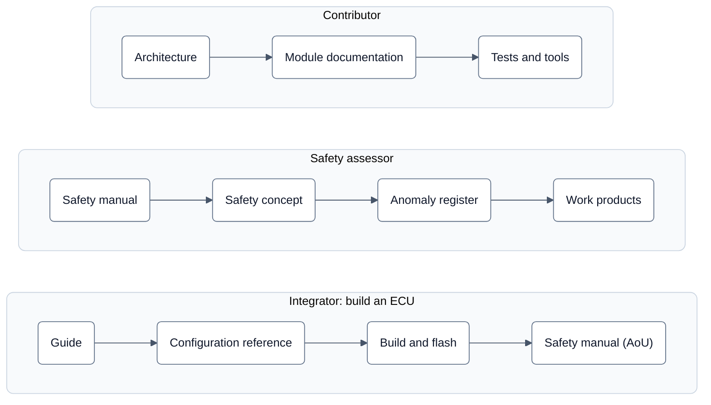

# neXtBSW – Neutral Embedded X-Domain Tailorable Basic Software

**Hardware-neutral basic software that works across domains and can be tailored to any control unit.**

> **Development release – no safety claim.** neXtBSW targets ASIL B as a software safety element out of context, but
> no release so far is a safety release: every tag is a development release without a safety claim. Read the
> [safety manual](doc/safety/safety-manual.md) before you use neXtBSW in a safety-related control unit; it states what
> is claimed, what is not, and what the integrator has to do.

neXtBSW is a configurable basic software for 32-bit ARM Cortex-M and Cortex-R microcontrollers (little endian). It is
built on [Eclipse OpenBSW](https://github.com/eclipse-openbsw/openbsw) and FreeRTOS. The focus is the NXP S32K1 family;
S32K3, STM32 and TI RM4x are targets too. Application software is attached as Simulink models (AUTOSAR Classic
software components) through a generated RTE.

A control unit is described in configuration files, not in code: the MCU derivative, the board and the project each
have their own file. Generators derive everything else from them: clock tree, pins, CAN bit timing, memory layout,
bootloader values and the RTE. The one thing you pick when you build is the project.

This page is the entry point. It says what is in the repository and how to build it the first time. Everything else is
in the [documentation](doc/README.md).

## State

Configuration, checks and target builds work for S32K1 derivatives with a Cortex-M4F. One example board (an S32K144
board) runs on hardware. Other derivatives and families are at different stages; the table
[What runs today](doc/guide/getting-started.md#what-runs-today) says exactly how far each one is.

## Repository layout

| Path | Content |
|---|---|
| `external/openbsw` | Eclipse OpenBSW as a Git submodule, never modified |
| `mcudb/<family>/` | derivatives: manufacturer facts such as memory regions, peripheral instances, pin functions |
| `boards/<board>/` | board profiles: what is fitted and how it is wired (`board.yaml`), hardware only |
| `projects/<project>/` | projects: what the ECU software uses (`project.yaml`), ECU description (`rte.yaml`), CAN database (`*.dbc`) |
| `libs/bsp/`, `libs/bsw/` | neutral driver contracts, device drivers and services; which module exists and how far it is verified: [module reference](doc/reference/modules.md) |
| `platforms/<family>/` | MCU drivers, startup and port of each MCU family |
| `ecu/` | the ECU application, derived from the OpenBSW reference application |
| `bootloader/` | UDS bootloader over CAN (ISO-TP), plain C, hardware-independent core |
| `swc/` | software components as Simulink models, generated code checked in |
| `tools/` | configuration model (`nxconfig`), generators (`bswgen`, `rtegen`, `dbcgen`), test runner (`test`), CAN flash tool (`canflash`) and more; each tool has its own README |
| `doc/` | documentation, see below |

What each layer does and how the parts fit together: [architecture overview](doc/architecture/overview.md).

## Prerequisites

- Python 3.12
- CMake 3.28 or newer, Ninja
- An `arm-none-eabi-gcc` of major version 11 for target builds. CI uses the freely available xPack GCC 11.3.1; the
  pinned versions of all tools are in [`tools/ci/versions.toml`](tools/ci/versions.toml), and
  [`tools/ci`](tools/ci/README.md) can fetch them.
- For flashing only: the tool of your debug probe (J-Link, ST-LINK, CMSIS-DAP/DAPLink or XDS110) and, for flashing over
  CAN, a CAN adapter supported by python-can.

The compiler is found on `PATH`, or through the environment variable `NX_ARM_GCC_BIN` pointing at its `bin` folder.
That is a setting of your workstation and is never checked in.

The commands below are written for Windows, where the interpreter of the virtual environment is
`.venv/Scripts/python`. Set `PYTHONUTF8=1` there, and keep the path of the checkout short (or enable long paths in
Windows): some installed packages and object files otherwise exceed the limit of 260 characters.

## First build

One-time set-up:

```sh
git submodule update --init
py -3.12 -m venv .venv
.venv/Scripts/python -m pip install -r tools/requirements.txt -r external/openbsw/libs/bsw/middleware/tools/cpp_generator/requirements.txt
# for the Studio (Qt, its tests, the packer) add (TOOL-63):
.venv/Scripts/python -m pip install -r tools/requirements-studio.txt
```

Check a project and build it. `buildtest-s32k148-min` is a project for an S32K148 without a board behind it; it exists
to be built, so it is a good first check of your set-up:

```sh
.venv/Scripts/python tools/nxconfig check projects/buildtest_s32k148_min/project.yaml
cmake --preset buildtest-s32k148-min
cmake --build --preset buildtest-s32k148-min
```

`nxconfig check` ends with `buildtest_s32k148_min: ok (board buildtest_s32k148, S32K148, 0 warning(s))`. It reports
every problem with file, line and YAML path; `--json` gives the same for tools. The configure run checks the project
again and runs the generators; the build compiles the application, the bootloader and a bootloader updater, with
warnings as errors. Each project has a CMake preset in `CMakePresets.json`; how to add one for your own project, and
what the configure run prints, is in [Build and flash](doc/guide/build-and-flash.md).

Flashing needs a board and was not run for this page. Every project has the targets `flash-bootloader` and `flash`
(through the debug probe) and `flash-can` (through the bootloader):

```sh
cmake --build --preset <preset> --target flash-bootloader
cmake --build --preset <preset> --target flash
cmake --build --preset <preset> --target flash-can
```

Which probe is used is a board fact; the details are in [Build and flash](doc/guide/build-and-flash.md#step-7-flash).

## Tests

One command runs every host test and the target builds. Nothing in it touches hardware:

```sh
.venv/Scripts/python tools/test --group all --jobs 4
```

`--list` shows what would run, `-k <name>` runs a selection. The test list, the groups and how single tests are run
are described in [`tools/test/README.md`](tools/test/README.md); what a change has to pass is in
[CONTRIBUTING.md](CONTRIBUTING.md#build-and-test).

## Reading paths

R1 is a **development release; it makes no safety claim.** The safety documents describe the target (ASIL B, safety
element out of context) and what is still open.



| Reader | Steps, in order |
|---|---|
| Integrator | [Guide](doc/guide/README.md) → [Configuration reference](doc/reference/README.md) → [Build and flash](doc/guide/build-and-flash.md) → [Safety manual](doc/safety/safety-manual.md) (assumptions of use) |
| Safety assessor | [Safety manual](doc/safety/safety-manual.md) → [Safety concept](doc/safety/concept.md) → [Anomaly register](doc/safety/anomaly-register.md) → work products: [safety plan](doc/safety/safety-plan.md), traceability (not published, available on request), [verification plan](doc/safety/verification-plan.md), [safety case](doc/safety/safety-case.md) |
| Contributor | [Architecture](doc/architecture/overview.md) → [Module documentation](doc/reference/modules.md) → [Tests](tools/test/README.md) and [tools](tools/docgen/README.md) |

## Documentation

| I want to … | Go to |
|---|---|
| find my way around the documentation | [`doc/README.md`](doc/README.md) |
| take a board from schematic to a running ECU, step by step | [Guide](doc/guide/README.md), starting with [Getting started](doc/guide/getting-started.md) |
| look up a configuration field, a module or a console command | [Reference](doc/reference/README.md) |
| understand layers, configuration levels and generators | [Architecture overview](doc/architecture/overview.md) and the binding [target picture](doc/architecture/README.md) |
| build, test and submit a change | [CONTRIBUTING.md](CONTRIBUTING.md) |
| read what changed, when and why | [CHANGELOG.md](CHANGELOG.md) (German, see [Language](CONTRIBUTING.md#language)) |

Documentation of a module, tool, board or project lives next to it, for example
[`libs/bsw/e2e/doc/e2e.md`](libs/bsw/e2e/doc/e2e.md), [`bootloader/doc/README.md`](bootloader/doc/README.md) or
[`projects/README.md`](projects/README.md).

## Licence

neXtBSW is being released under the Apache License 2.0; the `LICENSE` file is still being prepared. Contributions are
accepted under the same licence with a Developer Certificate of Origin, see [CONTRIBUTING.md](CONTRIBUTING.md).

**Generator output exception:** what the neXtBSW generators produce (source code, headers, linker scripts,
configuration and documentation) may be used, modified and distributed under terms of your choice, without the
obligations of the Apache License 2.0 for the template parts contained in that output. Every generated file carries an
SPDX line that points to the exception in [NOTICE](NOTICE). The exception does not apply to the generators and
templates themselves, which stay under Apache-2.0.

Third-party content in this repository keeps its licence and its headers:

| Path | Origin | Licence |
|---|---|---|
| `ecu/` | files derived from the Eclipse OpenBSW reference application (Copyright Accenture) | Apache-2.0 |
| `mcudb/s32k1xx/sources/hal_nxp/*-pinctrl.h` and the `mcudb/s32k1xx/*.pinmux.yaml` generated from them | [zephyrproject-rtos/hal_nxp](https://github.com/zephyrproject-rtos/hal_nxp) (Copyright NXP) | Apache-2.0 |

Further third-party code (CMSIS, FreeRTOS ports, vendor device headers, pin data) lives in `3rdparty/` and `sources/`
folders; it keeps the licence headers of its origin, and a README in or next to it names the source.
