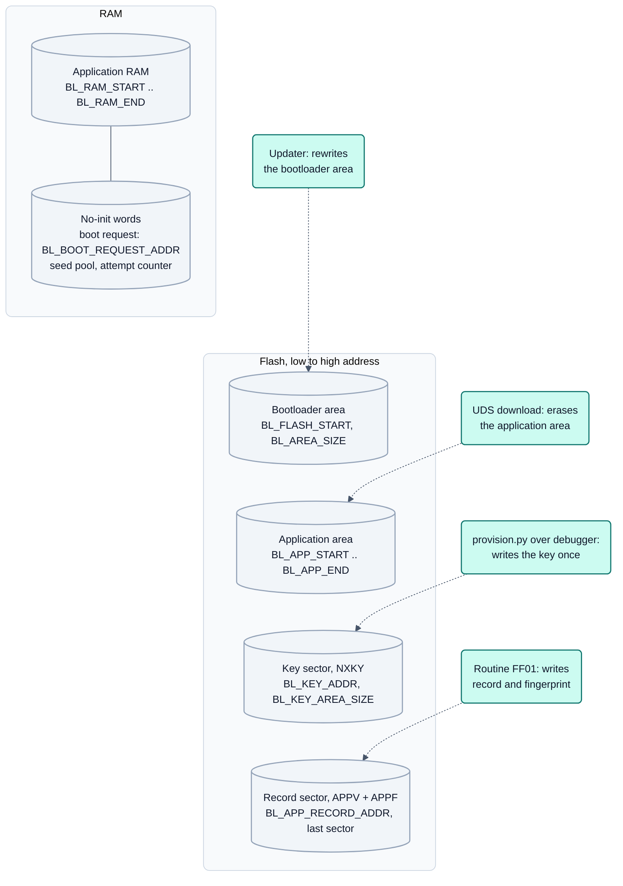
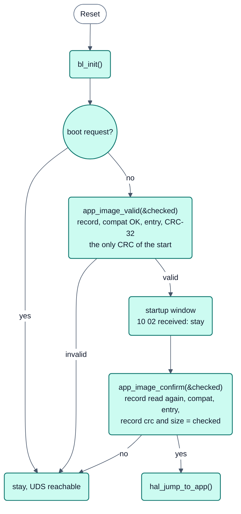
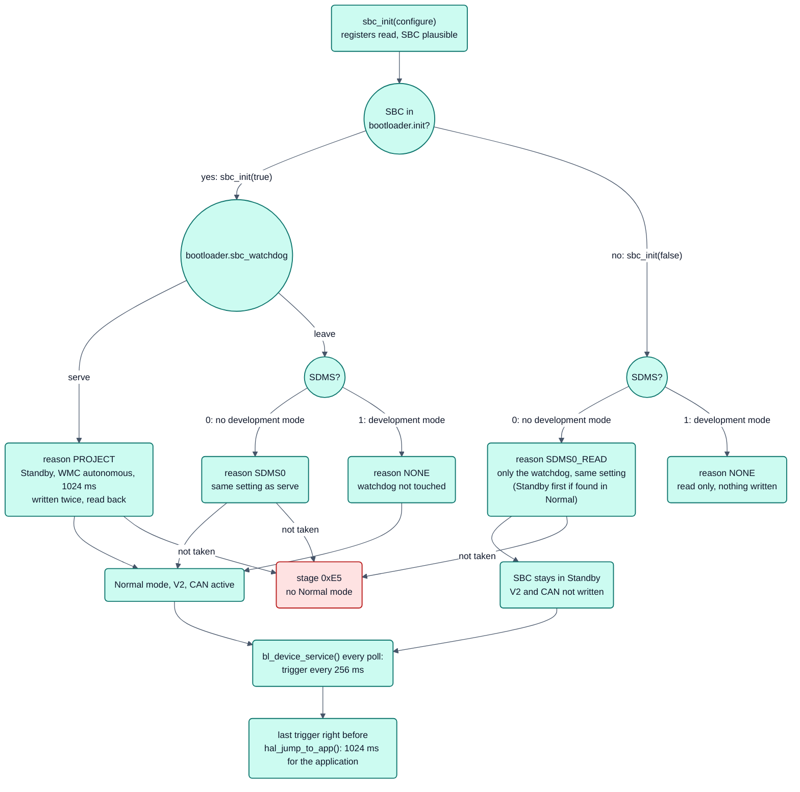

# Bootloader: Aufbau, generierter Board-Teil und HAL-Schnitt
## Bilder

### Speicherlayout



**Legende**

- Reihenfolge: Bootloader vorn (Konvention), Record im letzten Sektor (so legt `tools/nxconfig/memory.py` ihn heute),
  der Schlüsselsektor direkt darunter. Die Namen sind die des generierten `bl_memory.h` (Abschnitt 1); Zahlen hängen
  vom Derivat ab (Eval Board: Schlüssel bei `0x7E000`, 4 KB). Der Anwendungsbereich liegt dazwischen.
- Das Löschen der Anwendung nimmt weder Schlüssel noch Record mit, das Update des Bootloaders nicht den Schlüssel:
  deshalb eigene Sektoren (Abschnitt 4, „Key sector“). Der Record-Sektor liegt nicht im Anwendungsbereich
  (`bl_sector_map_ok()`, Abschnitt 2).
- Boot-Request: Magic plus Inversion, 0x10 unter dem Ende des Anwendungs-RAM (Abschnitt 2).

### Startentscheidung im Bootloader



**Legende**

- Gesamtablauf mit der Anwendung danach: [Bild 3, Startablauf](../../doc/figures/03-startablauf.md). Hier nur die
  zwei Prüfungen des Bootloaders (BL-36, BL-38, Abschnitt 4): die CRC läuft einmal je Start, die zweite Prüfung vor
  dem Sprung liest den Record erneut und vergleicht ihn mit dem Ergebnis aus `bl_init()`.
- Die beiden Resets des Watchdog-Schnelltests überspringen das Startfenster (`hal_reset_skips_startup_window()`, BL-33).
- Zwischen den Prüfungen schreibt der Bootloader nichts in den Flash; der Eintritt in die Programmiersitzung hält ihn
  im Bootloader (Abschnitt 4).

### Flash-Ablauf über UDS

Die Sequenz (Sitzung, Security Access, Fingerprint, `31 01 FF00`, `34/36/37`, `31 01 FF01`, `11 01`) steht als
[Bild 4, Flash-Ablauf über UDS](../../doc/figures/04-flash-uds.md); Kennungen und Routinen in Abschnitt 4 dieses
Dokuments. Nicht wiederholt, damit es nur eine Fassung gibt.

> Konformität gegen ISO 14229-1 Kapitel 16 (Programmierablauf, Tabellen 501–503, Anforderungen 16.4.1–16.4.3):
> [`iso14229-1-clause16-conformance.md`](iso14229-1-clause16-conformance.md) – Zeile für Zeile mit Stand und
> Test-ID, samt der offenen Punkte, die nur am Board zu belegen sind (BL-21).

Stand BL-14 (2026-09-21: Transportschnitt im Kern; davor BL-10 2026-09-18, davor BL-03/BL-04/BL-08/PLAT-16/ARCH-08/BL-05/BL-02; Abschnitt 4 neu und englisch). Zielbild:
[`doc/architecture/README.md`](../../doc/architecture/README.md) Abschnitt 7
(D6: C ohne OpenBSW, HAL je Familie, gleiche Konfigurationsquelle). Verifikation dieses Dokuments: **Analyse** gegen
Code, mcudb und [`doc/architecture/plattformen.md`](../../doc/architecture/plattformen.md); Aussagen zu S32K3/STM32 ohne
Beleg im Repo sind als **Annahme** markiert.

## 1. Aufbau

```
bootloader/
  include/            bl_config.h (Protokoll: IDs, ISO-TP, UDS-Zeiten, Version; bindet bootloader/bl_memory.h ein),
                      bl_interface.h (Boot-Request für die Anwendung), bl_spi.h (SPI-Schnitt für Baustein-Hooks)
  src/core/           familienneutral: UDS, Transport (bl_transport.h: senden, empfangen, Leerlauf, maximale
                      Nachrichtenlänge; CAN mit ISO-TP in isotp.c ist eine Implementierung davon, die Wahl steht
                      als BL_TRANSPORT im Generat, BL-14), Record-Prüfung, Ablauf; nur bl_hal.h als Hardware-Schnitt,
                      bl_sectors.h (Sektor-Tabelle aus der generierten Aufteilung, PLAT-16); kennt keinen Abbild-Anfang
                      (keine Vektortabelle, kein FCF, BL-08)
  platforms/common/arch/ cortex_m_app_entry.inc: Anwendungsanfang Cortex-M (Stapelzeiger, Thumb-Reset), von den
                      Cortex-M-Familien eingebunden, nicht vom Kern (BL-08, Ort seit BL-11)
  platforms/<familie>/ HAL (hal_<familie>.c), startup.S, main.c, linker.ld (Vorlage, Werte per INCLUDE bl_memory.ld),
                      Familien-Hooks (BL-08): bl_family_image.inc (hal_app_entry_plausible), mit Updater-Port zusätzlich
                      upd_family.h (Stub, frühe Phrasen, Abbild-Kopf) und upd_family_check_image.inc;
                      s32k1xx: bl_spi_s32k1xx.c, bl_sosc_s32k1xx.h; stm32: mcu_stm32f4.h, bl_psize_stm32f4.h
                      optional family.cmake: family sources besides the HAL (BL_FAMILY_SOURCES, also for the
                      updater); s32k1xx: bl_reset_s32k1xx.h (fast test resets, BL-33), bl_lvd_s32k1xx.cpp/.h
                      (low-voltage detect reset, BL-34)
  devices/<modul>/    Bootloader-Hook eines Baustein-Moduls (heute sbcUja113x) + bootloader.cmake (Quellen, Includes)
  updater/            Bootloader-Update als Anwendung: src/core/bl_update.c, platforms/<familie>/ (heute nur s32k1xx)
  test/host/          bl_host.c: simulierter HAL für die Host-Tests (tools/canflash/test_bootloader_host.py);
                      family/: Hook für synthetische Testfamilien ohne HAL (testfam), Cortex-M-Regel (BL-08)
  test/layouts/       synthetische Aufteilungen als Testdaten (S32K116 2 KB, STM32F446 16/64/128 KB) – README dort
  test/board/         Board-Teil als Testdaten, solange blgen keinen Generator der Familie hat (stm32f446)
  test/              test_bl_stm32_build.py: Übersetzen/Linken der Familie stm32 mit arm-none-eabi-gcc
                      test_bl_flash_reserve.py: flash reserve >= 512 bytes per build profile (BL-30)
```

Generiert nach `<build>/generated/board/` (nicht eingecheckt):

| Datei | Erzeuger | Inhalt |
|---|---|---|
| `bootloader/bl_memory.h` | bswgen (`blgen.memory_files`) | `BL_FLASH_START/SIZE`, `BL_SECTOR_SIZE`, `BL_PHRASE_SIZE`, `BL_APP_START/END`, `BL_APP_RECORD_ADDR`, `BL_RAM_START/END`, `BL_BOOT_REQUEST_ADDR`, `BL_KEY_ADDR`/`BL_KEY_AREA_SIZE` (BL-03), `BL_TARGET_ID`, `BL_HARDWARE_ID` (`"<board>/<derivative>"`, BL-10) und `BL_FAMILY` (BL-10); **noch nicht** die Sektor-Tabelle (`BL_SECTOR_GROUPS`, `BL_SECTOR_MAX_SIZE`, `BL_BOOT_SECTOR_MAX_SIZE`) – Diff-Vorschlag in PLAT-16, bis dahin ergänzt `tools/canflash/hostbuild.py` sie für Host-Builds und `bl_sectors.h` fällt auf eine Gruppe aus `BL_SECTOR_SIZE` zurück |
| `bootloader/bl_memory.ld` | bswgen | `BL_FLASH_ORIGIN`, `BL_AREA_SIZE`, `BL_APP_ORIGIN/LIMIT`, `BL_RAM_ORIGIN/LENGTH`, `BL_STACK_SIZE` |
| `memory/memoryLayout.h` | bswgen | App-Linker: Flash, RAM-Regionen, No-Init-Größe, Boot-Request |
| `bootloader/bl_diag.h` | bswgen | CAN-IDs, ISO-TP, Kennungspräfix `BL_VERSION_PREFIX`, Suchbereich der Anwendung (COM-11) |
| `bootloader/bl_security.h` | bswgen | Security Access (BL-03): Verfahren, Chip-UID des Derivats, Name des Hauptschlüssels; kein Schlüssel |
| `bootloader/bl_board.h` | `blgen.py` beim Konfigurieren von `bootloader/` | Familie s32k1xx: `BL_CORE_CLOCK_HZ`, `BL_OSC_HZ`, `BOARD_CAN`, `BOARD_CAN_PCC_INDEX`, `BOARD_CAN_CTRL1`, `bl_board_can_pins()`, Hook-Makros, `bl_board_init()`, `bl_board_environment_ok()` |
| `bootloader/bl_board.cmake` | dito | `NX_BL_CAN_BUS`, `NX_BL_DEVICES` |
| `bootloader/bl_sections.ld` | dito | Family s32k1xx, per core architecture (BL-30): with ARMv6-M the section `.text_gap`, code between the 48-entry vector table and the FCF at 0x400 (832 bytes); with ARMv7-M only a comment (256 entries fill the first KB). Included by `platforms/s32k1xx/linker.ld`, linked with `--enable-non-contiguous-regions` |

Quelle der Werte: Derivat `memory[]` (Regionen, `sector_size`/`sectors`, `program_size`), Projekt `memory` und
`bootloader`, Board (CAN-Pins, Transceiver, SPI des SBC), Taktmodell (`tools/nxconfig/clock.py`: Reset-Takt,
Oszillator, CAN-Bit-Timing). Bausteine mit Hook: Verzeichnis `devices/<modul>` vorhanden und Baustein vom Projekt
genutzt; eingeschaltet (`sbc_init(true)`) wird der Transceiver des Bootloader-Busses oder was `bootloader.init` nennt,
andere nur gelesen.

## 2. HAL-Schnitt `src/core/bl_hal.h` gegen S32K3 und STM32

Der Kern ist familienneutral; was von der Familie abhängt, steht hinter `bl_hal.h`. Die Tabelle zeigt, was der Schnitt
für die R1-Familie (s32k1xx) bedeutet und wo andere Familien eine Entscheidung brauchen. STM32F4 ist umgesetzt
(PLAT-16), S32K3 und Cortex-R4F sind Annahmen.

| Funktion | s32k1xx (R1) | Andere Familien |
|---|---|---|
| `hal_init()` | Kern bleibt auf dem Reset-Takt FIRC, SOSC für FlexCAN/LPSPI, Hooks, FlexCAN | S32K3: FXOSC für CAN, Takt über MC_ME/MC_CGM. STM32: HSI, mit `BL_CLOCK_HSE` SYSCLK auf HSE, weil bxCAN nur aus PCLK1 läuft |
| `hal_millis()`, `hal_entropy()`, `hal_reset()` | SysTick aus `BL_CORE_CLOCK_HZ`, `NVIC_SystemReset` | Cortex-M-neutral; Cortex-R4F: RTI und Familien-HAL |
| `hal_can_send/receive/tx_idle()` | FlexCAN, Mailboxen im Polling | STM32: bxCAN mit einer Sende-Mailbox, FIFO 0, zwei Filterbänke; FDCAN (G4) offen |
| `hal_flash_erase_sector(address)` | FTFC, 4-KB-Sektoren, RAM-Funktion | S32K3: 8-KB-Sektoren; STM32F4: ungleiche Sektoren 16/64/128 KB. Die Geometrie ist Daten: `bl_sectors.h` liefert Start, Größe und Index eines Sektors aus der generierten Tabelle |
| `hal_flash_program(address, data, len)` | Phrase 8 Byte (`program_size`) | `BL_PHRASE_SIZE` aus mcudb; STM32F4 leitet `PSIZE` daraus ab |
| `hal_boot_request_consume()` | nur nach Software-Reset (`RCM_SRS.SW`) | STM32: `RCC_CSR.SFTRSTF`; S32K3: MC_RGM (Annahme) |
| `hal_reset_skips_startup_window()` (BL-33) | true nur für die zwei Resets des Watchdog-Schnelltests (`RCM_SRS` genau WDOG, `WDOG_CS[TST]` 2 oder 3); Power-on antwortet false | false, solange kein Port eine solche Testfolge zeigt |
| `hal_random(out, len)` (BL-03, optional) | nicht vorhanden (kein TRNG ohne CSEc) | Familie mit Zufallsgenerator definiert sie, der Seed mischt ihn ein |
| `hal_app_entry_plausible(start, size)` (BL-08) | Cortex-M-Regel: Stapelzeiger im App-RAM, Reset-Vektor Thumb | Cortex-R4F: feste Weiterleitungstabelle am Anwendungsanfang (E2, BL-09) |
| `hal_jump_to_app(appStart)` | SysTick/FlexCAN aus, ICER/ICPR, VTOR, MSP | STM32: `VTOR` auf `BL_FLASH_START`, bxCAN über `MCR.RESET` still; Cortex-R4F: kein VTOR |
| Startup, Linker | FCF bei 0x400 in `platforms/s32k1xx/linker.ld` | STM32: kein FCF, Vektortabelle 0x200; S32K3: IVT/Boot-Header |

**Reset handler, s32k1xx (BL-34):** `bl_system_init()` schaltet den MCU-Watchdog aus (`WDOG_CS[TST]` bleibt für den
Schnelltest der Anwendung) und dann den Low-Voltage-Detect-Reset ein (`PMC_LVDSC1 = LVDRE`, SM-59 von SYS-125), vor der
RAM-Initialisierung. Der Wert kommt aus `platforms/s32k1xx/port/main/include/pmc/LowVoltageDetectReset.h`; die Datei
`bl_lvd_s32k1xx.cpp` ist die einzige C++-Einheit des Bootloaders.

**Record und Boot-Request:** Record-Format (`app_record_t`, Magic „APPV“) und Boot-Request (Magic + Inversion, 0x10 unter
dem App-RAM-Ende) gelten für alle Familien. Die Record-Position ist frei (`BL_APP_RECORD_ADDR` und `BL_APP_END` getrennt).
Bootloader-Bereich, Anwendungsbereich und Record liegen auf Sektorgrenzen, der Record-Sektor nicht im Anwendungsbereich;
`bl_sector_map_ok()` prüft das.

**Updater:** `updater/src/core/bl_update.c` ist familienneutral und hält den Ablauf (Stub, übrige Sektoren, Sektor 0,
Record; Wiederaufnahme über die Einsprung-Phrase bei Offset 0). Der Abbild-Anfang gehört der Familie
(`platforms/<familie>/upd_family.h`, `upd_family_check_image.inc`). Gebaut wird der Updater nur, wenn
`updater/platforms/<familie>` existiert; S32K3, STM32 (PLAT-15) und Cortex-R4F (BL-09) brauchen einen eigenen Port.
`tools/canflash` wählt dieselbe Regel aus der Familie (`IMAGE_RULES`); eine Familie ohne Regel lehnt `canflash
blimage/blupdate` ab. Der **Hook sbcUja113x** nutzt `bl_spi.h` (16 Bit, CPOL 0, CPHA 1); fehlt `bl_spi_<familie>.c`,
bricht `devices/sbcUja113x/bootloader.cmake` ab.

### SBC watchdog in the bootloader (BL-28, BL-41, BL-42, bootloader 0.3.11)



- **SDMS 0 is always served.** After an SBC reset without software development mode the UJA113x watchdog is a
  timeout watchdog with 128 ms that already runs in Standby (public data sheet UJA113X_SER Rev. 2, Table 7 with
  7.2.1, Table 8). Before BL-41 `leave` left it alone: without a valid application the SBC reset the ECU over and
  over, with one the application got only the rest of 128 ms. Since BL-41 (safety review SBC watchdog 2026-10-06,
  SDMS0-1 c) the hook serves it whatever the project says; `leave` takes effect only with SDMS 1.
- **Also when the SBC is only read (BL-42, bootloader 0.3.11).** An SBC that is not in `bootloader.init`
  (`sbc_init(false)`) has the same running watchdog. Since BL-42 (safety review bootloader 0.3.10 2026-10-07,
  BL41-2 b) the hook sets up only the watchdog and serves it: the setting needs Standby (a change of WMC/NWP in Normal
  mode is a system reset, data sheet 7.2, 7.3.3), serving does not need Normal mode (autonomous in Standby is off
  while INTN1 is high and a timeout watchdog while an interrupt is pending, Table 8). So the SBC stays in Standby,
  regulator (V2) and CAN control are not written; an SBC found in Normal mode after an MCU-only reset is put into
  Standby for the setting and stays there until the application takes over. With SDMS 1 it stays read only.
- `serve` differs from `leave` only with SDMS 1: a watchdog the application left running (MCU-only reset) is set to
  the fixed setting, i.e. autonomous and therefore off in development mode.
- Not touched: Forced Normal mode (watchdog off), an SBC that never answers plausibly (stage 0xE4), and an SBC that
  is only read with SDMS 1.
- Diagnosis over J-Link: `bl_sbc_watchdog` (`reason` 0 none, 1 project `serve`, 2 SDMS 0, 3 SDMS 0 with the SBC only
  read; `served`, `triggers`, `errors`, register 0x00 before and after), `bl_sbc_diag` (registers, stage).
- The application takes the running watchdog over within 1 024 ms after the jump (AoU-34). The **updater** builds the
  hook without the service and still refuses to run unless the SBC watchdog is off (SDMS 1); read only stays read
  only there.
- Build: `devices/sbcUja113x/bootloader.cmake` defines `BL_SBC_WATCHDOG_SERVICE` (hook) and `BL_DEVICE_SERVICE`
  (`bl_main.c`) for every bootloader with this hook, and `BL_SBC_WATCHDOG_SERVE` with `serve`. Host test:
  `bootloader/test/host/test_bl_sbc_watchdog_host.py` (`tools/test -k bl-sbc-watchdog-host`).

**Antwortzeiten von Flash-Aufträgen (PLAT-16, BL-25):** Ein Auftragsschritt (Sektor löschen, CRC-Stück, Programmierstück,
Record) muss in P2\* (`BL_P2STAR_SERVER_MS`, 5 s) passen. Ein Auftrag beginnt mit „response pending“ (0x78); danach
schätzt der Kern den nächsten Schritt aus den bisherigen Kosten (Löschen je KB, mal die Größe des nächsten Sektors). Ein
0x78 geht nur, wenn der Schritt hinter P2\* enden könnte, und nie früher als `BL_PENDING_MIN_GAP_MS` (0,3 x P2\*,
ISO 14229-2) nach dem vorigen. Ein Sektor, der allein länger als P2\* braucht, ist nicht abgedeckt; dann muss P2\* steigen
oder das Löschen unterbrechbar werden.

**Zeitbasis des CAN-Transports (BL-25):** `bl_transport_poll(nowMs)` stempelt alle Frames eines Polls mit dem `nowMs`
dieses Polls und vergleicht N_Cr und N_Bs gegen denselben Wert; ein Stempel hinter `nowMs` lässt nie einen Timer ablaufen.

## 3. Kompatibilität mit dem geflashten Bootloader

Wer die Aufteilung im Projekt ändert, ändert Bootloader **und** Anwendung: ein bereits geflashter Bootloader prüft weiter
seine alten Adressen. Bootloader-Bereich, Record-Sektor, App-RAM-Ende und No-Init-Größe eines Boards im Feld daher nur
zusammen mit einem Bootloader-Update ändern. Familien-Hooks sind textuell eingebunden (`#include "bl_family_image.inc"`
in `app_image.c`, `upd_family_check_image.inc` in `upd_check_blob()`), damit die Abbilder byte-gleich bleiben; die
SHA-256-Vergleiche der einzelnen Änderungen stehen im Changelog (BL-08, ARCH-08).

**Abbild geändert → Version geändert (BL-32).** Ein Bootloader im Feld ist nur an seiner Nummer (`BL_VERSION_NUMBER`,
DID 0xF180/0xF189) erkennbar. `bootloader/test/image_version.sha256` hält je Nummer den SHA-256 des Abbilds des
Referenz-Presets `evalboard-s32k144-demo` und die GCC-Version. `tools/elfcheck blversion <bootloader.hex>` vergleicht, der
Host-Test `bootloader/test/test_bl_image_version.py` macht ein geändertes Abbild bei gleicher Nummer rot. Neue Nummer:
`bl_config.h` hochziehen, Demo bauen, `tools/elfcheck blversion --add <bootloader.hex>`; bestehende Zeilen schreibt es nie
um. Ein Bau mit anderer GCC-Version ist nicht vergleichbar (übersprungen).

**BL-03 ändert die Speicheraufteilung** (Key-Sektor unter dem Record, die Anwendung endet einen Sektor früher):
Bootloader und Anwendung ab BL-03 gehören zusammen und gehen in einem Bootloader-Update aufs Board. BL-10 erweitert den
Record hinter dem Kompatibilitätsblock (Abschnitt 4); ein Bootloader vor BL-10 liest die ersten 56 Byte und ignoriert den
Rest.

## 4. Security access, identification and fingerprint (BL-03, BL-04, BL-10)

**Key sector.** The device key of the security access lives in its own flash sector, `BL_KEY_ADDR`/`BL_KEY_AREA_SIZE`
of the generated `bl_memory.h`: the sector below the validity record (eval board: `0x7E000`, 4 KB; STM32F446 test
layout: sector 2). It is outside the bootloader area, which the updater rewrites completely, and outside the
application area, which every download erases, so a provisioned key survives both. The bootloader image itself is
the same for every device and holds no key. The key record (`NXKY`, version, method, length, 32-byte key, CRC-32;
48 bytes, `bl_config.h`) is written once per chip by `tools/canflash/provision.py` over the debugger. An erased, half
written or foreign record counts as "no key": the security access answers NRC 0x22 and DID 0xF1A1 says why.

**Method.** Key = HMAC-SHA256(device key, seed), device key = HMAC-SHA256(master key, chip UID). SHA-256/HMAC are
implemented in `src/core/sha256.c`, seed and key in `src/core/seedkey.c` (own translation units since BL-11). The seed
(16 bytes) mixes a pool in no-init RAM with the UID, timers (`hal_entropy()`, `hal_millis()`) and, where the family
has one, the hardware random generator: `hal_random()` is an optional HAL function with a weak "not available"
default in the core; no family defines it yet (S32K1 without CSEc has no TRNG). A counter in no-init RAM keeps a
reset from bringing back an earlier seed; failed attempts and a running lockout survive a reset as well.

**Identifiers** (`src/core/uds.c`; all but 0xF184 readable in every session without security access):

| DID | Content | Source |
|---|---|---|
| 0xF180 | bootloader identification: numberOfModules `01` (Annex C.1, BL-22) followed by `"<prefix> <version>"` | `BL_VERSION_PREFIX` (project, `bl_diag.h`) + `BL_VERSION_NUMBER` (`bl_config.h`) |
| 0xF186 | active session | UDS state |
| 0xF189 | software version number, ASCII | `BL_VERSION_NUMBER` |
| 0xF18C | ECU serial number = chip UID (the tester derives the device key from it) | derivative `uid` (`bl_security.h`) |
| 0xF191 | hardware number `"<board>/<derivative>"`, ASCII (BL-10; a build between BL-04 and BL-10 sent the 4 bytes of `BL_TARGET_ID`) | `BL_HARDWARE_ID` (`bl_memory.h`); `BL_TARGET_ID` is its CRC-32 |
| 0xF1A0 | compatibility: record version, target and layout identity, application area, state of the installed record | `bl_memory.h`, record |
| 0xF1A1 | security access: format, method, key state (0 missing, 1 present, 2 invalid), seed and key length | `bl_security.h`, key sector |
| 0xF184 | application software fingerprint: 4 bytes date (BCD) + 12 bytes tester, programming session only | see below |

**Form der Kennungen (BL-22).** 0xF180 des Bootloaders und 0xF180/0xF181 der Anwendung antworten nach ISO 14229-1
Anhang C.1: ein Byte numberOfModules (hier immer 1) und danach der Kennungstext. Im Flash steht der Text ohne Zählbyte, weil
Anwendung (`findBootloaderVersion()`, COM-11), Updater (`upd_check_blob()`) und `canflash blimage` ihn dort suchen.
`tools/canflash` liest beide Formen (erstes Byte 0x01..0x1F = Modulzahl, ab 0x20 = Text) und meldet, welche es bekam. Ein
Tester vor BL-22 liest die Antwort eines BL-22-Servers als Text mit Steuerzeichen und verliert den Versionsvergleich von
`canflash blupdate`; ein Arbeitsplatz aktualisiert `canflash` also vor dem Flashen eines BL-22-Bootloaders.

**Routines** (RoutineControl `31 01`, programming session with security access):

| RID | Function | Range (ISO 14229-1 Annex F.1) |
|---|---|---|
| 0xFF00 | erase memory: control option `44`, address, length | eraseMemory, fixed by the standard |
| 0xFF01 | check memory: CRC-32, application entry, validity record with fingerprint | checkProgrammingDependencies, fixed by the standard |
| 0xF1A0 | check compatibility (BL-02): record version, target and layout identity, application area of the image; a mismatch blocks erase and download | system supplier range 0xF000..0xFEFF |
| 0xFF02 | the same check under its number before BL-24, answered for testers from before 0.3.4 | reserved by the standard - transition only |

**Kompatibilitätsroutine verschoben (BL-24, Bootloader 0.3.4).** Bis 0.3.3 war die Prüfung Routine 0xFF02, ein vom
Standard reservierter Wert; sie liegt jetzt auf 0xF1A0 im Bereich des Systemlieferanten, derselben Nummer wie DID 0xF1A0.
Beide führen dieselbe Prüfung aus. `canflash` wählt nach der Version in DID 0xF180: 0.3.3 und älter bekommen 0xFF02,
neuere 0xF1A0. 0xFF02 ganz zu entfernen ist eine Entscheidung über die Tester im Einsatz (offener Punkt 10 der
Konformitätstabelle).

**Fingerprint.** The tester writes DID 0xF184 (WriteDataByIdentifier, programming session, after security access)
before the first erase or download; without it both are refused with NRC 0x22. It lives in `uds_t` for the session
and is dropped with a session change. Since BL-10 routine 0xFF01 (check memory) writes it into the validity record
as a block of its own behind the compatibility block: magic `APPF`, the 16 bytes, CRC-32 over both (`app_record_t`,
`src/core/app_image.h`; record 80 bytes, a multiple of the flash phrase, checked at compile time). Reading DID 0xF184
returns the fingerprint written in the running session, otherwise the one of the installed application's record,
otherwise NRC 0x22. A record written before BL-10, or by `canflash record`, has the block erased and no fingerprint.
No FlexNVM is used (NVM-01).

**Startentscheidung (BL-36, Bootloader 0.3.7; BL-38, 0.3.8).** Nur ein Record mit vorhandenem und passendem
Kompatibilitätsblock (`APP_COMPAT_OK`) wird gestartet; ein Record ohne Block (`APP_COMPAT_ABSENT`) startet nicht mehr
(DID 0xF1A0 meldet 0x10, Neuflashen der Anwendung behebt es), weil ein einziges verfälschtes Wort `compatMagic` sonst die
Ziel- und Layoutprüfung übersprungen hätte. Die Entscheidung wird unmittelbar vor `hal_jump_to_app()` ein zweites Mal
geprüft, denn das Ergebnis von `bl_init()` ist ein RAM-Wort, das ein Tester Minuten in der Extended Session halten kann.
Scheitert die zweite Prüfung, bleibt der Bootloader. Der Bootloader läuft ohne MCU-Watchdog (s32k1xx: in
`bl_system_init()` abgeschaltet; HSI Abschnitt 4.13, Safety-Handbuch Abschnitt 4).

Pro Start läuft genau eine CRC-32 über das Abbild (BL-38; eine zweite Voll-Prüfung kostete am Eval Board etwa 160 ms je
Start):

| | `bl_init()`: `app_image_valid(&checked)` | vor dem Sprung: `app_image_confirm(&checked)` |
|---|---|---|
| Record (Magic, `recordCrc`, Bereich, Start) | ja | ja, erneut aus dem Flash gelesen |
| Kompatibilitätsblock (`APP_COMPAT_OK`) | ja | ja |
| Anwendungsstart (`hal_app_entry_plausible()`) | ja | ja |
| CRC-32 über das Abbild | ja, die einzige des Starts; Wert und Größe gehen in `checked` | nein: `crc` und `size` des Records müssen `checked` entsprechen |

Das genügt, weil der Bootloader zwischen beiden Prüfungen keinen Flash-Befehl ausgibt: Löschen, Download und Record-Schreiben
sind Aufträge der Programmiersitzung, deren Eintritt `stayInBootloader` setzt; die Extended Session verweigert sie alle
(Host-Tests `test_extended_session_grants_no_programming_rights`,
`test_flash_is_written_only_by_jobs_of_the_programming_session`). Nicht gesehen wird ein Abbildkörper, der ohne
Flash-Befehl des Bootloaders geändert wurde (Debugger, Bitfehler); das deckt die ROM-Prüfung SM-14 der Anwendung beim
Start (Grenze als Host-Test `test_image_changed_without_flash_command_is_left_to_the_application`).
