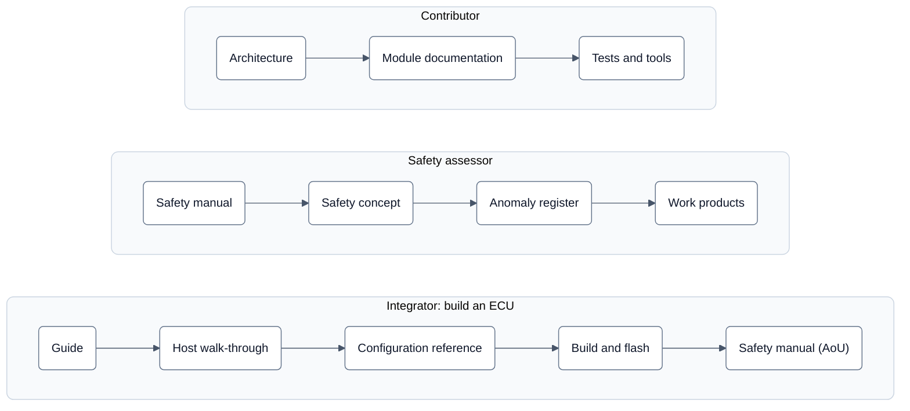

# neXtBSW documentation

neXtBSW is a hardware-neutral, configurable basic software for 32-bit ARM Cortex-M and Cortex-R automotive MCUs,
built on Eclipse OpenBSW. Applications are attached as Simulink models (AUTOSAR Classic SWC) through a generated RTE.

This page is the map. It tells you where to look; it does not repeat what the linked documents say.

## Reading paths

R1 is a **development release; it makes no safety claim.** The safety documents describe the target (ASIL B, safety
element out of context) and what is still open.



| Reader | Steps, in order |
|---|---|
| Integrator | [Guide](guide/README.md) → [Host walk-through without hardware](guide/host-durchlauf.md) → [Configuration reference](reference/README.md) → [Build and flash](guide/build-and-flash.md) → [Safety manual](safety/safety-manual.md) (assumptions of use) |
| Safety assessor | [Safety entry page](safety/start/README.md) → [Safety manual](safety/safety-manual.md) → [Safety concept](safety/concept.md) → [Anomaly register](safety/anomaly-register.md) → work products: [safety plan](safety/safety-plan.md), traceability (not published, available on request), [verification plan](safety/verification-plan.md), [safety case](safety/safety-case.md) |
| Contributor | [Architecture](architecture/overview.md) → [Module documentation](reference/modules.md) → [Tests](../tools/test/README.md) and [tools](../tools/docgen/README.md) |

## Where to find what

| I want to … | Go to |
|---|---|
| know what neXtBSW is, what the repository contains, how to build it the first time | [`../README.md`](../README.md) |
| take a board from schematic to a running ECU, step by step | [`guide/`](guide/README.md), starting with [getting-started.md](guide/getting-started.md) |
| set up an ECU in your own repository, with neXtBSW pinned to a fixed version | [`guide/customer-project.md`](guide/customer-project.md) |
| look up a configuration field (derivative, `board.yaml`, `project.yaml`, `rte.yaml`) | [reference/](reference/README.md) — generated from the `tools/nxconfig` schema; `rte.yaml`: [reference/rte.md](reference/rte.md) |
| see which driver and service modules exist and how far each is verified | [reference/modules.md](reference/modules.md) — generated from `libs/` (module manifests, module documentation, test list) |
| see at a glance which modules are confirmed on a board and which only in host tests (mock) | [figures/07-modulkarte.md](figures/07-modulkarte.md) — module map and status matrix, generated from the module manifests like reference/modules.md; legend in German until DOC-70 |
| look up a console command: syntax, purpose, the build or module it needs, board rules | [reference/console.md](reference/console.md) — generated from the command registration in the code |
| understand how the layers, configuration levels and generators fit together | [architecture/overview.md](architecture/overview.md) |
| see the system in pictures: layers, configuration flow, start-up, UDS flash, ECU states, safety chain, module map | [figures/](figures/README.md) — captions in German until DOC-70 |
| know what comes from OpenBSW and what neXtBSW adds | [architecture/openbsw.md](architecture/openbsw.md) |
| know which parts follow AUTOSAR and which do not | [architecture/autosar.md](architecture/autosar.md) |
| find out which AUTOSAR specification documents exist, where they live and what the current release changed | [architecture/autosar-standard-set.md](architecture/autosar-standard-set.md) — index survey, nothing read in detail |
| look up a binding architecture decision (D1–D15), the review questions, the target repo layout | [`architecture/README.md`](architecture/README.md) — the binding target picture |
| understand how an ECU with several MCUs is programmed (one over CAN, the others by it over SPI) | [architecture/planned.md](architecture/planned.md) — *planned (after R1), short page* |
| see what neXtBSW assures about functional safety, and what it assumes of the integrator | [safety/concept.md](safety/concept.md) — target ASIL B, safety element out of context |
| see how edge interrupts on digital inputs are to be configured (level, driver, path into the RTE, safety) | [architecture/pin-interrupts.md](architecture/pin-interrupts.md) — variant A implemented (IO-51 to IO-54) |
| see which safety mechanisms work **without software**, and what they would cost | [safety/hardware-mechanisms.md](safety/hardware-mechanisms.md) — FTM fault inputs, TRGMUX, comparator; catalogue, none used yet |
| know which static analysis runs, what counts as a deviation and how a new finding stops the CI | [safety/static-analysis.md](safety/static-analysis.md) — cppcheck with the MISRA add-on and clang-tidy, baseline, deviations |
| see how much of the per-driver glue in the family integration is common, parameter or truly driver-specific | [architecture/treiber-anbindung-analyse.md](architecture/treiber-anbindung-analyse.md) — measurement behind ARCH-52 |
| know how versions are numbered, what is stable, what support exists, how to report a vulnerability | [architecture/versioning.md](architecture/versioning.md), [`../SECURITY.md`](../SECURITY.md); third-party notices: [`../NOTICE`](../NOTICE) |
| build, test and submit a change | [`../CONTRIBUTING.md`](../CONTRIBUTING.md) |
| read what changed, when and why | [`../CHANGELOG.md`](../CHANGELOG.md) (German, see *Language* below) |

Documentation that lives next to the code it describes stays there and is linked from here, not copied:

| Area | Document |
|---|---|
| Projects, presets, ECU description, DBC | [`../projects/README.md`](../projects/README.md) |
| Software components (Simulink, AUTOSAR Classic) | [`../swc/README.md`](../swc/README.md) |
| Board profiles | `../boards/<board>/README.md` |
| Board ports | [`../ecu/platforms/README.md`](../ecu/platforms/README.md) |
| UDS bootloader | [`../bootloader/doc/README.md`](../bootloader/doc/README.md) |
| Device drivers and libraries | `../libs/bsw/<module>/doc/<module>.md` (for example [`e2e`](../libs/bsw/e2e/doc/e2e.md), [`sbcUja113x`](../libs/bsw/sbcUja113x/doc/sbcUja113x.md)) |
| Tools (test runner, CI, flashing, board measurements) | `../tools/<tool>/README.md`, starting with [`tools/test`](../tools/test/README.md) |
| Patches sent upstream to Eclipse OpenBSW | [`openbsw-beitraege/README.md`](openbsw-beitraege/README.md) |

## Language

Published documentation is written in **English**. The **changelog stays German**: it is the working log of this
project, written and read by its author, and translating it would cost more than it is worth. The full rule, including
what it means for code comments and commit messages, is in [`../CONTRIBUTING.md`](../CONTRIBUTING.md).

All documents under `architecture/` are English since DOC-05 (2026-09-19); the file names stayed German so that
existing references keep working. Some module documents under `libs/` are still German and follow as a separate step.
Anything new or rewritten is English from the start.
Exception until DOC-70 translates them: the short pages under `architecture/` for what is planned after R1
(`planned.md`, `non-cortex-m-audit.md`, `rm4x-quellen.md`, `stm32-nucleo.md`), the short page `openbsw-beitraege/README.md` and the
shortening notes at the head of the shortened pages (DOC-75) are German.

## How this folder is organised

```
doc/
  README.md        this page — the map
  guide/           task-oriented documentation for users: getting started, how-to guides
  reference/       look-up material, generated from the schema, from libs/ and from the console code
  architecture/    how and why the software is built the way it is, plus binding decisions
  safety/          safety concept, safety manual, analyses and work products (target ASIL B)
```

`guide/`, `reference/` and `architecture/` each have a `README.md` that says what belongs in it. The split is by *what the reader wants* (learn, do, look
up, understand), not by component, so a page keeps its place as the software grows.

The same pages are built into a documentation website with MkDocs Material (`mkdocs.yml` in the repository root,
DOC-71): search, German/English switcher, Mermaid, navigation along the reading paths above. It takes this folder plus
`README.md`, the module documents next to the code and the tool READMEs, without moving files: one folder per
navigation section, each with a `README.md` as the section index page, and only relative links between documents. The
public site is built from the exported tree, so it holds exactly the published pages; how to build it:
[`tools/docgen/website.md`](../tools/docgen/website.md).

Not covered here, on purpose:

- **Planning and workflow** — `todo.yaml`, `TODO.md`, `koordinator-stand.md` and `../CLAUDE.md` are internal working
  files, not documentation for readers of the software.
- **Hardware documents** — the datasheets and schematics under `hardware/` are manufacturer documents. They are kept
  locally for development; redistribution is not covered by their terms.
- **neXtBSW Studio** — the desktop tool under `tools/studio` is proprietary and is not part of the open source
  project, so it has no documentation in this tree.
