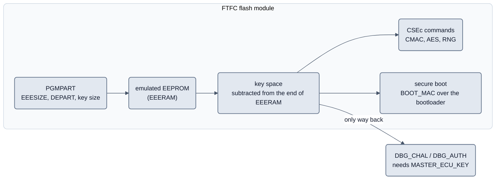

# CSEc in neXtBSW: keys, message authentication and secure start (SYS-56)

Status: 2026-09-23, **proposal**, am 2026-10-04 (DOC-75) gekürzt; die Abwägungen je Kandidat, die Review-Fragen, die
Folgen für andere Aufgaben und die Langfassung der Fragen Q1 bis Q7 stehen in der Versionshistorie dieser Datei
(Commit vor DOC-75). Der Nutzer entschied am 2026-09-23, dass **CSEc auf diesem Board gebraucht wird**; das Dokument
klärt, *wofür*, *wie viele Schlüsselplätze* und *was das mit der FlexNVM-Partition macht*. Es ist die Grundlage für
**NVM-11** (PGMPART mit Schlüsselraum statt festem `FCCOB1/2 = 0`).

Reference: [architecture target picture](README.md), FlexNVM partition state (not published, available on request)
(NVM-10), [safety concept](../safety/concept.md).

**Why this is worth care.** The number of key slots is written into the chip **once**, together with the partition.
Raising it later needs the CSEc debug authentication with a key that has to exist at that moment, or the device is
finished. The eval board is a `FS32K144UAVLL`, a CSEc part (SDID `0x144F14EA`, FEATURES bit 7 set), and it is **not
partitioned**; nothing has been written.

## 1. Sources

Public, on this machine: [RM13] `doc/hardware/s32k1xx/S32K-RM.pdf` (S32K1xx Reference Manual Rev. 13: ch. 5, 36.1.2.4,
36.5.11.11, 36.5.11.14, 36.5.13), [DS13] the data sheet (Table 38 NVM reliability), [AN11983] *Using the S32K1xx EEPROM
Functionality* Rev. 2 (§2.2.2.1, §3.1, §7, §8.2), [MAP] `S32K1xx_Memory_Map.xlsx` (attachment of [RM13]: FlexRAM and
`CSE_PRAM` per derivative), [AN5401] *Getting Started with CSEc Security module* (§4, Tables 9 and 10, Appendix A).
A vendor safety document under `doc/confidential/` was searched for CSEc content and contains nothing; no statement
here rests on it. The HIS SHE specification 1.0.1 is not available here; [RM13] 36.5.13 does not repeat it.

## 2. What CSEc is on this part, in facts

- CSEc is a feature set **of the flash module (FTFC)**, not a separate peripheral: AES-128 (ECB, CBC), CMAC,
  TRNG and PRNG, secure boot, and a key store in flash ([RM13] 5.2.2, 36.5.13). It follows the SHE specification.
- **It only exists when the FlexNVM is configured for emulated EEPROM.** "To access the command feature set, the
  part must be configured for EEE operation, using the PGMPART command" ([RM13] 36.5.13). On a non-CSEc part, and
  on a CSEc part with key size 0, access to the CSEc parameter RAM is not even guaranteed ([RM13] 5.2).
  **CSEc and the emulated EEPROM are one decision, not two.**
- **The keys live in the EEPROM RAM.** The key space is subtracted from the end of the EEERAM address range and
  becomes unaddressable ([RM13] 5.2, 36.5.13). It is backed up in the EEPROM backup inside the FlexNVM.
- **No concurrency.** EEPROM operations, ordinary flash commands and CSEc commands cannot run at the same time;
  one operation of any kind at a time ([RM13] 36.5.13, [AN11983] §8.1).
- **Not in HSRUN.** Flash writes/erases, EEPROM writes and CSEc commands are not supported above RUN mode; in
  HSRUN (112 MHz) they raise error flags ([DS13] Table 38 notes 2 and 5; [RM13] introduction, footnote 1 to the
  S32K14x feature list: switch back to RUN at 80 MHz to execute CSEc or EEPROM writes). The demo project runs
  at 80 MHz (`projects/evalboard_s32k144_demo/project.yaml`, `clock.system_hz`), so this is a check to add, not a
  problem today.
- **The parameter RAM lies behind the FlexRAM, not in it — and moves with the FlexRAM size** (NVM-21). `CSE_PRAM`
  (128 bytes) is at `0x1400_1000` on the S32K14x/S32K14xW (4 KB FlexRAM) and at `0x1400_0800` on the S32K11x (2 KB)
  ([MAP] `S32K1xx_Memory_Map.xlsx`, file attachment of [RM13], sheet "Overview Memory Map"). No device header of the
  family has it. On an S32K14x, `0x1400_0800` is FlexRAM offset `0x800`, i.e. the **emulated EEPROM**: a write there
  is an EEPROM record, and a second write before `CCIF` returns ends in a transfer error ([RM13] 36.5.2.3). That is
  what NVM-13 did on the board on 2026-09-30 with the address of the S32K116 SVD; `bspCsec` now picks the address
  from `SIM_SDID` SUBSERIES at run time (`csec/CsecPramAddress.h`) and refuses an unknown sub-series.
- **Key slots are fixed by SHE, not by us.** Slot 1 `MASTER_ECU_KEY`, slot 2 `BOOT_MAC_KEY`, slot 3 `BOOT_MAC`,
  then `KEY_1`…`KEY_17` ([RM13] Table 36-75). If any key at all is allocated, those first three slots are assumed
  to be taken, so of 20 slots 17 are free for our own use ([RM13] 36.5.11.14).

## 3. What CSEc should be used for

Test applied to each candidate: *does CSEc do something here that software on this MCU cannot do as well, and is the
gain worth a permanent decision?*

| Candidate | CSEc the right means? | Slots needed now | Reason |
|---|---|---|---|
| SecOC CMAC on CAN (3.1) | yes, later | 1 | AES-128 CMAC is the SecOC primitive and the key stays unreadable; but no freshness manager, PDU configuration or key distribution exists (`libs/bsw/e2e` protects against faults, not attackers); a SecOC concept is its own task |
| Secure boot of the bootloader (3.2) | **yes, only CSEc can do it** | `BOOT_MAC_KEY` + `BOOT_MAC` (slots 2, 3) | the flash module checks a CMAC over the program flash from address 0 at every reset; no software can check its own first instruction |
| Application Security Access 0x27 (3.3) | no, software path stays; CSEc as a later option of `security[].method` | 1 | HMAC-SHA256 with a per-device key (COM-30) is proven, family-neutral and works without CSEc; the gain would be defence in depth only |
| Bootloader Security Access (3.4) | no, but `hal_random()` via `CMD_RND` is a free win | 0 | the bootloader must keep the software path anyway, so CSEc would add code; the weak seed (UID and timers) gets a real hardware random source |
| Device key / identity (3.5) | yes in principle, no partner today | 1 | component protection needs a partner that challenges |
| Signed application image (BL-12) | **no, Ed25519 stays** | 0 | a symmetric CMAC would put a forging key on every device and the build machine |

**Secure-boot flavours** ([RM13] 36.5.13.2, 5.2.3):

| Flavour | Behaviour on a MAC mismatch | Suitable here |
|---|---|---|
| Sequential | core starts only after the check; keys with the boot-protection attribute stay locked | possible |
| Parallel | core starts immediately, the check runs beside it; keys stay locked on failure | **recommended** |
| Strict | **the part stays in reset** | **never** – "Strict" is one-time and cannot be undone ([RM13] 36.5.13.25); a single mismatch, e.g. an interrupted bootloader update, bricks the device permanently |

**Relation to BL-12.** Two links of one chain, not alternatives:

| | CSEc secure boot | BL-12 Ed25519 |
|---|---|---|
| Protects | the **bootloader** (0x0…0x7FFF today) | the **application image** |
| Checked by | the flash module, at every reset | the bootloader, before it starts the application |
| Key on the device | symmetric `BOOT_MAC_KEY` – whoever can verify can also forge | only the **public** key – a stolen device yields no signing key |
| Answers | "is the root of trust still the one we installed?" | "did this image come from us?" |

Constraints for NVM-11 and a later bootloader task: `BOOT_SIZE` covers the **bootloader area only**
(`memory.bootloader.size`), never the application; the flash configuration field at 0x400 lies inside that area; with
secure boot active `canflash blupdate` writes the new `BOOT_MAC` in the same operation, before the reset (second reason
against Strict); the boot MAC is checked by hardware, so the bootloader core needs no code for it.

## 4. How many key slots, and what each one is for

The part's ceiling is **20 slots**, of which 3 are taken by SHE itself, leaving **17 of our own** ([RM13]
Table 36-62 and the text after it). Slots cannot be bought singly: `FCCOB1[1:0]` selects one of four steps, and each
step costs a fixed number of bytes out of the EEERAM.

| `FCCOB1[1:0]` | Slots | Of those, free for us | Cost from the EEERAM |
|---|---|---|---|
| `00` | none (CSEc off) | – | 0 bytes |
| `01` | 1 to 5 | 2 | 128 bytes |
| `10` | 1 to 10 | 7 | 256 bytes |
| `11` | 1 to 20 | **17** | 512 bytes |

Source: [RM13] Table 36-62 "CSEc/SHE key size" (p. 865). The byte figures are larger than 16 bytes per key because
the store holds each key's attributes as well; the RM gives only the totals and so does this table.

**Proposed allocation (17 free slots, `FCCOB1 = 11`):**

| Slot | SHE name | Purpose | Needed when |
|---|---|---|---|
| 1 | `MASTER_ECU_KEY` | authorises loading every other key, and the debug authentication that is **the only way back** | at once, in production, as the first key |
| 2 | `BOOT_MAC_KEY` | key of the secure-boot CMAC over the bootloader (3.2) | with secure boot |
| 3 | `BOOT_MAC` | the expected CMAC of the boot area (a slot, though it is a MAC) | with secure boot |
| `KEY_1` | | CAN message authentication (SecOC) – one bus (3.1) | later |
| `KEY_2` | | bootloader Security Access, if it ever moves to CSEc (3.4) | probably never |
| `KEY_3` | | application Security Access 0x27, as an option (3.3) | later |
| `KEY_4` | | ECU identity / component protection (3.5) | later |
| `KEY_5`…`KEY_17` | | reserve: second bus, key rotation, application keys | unknown |

**Why the largest step and not `10`.** The difference between `10` and `11` is **256 bytes** of emulated EEPROM out
of 4096 — 6 %. The difference in what it buys is 7 usable slots against 17. The project has no NvM blocks defined at
all yet (`nvm.blocks` is absent from `project.yaml`), so nothing is known to be short of those 256 bytes, while the
cost of finding out later that 7 slots were not enough is a device that has to go through the debug authentication
and be re-partitioned (the way back in stages is in 6.3; the partition step alone is reversible). Buy the headroom.

## 5. Interaction with the partition: the table for NVM-11

Three values go into one `PGMPART` command and can never be separated afterwards
([RM13] Table 36-61): `FCCOB1` key size, `FCCOB2` SFE, `FCCOB3` load-on-reset, `FCCOB4` EEESIZE, `FCCOB5` DEPART.

**Fixed by the part, not a choice.** On a CSEc part with 4 KB FlexRAM the EEPROM size **must** be `0010b` = 4096
bytes ([RM13] 36.1.2.4.1, Table 36-15 note 2, pp. 793-794). `1111b` (0 bytes) is only allowed when DEPART says "no
EEPROM", and that
in turn switches CSEc off. On the S32K11x family with 2 KB FlexRAM the corresponding value is `0011b` = 2048 bytes
([RM13] Table 36-3 note 2) — which is why this belongs in `mcudb`, per derivative, and not in the code.

**Usable EEPROM per key-size code** (S32K144, EEESIZE `0x2` = 4096 bytes; the key space is subtracted from the end
of the EEERAM, [RM13] 5.2 and 36.5.13):

| `FCCOB1` | Key space | Usable emulated EEPROM | Against 4096 bytes |
|---|---|---|---|
| `00` (CSEc off) | 0 | **4096 bytes** | – |
| `01` (5 slots) | 128 | **3968 bytes** | −3 % |
| `10` (10 slots) | 256 | **3840 bytes** | −6 % |
| `11` (20 slots) | 512 | **3584 bytes** | −12,5 % |

[AN11983] §8.2 states the same result for the family in one line: with CSEc enabled up to 512 B go to key storage,
leaving 3.5 kB on S32K14x and 1.5 kB on S32K11x. So **nobody may plan with 4 KB**: with the recommended code the
application gets **3584 bytes**, and `tools/nxconfig` and the display before writing must say so (NVM-11).

Concretely for NVM-11: `tools/nxconfig/nvm.py`, `check()` sets `usable = partition.eeprom_bytes` today. That is the
one line where the key bytes have to be subtracted, so that every NvM block placement downstream counts with the
real size instead of the programmed one. `NvmPartitionPlan.describe()` is where the two extra lines of the display
belong (key slots and usable bytes).
**The second effect, and the one that surprises: the partition split.** The key space is backed up inside the
EEPROM backup, and the endurance of the emulated EEPROM depends on the ratio of backup to FlexRAM:

- [DS13] Table 38 "NVM reliability specifications": write endurance **100 K writes at an EEPROM-backup-to-FlexRAM
  ratio of 16**, and 1.6 M writes at a ratio of 256. Below a ratio of 16 the data sheet specifies **no** figure.
- [AN11983] §7: to reach the data sheet endurance the backup must be at least 16 times the EEERAM size; the whole
  FlexNVM as E-flash (64 KB on S32K14x) with the maximum EEERAM (4 KB) is exactly that ratio.
- [AN11983] §2.2.2.1: if EEE is used at all, **at least 32 KB** of the FlexNVM must be E-flash on S32K14x.
- [AN11983] §8.2, for the CSEc case explicitly: "Program partition command must use the maximum available E-Flash
  size (64 kB for S32K14x devices)".

Applied to the codes the S32K144 offers ([RM13] Table 36-17, already in `mcudb/s32k1xx/S32K144.yaml`):

| DEPART | Data flash | EEPROM backup | Backup : 4 KB FlexRAM | Data sheet endurance figure |
|---|---|---|---|---|
| `0x0` / `0xC` | 64 KB | 0 KB | – | **not possible with CSEc** (no EEPROM → no CSEc) |
| `0xA` | 16 KB | 48 KB | 12 | below 16 – no specified figure |
| `0x3` / `0xB` | 32 KB | 32 KB | **8** | below 16 – no specified figure |
| `0x4` / `0x8` | 0 KB | **64 KB** | **16** | **100 K writes** |

**Finding.** The value in the project today is `partition_code: 0xB` — 32 KB data flash, 32 KB backup, ratio 8. That
is the bare minimum [AN11983] allows for EEE at all, and it is **half** the ratio at which the data sheet gives an
endurance figure. It was chosen before CSEc was on the table and while it was assumed that data flash would be
wanted; no project value uses data flash today (`nvm.blocks` does not exist, `data_flash_bytes` is used by nothing
but the partition check). With CSEc, both NXP notes point the same way: give the FlexNVM entirely to the backup.

**Recommendation for NVM-11:** `EEESIZE = 0x2`, `DEPART = 0x4` (0 KB data flash, 64 KB backup), `FCCOB1 = 0b11`,
`FCCOB2 = 0x00`, `FCCOB3 = 0` (load on reset — with CSEc the FlexRAM is loaded at reset anyway, [RM13] Table 36-15).
Result: **3584 bytes of usable emulated EEPROM at the data sheet's 100 K write endurance**, and 17 free key slots.
If data flash is wanted after all, `0xA` (16 KB data flash, 48 KB backup, ratio 12) is the compromise — but then the
100 K figure is gone and the concept must say so out loud.

`FCCOB2` (SFE) stays `0x00`: it only enables the non-SHE "verify only" key attribute ([RM13] Table 36-63), we have
no use for it, and `FCCOB1 > 0` together with `SFE = 1` is an error condition in the command ([RM13] Table 36-69).

### 5.1 What the commands cost ([AN5401] Tables 9 and 10)

NXP's nominal figures (Cortex-M4 at 80 MHz, 112 bytes of data per command), not our measurements. `GENERATE_MAC`
0.0229 ms, `VERIFY_MAC` 0.0363 ms; an 8-byte CAN frame is far below the 112 bytes, so about 23 µs per generated and 36 µs
per verified MAC are upper bounds (0.23 % of a 10 ms task per protected frame). The command interface is serial and a
`CCOB` command cancels a running one, so the **queue** needs designing, not the arithmetic. Secure boot, which matters
for start-up time:

| Flavour | Size | Clock | Time |
|---|---|---|---|
| Sequential (and strict sequential) | 128 KB | 25 MHz **and** 12.5 MHz IPG | **5.09 ms** — identical |
| Parallel | 32 KB | `LPBOOT` = 1 (48 MHz) | 2.06 ms |
| Parallel | 128 KB | `LPBOOT` = 1 (48 MHz) | 8.33 ms |
| Parallel | 32 KB | `LPBOOT` = 0 (24 MHz) | 4.17 ms |
| Parallel | 128 KB | `LPBOOT` = 0 (24 MHz) | 16.60 ms |

The sequential figure does not depend on the IPG clock (the FTFC uses its own 50 MHz source); the parallel flavour takes
the MCU clock. Sequential is the predictable one; for a bootloader-sized region it is both simpler to argue and, at
`LPBOOT` = 0, the faster one.

## 6. Lifecycle of the keys

### 6.1 Who generates them, and when are they written

The scheme that exists stays: a project master key outside the repository (`%LOCALAPPDATA%/neXtBSW/keys/<name>.key`,
BL-03), per-device keys derived from it and the chip UID; CSEc only changes *where* the derived key ends up (a key slot,
loaded with the SHE `LOAD_KEY` protocol). Production order ([AN11983] §3.1, [RM13] 36.5.11.14):

1. `PGMPART` with the values of section 5, **once per device, at the very beginning**.
2. Reset (the codes take effect at the next reset).
3. `LOAD_KEY(MASTER_ECU_KEY)` with the per-device value, before anything else.
4. Bootloader and application over the debugger, key record of the software path as today.
5. The remaining keys as needed: `BOOT_MAC_KEY`, then `CMD_BOOT_DEFINE` with flavour and `BOOT_SIZE`, then the boot MAC.

Never provision at first power-up in the field. **No key may get the `WRITE_PROTECTION` attribute**: it makes the debug
authentication impossible, with it the mass erase and NXP's failure analysis; there is no way back. A replacement
device has a different UID and therefore different derived keys; whatever holds the counterpart (partner ECU, backend)
has to learn the new device, which is an integrator duty.

### 6.3 How a development board gets back to a blank state

The block on the ordinary mass erase hangs on the **presence of keys** ([RM13] 36.5.11.11 and 36.5.11.13, [AN5401]
§4.2.2.3). Sector erase and programming of the program flash are not affected, so flashing an application or a
bootloader keeps working in every case. State of 2026-09-23:

| State | Way back | Costs |
|---|---|---|
| `PGMPART` run, key space reserved, **no key loaded** | the **ordinary mass erase** (`Erase All Blocks`, the J-Link unlock, the external erase-all request of 36.5.11.11.1) — it is not blocked, because no key is present | nothing but the flash content |
| at least one key loaded, **none write protected** | `CMD_DBG_CHAL` → `CMD_DBG_AUTH` → reset. [AN5401] §4.5 states the result: all keys erased, **FlexRAM back to ordinary RAM** (`RAMRDY` = 1) and **FlexNVM back to all data flash** (`EEERDY` = 0). The partition itself is undone, not only the keys | the `MASTER_ECU_KEY` must be **known**; `INIT_RNG` first |
| any key with `WRITE_PROTECTION` | **none, ever** — for us and for NXP's own failure analysis | the part stays as it is |

**Superseded in part on 2026-09-29 (decision `csec-pgmpart-rueckweg`, CLAUDE.md):** already a `PGMPART` *with key space*
blocks the mass erase, with or without a loaded key; the table above is kept as the record of 2026-09-23. The way back
is therefore needed in every stage except "write protected", and it is implemented (NVM-13, host-verified only): device
side [`platforms/s32k1xx/bsp/bspCsec`](../../platforms/s32k1xx/bsp/bspCsec/README.md) (`LOAD_KEY` of the
`MASTER_ECU_KEY` into its empty slot, `INIT_RNG`, `GET_ID`, `DBG_CHAL`, `DBG_AUTH`, from RAM, typed confirmations, no key
flag can pass), host side [`tools/csec`](../../tools/csec/README.md) (SHE KDF, M1..M5, debug authorisation). The proof on
the board is part of NVM-07.

The documented way back ([RM13] 36.5.13.26/27): `CMD_DBG_CHAL` returns a 128-bit challenge; the workstation computes the
authorisation from `MASTER_ECU_KEY`, challenge and UID; `CMD_DBG_AUTH` erases all keys and the user IFR (factory
status); after a reset `EEERDY` is 0, `RAMRDY` is 1 and `PGMPART` may be issued again. **The master key must be kept**:
losing it leaves every provisioned device re-flashable but never re-partitionable. Operational risks: interrupting a
`PGMPART` can leave the partition codes indeterminate and the command runs from RAM, not from flash ([RM13]
36.5.11.14); the data flash IFR must be erased before `PGMPART` ([AN5401] §4.1); re-partitioning loses the stored data
and the endurance guarantee ([AN11983] §3.1). Prove the way back **once, on a sample**.

### 6.4 What it means for the bootloader and for `canflash`

| | With key space allocated |
|---|---|
| `canflash` erase/program of the application | unchanged — program flash sectors are not blocked |
| `canflash blupdate` | unchanged today; **with secure boot active** it has to rewrite `BOOT_MAC` in the same operation, before the reset |
| J-Link flashing of the bootloader | unchanged |
| J-Link "unlock" / mass erase as a rescue path | **unchanged while no key is loaded**; **gone once a key exists**, and then replaced by `DBG_CHAL`/`DBG_AUTH` with the master key (6.3). The rule in `CLAUDE.md` is reworded accordingly, not deleted |
| Bootloader security access | unchanged (software path stays, 3.4) |
| Bootloader seed quality | **better** – `hal_random()` can be implemented with `CMD_RND` (3.4) |
| Emulated EEPROM of the application | **3584 bytes instead of 4096** (section 5) |

### 6.5 The `MASTER_ECU_KEY` of development boards, and the lock on `WRITE_PROTECTION` (NVM-14)

On a development board the `MASTER_ECU_KEY` is a project secret shared by every board of the project, known by
construction, so the debug authentication of 6.3 can bring any of them back. It never stands in the repository; it lives
in the key store of the workstation (a folder in the per-user application data: outside every worktree, protected by the
user account, one folder to back up; an environment variable would leak into child processes and logs):

| | |
|---|---|
| Folder | `%LOCALAPPDATA%/neXtBSW/keys/csec/` (elsewhere `~/.local/share/neXtBSW/keys/csec/`); `NX_CSEC_KEY_DIR` moves it (tests, CI) |
| File | `<name>.key`, UTF-8; lines starting with `#` are comments, the rest is 32 hex digits = the 16 key bytes, most significant byte first |
| Name | `project.yaml security.master_ecu_key`; left out: the board name (one key for every project of a board, as for the bootloader master key of BL-03) |
| Refused | all-zero, all-one (the empty slot) and the public SHE/AES test values; a project value that looks like key material |
| Created | `python tools/nxconfig csec-key new <project>` — random, never overwrites an existing file; `csec-key where <project>` shows the path and a fingerprint, never the key |

Host interface (`tools/nxconfig/keystore.py`, standard library only): `security.master_ecu_key_name(cfg)`,
`keystore.load_master_ecu_key(name)`, `keystore.checked_flags([...])` (raises `WriteProtectionRefused`). `tools/csec`
uses it: `python -m tools.csec load-master --project <project>` (or `--key-name`, `--key-file`; a file inside the
repository is refused). `*.key` is in `.gitignore`; `python tools/nxconfig csec-key scan` searches every file git would
commit for every key of the store (hex in any spelling, spread over lines, or raw bytes) and names file and key name,
never the key; the host test `nxconfig-security` runs the same scan.

**The lock.** The project describes keys and flags in `security.keys` (SHE names, checked against
`nvm.partition.key_slots`). The schema offers `boot_protection`, `debugger_protection`, `key_usage`, `wildcard` and
`verify_only`; `WRITE_PROTECTION` is deliberately not offered and is refused three times, each with the YAML path: by the
schema validators, by `tools/nxconfig/security.py` on the loaded project, and by `keystore.checked_flags` in the tool
that builds the `LOAD_KEY` message. Stage `production` is refused as a whole until per-device keys are designed.

## 7. What it means for the architecture

### 7.1 Where a CSEc driver sits

CSEc is a feature of the FTFC, i.e. MCU hardware of one family. The platform rule (README section 6, P1 to P3) puts it
per family in the OpenBSW layout: `platforms/s32k1xx/bsp/bspCsec`, beside `bspFlexNvm`, not in `platforms/common`.
Above it a **neutral contract** `libs/bsp/bspCrypto` (CMAC over a buffer and a flash range with a key **handle**, random
bytes, key load, secure-boot state, "key not available" as an ordinary result) with a contract test, in the shape of
`IFlashDriver`/`IEepromDriver`. Services in `libs/bsw/<module>` ask for a **role** (`crypto_cmac`); a board without CSEc
fills it with a software module built from the bootloader's SHA-256/HMAC code. The bootloader keeps its own way: C
without OpenBSW, the CSEc access in `bootloader/platforms/s32k1xx`, `hal_random()` as the existing hook.

### 7.2 Which configuration level holds which value

| Value | Level | Why |
|---|---|---|
| Does the family/derivative offer CSEc at all; the `FCCOB1` codes with their slot counts and byte cost; the EEESIZE the derivative forces on a CSEc part (4096 on 4 KB FlexRAM, 2048 on 2 KB) | **Derivative** (`mcudb/<family>/<derivative>.yaml`, beside `eeprom_emulation`) | manufacturer fact, the same for every board |
| Address of the parameter RAM `CSE_PRAM` (NVM-21) | **Family code**, chosen at run time from `SIM_SDID` SUBSERIES (`bspCsec` `csec/CsecPramAddress.h`); `test_csec.py` checks it against the FlexRAM region of every derivative in `mcudb` | manufacturer fact of the sub-series; the silicon says which one it is, the S32K144 builds with the S32K148 header. A `cse_pram` region in `mcudb` with a generated constant is the alternative (open point of NVM-21) |
| Whether the **fitted** chip is a security part — the ordering part number (`FS32K144U**A**VLL`) | **Board** (`boards/<board>/board.yaml`, a new `mcu_part` beside `mcu`/`package`) | a property of this PCB; the derivative name S32K144 covers both variants |
| Number of key slots (`FCCOB1`), `SFE`, which slot serves which purpose, secure-boot flavour and `BOOT_SIZE`, whether the Security Access uses the hardware key | **Project** (`project.yaml`, `nvm.partition` and a new `security:` section) | a decision of this ECU software |
| The usable EEPROM that results, the endurance ratio, the register encoding of the command | **derived** by `tools/nxconfig` and shown by `bswgen` / `flexnvm show` before writing | README section 4: the generator derives what is derived |

Run time keeps its own check: `SIM_SDID` FEATURES bit 7 says whether the chip has CSEc
(`platforms/s32k1xx/bsp/bspFlexNvm/include/flexnvm/FlexNvmChip.h`). Key slots on a board whose part number says "no
security" are an `nxconfig` error with a YAML path, a mismatch at start-up a reported fault.

### 7.3 What is board- and family-neutral

Neutral: the contract `bspCrypto`, the role `crypto_cmac`, the software fallback, the project values "how many slots,
what for", addressing a key by a handle. Family-specific, never reaching the neutral contract: that the key space comes
out of the EEERAM, the four steps, the common write with the FlexNVM partition, that CSEc needs EEE operation (on the S32K3
the counterpart is the HSE firmware with its own key store; STM32 and rm4x have none in the current scope). Board-specific:
only "is a security part fitted".

## 8. What this does not decide

No SecOC profile, no freshness-value handling, no key distribution; no general provisioning tool (the `LOAD_KEY`
protocol is implemented for the first `MASTER_ECU_KEY`, NVM-13); `PGMPART` stays blocked until NVM-11 and the decision
on Q1 to Q7 are in.

## 9. Open gaps

| # | Gap | Effect |
|---|---|---|
| G4 | Whether the *external*, debugger-triggered erase-all is also refused when keys are allocated but none is write-protected ([RM13] 36.5.11.11.1 says that path ignores `ACCERR`) | the remaining rescue path of a development board is uncertain; Q6 treats it as blocked |
| G5 | Which S32K1 part numbers carry the security option is not in [RM13]; for this board settled (`FS32K144UAVLL`) | `mcudb`/`board.yaml` need the part number as a source |
| G6 | Nothing here has been run on hardware | verification stays `mock` until NVM-11 and a board run |

Closed: G1 (command times, [AN5401] Tables 9 and 10), G2 (the mass erase is blocked by the presence of keys, not by the
key space), G3 (`LOAD_KEY` M1..M5 implemented in `tools/csec`, NVM-13).

## 10. Decision proposal

| # | Question | Recommendation | Reason |
|---|---|---|---|
| Q1 *(irreversible)* | Allocate key space, how much? | yes, `FCCOB1 = 0b11`: 20 slots, 17 free, 512 bytes of EEERAM | cannot be raised later without debug authentication and re-partition; the largest step costs 256 bytes (6 %) more than the next |
| Q2 *(irreversible)* | Which FlexNVM split? | `DEPART = 0x4` (0 KB data flash, 64 KB backup) instead of today's `0xB`; `EEESIZE 0x2`, `FCCOB2 = 0`, `FCCOB3 = 0`; if data flash is wanted, `0xA` (ratio 12, no 100 K figure) | only at ratio 16 does [DS13] Table 38 give an endurance figure; no project value uses data flash |
| Q3 | Secure boot? | yes as a target, `BOOT_SIZE` = bootloader only, flavour **parallel**, never Strict; reserve the slots now, secure boot later (`csec-q3-secureboot`) | only CSEc can check the first code; Strict cannot be undone |
| Q4 | Security Access 0x27 to CSEc? | no; keep HMAC-SHA256 with the per-device key, reserve one slot, CSEc later as an option | proven, works without CSEc |
| Q5 | Does BL-12 (Ed25519) stay? | yes, unchanged | different protection goals (3.2) |
| Q6 *(risky)* | Way back before the first `PGMPART` with key space | master key recorded outside the repository and the chip's `MASTER_ECU_KEY` computed beforehand; the first session stops after `PGMPART`; `DBG_CHAL`/`DBG_AUTH` proven before the first key is loaded for good; **never `WRITE_PROTECTION`** (answered `csec-q6-rueckweg`: no second eval board, S32K146 boards exist, they confirm the procedure, not the numbers) | the only truly irreversible act is a write-protected key |
| Q7 | Checks `nxconfig` refuses (NVM-11) | key slots on a non-security part; key slots with an `EEESIZE` other than the derivative's CSEc value; key slots with a `DEPART` without EEPROM backup (errors); backup ratio below 16 and `clock.system_hz` above the RUN limit with EEPROM or CSEc use (warnings); the display before writing names usable EEPROM, slot count, ratio and that the mass erase will be refused | each with a YAML path |

*Written for SYS-56 on 2026-09-23. No code changed, nothing written to any chip, no board touched.*
