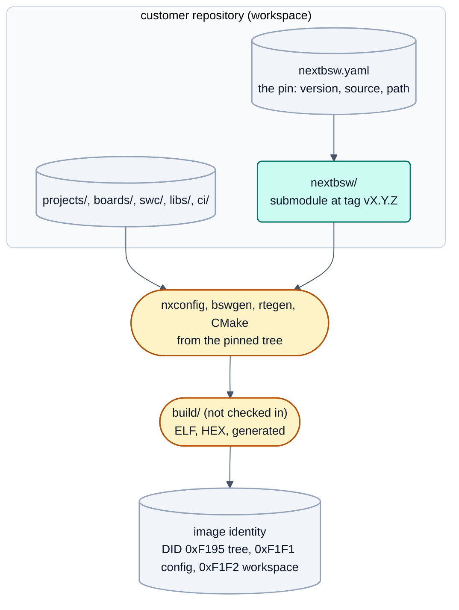

<!-- SPDX-License-Identifier: Apache-2.0 -->

# Customer ECU project in its own repository



Status: 2026-09-22, **ARCH-54**, umgesetzt (N1 bis N20 unten); am 2026-10-04 (DOC-75) auf die Entwurfsentscheidungen
gekürzt. Schrittfolge, Befehle und Beispielausgaben stehen im [Guide "Your own ECU repository"](../guide/customer-project.md);
die Abwägungen, offenen Fragen Q1 bis Q12 und der Studio-Wizard-Entwurf stehen in der Versionshistorie dieser Datei
(Commit vor DOC-75). Das Dokument ist dem verbindlichen Zielbild [`README.md`](README.md) nachgeordnet.

Entscheidungen des Nutzers vom 2026-09-22:

| Key | Decision |
|---|---|
| `studio-neues-projekt-ablage` | In production, **every ECU project has its own repository**. |
| (same) | neXtBSW is referenced there at a **fixed version**. After the project has started, the newest neXtBSW state is **never pulled in automatically**; an update is a deliberate step. |
| `studio-neues-projekt-*` | The Studio wizard "New project" (TOOL-59) is built on this design: location free to choose, start empty for a board or as a copy of a project. |
| `iso-q3` (SYS-68) | A neXtBSW release is an **annotated tag `vX.Y.Z` on `master`**, preceded by a green CI run with an archived report. |

## 1. Guiding sentence

> A customer repository contains **only what the ECU decides**: its projects, its own boards, components, modules and
> tests, and **one pin** that names exactly one released neXtBSW. Everything neXtBSW provides is read from that pinned
> tree and never copied or modified. Generated output is reproducible from the two and is therefore not checked in.

Consequences:

- The three configuration levels (derivative, board, project; [`README.md`](README.md) section 4) stay as they are.
  The pin is **not a fourth configuration level**: it carries no value of the ECU, only where neXtBSW and the
  customer's extensions are found (same stance as the multi-MCU concept, see [`planned.md`](planned.md)).
- Everything is board-neutral: the customer's boards are ordinary `board.yaml` files, found by path like the boards of
  neXtBSW. The examples below use invented names (`acme_bcm`, `acme_bcm_b2`); no neXtBSW board is special.
- The same rule serves the development case: the projects under `projects/` of the neXtBSW repository are a
  workspace whose pin is "this working tree" (section 6.4).

## 2. Terms

| Term | Meaning |
|---|---|
| **neXtBSW tree** | one checked-out or unpacked neXtBSW release (or, for development, the working tree of the neXtBSW repository) |
| **Workspace** | the customer repository root: the folder that holds the pin file `nextbsw.yaml`; one workspace has exactly one neXtBSW tree |
| **Pin** | the reference to exactly one neXtBSW version (section 4), recorded in `nextbsw.yaml` and, for the recommended variant, in the git submodule entry |
| **Release** | an annotated tag `vX.Y.Z` on `master` of neXtBSW (SYS-68) with its CI report; for a licensed line, the same version of the licensed export or overlay |
| **Update** | moving the pin from one release to another, as a reviewed change of its own (section 5.5) |


## 3. Example tree of a customer repository

```
acme-bcm/                              customer repository: one ECU (possibly several MCUs = several projects)
  nextbsw.yaml                         [in]  the pin: version, source, path of the tree, search paths (section 3.1)
  nextbsw/                             [ref] git submodule -> neXtBSW, checked out at tag v1.4.2
                                             (the gitlink is checked in, the content is not)
  CMakeLists.txt                       [in]  thin root, written once by the wizard: includes the build of the
                                             neXtBSW tree (gap N4); no logic of its own
  CMakePresets.json                    [in]  one visible preset per project, inherits the base presets of the tree
  CMakeUserPresets.json                [--]  workstation (compiler path, CAN adapter), in .gitignore as today
  .gitignore  .gitattributes           [in]  build/, .venv/, doc/confidential/; eol rules for YAML/DBC
  .github/workflows/ci.yml             [in]  provider file only: checkout with submodules, then python -m tools.ci
                                             of the neXtBSW tree with --workspace . (gap N12)
  ci/
    pipeline.toml                      [in]  which projects the CI builds, allowed skips (format of tools/ci)
    tests.yaml                         [in]  host tests of the workspace (format of tools/test/tests.yaml)
  projects/
    bcm_main/
      project.yaml                     [in]  board: ../../boards/acme_bcm_b2 ; rte: rte.yaml ; diag: diag.yaml
      rte.yaml                         [in]  components, connections, tasks, CAN (paths relative to this file, gap N3)
      diag.yaml                        [in]  DIDs, routines, sessions, DTCs (ARCH-51)
      can/BCM_Body.dbc                 [in]  the project's CAN database (or a submodule of a vehicle network repo)
      swc/
        DoorLogic/                     Simulink component (swc/README.md)
          DoorLogic.slx                [in]  the source
          DoorLogic_data.m             [in]  calibration values
          generated/{src,arxml}/       [in]  Embedded Coder output, as in neXtBSW: builds and CI need no MATLAB
          generated/model.sha256       [in]  hash of the .slx, configure warns when the code is stale
          test/                        [in]  SIL/MIL stimuli
        LevelMon/                      hand-written C component (RTE-20)
          swc.yaml                     [in]  implementation: c - the master of the component
          LevelMon_data.m              [in]  calibration values (read without MATLAB)
          src/LevelMon.c               [in]  hand-written code
          test/                        [in]  host test of the component
    bcm_io_slave/                      second MCU of the same ECU ([`planned.md`](planned.md)): its own project.yaml ...
  swc/                                 [in]  components shared by several projects of this repository
  boards/
    acme_bcm_b2/
      board.yaml                       [in]  the customer's PCB, same schema as neXtBSW boards
      README.md                        [in]  board notes, safety rules of the board
  mcudb/<family>/<derivative>.yaml     [in]  only if a derivative is missing in the pinned release; should flow
                                             upstream, found through search paths (gap N2)
  libs/<module>/module.yaml ...        [in]  the customer's own device drivers or services with manifest
  doc/
    nextbsw-updates/v1.4.2-v1.5.0.md   [in]  update report of every pin move (section 5.5)
    safety/ ...                        [in]  the integrator's work products; they cite the neXtBSW baseline tag
  build/                               [--]  build directories, one per project and preset (or a short build root)
  .venv/                               [--]  Python environment of this workspace, made from the pinned tree
```

`[in]` checked in, `[--]` never checked in, `[ref]` referenced (only the pointer is checked in).


### 3.1 The pin file `nextbsw.yaml`

Implemented in N2 (ARCH-56): schema `WorkspacePin` in `tools/nxconfig/model.py`, discovery and checks in
`tools/nxconfig/workspace.py`. Step by step: [guide, step 1](../guide/customer-project.md#step-1-the-repository-and-the-pin).

```yaml
# acme-bcm/nextbsw.yaml - which neXtBSW this workspace is built with. Not an ECU configuration level.
schema_version: 1
nextbsw:
  version: 1.4.2                 # the release; must equal the tree's VERSION file (error otherwise)
  source: submodule              # submodule | archive (section 4); decides how tools check the pin
  path: nextbsw                  # the neXtBSW tree, relative to this file
  profile: open                  # open | licensed | nda: the distribution line (lizenz-und-release.md 5.2), default open
  # archive only (required there, refused for a submodule): url: ..., sha256: <64 hex digits>
search:                          # the workspace's own extensions, searched BEFORE the tree's own folders
  mcudb: [mcudb]                 # <dir>/<family>/<derivative>.yaml
  modules: [libs]                # <dir>/**/<module>/module.yaml
  boards: [boards]               # <dir>/<board>/board.yaml - offered by tools; a project still names its board by path
  # overlays (licensed modules, model B, N16): further trees with their own version, checked against nextbsw.version
  # overlays: [{ path: nextbsw-licensed, version: 1.4.2 }]
```

Rules as implemented (every message with file, line and YAML path of `nextbsw.yaml`):

- **Discovery** walks up from the folder of `project.yaml` to the first folder that holds `nextbsw.yaml`, is the root of
  a neXtBSW tree (`VERSION` plus `tools/nxconfig`) or of a git repository. No pin: the tree the tool runs from.
- **Tree:** `nextbsw.path` must be the neXtBSW tree the tool runs from; `nextbsw.version` must equal its `VERSION`.
- **Search paths** lie outside the tree. A derivative or module found twice, or a board name that exists in two board
  folders, is an error naming both paths. Unknown keys are errors, so ECU values cannot creep into the pin.
- **One file at the root, no per-project version** in `project.yaml`: every value exactly once
  ([`README.md`](README.md) section 4); fitting formats are decided by `schema_version` of each YAML level, with a
  migration when a release raises it (N11).

### 3.2 What is checked in, and why

| Artefact | Checked in? | Reason |
|---|---|---|
| `project.yaml`, `rte.yaml`, `diag.yaml`, DBC, `board.yaml`, own `mcudb`/modules | yes | the sources of the ECU; reviewed as text |
| `.slx`, `_data.m`, `swc.yaml`, hand-written `src/` | yes | the sources of the components |
| `swc/<Swc>/generated/{src,arxml}`, `model.sha256` | **yes** | same rule as in neXtBSW: the firmware and the CI build without MATLAB; the hash makes stale code visible at configure |
| `build/<preset>/generated/` (bswgen, rtegen, dbcgen, diaggen, memory layout, A2L) | **no** | fully determined by the workspace sources plus the pinned tree; checking it in would create a second truth that can drift. For traceability each customer release archives it as a CI artefact next to ELF/HEX/MAP, and the image carries the generator identity (PLAT-79) |
| update report `doc/nextbsw-updates/*.md` | yes | the evidence of the impact analysis of a pin move (section 5.5), small text; the full generated diff is a CI artefact |
| gitlink of the submodule | yes | it **is** the pin for variant 1 (a commit SHA) |
| content of `nextbsw/`, `.venv/`, `build/`, `CMakeUserPresets.json` | no | referenced, workstation or derived |

Whether a customer wants generated code in git anyway (some reviews ask for it) is question Q6; the design allows it
as an export step without making it a second source.

## 4. Variants for referencing neXtBSW at a fixed version

Rated `++` very good, `+` good, `o` neutral, `-` weak, `--` unsuitable.

| Criterion | 1 submodule on tag | 2 FetchContent | 3 release archive + SHA-256 | 4a pip package | 4b vendored copy |
|---|---|---|---|---|---|
| Reproducibility | ++ gitlink is the commit SHA | + SHA or `URL_HASH` | ++ archive hash | + `--require-hashes` | + release identity only by convention |
| Offline build | + mirror via `insteadOf` | - cache per build directory | ++ one shared cache | + wheelhouse | ++ |
| Licensed lines | + repository permission | o credentials in CMake | + one archive per profile | + private index | o licensed files enter the history |
| Python tools before CMake | o `.venv` from the tree | -- tree appears only at configure | + wheelhouse | ++ | o |
| Studio matches the pin | + `VERSION`, tag at a fixed place | -- | + from `nextbsw.yaml` | + | o |
| Deliberate, traceable update | ++ one reviewed diff, `git log vA..vB` | + hash diff only | + hash diff, release notes | o | -- huge diffs |
| Safety baseline (SYS-68) | ++ tag reachable from `master`, dirty submodule visible | + | + hash, origin needs a signature | o | -- |

Decisive facts: the tree is needed **before** CMake (`nxconfig check`, Studio live check, RTE and component tools,
MATLAB read it directly; the root `CMakeLists.txt` selects the toolchain before `project()`); the Studio bundles the
generator modules of its build, so its version must match the pin; OpenBSW is a nested submodule (git variants need
`--recursive`); licensed content never shares an object store with the public line.

### 4.4 Recommendation

**Variant 1: git submodule `nextbsw/` on a release tag, declared in `nextbsw.yaml`.** The pin is a commit SHA in the
customer's own history, so nothing moves it except a commit; the update is a normal reviewed change. The safety
baseline is checkable by a tool (N10: annotated tag `v<version>` reachable from `master`, clean submodule). It fits both
licence models (`lizenz-und-release.md` (not published, available on request) 4.4) and needs the least new infrastructure.

**Variant 3 is the documented fallback** for air-gapped build machines: the same `nextbsw.yaml` with `source: archive`,
`url` and `sha256`; the tools read only `path` and `version`, so switching changes one file. Variants 2 and 4b are not
recommended; 4a is a candidate for the web app, not for the firmware tree.

Rules: only release tags in a workspace that builds a customer release (CI flag `--release`; an untagged pin is a
warning during development); the submodule is never edited; `git clone --recurse-submodules` is the documented clone.

## 5. How the parts work together

Commands and examples: [guide](../guide/customer-project.md). The rules:

### 5.1 Finding things

The tree comes from `nextbsw.yaml` (walk up from `project.yaml`), without the file the tree the tool runs from; for a
project the Studio takes the tree of its pin, not its own. A board is named by path in `project.board` (explicit and
diff-visible, no name lookup); derivatives and modules are searched in the workspace `search` paths first, then in the
tree; `rte.yaml` paths are relative to the file; the Python `.venv` and the build directory belong to the workspace.

### 5.2 Building

The workspace root gets a thin `CMakeLists.txt` that hands over to the tree. The root build separates **the tree root**
(`NX_ROOT`: generators, platforms, libs, OpenBSW) from **the workspace root** (`NX_WORKSPACE`: projects, boards, `.venv`,
build); no board port is needed, because the feature switches come from the project (N5). `cmake --preset <project>`
works in the workspace like in the neXtBSW repository. See [guide, step 5](../guide/customer-project.md#step-5-check-generate-build).

### 5.3 Python environment

`tools/requirements.txt` and `tools/ci/constraints.txt` of the pinned tree define the environment; the workspace gets its
own `.venv`, made by one command of the tree (N8, `tools/setup`) that writes a marker with the hash of the constraints;
tools warn when it does not match the pinned tree. See [guide, step 2](../guide/customer-project.md#step-2-the-python-environment).

### 5.4 Studio and version

The Studio bundles the generator modules of its build, so its version must match the pin (N7). On opening a project it
reads the pin: same version opens normally, a different version is said so, the installed Studio build of the pinned
version is offered, otherwise the project opens read-only with a warning. External steps (CMake, generators) always run
from the pinned tree with the workspace `.venv`. **Exact match** instead of a compatibility range is the only rule a tool
qualification can state (PLAT-83). See [guide, step 8](../guide/customer-project.md#step-8-taking-a-newer-nextbsw).

### 5.5 Update workflow (deliberate and traceable)

One command in the core (`tools/nxupdate`, N9), run on a branch: generate every project with the current pin; move the
pin (fetch, check out the new tag, check it, update `nextbsw.yaml`, recreate `.venv`); run the format migrations of every
raised `schema_version` (N11); generate again, compile, run the workspace tests; write `doc/nextbsw-updates/v<old>-v<new>.md`
(skipped releases, changelog excerpt, migrated files, new and gone `nxconfig` messages, generated-file diff, ELF size
change, and a prominent list of **field-relevant changes**: memory layout, bootloader identity, CAN IDs, diagnostic
addresses, record formats); commit the gitlink, `nextbsw.yaml`, migrated files and the report as one change. Nothing runs
automatically; the Studio may inform that a newer release exists but never moves the pin.

### 5.6 CI in the customer repository

The provider file only checks out (with submodules and credentials for private lines) and calls
`python nextbsw/tools/ci` with `--workspace .` (N12); compiler versions come from the tree, the workspace adds
`ci/pipeline.toml` and `ci/tests.yaml`, and `--release` runs the pin check (N10). See
[guide, step 6](../guide/customer-project.md#step-6-your-tests-and-your-ci).

### 5.7 Safety

- The customer (integrator) cites **two baselines**: the neXtBSW release tag (with commit) and the customer's own tag.
  The image identifies both (N13, next section).
- Assumption of use for the safety concept: *the integrator uses a released neXtBSW baseline unmodified and performs an
  impact analysis on every update*; the update report is that analysis's input, and the pin check (N10) turns the
  assumption into a CI error.

### 5.7.1 What the image says about the customer baselines (N13)

Implemented in PLAT-79, PLAT-98 and PLAT-93. Four values, each with one source and one place in the image:

| Value | Source (one) | Console (`info`) | DID | Build header |
|---|---|---|---|---|
| neXtBSW version | `VERSION` of the tree the build runs from (`PROJECT_VERSION`, PLAT-98) | `neXtBSW`, also in `version` | 0xF195, first word | - |
| neXtBSW commit | `git describe --tags --always --dirty` of the tree, plus a hash of uncommitted changes (`tools/diaggen/buildid.py`, same rule as the EPK) | `commit` | 0xF195, second word | `NX_DIAG_NEXTBSW_COMMIT` / `NX_DIAG_NEXTBSW_VERSION` |
| Configuration and generators | SHA-256 over the configuration files (pin file `nextbsw.yaml` included) and the generator sources (`tools/nxconfig/identity.py`) | `configuration` (also in `version`), `identity`, ... | 0xF1F1 | `identity/nxIdentityFields.h` |
| Workspace (customer) commit | `git describe` of the workspace root, same rule | `workspace` | 0xF1F2 (`workspace.version`, 48 bytes) | `NX_DIAG_WORKSPACE_VERSION` |

- **One header for the git state:** `diag/DiagBuildId.h` is written by `buildid.py` at every build; DiagSystem and the
  console read the same macros, so console and DID cannot disagree.
- **The tree is the pin; the workspace is `NX_WORKSPACE`.** In a submodule `git describe` names the release tag, not the
  customer's commit. An archive has no `.git` and shows `nogit`. The workspace value is `-` in the development case
  (`NX_WORKSPACE` equals `NX_ROOT`) and carries a hash of uncommitted changes, so a build from uncommitted files never
  looks like a release.
- **No git state in the configuration identity:** 0xF1F1 stays reproducible in every checkout; the pin file is one of its
  inputs, neither commit is.
- **Identifier 0xF1F2** is the next free one in the supplier-specific identification group of
  `tools/diaggen/standard_diag.yaml`. The release CI (`--release`) refuses a dirty or untagged pin.

### 5.8 Licensed modules

| Model (`lizenz-und-release.md` (not published, available on request) 4.4) | What the workspace references |
|---|---|
| C (now): monorepo + export per profile | one submodule: the export repository of the customer's profile (`open`, `licensed-<line>`); `profile` in `nextbsw.yaml` names it |
| B (goal): open repository + overlays | submodule `nextbsw/` (open) plus overlay submodules (`nextbsw-licensed`, per class); overlays listed in `nextbsw.yaml` with their version, found through the module search path, checked to equal `nextbsw.version` |

In both, a project that uses a module above its `profile` is reported by `nxconfig` (the planned
`distribution_profile` check of PLAT-46 section 5.2 moves into the workspace pin).

## 6. Studio wizard "New project" (TOOL-59) and the development case

The wizard (core function without Qt plus GUI) asks where (new repository, existing workspace, development in the
neXtBSW repository), which neXtBSW release, what to start from (empty for a board, copy of a project), the name, and
shows a summary before anything is written; failed checks leave the files in place and open the project with the
messages. See [guide, step 1, "In the Studio"](../guide/customer-project.md#in-the-studio).

### 6.4 The demo and development case

`projects/` in the neXtBSW repository stays: examples, build tests, the projects the neXtBSW CI builds, and the
place where neXtBSW itself is developed and tested. Such a project has **no `nextbsw.yaml`**; the tools fall back to
"the tree I run from", its version is the working tree (`git describe`), presets stay in the root
`CMakePresets.json` or none (explicit `NX_PROJECT`). These projects are not for production.

A consequence worth naming: the user's own non-public projects (for example those on private boards, PLAT-46 F10)
fit the workspace model directly - in model B the "private integration repository" of PLAT-46 is exactly a workspace
with a pin.

## 7. Gaps in today's neXtBSW and task proposals

Status is kept in `doc/todo.yaml`; the IDs N1 to N20 stay as references. Done and described in the guide or in code:
N2 (pin and discovery), N5 (no board port needed), N9 (`tools/nxupdate`), N10 (pin check, `tools/nxconfig/pincheck.py`),
N11 (format migrations, `nxconfig migrate`), N13 (image identity, section 5.7.1), N15 (release publication,
`tools/ci/release.py`), N17 (the guide), N19 (coverage and static analysis of the customer's own code), N20 (empty
project on a board of an existing workspace).

| # | Title |
|---|---|
| N1 | neXtBSW version identity: one `VERSION` file at the tree root, checked against the tag `vX.Y.Z` |
| N2 | Workspace pin `nextbsw.yaml` and discovery (section 3.1) |
| N3 | Paths in `rte.yaml` relative to the file, `schema_version: 2` with migration |
| N4 | Build a workspace outside the tree: `NX_ROOT` and `NX_WORKSPACE` separated |
| N5 | Feature switches from the project instead of `ecu/platforms/<board>/Options.cmake` |
| N6 | Studio: tree, interpreter and build root per project |
| N7 | Studio and pin version rule (exact match, warning, read-only) |
| N8 | Workspace Python environment from the tree's requirements and constraints, with a marker |
| N9 | Update workflow: before/after generation, pin move, migrations, report |
| N10 | Pin check: annotated tag on `master`, clean, overlays equal in version |
| N11 | Format migrations when a `schema_version` rises |
| N12 | `tools/test` and `tools/ci` for workspaces (`--workspace`) |
| N13 | neXtBSW version and workspace commit in the image identity |
| N14 | Studio git page in a workspace (submodule as its own category, commit blocked on a dirty submodule) |
| N15 | Release publication: tag, archived CI report, export per profile, optional archive with SHA-256 |
| N16 | Licensed overlays in a workspace |
| N17 | Guide "Customer project" |
| N18 | Safety: assumption of use for the pin |
| N19 | Coverage and static analysis of the customer's own code |
| N20 | Empty project on a board of an existing workspace |

Out of scope: the format of a vehicle-network description shared by several ECU repositories (ARCH-50), OTA packages and
multi-ECU composition ([`planned.md`](planned.md)), signing of releases and archives.

Review questions ([`README.md`](README.md) section 11): the design touches no ECU value (questions 1 to 5), keeps the pin in
one file (6), is tested with synthetic workspaces outside the repository (7) and keeps the core free of Qt (8).
