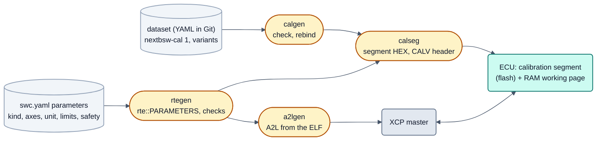

# Calibration in neXtBSW: parameters, maps, a versioned calibration database, measurement signals (ARCH-64)

Status: 2026-09-28, concept; decisions E1 to E6 taken by the user (all recommendations a, section 11); stages K1, K2, K3
and K6 are implemented (section 10). Am 2026-10-04 (DOC-75) gekürzt: Optionenvergleiche, Ist-Zustand vor der Umsetzung,
Umsetzungsnotizen (7.6, 7.7) und die Langfassung der Entscheidungen stehen in der Versionshistorie dieser Datei (Commit
vor DOC-75), die Umsetzung in den Readmes der Werkzeuge.




Reference: [architecture target picture](README.md) (configuration levels section 4, bootloader section 7, review
questions section 11), [swc/README.md](../../swc/README.md) (calibration parameters, RTE-03),
[tools/a2lgen/README.md](../../tools/a2lgen/README.md) (A2L and `xcp_master.py`),
Studio guide (not published, available on request) (model import and `<Name>_init.m`, TOOL-138),
[safety concept](../safety/concept.md), ISO 26262 gap analysis (not published, available on request) (row 6-40, item 22),
[tool classification](../safety/tool-classification.md) (a2lgen, AoU-28).

The question of the user (2026-09-27): how are parameters and maps given their values, can a versioned calibration
database solve that, and how are measurement and calibration signals defined?

Short answer, detailed in the sections below:

1. **One definition per calibration object, one place for its values.** The definition (kind, type, axes, unit,
   limits, safety class) belongs to the component description `swc.yaml`. The model is checked against it, as ports
   already are. The values belong to **datasets** that the project owns.
2. **The calibration database is Git plus a text format plus tools.** It is not a server and not a binary store. A
   dataset is a folder of YAML files, one per component, laid out so that a line diff is a value diff. DCM and CDFX
   are exchange formats at the edge, not the store.
3. **`init_data/` stays the build environment of an imported model and does not become the database.** Its constants,
   types and data stores are what the model needs to compile. The values promoted to calibration parameters move out
   of it into the dataset. A later `neXtBSW init v2` then loads them from the dataset (section 5.4).
4. **Runtime:** a calibration segment of its own in flash, with its own validity record (CRC, layout identifier) and a
   RAM working page in development builds. The segment can be flashed without the application. Production builds
   read the flash page directly and have no write path (SYS-76).
5. **Measurement:** ports stay measurable automatically. Internal model signals are measurable only when the model
   marks them. BSW values come from the module manifests. DAQ runs per RTE task.

---

## 1. Terms

| Term | Meaning here | A2L object |
|---|---|---|
| Calibration parameter | value a calibration engineer may change without a new build; the software only reads it | `CHARACTERISTIC` |
| Scalar | one value | `VALUE` |
| Array | fixed number of values without an axis (today's `dim`) | `VAL_BLK` |
| Curve (Kennlinie) | values over one axis, interpolated or looked up | `CURVE` |
| Map (Kennfeld) | values over two axes | `MAP` |
| Axis | ascending breakpoints; **own** (stored with the curve/map) or **shared** (a separate object used by several curves/maps) | `AXIS_DESCR` with `STD_AXIS`/`COM_AXIS`, `AXIS_PTS` |
| Conversion | stored value ↔ physical value (today rational: `phys = (n0 + n1·stored)/d`); for an enumeration a value table | `COMPU_METHOD` (`RAT_FUNC`, `TAB_VERB`) |
| Measurement signal | value a tool may read while the software runs | `MEASUREMENT` |
| Dataset (Datensatz) | complete set of values of all calibration parameters of one ECU software | DCM/CDFX file, HEX of the segment |
| Variant | dataset that differs from a base dataset in some values (vehicle, power class, market) | – |
| Layout identifier | hash over names, kinds, types, dimensions and order of all parameters in the segment; a dataset fits every build with the same layout | – |
| EPK | identifier of the software build in the image, which a tool compares with the A2L | `EPK`, `ADDR_EPK` |
| Working / reference page | writable RAM copy of the values / flash original | `SEGMENT` + `PAGE` in `IF_DATA XCP` |

---


## 2. Current state

Implemented: calibration objects in `swc.yaml` with extended A2L (K1, RTE-26), datasets and `calgen` (K2, TOOL-145), the
calibration segment with start-up check (K3, SYS-89) and plausibility checks (K6, SYS-90). The XCP slave (`ecu/xcp`),
`tools/a2lgen` (A2L from the ELF, `xcp_master.py`), `swc.yaml` `parameters:` (RTE-03) and the Studio parameter editing
for C components are older; imported models keep `init_data/` as the build environment (TOOL-138). Still missing: live
values and online calibration in the Studio (TOOL-11), FreeMASTER (TOOL-19), `canflash cal` (K4), Simulink round trip
(K5), measurement signals and DAQ (K7, K8). Sensor characteristics of the board (IO-18) are configuration, not
calibration data (4.5).

---

## 3. Requirements and boundary conditions

- **Board neutral** (architecture section 1). No family-specific overlay hardware is assumed. Sizes and places are
  project values in `memory:`. The targets are Cortex-M and Cortex-R, 32 bit, little endian.
- **No FPU on every target** (S32K116, architecture section 4, IO-18 decision 2). Curves and maps must work in
  integer or fixed point. `float32` stays allowed where the derivative has an FPU.
- **One value, one place** (architecture section 4). No number is typed twice: not in the model, not in C, and not in
  the A2L.
- **No MATLAB where it is not needed.** rtegen, a2lgen and the Studio read everything without MATLAB, as they do
  today with `mdata.py`.
- **Simulink is the user's working environment.** Calibration must fit his workflow: data scripts, `Simulink.Parameter`,
  and lookup table blocks.
- **Git is the version control** of all project data (customer project, `doc/architecture/customer-project.md`).
- **ASIL B** is confirmed. C and D come later. BSW mechanisms stay separate from driver mechanisms.
- The **bootloader** stays compatible: a new record goes behind the existing ones and is never a change of format
  (`app_image.h`, BL-02 rule).

---

## 4. Model of calibration data

### 4.1 Kinds

| Kind | Content | Proposal |
|---|---|---|
| `value` | scalar | as today |
| `array` | fixed count without an axis | today's `dim`, renamed. Kept for tables that have no physical axis (e.g. per-cell offsets). |
| `curve` | N values over one axis | new |
| `map` | N×M values over two axes | new; row = X, column = Y, stored in row-major order (C order) |
| `axis` | shared breakpoint vector | new; own object, used by name from several curves/maps (`COM_AXIS`) |
| `text` / `boolean` / `enum` | value with a value table | `enum` new: the value table comes from the type, as for ports (TEXTTABLE) |

An axis is either **own** (`axis: {points: 8, …}` in the curve, stored in front of the values, `STD_AXIS`) or
**shared** (`axis: SpeedAxis_rpm`, `COM_AXIS`). Shared axes are the normal case for maps over the same operating
point. The user's MBDT models build them from `Simulink.Breakpoint` + `Simulink.LookupTable` (section 5.4).

**Interpolation belongs to the component, not to the calibration layer.** A Simulink component uses its lookup
block. A C component uses a small library function (`nxLookup1D/2D` in integer with the same rounding rule as
`sensor.py`, later). The description only states which behaviour the component expects (`interpolation: linear |
nearest`, `extrapolation: hold`). The generator checks the axis: strictly ascending, and the type range is enough for
the differences.

### 4.2 Types and conversion

- Stored types: the platform types as today (`uint8` … `sint32`, `float32`, `float64`, `boolean`). Axis and values
  may have different types, with their own conversion each.
- Conversion: the existing rational form `phys = (n0 + n1·stored)/d` (generator `Fraction`, A2L `RAT_FUNC`) covers
  `lsb`/`offset`. **No new conversion kinds.** A non-linear conversion is a curve in its own right. Enumerations use
  value tables.
- Values in the dataset are **physical**, as in `<Swc>_data.m` today. The generator rounds to the grid and reports a
  deviation above half a step as a warning (TOOL-70 already does this).

### 4.3 Unit, limits, description

Each calibration object gets:

| Key | Meaning | Used by |
|---|---|---|
| `unit` | physical unit (`rpm`, `mV`, `degC`, `-`) | A2L `PHYS_UNIT`, Studio, dataset check |
| `min`, `max` | **engineering limits**, physical, inside the type range | A2L lower/upper limit; dataset check, which refuses values outside; optional run-time check (4.4) |
| `description` | one line | A2L long identifier, Studio |
| `display` | optional format (`%.3f`) | A2L format |

The type range becomes `EXTENDED_LIMITS`. A calibration tool then warns inside the type range but outside the
engineering limits, and refuses outside the type range.

### 4.4 Safety class

`safety: qm | asil_a | asil_b` per parameter (C and D later, same key). What the class causes is defined in section 7.5
(SYS-76):

- Not writable over XCP in a production build, and not writable at all when the project sets
  `calibration.lock_safety: true`.
- A generated **plausibility check** against `min`/`max` (and monotony for axes) at start-up and after every write.
  A violation leads to a DEM entry and the component's default reaction; the value is not silently corrected.
- Listed in a generated report (safety-relevant calibration parameters with limits and dataset value). That report
  is part of the evidence for Part 6 Annex C of ISO 26262 (calibration data: specified, verified, protected).

### 4.5 What is not calibration data

- **Configuration** (`board.yaml`, `project.yaml`: ADC sensor tables, PWM frequency, thresholds of the safe
  supervisor) is fixed at generation time and belongs to a build. A value that must change without a build moves to
  a component parameter.
- **Coding** (variant selection in the field, e.g. by UDS `0x2E`) and **learned values** (adaptation, NvM) are
  different life cycles. Both may **select** or **correct** a calibration value, but they never live in the dataset.
- **Constants** of an imported model that no one should change (`SYSCONST.HW_REVISION`, task time) stay in
  `init_data/` (section 5.4).

---

## 5. One source for the definition, one place for the values

### 5.1 The definition: `swc.yaml` is the master (E1 a)

| Option | Result |
|---|---|
| A: Simulink data objects are the master | rejected: C components have no Simulink objects (a second path), `.sldd` is binary, the Studio would need MATLAB for every view, two masters as soon as C components exist |
| **B: `swc.yaml` is the master (extended)** | **chosen:** the same pattern as ports (description in `swc.yaml`, ARXML as the check); no MATLAB to read it; the model is written from it and checked against it |
| C: a separate `<Swc>.cal.yaml` | rejected: as B, but a third file to keep in step |

`swc.yaml` stays the one description of the interface of a component type: ports, runnables and calibration objects.
The chain:

```
swc.yaml parameters:  ──(swc_create / "write to model", MATLAB)──▶  .slx: Simulink.Parameter / LookupTable / Breakpoint
      │                                                                   │ swc_build
      │                                                                   ▼
      │                                                        ARXML (types, dims, compu methods)
      ├──────────── rtegen: check swc.yaml == ARXML (error with YAML path) ◀┘
      ▼
rtegen: Rte_Prm_* storage in the calibration segment, rte::PARAMETERS[] (extended by kind, axes, limits, safety)
      ▼
a2lgen: CHARACTERISTIC/AXIS_PTS/COMPU_METHOD/RECORD_LAYOUT from the ELF tables  +  dataset ──▶ HEX of the segment
```

The ELF stays the source of addresses: the A2L describes exactly the binary it came from, as today. The extended
table `rte::PARAMETERS[]` has to carry kind and axis references. Alternatively a2lgen reads those two from
`swc.yaml`/the generated `RteConfig` next to the ELF. That is a detail for the implementation. The rule is: **a2lgen
never takes a number that the ELF does not confirm.**

### 5.2 Where the values live: the dataset (E2 a)

| Option | Result |
|---|---|
| 1: keep `<Swc>_data.m` | becomes the **default values of the component type** (what the MIL test runs with); the Studio migrates it into the first dataset; no place for metadata or variants |
| **2: neXtBSW dataset (YAML)** | **chosen:** one value per line, one map row per line, stable order, so a line diff is a value diff; status, author, reason, variant, layout identifier per value or file; MATLAB loader `nx_cal_load` |
| 3: DCM as the store | exchange format only: little room for metadata |
| 4: CDFX as the store | exchange format only: ASAM standard, but XML diffs poorly |

Sketch of a dataset file:

```yaml
# projects/<p>/calibration/base/HvsControl.cal.yaml
format: nextbsw-cal 1
component: HvsControl
layout: 3f2a9c1e               # layout identifier this file was written for (checked, not decisive)
values:
  HvsOpModeOnDelay_ms: {value: 200, status: released}
  CellBalThr_mV:       {value: 15, status: checked, note: "measured 2026-10-02 at 25 degC"}
  SpeedAxis_rpm:
    value: [0, 500, 1000, 2000, 4000, 6000]
  TorqueLimit_Nm:                # map over SpeedAxis_rpm (X) x TempAxis_degC (Y)
    status: draft
    value:
      - [120, 120, 110,  90]     # 0 rpm
      - [120, 118, 108,  88]     # 500 rpm
      # one row per line: a changed cell is a changed line in the diff
```

### 5.3 Datasets, variants and who owns them

- A dataset belongs to the **project**, not to the reusable component: `projects/<p>/calibration/<dataset>/`, one
  file per component instance (fits RTE-09: one file per instance). Today's `<Swc>_data.m` in `swc/<Swc>/` would
  otherwise give every project that uses a reusable component the same values.
- **Variants** as a base plus a delta: `calibration/base/` is complete, and `calibration/variants/<v>/` contains only
  the values that differ. The generator resolves them, so a delta never becomes a copy of the whole dataset. Which
  dataset or variant goes into a build or a segment HEX is a project value (`calibration.dataset: base`,
  `calibration.variant: 400V`). Several variants in one flash image, selected by coding, come later and fit the same
  model.
- A dataset must be **complete** against the layout. A missing value is an error; the default of the component type
  is not taken silently. The Studio offers "fill from defaults" as an explicit action.

### 5.4 `init_data/` and the calibration database

`init_data/` (TOOL-138) holds copies of the old project's scripts. They define three kinds of content:

| Content | Example | Future place |
|---|---|---|
| constants the model needs to compile | `SYSCONST.HW_REVISION`, `SYSCONST.HVS_CONTROL_TASK_TIME` | **stays** in `init_data/` |
| types and data stores | `Simulink.Signal` for global data stores, bus objects, enumerations | **stays** in `init_data/` (`nx:datastores`) |
| tuning values | thresholds, delays, curves in `hvsctrl.*` | **moves** into the dataset once promoted to a calibration parameter |

So `init_data/` does **not** become the calibration database, and the database does not replace it as a whole. It
is the model's build environment and keeps that role. The database takes over the values that are meant to be
calibrated. The step between the two is a Studio action **"make calibratable"** on an imported model:

1. The Studio lists the variables the model reads from `init_data/`, marked with where they are used. A variable
   that feeds a lookup block is proposed as a curve or map with its breakpoints.
2. The user selects the ones to promote. The Studio adds them to `swc.yaml` `parameters:` with type, dimension and
   axes from the compiled model. Unit, limits and safety class are asked.
3. MATLAB turns the workspace constant in the model copy into a `Simulink.Parameter` or `LookupTable` model argument
   mapped for AUTOSAR. This is the parameter counterpart of "Ports ins Modell schreiben" (TOOL-14).
4. The value goes into the dataset. In the init file the assignment is **commented out, not deleted**, with a pointer
   to the dataset, so the history of the old script stays visible.
5. **`neXtBSW init v2`** gets a section `%% nx:calibration` that loads the chosen dataset (default: the project's
   `base`) with `nx_cal_load` before the model is compiled. Files marked `v1` stay valid.

This keeps the user's accepted rule: the copy in `swc/<Name>/` is the master of what it still contains.

---

## 6. The versioned calibration database

### 6.1 Git is the database

| Function of a calibration database | Realised by |
|---|---|
| history, who changed what and why | Git log/blame over the dataset files; a `note` per value for the reason |
| branches for experiments | Git branches; the Studio names them (`cal/<dataset>/<topic>`) |
| merge | line-based Git merge. The format is built for it: stable order, one value or row per line. A conflict is a real conflict of two values and is shown per object by the Studio (a later merge driver can resolve maps cell by cell) |
| release | a value status per object, and a **release of the dataset** as an annotated tag `cal/<project>/<dataset>/vN` on a commit where every safety-relevant value is `released`. The Studio generates the segment HEX and a report with the tag |
| comparison | Studio: dataset ↔ dataset, dataset ↔ ECU (upload), dataset ↔ DCM/CDFX |
| access rights | repository permissions; for customer projects the customer's own repository (customer-project.md) |

No server, no binary store. The "database" is the folder layout, the schema, the checks in `tools/nxconfig` (or a
small `tools/calgen`), and the Studio.

### 6.2 Value status

A small set that CDFX can also express, so an export does not lose information:

`draft` → `checked` → `released`. A changed value falls back to `draft`. A release refuses safety-relevant values
that are not `released`.

### 6.3 Relation to the software build (EPK, layout identifier)

Two identifiers, because a dataset outlives many builds:

| Identifier | Content | Where |
|---|---|---|
| **EPK** of the application | build identity (version, Git description, hash) | fixed string in the image, `EPK`/`ADDR_EPK` in the A2L, also readable over UDS |
| **Layout identifier** | hash over name, kind, type, dimensions, axis references and order of all objects in the calibration segment | in the application (expected) and in the header of the segment (present) |

- A dataset fits **every build with the same layout identifier**. Fixing a bug in the software does not invalidate
  the calibration.
- The dataset file records the layout identifier it was written for. The generator reports a stale layout with the
  objects that were added, removed or changed, and the Studio offers the migration.
- The application compares the two identifiers at start-up (section 7.3).

### 6.4 Flow back from an XCP session

1. The engineer calibrates on the RAM working page (Studio, CANape, INCA).
2. At the end, the Studio uploads the working page, compares it with the dataset, and shows the changes per object in
   physical values.
3. The engineer accepts per object. The Studio writes the values into the dataset files with status `draft`, the
   author, and an optional reason, and offers a commit on the Git page.
4. From a third-party tool the same flow goes through a DCM or CDFX export of the session.
5. **To keep the values on the ECU**, a segment HEX is built from the dataset and flashed with `canflash` (7.4). The
   application itself does not write flash in this concept.

---

## 7. Run time

### 7.1 Memory and page switching (E4 a)

| Option | Result |
|---|---|
| R1: as today (`.data`) | no flashing without the application |
| **R2: own segment + RAM working page, switching by copy** | **chosen:** needs nothing from the derivative, component code and RTE API unchanged, fits the write mechanism of `XcpSystem`; the XCP "reference page" becomes a copy action; production build `const` from flash |
| R3: two pages switched by pointer | rejected: one indirection per access, generated component code changes; pays off only when two pages must switch within one cycle |
| R4: hardware overlay | possible later as a family option, not board neutral |

### 7.2 Layout

- `memory.calibration: {size: 0x2000, region: PFLASH | DFLASH}` in `project.yaml`, checked and placed by
  `tools/nxconfig/memory.py` (sector aligned, no overlap, fits). Whether the data flash of an S32K1 is the place is
  NVM-12's question. The concept allows both.
- Linker: section `.nx_cal` for all `Rte_Prm_*` objects, in the order that the layout identifier covers. The RAM copy
  lies in `.nx_cal_ram` (development build).
- Header of the segment: magic `CALV`, format version, layout identifier, dataset identifier (tag or commit), size,
  CRC-32 over the values, CRC over the header. It follows the rules of `app_image.h`: fields never move, and
  additions are appended.

### 7.3 Start-up check

1. Header valid, CRC correct, layout identifier equal to the one the application expects → use the segment.
2. Otherwise the project decides (`calibration.on_invalid`): **`defaults`**: the application uses the default values
   built into its image (`const`, costs flash once more) and sets a DTC. **`refuse`**: the application does not start
   its functions and stays reachable over UDS/`canflash`. Recommended default: `refuse` for projects with a
   safety-relevant parameter, `defaults` otherwise.
3. The plausibility checks of safety-relevant parameters (4.4) run after 1 and after every XCP write (as built: before the values take effect, section 7.7).

### 7.4 Flashing a dataset without the application

- `canflash cal <segment.hex>` writes only the calibration region: the same UDS sequence as for the application
  (request download to the address of the region, transfer, exit, check routine), with the region in the memory
  layout that the bootloader already knows from the generated header.
- The bootloader has to know the region (erase and write only there, and the compatibility check of the `CALV`
  record against the application record). **That is a bootloader update**, so it is done only with the user present
  (CLAUDE.md). An older bootloader refuses the address, so nothing breaks.
- The segment HEX is generated from the dataset and the ELF without a build: addresses from the ELF, values from the
  dataset, header and CRC by the generator.

### 7.5 Protection in the product (SYS-76)

| Measure | Development build | Production build |
|---|---|---|
| XCP | on (project `xcp:`) | **off**: the production profile has no `xcp:` section, and nxconfig refuses `xcp:` in a profile marked `release: production` |
| Calibration values | RAM working page | `const` in the flash segment, no RAM copy, so there is no writable path in memory |
| Safety-relevant parameters | writable unless `lock_safety` | not writable (follows from the row above) |
| Integrity | CRC at start-up; since SYS-91 re-checked in every ROM check pass (7.6) | CRC at start-up; since SYS-91 re-checked in every ROM check pass (a BSW mechanism, separate from drivers, 7.6) |
| Plausibility | after every write | at start-up |
| Read-back without the A2L conversion | a console command that prints stored parameter values (AoU-28); **to be added**, since `rte` shows only signals today | – |

This is the "disabled in the product" branch of AoU-28. The "interlocked writes" branch is only needed if a customer
wants XCP in the vehicle. It stays possible through `lock_safety` plus seed & key on XCP (not planned).

---

### 7.6 Implementation (SYS-89)

Stage K3 as built. Details of the code are in `ecu/calibration` and `tools/calseg`.

- **Project value** (`tools/nxconfig`, reference `doc/reference/project.md`):

  ```yaml
  memory:
    calibration: { region: PFLASH, size: 0x1000, on_invalid: refuse, profile: development }
  ```

  `region` is the code flash of `memory.flash` or a data flash region (the latter refused until the bootloader can
  write it, BL-31, NVM-12); `size` whole sectors; `on_invalid` `refuse` (default) | `defaults` | `warn`; `profile`
  `development` (default) | `production`. nxconfig refuses `on_invalid` other than `refuse` when a parameter has a
  `safety` class other than `qm`, `xcp` in the production profile, and `defaults` in the production profile.
- **Place and linker.** In the code flash the segment follows the first sector of the application, so the vector table
  stays where the bootloader jumps to. Production: the values are read from the flash segment; development: a RAM
  working page filled at start-up, and the segment holds the copy. Both profiles give the segment the same bytes.
- **Header** (`ecu/calibration/include/calibration/CalibrationSegment.h`, 32 bytes, little endian): magic `CALV`, format
  1, layout identifier, dataset identifier, length, CRC-32 over the values and over the header. `tools/calseg seal`
  writes it after the link; it stops the build if a parameter lies outside the page.
- **Start-up check** (in `RteSystem::init()` before the init runnables): erased, magic, format, header CRC, length,
  layout identifier, values CRC. `refuse` starts no init runnable and no application task (NvM, fault memory, UDS and
  console keep running, so a valid image can be downloaded); `defaults` keeps the values of the build; `warn` uses the
  segment. Every result is one log line and a DTC event `calibration.segment`.
- **XCP, console, HEX.** The RAM working page is the only page the ECU uses; the flash segment is readable over XCP as
  the reference page. Console `cal status` and `cal values` are the read-back path of AoU-28. `tools/calseg hex` writes
  the segment HEX of every build and for any dataset (`--dataset <project.yaml> [--variant V]`).
- **ROM check (SYS-91).** The segment is not on the ROM check list (SM-14); its own CRCs are its reference, re-checked
  with the same period by `calibration::recheckSegment()` when the start-up found the segment valid. A failure there is
  the SM-14 reaction (`ROM_CHECK_FAILURE`, S1 held); after the power cycle the start-up check applies `on_invalid`, so
  the ECU can be flashed again. `tools/calseg merge --flip OFFSET:BIT` writes a damaged image as a test aid.

### 7.7 Implementation (SYS-90)

Stage K6 as built. The ECU checks every calibration parameter whose `safety` is not `qm` (axes take at least the class of
the curves and maps that use them). `tools/rtegen` writes one row per parameter into `rte::PARAMETER_CHECKS`; a project
without such a parameter gets neither table nor code. The rules are the ones the build and `tools/calgen check` apply
(`rtegen.value_rules`): `limits` (every stored value inside `Rte_Lim_*`, NaN fails), `ascending` (breakpoints strictly
rising), `form` (number of values, element type and axis element counts as in `swc.yaml`).

- **When:** always before the values take effect: at start-up (segment, else image values; failure leads to `on_invalid`,
  `refuse` as soon as a checked parameter exists, and always without a segment) and on every XCP write (a refused write
  never reaches memory; the master gets `ERR_OUT_OF_RANGE`; an axis is written as one DOWNLOAD block).
- **No cyclic check (decision):** development values change only through XCP, production values are `const` under the
  CRC and the ROM check; a cyclic check would only find faults of the RAM working page, which is the RAM test's job.
- **Evidence:** one log line per start-up result and per refused write, DTC event `calibration.plausibility`, console
  `cal check`, and `RteParameterChecks.md` next to `RteConfig.h` (every checked parameter with class, kind, form, unit,
  limits, rules and value of the build: the list for the safety case).

## 8. Measurement and calibration signals

### 8.1 Who decides what is measurable or writable

| | M1: everything global is measurable | M2: explicit list in `swc.yaml` | M3: ports automatic + annotation in the model + BSW manifests |
|---|---|---|---|
| Ports | yes | listed | **yes, automatic** (today's state) |
| Internal model signals | only if the coder makes them global; uncontrolled | listed by name; breaks on every rename in the model | **the model marks them** (test point or a mapping to static memory); the ARXML carries them; rtegen collects them |
| BSW values | – | – | **module manifest** (`measurements:` with name, type, unit) → one generated BSW table |
| Effort for the user | none | high, duplicate | low, in the tool he works in |
| One source | no | duplicate of the model | yes |

**Recommendation: M3.** Calibration objects are always declared in `swc.yaml` (section 5.1). Measurement follows the
place where a signal exists:

- **RTE signals** (every port, including BSW signals that are connected to a port) are always measurable, as today.
- **Internal signals of a Simulink model** are made measurable in the model: the AUTOSAR code mapping of an internal
  signal or state to static memory with read-only calibration access (the exact R2024a mapping is to be verified in
  the implementation). The ARXML then carries them, and rtegen adds them to the table. A signal without this mark
  cannot be measured, so the model author decides and nothing is typed twice.
- **Internal values of a C component**: `measurements:` in `swc.yaml`, because there is no model. The code declares
  them through an RTE macro that places them in the table.
- **BSW** (supply voltage, task load, bus state, NvM state): each module manifest names what it offers. The generated
  BSW table uses the same format as `rte::SIGNALS`. A project can restrict it (`xcp.bsw: [power, can]`).

**Calibration access is never automatic.** Only objects in `parameters:` are writable. Measurement objects are
always read-only.

### 8.2 The user's name prefixes

The user's models name signals with prefixes that carry type and meaning (`b_…`, `bm_…` as in `bm_HvsErrorState`,
`st_…` as in `st_CmcStatus`, `u_…`). The complete table is not written down in the repository. The meaning of `u_`
in particular has to come from the user (voltage or unsigned). Proposal:

- The prefix **does not decide** measurability or calibration access. That would make a rename a change of the
  interface.
- It is a **checked convention**: a table in the workspace (`nextbsw.yaml` `naming.prefixes`, prefix → allowed types,
  display) lets the Studio **propose** type and display (`bm_` → `BIT_MASK` per bit, `st_` → value table, `b_` →
  `boolean`) and **warn** when a port's type contradicts its prefix. Without the table nothing is checked.
  Customers use their own conventions.

### 8.3 Measurement grid and DAQ

- **Events = RTE tasks.** Each application task becomes an XCP event (`EVENT` in the A2L, period from `rte.yaml`).
  The sample is taken at the end of the task cycle, so all signals of one task are consistent with each other. This
  matches the copies at task boundaries the RTE already makes.
- DAQ lists: dynamic (`ALLOC_DAQ`/`ALLOC_ODT`) with a fixed RAM budget as a project value (`xcp.daq_bytes`). Static
  lists are not needed.
- Timestamp: 1 µs or 10 µs from the system timer (`SystemTimer`), 4 bytes, one per DTO of the first ODT.
- Bandwidth on classic CAN is the limit. At 500 kbit/s, well below 4000 frames/s are available for all traffic, and
  each DTO carries 7 bytes. The Studio shows the load of the chosen DAQ lists before the start. CAN FD (64-byte DTO)
  helps where the bus offers it.
- Polling (`SHORT_UPLOAD`) stays for single values and for tools without DAQ.

---

## 9. Tools

| Where | What | Notes |
|---|---|---|
| Studio: component page | calibration objects (define: kind, axis, unit, limits, safety) for C **and** Simulink components; "make calibratable" for imported models (5.4) | extends TOOL-70; MATLAB only for writing into the model |
| Studio: calibration page (new) | datasets and variants, table and graph editor for curves and maps (edit cells, a row, or a region; offset or factor on a selection; 2-D plot per row/column and a surface view), status per value, compare two datasets, release (tag + HEX + report) | reads/writes only text files, no MATLAB |
| Studio: online (TOOL-11) | live values from DAQ, calibrate the working page, reference/working page, upload/compare/write-back (6.4), flash the segment (`canflash cal`) | needs the runtime of section 7 |
| Import/export | A2L (generated), DCM and CDFX (import/export of a dataset, with status in CDFX), Intel HEX/S-record of the segment (flashing, and for tools that take HEX + A2L), `<Swc>_data.m` (import, migration) | converters without Qt in `tools/` (core logic free of Qt, as for the later web application) |
| MATLAB | `nx_cal_load(dataset)` → `Simulink.Parameter`/`LookupTable`/`Breakpoint` in the model workspace; `nx_cal_save` for values tuned in simulation; `init v2` section `nx:calibration` | the only MATLAB parts; the dataset reader is also a small subset reader like `mdata.py` |
| FreeMASTER (TOOL-19) | variable list from the same tables as the A2L | no own definition |

## 10. Stage plan

| Stage | Content | State |
|---|---|---|
| K1 Definition | `swc.yaml` kinds (value/array/curve/map/axis/enum), axes, `unit`, `min`/`max`, `safety`; rtegen check against the ARXML; a2lgen `CURVE`/`MAP`/`AXIS_PTS`, record layouts, limits, units, `COMPU_VTAB`, `EPK`/`ADDR_EPK`, `FUNCTION` | implemented (RTE-26) |
| K2 Dataset | format `nextbsw-cal 1`, `calibration/dataset.yaml`, `base/` and `variants/<v>/` (delta), status per value, layout identifier (`calgen rebind`), release tag `cal/<project>/<dataset>/v<N>`, `nx_cal_load.m` | implemented (TOOL-145, `tools/calgen/README.md`) |
| K3 Runtime | `memory.calibration`, `CALV` header, start-up check with `on_invalid`, production build `const` and no XCP, segment HEX | implemented (SYS-89, 7.6) |
| K4 Flashing | `canflash cal`, bootloader checks the `CALV` record against the application | open |
| K5 Simulink | curves/maps as model arguments, parameter sync, "make calibratable" for imported models, `init v2` | open |
| K6 Plausibility | generated checks at start-up and after writes, DEM entry, report | implemented (SYS-90, 7.7) |
| K7 Measurement | internal model signals, `measurements:` for C components and BSW manifests, prefix table (warnings only) | open (QM) |
| K8 DAQ | events per RTE task, dynamic DAQ, timestamp | open (QM) |
| K9 Studio | calibration page and map editor, online page (TOOL-11), FreeMASTER list (TOOL-19) | open; the Studio display is not evidence (AoU-27) |

What matters for ASIL B: the definition with limits (K1), integrity and version check of the segment (K3), the product
protection (K3, 7.5) and plausibility where a safety-relevant parameter stays calibratable (K6); a2lgen is qualified or
covered by AoU-28 (`tool-classification.md`), and the dataset release is a defined, verified generation procedure.
Variants, DCM/CDFX, the map editor, DAQ and the measurement definition are QM development aids. ASIL C/D would add
redundant storage of safety-relevant parameters, for which the segment header leaves room.

---

## 11. Decisions

| # | Decision (user, 2026-09-28: all recommendations a) | Section |
|---|---|---|
| E1 | The definition of calibration objects is `swc.yaml` `parameters:` (extended); the model is written from it and checked against it | 5.1 |
| E2 | The store is the own YAML dataset `nextbsw-cal 1`; DCM and CDFX are import/export | 5.2 |
| E3 | Datasets per project (`projects/<p>/calibration/`); the component folder keeps only defaults; `init_data/` stays the model's build environment and promoted values move into the dataset (`init v2`) | 5.3, 5.4 |
| E4 | Own flash segment with a `CALV` record, RAM working page in development builds, reference page by copying, production build `const` from flash | 7.1 |
| E5 | Production build without XCP and with `const` values, CRC at start-up, `on_invalid: refuse` when a safety-relevant parameter exists (SYS-76, AoU-28) | 7.5 |
| E6 | Ports automatic, internal model signals by marking in the model, C components by `measurements:`, BSW by module manifests; prefixes only as a checked convention (warnings); the complete prefix table is still needed from the user | 8.1, 8.2 |
