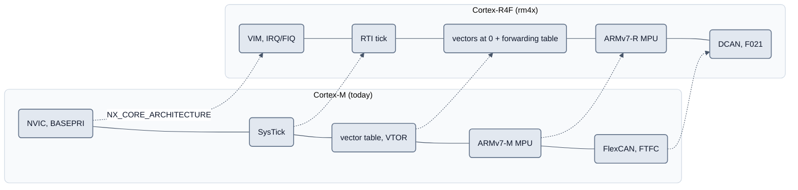

<!-- SPDX-License-Identifier: Apache-2.0 -->

# RM46 / rm4x: Audit der Cortex-M-Annahmen (Kurzseite)

Status: **planned (after R1)**. Die Familie `rm4x` (TI Hercules RM4x, Cortex-R4F, Little Endian, Nachweisziel
LAUNCHXL2-RM46) ist kein Teil von R1. Der Audit (ARCH-19, 2026-09-16) mit Fundstellenliste, Messbelegen und
Review-Fragen steht in der Git-Historie dieser Datei (Commit vor DOC-75). Seine Entscheidungen sind verbindlich in
[`README.md`](README.md): **D11** Kernprofile, **D12** Bootloader ohne VTOR, **D13** Familienname, **D14**
Quellenverfahren (Abschnitt 10), dazu die Plattformregel (Abschnitt 6).

## Bild

## Legende

- **Die Grundannahmen halten:** ILP32, Little Endian, AAPCS mit VFP; Bootloader-Kern und hardwareunabhängige Module
  übersetzen für `-mcpu=cortex-r4f` ohne Meldung; die Toolchain (`arm-none-eabi-gcc`) genügt.
- **Neutral zu machen** war: das Kernmodell in `nxconfig` (NVIC/BASEPRI), die Architekturerkennung (nie über
  `__ARM_ARCH`, es ist 7 für R und M), die Auswahl des FreeRTOS-Ports, Bootloader/Updater/`canflash` (Image-Anfang
  ist beim R4F kein Cortex-M-Vektor), `FreeRtosAdcLock.h` und das Dump-Layout.
- **Unterschiede des RM46:** VIM statt NVIC, RTI statt SysTick, Modus-Stacks und Vektoren ab 0 statt VTOR,
  ARMv7-R-MPU, FreeRTOS-Port `ARM_CRx_No_GIC`, DCAN statt FlexCAN, F021-Flash-API, XDS110 statt J-Link.
- Die Quellen- und Lizenzprüfung steht auf [`rm4x-quellen.md`](rm4x-quellen.md).

Verweise: [Zielbild](README.md), [Plattformen](plattformen.md), [Bootloader](../../bootloader/doc/README.md).
