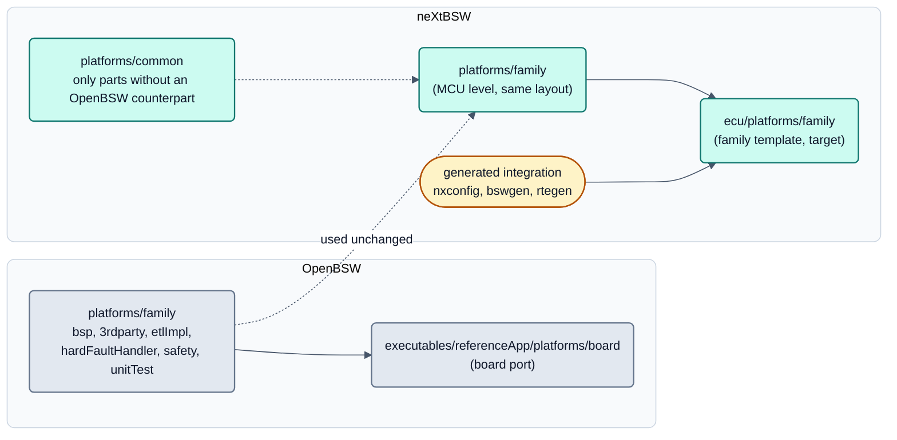

<!-- SPDX-License-Identifier: Apache-2.0 -->

# neXtBSW – closeness to OpenBSW: deviations for s32k1xx and the way back

Status: 2026-09-17, **ARCH-30**, Analyse ohne Codeänderung (Nachweis: mock/analysis). Am 2026-10-04 (DOC-75) auf
Struktur-Vergleich, Abweichungsklassen und Ergebnis gekürzt: das zeilenweise Abweichungsinventar (R, P, T, C, S, E, L),
die Momentaufnahme von OpenBSW `main` vom 2026-09-17, die Folgeaufgaben V1 bis V8, die Fragen F1 bis F8 und die
Review-Fragen stehen in der Versionshistorie dieser Datei (Commit vor DOC-75). Analysierter Stand: Repository
`c64fd78`, Submodul `external/openbsw` `00e3cab`.

Occasion: the user's wish of 2026-09-17 to **stay close to OpenBSW instead of moving away from it**. The result is the
platform rule in [`README.md`](README.md) section 6 (P1 to P6, decision D15), which also governs the new platform `rm4x`.

## 0. Notation

- `openbsw:<path>` = file in the submodule, `repo:<path>` = file in this repository.
- **Classification of a deviation:** **(a) back to OpenBSW** (neXtBSW version dropped), **(b) extension in OpenBSW
  style** (stays, at the place, with the name and interface OpenBSW would use), **(c) submit upstream** (bug fix or
  generally useful addition, PLAT-03), **(d) necessary and neXtBSW-specific** (generator, RTE, configuration levels,
  board neutrality, bootloader).

## 1. How OpenBSW is structured, and how neXtBSW cuts it

| Level | OpenBSW (`00e3cab`) | neXtBSW (`c64fd78`) |
|---|---|---|
| MCU drivers of a family | `openbsw:platforms/<family>/{3rdparty,bsp,etlImpl,hardFaultHandler,safety,unitTest}` | **used unchanged** via `repo:platforms/s32k1xx/CMakeLists.txt` (wrapper + three derivative workarounds); own modules alongside in `repo:platforms/s32k1xx/{bsp,hardFaultHandler,3rdparty,startup}` |
| Board port | `openbsw:executables/referenceApp/platforms/<board>/{Options.cmake,bspConfiguration,main,safety,freeRtosCoreConfiguration,threadXCoreConfiguration,ethConfiguration}` | **family template** `repo:platforms/s32k1xx/port/{bspConfiguration,main,safety,freeRtosCoreConfiguration}` (PLAT-23) + `repo:ecu/platforms/<board>/Options.cmake` |
| Application | `openbsw:executables/referenceApp` | `repo:ecu` (derived, milestone 1) |
| Neutral interfaces | `openbsw:libs/bsp/*`, `openbsw:libs/bsw/bsp` | additionally `repo:libs/bsp/{bspSpi,bspAdcAccess}` |
| Services, device drivers | `openbsw:libs/bsw/*` | additionally `repo:libs/bsw/*` (10 modules) |
| Across cores/profiles | **does not exist**: every platform brings its own RTOS port and fault handler (`freertos_cm4_sysTick` and `hardFaultHandler.s` exist in `s32k1xx` **and** `stm32`, each as a copy of its own; `stm32/hardFaultHandler` came with PR #417). CMSIS lives in `openbsw:libs/3rdparty/cmsis` | `repo:platforms/common/{cmake,3rdparty/cmsis,3rdparty/freertosPort,interruptPriority,cortex-m,cortex-r,test}` (PLAT-10, ARCH-24/25) |
| Entry point | `openbsw:CMakeLists.txt`, `OPENBSW_PLATFORM`, `BUILD_TARGET_PLATFORM` | `repo:CMakeLists.txt` with `NX_PROJECT` → nxconfig → `OPENBSW_PLATFORM = NX_FAMILY` |
| Unit tests | googletest, `openbsw:executables/unitTest`, `platforms/<family>/unitTest` | own host tests (C++ + Python runner, `tools/test`), no googletest |

The most important structural differences: the board port became a **family template** driven by generated output
(today `platforms/<family>/port`, target `ecu/platforms/<family>`, README section 8), and `platforms/common` is a level
OpenBSW does not have (rule P3/P4 in README section 6 limits it).

## 2. Inventory of the deviations, by area

Figures from file comparisons: `repo:platforms/s32k1xx/port` against `openbsw:executables/referenceApp/platforms/s32k148evb`:
21 files identical, 38 changed, 57 new; `repo:ecu` against `referenceApp`: 33 identical, 11 changed, 38 new. Overrides of
OpenBSW targets via CMake are few: `bspMcu` include directories, `etl_profile` before ETL, `bspCore` sources, `-include`
for `bspClock` and `bspInterruptsImpl`, an alias for the FreeRTOS port.

| Area | Deviation | Class |
|---|---|---|
| Root CMake | own top level: `NX_PROJECT` to `nxconfig` before `project()`, toolchain from the derivative, `OPENBSW_PLATFORM = NX_FAMILY` (fits an OpenBSW-layout `rm4x`), bswgen/rtegen/dbcgen at configure time | d / b |
| `bspMcu` include paths | `CMAKE_SOURCE_DIR` wrong when OpenBSW is not the root project (same bug in `platforms/stm32`); derivative-neutral `mcu.h` | c + b |
| S32K116 workarounds | `pllOff()` outside `PLL_AVAILABLE`, `NVIC_GetActive` on ARMv6-M, `cache.cpp` without LMEM | c, then a |
| Own MCU modules | `bspLpspi`, `bspHall`, ARMv6-M FreeRTOS port `freertos_cm0_sysTick` (kept per family, not in `common`), startup template | b |
| Hard fault handler | dump location from linker symbols (the fixed `0x2000EC00` is outside the S32K144 SRAM), SP check, FP frame, reader; `printf` before the jump destroys `EXC_RETURN` | c, location b |
| Safety (`safeMemory`, `safeSystem`, `safeIo`) | MPU region count from mcudb (`isGlobalEnabled() == 0x201`, `slot <= SMPU_ENTRYS` bugs), ADC reference limits as configuration, role pins instead of board LEDs | c, then a / d |
| CAN | several buses; `FlexCANDevice::getBusOffState()` applies the setter macro `FLEXCAN_ESR1_FLTCONF` to ESR1 (permanently bus-off) | c, then a; multi-bus d |
| `SystemTimer`, clock | frequencies from the clock plan, DWT division remainder kept (-166 ppm on the board), `configurPll()` enables peripheral clocks itself | c + d |
| Board configuration headers | generated under the OpenBSW names (`bsp/io/io/ioConfiguration.h`, `bsp/clock/boardClock.h`), so the OpenBSW drivers stay unchanged | d (positive) |
| Startup, linker | `.FlashConfig` at 0x400, memory from derivative and project, boot header for the bootloader | c (FlashConfig), d |
| `platforms/common` | architecture CMake, interrupt ranks, build tests, newlib stubs, port switch, `core_cm0plus.h` | d; see README P4 |
| `platforms/stm32` | derivative list `STM32_CHIP` replaced, CAN2 in `bspBxCan`, handler per platform | c + b |
| `ecu/` | copies of `referenceApp` (keep with a comparison, tool `tools/openbswsync`), own UDS/transport integration, RTE, ECU state | b / d |
| `libs/` | neutral contracts `bspSpi`, `bspAdcAccess` (offer upstream later, D9), device drivers with `module.yaml` (`bccMc33771` is NDA and never goes upstream) | b / d |
| Not taken over | ThreadX and Ethernet by default (kept open by build tests `buildtest-s32k148-threadx`, `buildtest-s32k148-ethernet`, PLAT-56/71), `isr_can.cpp`, `module.spec`, `BUILD.bazel` | b |

Not related to OpenBSW: `bootloader/` (D6), `tools/`, `mcudb/`, `boards/`, `projects/`, `swc/`.

## 3. Assessment of the moves to `platforms/common`

**Yardstick:** OpenBSW has no cross-family platform level. What several platforms need lives neutrally in `libs/`
(interfaces, CMSIS, FreeRTOS kernel) or is copied per platform (RTOS port, `hardFaultHandler`, `etlImpl`,
`safety/safeBspMcuWatchdog`). An OpenBSW platform is self-contained: `platforms/<family>` plus `libs` suffices.

| Move | Compatible? | Result |
|---|---|---|
| ARCH-24: interrupt ranks by profile under `platforms/common` | yes: no counterpart, bound to the generator | keep |
| ARCH-25: CMSIS paths by profile, platform hook `platforms/<family>/CMakeLists.txt` | yes: the hook corresponds to `OPENBSW_PLATFORM` | keep |
| ARCH-25: FreeRTOS port selection in `platforms/common/3rdparty/freertosPort` | partly: the switch may stay central; **the ports themselves stay per family** (`s32k1xx/3rdparty/freertos_cm0_sysTick`, `rm4x/3rdparty/freertos_crx`) | keep the switch, remove the forwarding in `s32k1xx` |
| ARCH-26: `FreeRtosAdcLock` without core registers | yes: contract in `libs/bsp` | keep |
| ARCH-27: hard fault handler to `platforms/common` | no: OpenBSW keeps it per platform | assembler handlers per family, only the architecture-neutral dump layout and reader neutral in `libs/bsw/faultDump` |

Do not turn back ARCH-24/25/26; `platforms/common` stays for neXtBSW's own parts without an OpenBSW counterpart;
everything OpenBSW places per platform stays per family. The binding wording is README section 6 (P1 to P6).

## 4. State of OpenBSW `main` and consequences

On 2026-09-17 (20 commits since `00e3cab`, no release) none of the gaps neXtBSW fills was closed upstream (`mpu.h`,
`getBusOffState()`, `isr_sys.cpp` with `printf`, `SystemTimer::updateTicks`, `clockConfig.cpp`, `SafeSystem.cpp`,
`startUp.S` without `.FlashConfig`; no S32K144/S32K116, no LPSPI, no ADC contract). Upstream removed the platform
library; the submodule was updated to `3b6e702` and all own occurrences replaced (PLAT-52, clean-up PLAT-58). Contributions
need the Eclipse Contributor Agreement; the user submits them himself. Order of the planned contribution packages, by
benefit and effort: MPU regions, FLTCONF, hard fault (`printf`, fixed location), DWT remainder, `CMAKE_SOURCE_DIR`, SPLL/
`NVIC_GetActive`/LMEM, ADC reference limits, `.FlashConfig`, `core_cm0plus.h`, monitor context; later derivative-neutral
`mcu.h`, stm32 changes and the SPI/ADC contracts (D9). After acceptance upstream the workaround or copy is deleted (class a).
