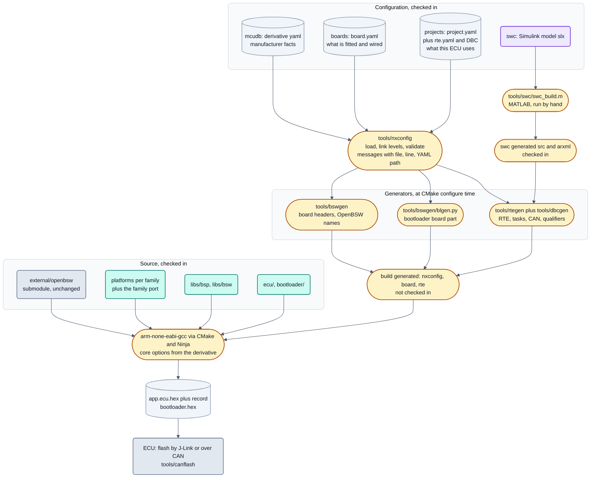

<!-- SPDX-License-Identifier: Apache-2.0 -->

# neXtBSW architecture overview

Status: 2026-09-17 (**DOC-07**). Written against the repository, not against intentions: every statement below names
the file it can be checked against, and where the code does not yet match the target picture this document says so.

**This is the reading version, not a second target picture.** The binding document is
[`doc/architecture/README.md`](README.md) — it holds the decision table D1–D15, the responsibility-per-value table and
the review questions that every change has to answer. This page explains the shape of the system to someone who has
to work with it; when the two disagree, the target picture wins and the difference is a finding, not a variant.

Companion pages: [`openbsw.md`](openbsw.md) (relationship to Eclipse OpenBSW) and [`autosar.md`](autosar.md) (what of
AUTOSAR is actually here). Analysis documents that stand behind this one:
[`openbsw-naehe.md`](openbsw-naehe.md), [`plattformen.md`](plattformen.md),
[`treiber-granularitaet.md`](treiber-granularitaet.md).

## 1. The one idea

A neXtBSW build has exactly one input the user picks: a **project**. Everything else — board, derivative, MCU family,
core, toolchain flags, clock tree, pin multiplexing, CAN bit timing, task list, memory layout — is read out of
configuration files and either derived or generated from them. `CMakeLists.txt:21-52` runs `tools/nxconfig` *before*
`project()`, because the toolchain itself depends on the answer.

That is the difference to the starting point. Eclipse OpenBSW is a working basic software with hand-integrated
reference boards; neXtBSW keeps its drivers and middleware and replaces the hand integration with a configuration
model plus generators. What that means in detail is in [`openbsw.md`](openbsw.md).

## 2. Layers

The layer model is defined in [`README.md`](README.md) section 3. Condensed, with the place in the repository:

| Layer | Content | Where |
|---|---|---|
| L5 application | software components, today Simulink models exported as AUTOSAR Classic SWC | `swc/<Swc>/`, `projects/
/swc/<Swc>/` |
| L4 RTE | generated: ports, runnables, tasks, data consistency, CAN signal qualifiers | `tools/rtegen` → `<build>/generated/rte` |
| L3 ECU services | CAN system, ECU state, diagnostics on CAN, console, safety supervisor | `libs/bsw/canSystem`, `libs/bsw/ecuState`, `ecu/uds`, `ecu/consoleCommands`, OpenBSW middleware |
| L2 device drivers | drivers for parts on the board, host-tested, no board names | `libs/bsw/<module>` (10 modules today) |
| L1 MCU abstraction | neutral contracts and their per-family implementation | `libs/bsp/<class>`, `platforms/<family>/bsp`, `external/openbsw/libs/bsp` |
| L0 hardware | derivative plus board | described, not coded: `mcudb/`, `boards/` |

Two rules carry most of the weight and are worth repeating here:

- **Dependencies only point downwards**, and **no layer knows a board**. Board knowledge lives in configuration data
  and in the code generated from it.
- Services ask for **roles** (`can_phy`, `power_supply`, `watchdog_trigger`, `early_init`), not for part names. Which
  part fills a role is a board statement. See the manifests `libs/bsw/*/module.yaml`.

Not in the layer stack, on purpose: the **bootloader** (`bootloader/`) is plain C without OpenBSW, with its own HAL per
family, and it reads the same memory layout as the application (decision D6, `bootloader/doc/README.md`).

## 3. The three configuration levels

Every value is written down exactly once, at the level that owns it. The levels and the full
responsibility-per-value table are [`README.md`](README.md) section 4; this is the short version with the files.

| Level | File | Owns | Example |
|---|---|---|---|
| Derivative | `mcudb/<family>/<derivative>.yaml` plus `<derivative>_<package>.pinmux.yaml` | manufacturer facts, read-only | flash and RAM regions, sector sizes, peripheral instances, possible pin functions, ADC resolution, core and FPU, NVIC priority bits |
| Board | `boards/<board>/board.yaml` | what is fitted and wired on the PCB | derivative and package, crystal frequency, pin assignment, fitted parts and how they are connected, dividers, sensor circuits in front of ADC pins, debug probe |
| Project | `projects/<project>/project.yaml` plus `rte.yaml` and `*.dbc` | what this ECU software uses | which peripherals are used, system clock, PWM frequency and dead time, bit rates, CAN IDs, UDS addresses, tasks, components and connections, memory split |
| Workstation | not checked in | belongs to the PC | toolchain path (`NX_ARM_GCC_BIN`), CAN adapter, serial port, debugger serial number |

Derivatives present today: `mcudb/s32k1xx` (S32K116/142/144/146/148 with package pinmux tables), `mcudb/stm32`
(STM32F446RE, STM32G474RE), `mcudb/s32k3xx` (S32K344). Boards: `boards/{evalboard_s32k144, s32k116evb,
nucleo_f446re, buildtest_s32k148}`. Projects: `projects/{evalboard_s32k144_demo, evalboard_s32k144_charge,
s32k116evb_minimal, nucleo_f446re_demo, buildtest_s32k148_min}`.

**Fact and decision are separated even inside one value.** The peripheral clock is the pattern: which sources a clock
gate offers and how fast its output may run is a datasheet fact and lives in the derivative; *which* source is used is
a project decision. The derivative may name a `default` that applies until the project chooses. Without evidence for a
default there is none, and a used instance without a project choice is an error with file, line and YAML path — never
a guessed value ([`README.md`](README.md) section 4, ARCH-18).

Two projects on one board are the proof that the split works: `evalboard_s32k144_demo` drives FTM0 as the motor PWM
group, `evalboard_s32k144_charge` uses the same FTM0 for input capture, and the board profile is byte-identical for
both (`projects/README.md`, IO-04).

`tools/nxconfig` loads project → board → derivative, validates across the levels and reports every message with file,
line and YAML path (`tools/nxconfig/checks.py` for cross-level checks, `clock.py`, `memory.py`, `adc.py`, `sensor.py`,
`powerstage.py`, `timing.py`, `can.py`, `uart.py`, `diag.py` for the computed parts). The core carries no Qt, so the
command line, the generators and the Studio all use the same loader.

## 4. What a generator writes and what a human writes

Generated (into `<build>/generated/`, never checked in, never edited by hand):

| Generator | Produces | Into |
|---|---|---|
| `tools/nxconfig` (`cmake` command) | `NX_BOARD`, `NX_DERIVATIVE`, `NX_FAMILY`, `NX_CORE`, core options, tool paths | `generated/nxconfig/project.cmake` |
| `tools/bswgen` | the board headers under the names OpenBSW already includes: `bsp/io/io/ioConfiguration.h`, `bsp/io/input/inputConfiguration.h`, `bsp/io/output/outputConfiguration.h`, `bsp/clock/boardClock.h`, `bsp/clock/peripheralClocks.h`, `bsp/can/canBitTimingConfiguration.h`, `bsp/adc/analogSensorConfiguration.h`, `bsp/io/outputPwm/outputPwmConfiguration.h`, `interrupts/interruptPriorities.h`, `features/derivativeFeatures.h`, `mcu/mcuDerivative.h`, `startup/nxIrqVectors.inc` and about twenty more (list in `tools/bswgen/bswgen.py`, `files`) | `generated/board/` |
| `tools/bswgen/blgen.py` | memory layout and the bootloader's board part: `bootloader/bl_memory.h`, `bootloader/bl_memory.ld`, `memory/memoryLayout.h`, plus `bootloader/bl_board.h` and `bl_board.cmake` when `bootloader/` is configured | `generated/board/` |
| `tools/rtegen` | `Rte_Type.h`, `Rte_<Swc>.h`, `Rte.c`, `RteConfig.h/.cpp`, `RteTasks.h`, `Rte_Qlf.h/.m`, `tasks/async/Config.h`, `EcuStateConfig.h` | `generated/rte/` |
| `tools/dbcgen` | `CanDb.h/.c`: pack and unpack of the used CAN messages, called from rtegen | `generated/rte/` |

Generated and **checked in**, because the tool that makes it is not free: the C code and ARXML of a software
component, `swc/<Swc>/generated/{src,arxml}` from `tools/swc/swc_build.m` under MATLAB. A hash of the model
(`generated/model.sha256`) is compared at configure time, so a stale check-in is reported.

Hand-written today, although the target picture wants it generated:

- The **family port**, `platforms/s32k1xx/port/{main,bspConfiguration,safety,freeRtosCoreConfiguration}` — start-up,
  linker script template, `StaticBsp`, `BspSystem`, the systems, the ISR table. Since PLAT-23 it carries no board
  name and no derivative value, but it is still written rather than generated.
- The **module composition**, `platforms/s32k1xx/port/main/src/integration/Integration.cpp`. Its own header comment
  says it plainly: wiring and values come from configuration, the composition per module is still written by hand.
- The **board port**, `ecu/platforms/<board>/Options.cmake` — the feature switches. This is the only place left that
  carries a board name in code; it disappears when the switches move into the project (ARCH-04/05).

The generator that the target picture calls `intgen` (main, lifecycle order, ISR table, role wiring, task list;
[`README.md`](README.md) sections 4 and 5) **does not exist yet** — `tools/` has `nxconfig`, `bswgen` with `blgen`,
`rtegen`, `dbcgen`, and no `intgen` and no `a2lgen`. Likewise, `module.yaml` manifests exist for 11 modules
(`libs/bsp/bspAdcAccess`, `libs/bsw/{canPhyPassive,canSystem,ecuState,gdTmc6200,hallDecoder,highSideSwitch,
sbcUja113x}` and three under the family port), not yet for every module — `libs/bsw/e2e`, `libs/bsw/autosarBase`,
`libs/bsw/bccMc33771` and `libs/bsp/bspSpi` have none.

The governing principle stays: **what is generated is wiring, not logic.** Logic lives in modules with host tests.

## 5. From configuration to the ECU

The same picture as a sentence: configuration is the single source, `nxconfig` is the single reader, the generators
turn it into headers that carry the names OpenBSW already expects, and the build links that against unchanged OpenBSW
plus the neXtBSW libraries. Nothing downstream re-decides a value that was decided upstream.

## 6. Build sequence

`cmake --preset <project>` (presets in `CMakePresets.json`; without one, `-DNX_PROJECT=projects/
`). In order,
from `CMakeLists.txt`:

1. **Before `project()`** — `tools/nxconfig cmake <project>` writes `generated/nxconfig/project.cmake`. Configuration
   errors abort here with `FATAL_ERROR` (line 43). The file sets `NX_FAMILY`, `NX_DERIVATIVE`, `NX_BOARD`, `NX_CORE`,
   `NX_CORE_ARCHITECTURE`, `NX_MCPU`, `NX_MFLOAT_ABI`, `NX_MFPU`, the debug probe and the flash tools.
2. **Platform of the family** (lines 102-110): if `platforms/<family>/CMakeLists.txt` exists it is used, otherwise
   `external/openbsw/platforms/<family>`. `OPENBSW_PLATFORM` is set to `NX_FAMILY` (line 118).
3. **Family port** must exist at `platforms/<family>/port/CMakeLists.txt`, else abort (lines 112-117).
4. **Board options**: `include(${ECU_PLATFORM_DIR}/Options.cmake)` — the feature switches, and a consistency check
   that the board port does not claim another family (lines 120-124).
5. `project()` with the toolchain file `cmake/toolchains/NxArmNoneEabi-gcc.cmake`, one file for all cores.
6. **Generators at configure time**, so every OpenBSW library finds the headers before the first compile:
   `bswgen` → `generated/board` (line 152), then `rtegen` (which calls `dbcgen`) → `generated/rte` (line 185).
   `blgen` runs when `bootloader/` is configured.
7. **Subdirectories**: family platform, OpenBSW `libs`, the FreeRTOS port chosen by architecture
   (`platforms/common/3rdparty/freertosPort`), the neXtBSW modules the project selected, `ecu`, `ecu/uds`,
   `bootloader`.

Build with `cmake --build --preset <project>`; the target build is warning-free with `-Werror`. Host tests and target
builds together: `.venv/Scripts/python tools/test --group all` (list in `tools/test/tests.yaml`).

## 7. Start-up sequence on the device

After reset the bootloader runs first (`bootloader/src/core/bl_main.c`): it checks the validity record, the CRC over
the whole image and the plausibility of the application entry, waits 200 ms for a `10 02` request, and otherwise jumps
into the application. The parameter of the jump is the **application entry**, not a vector table — what stands there
is a family decision (`bootloader/doc/README.md`, BL-08; Cortex-M sets VTOR, Cortex-R has no VTOR and uses a fixed
forwarding table, decision D12).

In the application, `platforms/s32k1xx/port/main/src/main.cpp`:

1. `integration::earlyInit()` — the `early_init` role of the project's modules (for example the SBC reset counter
   compensation).
2. `safety::MemoryProtection::init()`, then the safety shell: supervisor into limp home, MCU watchdog fast test
   (deliberately causes two resets), watchdog enabled.
3. `integration::preBspInit()`, then `platform::staticBsp.init()`.
4. `hardfault::reportAndClearDump()` — reports a hard fault from before the last reset, once (PLAT-20).
5. `app_main()` (`ecu/application/src/main.cpp`) → `app::run()` (`ecu/application/src/app/app.cpp`): console UART up,
   then FreeRTOS starts and `startApp()` runs.

`startApp()` fills the lifecycle manager and transitions through the levels
(`ecu/application/src/app/app.cpp:176-215`):

| Level | Components |
|---|---|
| 1 | platform modules (`platformLifecycleAdd`), `runtime`, `safety`, `ecu` state management |
| 2 | platform modules of level 2 (CAN) |
| 3 | `uds` — diagnostics on CAN, in the CAN task, only with `PLATFORM_SUPPORT_UDS` |
| 8 | `sysadmin` |
| 9 | `rte` — runnables in the application tasks |

Nine levels total (`MaxNumLevels = 9`). The RTE is deliberately last: application code starts only after the basic
software is up.

## 8. Where today differs from the target picture

The full list of 31 board couplings with target location and task ID is [`README.md`](README.md) section 9. What shapes
the repository right now: the composition in the family port is hand-written (values inside it are generated; ARCH-05,
ARCH-52); the family port still sits at `platforms/s32k1xx/port` instead of `ecu/platforms/<family>` (rule P5, PLAT-54);
`platforms/common` still holds items that rule P3 sends elsewhere, each with an entry in the P4 list; and not every
module has a manifest or a contract suite that each family implementation must pass. None of this is a variant of the
architecture; all of it is work in `doc/todo.yaml`.
