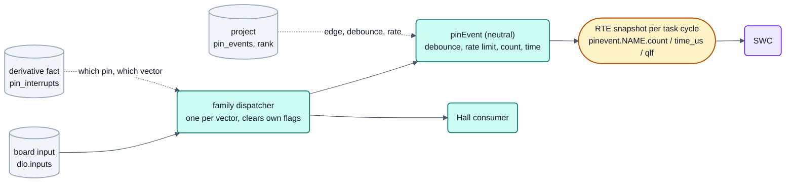

<!-- SPDX-License-Identifier: Apache-2.0 -->

# Pin interrupts (edge events on digital inputs)



Status: **variant A decided and implemented** (decision of the user 2026-09-29; IO-47 concept, IO-51 to IO-54);
am 2026-10-04 (DOC-75) gekürzt: Bestandsaufnahme, Varianten B und C im Detail und die Fragen F1 bis F4 stehen in der
Versionshistorie dieser Datei (Commit vor DOC-75). Finding of the Studio user test 2026-09-25: interrupts on pins (edge,
priority) could not be configured.
Reference: [architecture target picture](README.md) (sections 3–5, review questions in section 11),
[safety concept](../safety/concept.md) section 1.4, [coexistence](../safety/coexistence.md), [dependent
failures](../safety/dfa.md) DF-37.

## 1. Inventory: what exists today

### 1.1 Pins in the configuration

The board lists inputs in `dio.inputs[]` (name, pin, pad, active level, pull); the project says which are used
(`use.dio`) and may give a rank (`interrupts.ranks[]`, `source: dio`); the RTE offers `dio.in.<NAME>` sampled per task
cycle. The derivative knew nothing about which pins can raise an interrupt.

### 1.2 Existing users of pin interrupts

| User | How | Remark |
|---|---|---|
| Hall sensors (IO-07, `platforms/s32k1xx/bsp/bspHall`) | `PORT_PCR.IRQC` = either edge, NVIC level from the `dio` rank of the three signals | **update 2026-09-29 (IO-52/IO-54):** the vectors belong to the family dispatcher `platforms/s32k1xx/bsp/bspPinIrq` (IO-52), the Hall pins are one consumer of it; since IO-54 tools/bswgen generates the whole table (`bsp/pinIrq/pinIrqConfiguration.h`: Hall pins and pin events, vectors from the derivative fact `pin_interrupts`, one rank per vector), so a Hall sensor also builds on the S32K11x (vector `PORT`) |
| Pin events (IO-53/IO-54, `libs/bsp/bspPinEvent`) | project `pin_events`; edge of the detector: both while debouncing, else the physical edge of the logical one | second consumer of the dispatcher through the s32k1xx adapter `bios::PinEventAdapter`; the port starts every consumer once (`bsp::startPinInterrupts()`), the RTE cycles the events in one task and offers `pinevent.<NAME>.count/.time_us/.qlf`; console `pinevent` |
| SBC INTN (`sbcUja113x`) | **polled** every 10 ms over SPI, deliberately no ISR | the INTN pins are ordinary `dio` inputs |
| Wake-up | through the supply (SBC local wake inputs `LOCAL0..7`, CAN wake), exposed as `ecu.wakeup[.<source>]` | the MCU itself has no low-power mode in use; with the SBC in sleep the MCU is unpowered |
| Input capture (IO-03) | timer channel, polled by a task | not a pin interrupt |

All four device drivers of the safety concept poll their FAULT/INT lines (concept section 13, "Polling, not
interrupts").

### 1.3 Interrupt priorities

Priorities are **ranks** in the project (`interrupts.ranks`): NVIC level = `max_syscall_level` + rank, VIM: the ranks
order the free channels. Levels above `max_syscall_level` stay reserved for interrupts that never call the RTOS (halt
deadman SM-06). `tools/elfcheck` compares the programmed levels with the ranks.

### 1.4 Vector topology differs per family

This is what makes "one flag per pin" insufficient:

| Family / derivative | Edge detection | Vectors | Consequence |
|---|---|---|---|
| s32k1xx S32K14x | `PORT_PCR.IRQC` per pin (rising, falling, either, level; DMA variants) | one vector **per port** (A–E) | all event pins of one port share one priority level |
| s32k1xx S32K11x | as above | **one vector for all ports** | all pin events of the MCU share one level |
| s32k3xx | SIUL2 external interrupt lines `EIRQn`, reachable only from certain pins (already in the pinmux table as signal `EIRQn`) | lines grouped onto a few vectors | not every pin can raise an interrupt; the pin mux decides |
| stm32 | EXTI line *n* serves pin *n* of **one** port (selected in SYSCFG) | lines 0–4 own vectors, 5–9 and 10–15 shared | `PA3` and `PB3` cannot both be event inputs |
| rm4x (RM46) | GIO: only ports GIOA/GIOB, every pin of them | two VIM requests (high/low line), chosen per pin | only 16 pins (fewer bonded on LQFP144) can raise an interrupt |

S32K1 additionally has a digital glitch filter per port (one filter width for all enabled pins of that port); other
families have different or no filters.

## 2. Which level owns which value

The user test asked for "edge and priority on a pin". Split according to section 4 of the target picture, fact and
decision separated:

| Value | Level | Reason |
|---|---|---|
| Which pin can raise an interrupt, which line/vector it belongs to, which pins share a vector or a line, filter capability | **Derivative** (new, `mcudb`) | manufacturer fact, the same on every board. Not the board: the board wizard would otherwise ask the user for a datasheet fact |
| The input itself: pin, active level, pull | Board (unchanged, `dio.inputs`) | property of the PCB |
| Optional: nature of the signal (mechanical contact that bounces, open-drain line) | Board (optional fact, proposal) | property of the circuit; allows a warning "contact input without debounce" |
| That the input raises events at all, edge, debounce time, maximum event rate, rank, wake-up source yes/no | **Project** | usage decision of the ECU software |

So the answer to "board or project" is: **the project configures pin interrupts**; the board stays as it is; the
capability comes from the derivative. The board wizard needs no new step (section 5).

Edges are proposed **relative to the active level of the board** (`activate`, `deactivate`, `both`), not as
physical rising/falling: the board already says whether the input is active low, and the project then does not
have to know it. This is open question F2.

Sketch (project, not a schema yet):

```yaml
pin_events:
  - input: DOOR_SW          # board dio.inputs[].name, must be in use.dio
    edge: activate          # activate | deactivate | both
    debounce_us: 2000       # 0 = none
    max_rate_hz: 200        # storm limit, required
    wakeup: false           # prepared for an MCU low-power mode, see 3.5
interrupts:
  ranks:
    - { source: dio, name: DOOR_SW, rank: 6 }
```

## 3. Driver interface and path into the application

### 3.1 Layering

```
 L5  SWC  reads pinevent.<NAME>.count / .time_us / .qlf        (variant A)
          or is activated by the event                         (variant B)
 L4  RTE  (generated) copies the snapshot per task cycle
 L3/L2    pinEvent (family neutral, host-tested): debounce, rate limit, counter, time stamp, qualifier
 L1       pin interrupt contract libs/bsp/<pinIrq>: arm(edge), disarm, callback per pin
          family implementation platforms/<family>/bsp: one dispatcher per vector,
          clears only the flags of its own pins, calls the registered consumer
          consumers: pinEvent, Hall (moved onto the dispatcher, IO-23), later BSW users
```

- **One dispatcher per vector** in the family (this is the IO-23 item "pin-interrupt dispatcher per port"). It owns
  `PORTx_IRQHandler` (or the EXTI/SIUL2/GIO vector), reads the flag register once, clears only the flags of pins that
  have a consumer, and calls the consumer with the pin and a time stamp. Hall and pin events are two consumers of
  the same dispatcher; the generator assigns each pin to exactly one consumer.
- **The consumer is chosen by the generator, not registered at run time.** A generated table (pin → consumer,
  edge code) keeps the wiring checkable (`elfcheck`, host tests) and avoids function pointers written at run time.
- **Edge codes stay in the family generator** (`IRQC` 9/10/11 on S32K1, `EXTI_RTSR/FTSR`, `GIOPOL` + both-edge
  emulation on rm4x). The contract only knows `activate/deactivate/both` after the inversion of the board.
- **No level-sensitive interrupts** for events: a stuck level would be an endless interrupt. Only edges.

### 3.2 Three ways into the application

| Way | What the SWC sees | Latency | Fits the RTE today? |
|---|---|---|---|
| **Signal**: counter, time stamp, level, qualifier | `pinevent.<NAME>.count` (uint32, wraps), `.time_us` (time of the last accepted edge), `.qlf` (QLF_* values of COM-03) as RTE inputs like `capture.*` and `hall.*` | one task cycle for the reaction; **no edge is lost** and the time stamp is exact | yes: a new input kind, like IO-03/IO-07 |
| **Activation**: the event starts a runnable | a runnable with an event instead of a period | interrupt + task switch | no: needs a new RTE event kind, a sporadic task with a minimum inter-arrival time, schedule analysis and deadline monitoring for it |
| **Callback** | nothing; only BSW modules get a function call in interrupt context | shortest | not meant for SWCs (interrupt context, no RTE consistency, no Simulink mapping) |

A callback into application code is **not** proposed at all: an SWC running in interrupt context would bypass
the task model, the RTE data consistency and every timing argument.

### 3.3 Run-time limits (interrupt storms)

A pin interrupt preempts every task, including the safety task. Without a limit, a bouncing contact, a broken wire
picking up noise, or a fault on the line can starve the system (DF-37, "interrupt storm").

Proposal for the pinEvent module (driver-level robustness, see 4.2):

- **Rate limit per pin**: at most `max_rate_hz` accepted edges over a sliding window (token bucket). On overflow
  the module **disarms the pin** (edge code 0), sets `.qlf = QLF_ERROR` and counts the overflow. Re-arming is
  open question F4 (automatic after a hold-off, or on request).
- **Debounce** in software as a lock-out: after an accepted edge further edges are counted as glitches for
  `debounce_us`, then the level is sampled once more to confirm it. Hardware filters (S32K1 port filter) are an
  optional family optimisation, not the contract, because their width is per port and other families lack them
  (open question F3).
- **ISR budget**: the dispatcher and the consumer have a bounded, short path (no loops over unused pins, no RTOS
  call except where the variant needs a task notification). The worst-case load is `max_rate_hz × ISR time` per
  pin and is reported by nxconfig as a load figure.

### 3.4 Priority

Pin interrupts use the existing rank mechanism (`source: dio`). The rank is per **input**, but the hardware level
is per **vector**: nxconfig checks that all event inputs (and Hall signals) sharing a vector have the same rank
and says which ones they are (as bswgen already does for Hall). Ranks are ≥ 0 and therefore always at or below
`max_syscall_level`: a pin event can never preempt the deadman or other levels reserved above the RTOS boundary.

### 3.5 Low power and wake-up

Today the ECU sleeps through the SBC, which switches the MCU supply off; a pin interrupt cannot wake an unpowered
MCU, so wake-up inputs are the SBC local inputs (`wakeup_local`, `ecu.wakeup.LOCALn`). An MCU low-power mode
(`IEcuPowerStateController`, S32K1 VLPS/STOP, noted as future in `ecuState.md`) would use pin interrupts as wake
sources. The concept therefore only **reserves** `wakeup: true` in the project entry: in stage 2 nxconfig rejects
it with a message until an MCU low-power implementation exists; later it adds a source `ecu.wakeup.<NAME>` in the
same way as `wakeup_local`, and the same rule applies as SYS-02: a wake-up input must be chosen explicitly
(default off), because an unterminated line wakes the ECU at random. Whether edge detection works in the chosen
stop mode of each family is a derivative fact to be confirmed from the reference manual at that time.

## 4. Safety

### 4.1 Temporal interference

- A pin interrupt is a new **interrupt source above every task**. Its effect on the safety task is bounded by the
  rate limit (3.3) and the ISR budget; the credited detection of a delay stays what it is today: SM-04 period check
  of the safety task, SM-06 halt deadman, SM-01 watchdog (DF-37). No new claim is made for application tasks —
  that remains F10/SYS-21 (activation of application tasks is not supervised).
- Variant B adds a **sporadic activation** of application tasks. This is exactly the unsupervised case of F10: the
  schedule analysis (`tools/schedana`) would need the minimum inter-arrival time, and SM-05 would need deadlines
  for event runnables. This is the main reason to postpone variant B (section 6).
- The dispatcher runs inside the `SafePreIsrHook`/`SafePostIsrHook` frame like the CAN, UART and Hall vectors; it
  is **not** a safety context: it may not write safety RAM (MPU, SM-10), and the static rule `safety-context` must
  not list its files.

### 4.2 Classification: driver mechanism, not a base-software safety mechanism

| Part | Classification | Reason |
|---|---|---|
| Rate limit, debounce, disarm on storm, qualifier | **driver robustness / quality measure (QM)**, not credited as a safety mechanism | it protects availability of the CPU; the credited detection of a stall remains SM-04/SM-06/SM-01. Crediting it would mix a driver-level measure into the stage-1 argument, which the strict separation (`abn-sys19`) forbids |
| Dispatcher, vector entries | part of the interrupt infrastructure (`S-INT`, coexistence class `B-SEP`) | it is a vector entry and shares the hook frame; so it is developed and reviewed like the other ISR entries |
| pinEvent module | QM module with a new coexistence row (timing: interrupt storm; argued with rate limit + SM-04, like CA-06/CA-14/CA-23) | new row in `coexistence.md` in stage 2 |
| Pin event used as input of a safety function by the integrator | integrator's responsibility (assumption of use) | the qualifier gives the SWC the information; the base software does not claim a detection for it |

No stage-1 mechanism depends on pin interrupts, and none is changed by this concept. If a later safety
mechanism needs a pin interrupt (e.g. a FAULT line of a gate driver as an interrupt instead of polling), it is a
stage-2 device-driver mechanism and gets its own analysis.

### 4.3 Checks in nxconfig (stage 2)

Errors with YAML path unless marked as warning:

1. The input exists on the board, is in `use.dio`, and has a rank (`interrupts.ranks`, `source: dio`).
2. The pin can raise an interrupt on this derivative (new derivative fact); on s32k3xx the `EIRQ` function is
   reachable at this pin.
3. Inputs that share a vector (S32K14x: port; S32K11x: all; STM32: EXTI 5–9/10–15) have the same rank; inputs that
   share a **line** (STM32 EXTI *n*) are mutually exclusive.
4. A pin has exactly one consumer: not both Hall signal and pin event; not a pin of `safety`, not a `safe_off`
   output (already covered by the pin claim check).
5. `max_rate_hz` is set and > 0; `debounce_us` < 1/`max_rate_hz`; warning when the sum of `max_rate_hz × ISR
   budget` over all pins exceeds a configurable share of CPU time (initial proposal 5 %).
6. Warning for a board input marked as mechanical contact without `debounce_us`.
7. `wakeup: true` is an error until an MCU low-power implementation exists (3.5).

Family-specific details (edge codes, filter register values) stay in the family generator as today.

## 5. Studio

| Where | What |
|---|---|
| Board wizard (`tools/studio/gui/newboard.py`, step "Digitaler Eingang") | **no new input**. Only a read-only hint per pin from the derivative fact: "interruptfähig (Vektor PORTC)" or "nicht interruptfähig", and a note when two inputs share an STM32 EXTI line |
| Project configuration (step `config`) | new card **"Pin-Ereignisse"**: table of used digital inputs with switch "Ereignis", edge (aktivieren / deaktivieren / beide), debounce, maximum rate, rank; messages of nxconfig in the row as elsewhere (live check) |
| Tasks & schedule (step `tasks`) | an overview of **all** interrupt ranks (CAN, UART, pin vectors) with the resulting NVIC level, grouped per vector, so the user sees that pins of one port share a level. Today no Studio page shows the ranks at all |
| Connections (step `connections`) | the new targets `pinevent.<NAME>.count/.time_us/.qlf` in the BSW input group |

## 6. Variants and decision

| Variant | What | Pro | Contra | Result |
|---|---|---|---|---|
| **A** pin events as RTE signals | the project enables events per input; a family dispatcher per vector feeds a family-neutral `pinEvent` module (debounce, rate limit); the RTE offers `pinevent.<NAME>.count`, `.time_us`, `.qlf` | no edge lost, exact time stamp, no new RTE event kind, task model and timing argument unchanged except for the bounded ISR; the dispatcher also serves Hall | the reaction waits for the next cycle of the reading task | **decided and implemented** (IO-51 to IO-54) |
| B: A plus runnable activation by the event | a runnable started by the event in a sporadic task with a minimum inter-arrival time | fast reaction without a fast periodic task | new RTE event kind and task type, schedule analysis and SM-05 deadlines for sporadic activation, enlarges the unsupervised activation gap F10 until SYS-21 | later, only after SYS-21 |
| C: BSW service only | dispatcher and a BSW-internal consumer interface; the application keeps reading `dio.in.<NAME>` | smallest change | does not answer the user-test finding | contained in A |

Decisions: edges are written **logically** relative to the board's active level (`activate`/`deactivate`/`both`),
debounce is a software lock-out with level confirmation (a hardware filter stays a later family optimisation), and a
tripped rate limit disarms the pin, sets `QLF_ERROR` and re-arms after a hold-off. The derivative fact (which pin can
raise an interrupt, vector and line sharing) is kept for all four families at once, so the configuration model is not
shaped by the S32K14x "one vector per port" case (review question 3).
