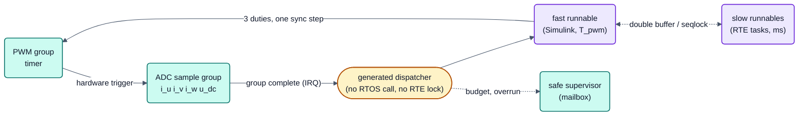
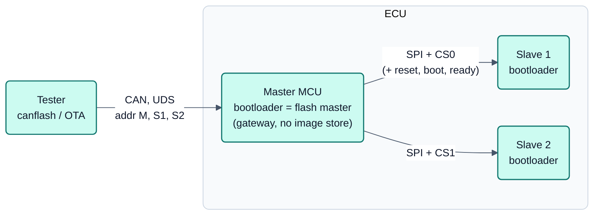

<!-- SPDX-License-Identifier: Apache-2.0 -->

# Geplant nach R1: Kurzfassungen

Status: **planned (after R1)**. Diese Themen sind kein Teil von R1. Die Seite fasst sie je auf einem Bild und einer
Legende zusammen. Die Volltexte der ersten beiden Themen (schnelle Regelschleife, Mehr-MCU-Steuergerät) liegen im
Entwicklungs-Repository und sind nicht veröffentlicht; auf Anfrage erhältlich. Für RM46 und STM32 gibt es eigene
Kurzseiten: [`non-cortex-m-audit.md`](non-cortex-m-audit.md), [`rm4x-quellen.md`](rm4x-quellen.md),
[`stm32-nucleo.md`](stm32-nucleo.md). Contributions an Eclipse OpenBSW: siehe unten.

## Schnelle Regelschleife

Zielbild für Stromregelung im PWM-Takt (FOC, DC/DC, Lader); es gibt weder Schema noch Generatorcode für die Schleife
selbst (ARCH-65, Entscheidungen F1–F8 vom 2026-09-29, Entwicklungszweig `dev-motor`).

- Der RTE kennt nur Timing-Events in ganzen Millisekunden. Die schnelle Schleife ist ein zweiter, **generierter
  Ausführungspfad**: ein Runnable, das direkt aus dem Interrupt "Messgruppe vollständig" einer Hardware-Triggerkette
  PWM → ADC läuft.
- Das Ereignis liefert ein L1-Vertrag (`bspSampleGroup`, je Familie umgesetzt; beschrieben im Modul
  [`bspSampleGroup`](../../libs/bsp/bspSampleGroup/doc/bspSampleGroup.md)); `rtegen` kennt nur Vertrag und
  Schleifenname, nie ein Register.
- Das Simulink-Modell bleibt eine mit `autosar.tlc` gebaute AUTOSAR-Komponente; Sub-Millisekunden-Perioden gibt es nur
  für Runnables einer schnellen Schleife. Zwischen schnell und langsam sorgt eine generierte, sperrfreie Übergabe für
  Konsistenz.
- Laufzeit und Überlauf werden je Zyklus am PWM-Timer gemessen und als Ereignis an den Safe-Supervisor gemeldet; die
  Schleife läuft über CAN, UART und allen Tasks, unter dem Halt-Deadman.

Verweise: [Zielbild](README.md), [Pin-Interrupts](pin-interrupts.md), [Safety-Konzept](../safety/concept.md).

## Mehrere MCUs in einem Steuergerät und Flash-Master

Ein Steuergerät mit mehr als einer MCU: Eine MCU wird über CAN programmiert, die übrigen programmiert sie über SPI
(ARCH-47; Umsetzung BL-14 bis BL-18, ARCH-48, TOOL-35).

> Ein Steuergerät mit mehreren MCUs sieht für den Tester aus wie mehrere Steuergeräte an einem Bus. Der Master
> ergänzt eine Route, kein Protokoll.

| Schlüssel | Entscheidung (Nutzer, 2026-09-19) |
|---|---|
| `fm-slave-bootloader` | Der Slave läuft mit dem neXtBSW-Bootloader, Transport ist SPI; kein ROM-Bootloader des Herstellers. |
| `fm-adressierung` | Der Tester erreicht jeden Slave durch Weiterleitung, jede MCU hat eine **eigene Diagnoseadresse**; der Master ist Gateway und speichert kein Image. |
| `fm-master-ort` | Die Weiterleitung liegt im **Bootloader des Masters**; Slaves bleiben aktualisierbar, wenn die Master-Applikation defekt ist. |
| `fm-slave-einstieg` | Einstieg des Slaves in den Bootloader: Reset und Boot-Leitung, nur Reset mit Bootfenster oder Kommando über SPI; alle drei müssen beschreibbar sein. |
| `fm-testaufbau` | Boardnachweis später mit Eval-Board S32K144 als Master und Nucleo F446RE als Slave. |

Ein Projekt ohne Slaves erzeugt unverändert das, was es heute erzeugt. Heute vorhanden: der Link-Kern
[`mcuLink`](../../libs/bsw/mcuLink/doc/mcuLink.md).

## RM46 / rm4x und STM32 / Nucleo

Siehe die Kurzseiten [`non-cortex-m-audit.md`](non-cortex-m-audit.md) (Audit der Cortex-M-Annahmen),
[`rm4x-quellen.md`](rm4x-quellen.md) (Quellen- und Lizenzprüfung) und [`stm32-nucleo.md`](stm32-nucleo.md); die
Plattformübersicht steht in [`plattformen.md`](plattformen.md).

## Beiträge an Eclipse OpenBSW

Die Beiträge (Issue-Texte, Patches, Tests, Einreichungsanleitung je Paket) sind vorbereitet, aber noch nicht
eingereicht; Einreichen ist Sache des Nutzers (Eclipse Contributor Agreement). Status: **planned (after R1)**.
Übersicht und Paketliste: [`openbsw.md`](openbsw.md) Abschnitt 7 und [`../openbsw-beitraege/README.md`](../openbsw-beitraege/README.md).
