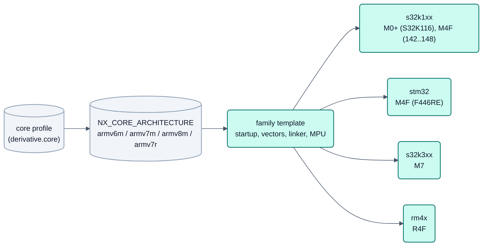

<!-- SPDX-License-Identifier: Apache-2.0 -->

# Plattformen: Matrix der Familien (S32K1, S32K116, STM32, S32K3, rm4x)

Status: Machbarkeitsanalyse ARCH-10 (2026-09-15), am 2026-10-04 (DOC-75) auf die gültigen Ergebnisse gekürzt. Die
Einzelbefunde (Fundstellenlisten je Stelle mit M4F-Annahme, Belege aus dem Referenzhandbuch, Folgeaufgaben,
Review-Fragen) stehen in der Versionshistorie dieser Datei (Commit vor DOC-75). Verbindlich bleibt
[`README.md`](README.md) (Abschnitte 6 und 10, Plattformregel P1–P6). Quellenregel für Derivatdaten:
[`../guide/new-derivative.md`](../guide/new-derivative.md), "The rule on sources".

## 1. Matrix

| Familie | Derivate / Board | Kern | Stand | Seite |
|---|---|---|---|---|
| s32k1xx | S32K142/144/146/148, Eval-Board S32K144 | Cortex-M4F | Fokus, in Betrieb auf Hardware | [README](README.md) Abschnitt 6 |
| s32k1xx | S32K116 (S32K116EVB, Profil `boards/s32k116evb`) | Cortex-M0+ (ARMv6-M, keine FPU) | Build und Host-Tests, mageres Projekt; kein Boardnachweis | Abschnitt 2 |
| stm32 | STM32F446RE (Nucleo F446RE) | Cortex-M4F | planned (after R1) | [stm32-nucleo.md](stm32-nucleo.md) |
| s32k3xx | S32K344 (nur bewertet, kein Board) | Cortex-M7 | planned (after R1) | Abschnitt 4 |
| rm4x | RM46L852 (LAUNCHXL2-RM46) | Cortex-R4F | planned (after R1) | [non-cortex-m-audit.md](non-cortex-m-audit.md), [rm4x-quellen.md](rm4x-quellen.md) |

## 2. S32K116 (Cortex-M0+)

Unterschiede zur S32K144; alle Werte stehen mit Beleg in `mcudb/s32k1xx/S32K116.yaml`. Die früheren Stellen mit
M4F-Annahme (Toolchain, FreeRTOS-Port, Interruptsperre, NVIC-Prioritätsbits, CMSIS-Header, Cache, Hard-Fault-Handler,
Startup, MPU, Takt, Watchdog-Test, Bootloader-HAL) sind über Familienvorlagen nach `NX_CORE_ARCHITECTURE` gelöst
(PLAT-09 bis PLAT-12, PLAT-21, PLAT-32).

| Eigenschaft | S32K116 | S32K144 |
|---|---|---|
| Kern | Cortex-M0+ (ARMv6-M), keine FPU | Cortex-M4F |
| NVIC-Prioritätsbits | 2 (der NXP-Header sagt fälschlich 4; die Anpassungsschicht korrigiert) | 4 |
| Interrupts | 32 externe; `CAN0_ORed_0_31_MB_IRQn`, `WDOG_IRQn` | `CAN0_ORed_0_15_MB_IRQn`/`_16_31_`, `WDOG_EWM_IRQn` |
| P-Flash | 128 KB, Sektor 2 KB | 512 KB, 4 KB |
| D-Flash / FlexRAM | 32 KB / 2 KB | 64 KB / 4 KB |
| SRAM | 1 KB SRAM_L + 14 KB SRAM_U | 32 KB + 28 KB |
| Takt | kein SPLL, FIRC 48 MHz | SPLL vorhanden |
| Instanzen | ADC0, FTM0/1, **LPSPI0**, LPUART0/1, FlexCAN0 (CAN FD), LPI2C0, FlexIO, MPU mit 8 Regionen | ADC0/1, FTM0–3, LPSPI0–2, FlexCAN0–2, LMEM-Cache |

Speicherbudget (größtes Risiko): Das Abbild des Eval-Boards (Text ca. 121 KB, bss ca. 37 KB) passt weder in 128 KB
Flash noch in rund 15 KB nutzbares RAM; allein der OpenBSW-Logpuffer belegt 8 KB. Ein S32K116-Projekt braucht ein
mageres Funktionsprofil (ohne Konsole/Logger oder mit kleinem Puffer, ein bis zwei Tasks, kleine Stacks, kleine
UDS-Puffer). Das ist Projektkonfiguration (README Abschnitt 4).

## 3. Toolchain per core and interrupt controller

| Core (`derivative.core`) | `-mcpu` | `-mfloat-abi` | `-mfpu` | Architecture (`.arch` in the start-up) | FreeRTOS port |
|---|---|---|---|---|---|
| `cortex-m0plus` (S32K116/118) | `cortex-m0plus` | `soft` | – | `armv6-m` | `GCC/ARM_CM0` + `setupApplicationsIsr` |
| `cortex-m4f` (S32K14x, STM32F4, today) | `cortex-m4` | `hard` | `fpv4-sp-d16` | `armv7e-m` (today `armv7-m`) | OpenBSW `freertos_cm4_sysTick` |
| `cortex-m7f` (S32K3, proposal) | `cortex-m7` | `hard` | `fpv5-sp-d16` or `fpv5-d16` (depending on the derivative's FPU, assumption) | `armv7e-m` | `GCC/ARM_CM7` or `ARM_CM4F` |
| `cortex-m33` (test profile only, `repo:tools/nxconfig/test_build_integration.py:67`) | `cortex-m33` | `hard` | `fpv5-sp-d16` | `armv8-m.main` | `GCC/ARM_CM33_NTZ` |
| `cortex-r4f` (family `rm4x`, proof target RM46L852; today only test profile `TESTR4F`, ARCH-23) | `cortex-r4f` | `hard` | `vfpv3-d16` | `armv7-r` (start-up in ARM state, `.arm`) | none yet – candidate `GCC/ARM_CRx_No_GIC`, source open until PLAT-44 (D14) |

**Core table in `nxconfig` (status ARCH-23).** The table above is `CORES` in `repo:tools/nxconfig/config.py`; per core
`-mcpu`, FPU variants (`derivative.fpu` → `-mfpu`), architecture (`NX_CORE_ARCHITECTURE`: `armv6m`, `armv7m`,
`armv8m`, `armv7r`) and **interrupt controller**:

| Controller | Cores | Derivative (mcudb) | Project `interrupts` | Mapping, RTOS boundary |
|---|---|---|---|---|
| `nvic` | Cortex-M0+/M4F/M7F/M33 | `derivative.nvic_priority_bits` (limits per core: ARMv6-M 2, otherwise 3..8) | `ranks`, optional `max_syscall_level` | level = `max_syscall_level` + rank (`checks.InterruptPriorities`); ARMv6-M without BASEPRI → level 0 |
| `vim` | Cortex-R4F | `vim.channels`, `vim.fixed[]` (channel, request, `irq`/`fiq`), `source` | only `ranks`; `max_syscall_level` is an error | the ranks order the non-fixed channels from the lowest number (same rank: YAML order, `checks.VimChannelOrder`); every rank source is an IRQ and may call the RTOS, FIQ never |

- The NVIC fields (`nvic_priority_bits`, `max_syscall_default`) only exist for `nvic` cores; `Core` checks this when it
  is created. `nvic_priority_bits` on a VIM derivative and `vim` on an NVIC derivative are errors with the YAML path.
- **Evidence:** architecture ARMv7-R, FPU VFPv3-D16 (double precision) and "Cortex-R4 without its own interrupt
  controller, locking via CPSR I/F" are general ARM facts [ARM, audit ARCH-19 section 0]; the VIM principle (priority =
  channel number, channels IRQ or FIQ) is TI Hercules knowledge [TRM, audit 4.1]. **The channel count and fixed
  channels of a real derivative are not yet anywhere in the repository** – the values in `TESTR4F` (48 channels, 0/1
  fixed) are synthetic. RM46L852 follows with evidence in PLAT-36 (sources/licence PLAT-44).
- The controller is attached to the core entry because all Cortex-R4F derivatives of the target picture (rm4x, D13)
  have the VIM. A Cortex-R derivative with a different controller (e.g. GIC) gets a core entry of its own, or the choice
  moves into the derivative – decision only with the second such derivative.
- How many channels an instance needs (e.g. two requests per DCAN) and how the requests are remapped onto their
  channels via `CHANCTRL` is only known to the family generator (ARCH-24/PLAT-37). `nxconfig` only checks the lower
  limit "one channel per rank entry".
- Platform code without an `armv7r` variant aborts loudly (FreeRTOS port, hard fault handler, updater cycle counter),
  checked with the test profile in `repo:tools/nxconfig/test_build_integration.py` (`ArmV7rStopsLoudlyTest`).

## 4. S32K3 (Cortex-M7), nur bewertet

Keine Plattform in OpenBSW, kein Board; Annahmen aus Herstellerunterlagen, nicht im Repository belegt. Status
**planned (after R1)**.

| Baustein | Bedarf |
|---|---|
| Kern | Cortex-M7 mit FPU, Toolchain `cortex-m7`, FreeRTOS-Port `GCC/ARM_CM7`, CMSIS `core_cm7.h` |
| Caches | I/D-Cache einschalten, nicht cachebare Bereiche für DMA/CAN/ENET-Puffer |
| MPU | ARMv7-M-MPU des Kerns (nicht die NXP-MPU der S32K1) |
| Boot | Image Vector Table statt FCF bei 0x400; Familien-HAL im Bootloader |
| HSE | zunächst nur "HSE nicht installiert" unterstützen; Secure Boot später |
| Flash, CAN, Takt, Pins | C40-Flashtreiber, FlexCAN (weitgehend kompatibel), eigenes Taktsystem (MC_CGM/MC_ME) und SIUL2-Pinmux |

Treiberquelle: eigene schlanke Registertreiber im OpenBSW-Stil; die NXP-RTD (oder die BSD-3-Kopie in Zephyr
`hal_nxp/s32`) nur als Referenz und Headerquelle, weil RTD die Konfiguration an EB tresos/S32 Config Tools binden würde
(D5) und die Lizenz je Paket zu prüfen ist.
