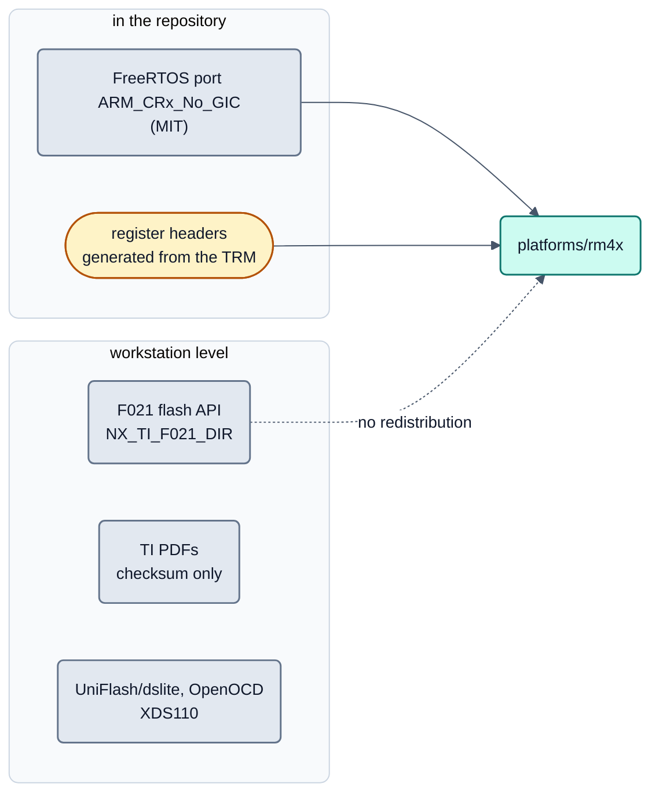

<!-- SPDX-License-Identifier: Apache-2.0 -->

# rm4x: Quellen- und Lizenzprüfung (Kurzseite)

Status: **planned (after R1)**. Die Familie `rm4x` (TI RM46L852, Cortex-R4F) ist kein Teil von R1. Die Prüfung
(PLAT-44, 2026-09-17, Grundlage der Entscheidung D14) steht mit allen Einzelbefunden und Quellen in der Git-Historie
dieser Datei (Commit vor DOC-75). **Keine Rechtsberatung:** bewertet ist, was die Lizenztexte und offiziellen Seiten
wörtlich sagen. Herkunft der Familie und Kernprofile: [`non-cortex-m-audit.md`](non-cortex-m-audit.md),
[`README.md`](README.md) (D11 bis D14, Plattformregel in Abschnitt 6).

## Bild

## Legende

| Quelle | Lizenz | ins Repository? | Empfehlung |
|---|---|---|---|
| HALCoGen (Werkzeug) | TI-Lizenz im Installer, Text nicht geprüft | nein | nur Werkzeug am Arbeitsplatz zum Nachschlagen |
| HALCoGen-Ausgabe (`reg_*.h`, `sys_core.S`, ...) | BSD-3-Clause im Dateikopf | erlaubt | nur als Referenz; Registerheader selbst aus dem TRM erzeugen |
| F021 Flash API (Binärbibliothek) | eigene Lizenz, Text nicht öffentlich | unklar, vorerst nein | Arbeitsplatz-Abhängigkeit `NX_TI_F021_DIR`; Linken mit GCC machbar, ABI-Risiko niedrig |
| FreeRTOS `portable/GCC/ARM_CRx_No_GIC` (V10.6.2, V11.2.0+) | MIT | erlaubt | verwenden; V11.2.0+ technisch besser, Mischung mit dem OpenBSW-Kernel prüfen |
| FreeRTOS-Demo für RM46, ältere Cortex-R4-Ports | MIT, TI BSD-3 | nicht nötig | Demo nur als Referenz, CCS-Ports verwerfen |
| TI-Dokumente (TRM, Datenblatt, F021-Guide, LaunchPad-Guide) | TI-Hinweis, Vervielfältigung eingeschränkt | unklar | nur Verweis und Prüfsumme im Repository |
| Registerheader selbst aus dem TRM erzeugen | eigene Arbeit | erlaubt | empfohlen (kein SVD für Hercules vorhanden) |
| UniFlash/`dslite`, OpenOCD + XDS110 | frei verfügbar, GPL-2.0-or-later | nein (Werkzeuge) | Arbeitsplatz-Werkzeuge; OpenOCD hat keinen F021-Flashtreiber, Flashen über UniFlash oder den eigenen Bootloader |

Fazit: Rechtlich unkritisch und ins Repository übernehmbar sind nur FreeRTOS (MIT) und selbst erzeugte Registerheader.
Die F021-Bibliothek bleibt wie das S32K116-SVD auf Arbeitsplatzebene, bis der Nutzer den Lizenztext im Installer
gelesen hat.
