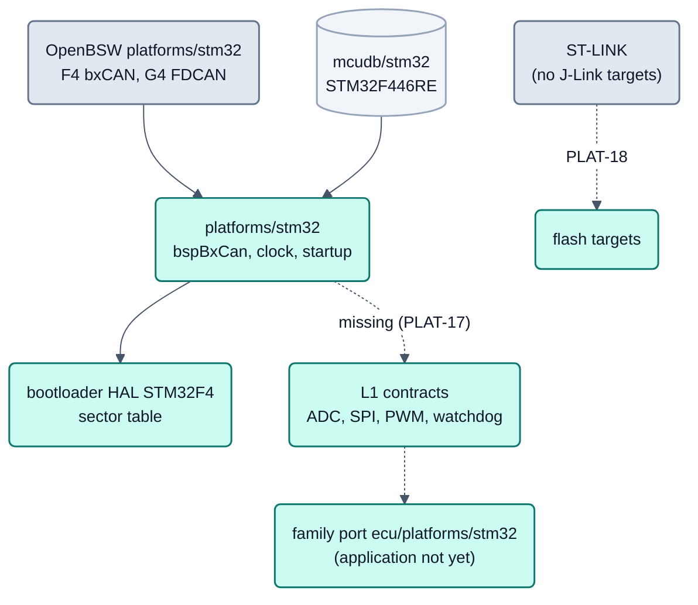

<!-- SPDX-License-Identifier: Apache-2.0 -->

# STM32 und Nucleo (Kurzseite)

Status: **planned (after R1)**. Die Familie `stm32` (Nucleo F446RE, STM32F446RE, Cortex-M4F) ist kein Teil von R1.
Vorhanden sind Plattform (`platforms/stm32`), Derivat `mcudb/stm32/STM32F446RE.yaml`, bxCAN für CAN1 und CAN2,
Bootloader-HAL und Build-Test (Nachweis: Mock/Host; am Board bestätigt: ST-LINK-Flash, Takt 96 MHz, LED, Taster, VCP, PLAT-15 Teil 1). Die Machbarkeitsanalyse (ARCH-10, ARCH-14/16) mit
Unterschieden zum OpenBSW-Referenzboard F413ZH, Bootloader-Sektortabelle, Debugger- und Lizenzfragen steht in der
Git-Historie von [`plattformen.md`](plattformen.md) (Commit vor DOC-75).

## Bild

## Legende

- **Vorhanden:** Taktmodell (HSE/PLL/APB, APB1-Grenze der F446 geprüft), Systemzeit, Startup mit Vektortabelle aus
  der IRQ-Liste des Derivats, Hard-Fault-Dump im SRAM, Bootloader-Boardteil aus dem Projekt, Plattform-Build-Test.
- **Offen:** L1-Verträge ADC, SPI, PWM, Watchdog und Flash/EEPROM (PLAT-17), damit die Applikation; Aufteilung mit
  ungleichen Sektoren in `tools/nxconfig/memory.py`; Flash-Ziele für ST-LINK (PLAT-18); Inbetriebnahme auf Hardware
  (PLAT-15).
- **F446RE-Fakten:** 512 KB Flash ab 0x08000000 mit Sektoren 4x16 KB, 1x64 KB, 3x128 KB; 128 KB SRAM; 96 MHz aus PLL,
  APB1 mit 24 MHz wegen der 45-MHz-Grenze; CAN1 PA11/PA12 oder PB8/PB9, CAN2 PB5/PB6 oder PB12/PB13 (AF9).
- **Quellen:** CMSIS-Device-Header `stm32f446xx.h` (Apache-2.0, `cmsis_device_f4` v2.6.11) liegt mit Lizenz und
  Herkunft unter `platforms/stm32/bsp/bspMcu/include/3rdparty/st`; Treiber schreiben Register direkt (kein HAL/LL).

Verweise: [Plattformen](plattformen.md), [Zielbild](README.md) (Abschnitt 6), [Bootloader](../../bootloader/doc/README.md),
[Neues Derivat](../guide/new-derivative.md).
