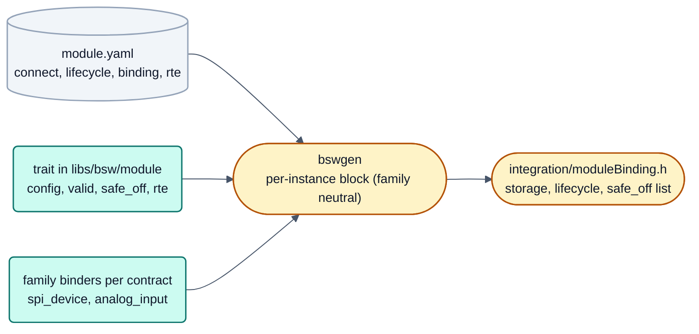

# neXtBSW – binding device drivers to the system: analysis of the hand-written integration

Status: 2026-09-21, ARCH-52 step 1 (analysis); am 2026-10-04 (DOC-75) auf Messergebnis, Variantenvergleich und
Entscheidung gekürzt. Die Zeilenmessung je Treiber, die Manifest-Sprache als Entwurf, der Abschnitt zur Sperre im
sicheren Zustand (SYS-36) und die Folgeschritte stehen in der Versionshistorie dieser Datei (Commit vor DOC-75).
Umgesetzt (2026-09-30): Schritte 3 bis 5 in ARCH-52 (Manifestfelder, Generator, synthetischer vierter Treiber);
ARCH-66 hat `highSideSwitch` auf die generierte Anbindung gebracht. `gdTmc6200` ist noch von Hand geschrieben, siehe
[`README.md`](README.md) Abschnitt 5, "Generated binding of a device driver".



Decision of the user of 2026-09-21 (item arch52-adapter): **measure first, then decide** between **(a)** the binding
described declaratively in the manifest, the generator writes the whole block, and **(b)** a small trait class per
driver, the generator writes the rest, or a justified mixture. Basis: [`README.md`](README.md) sections 3, 5 and 6,
[`treiber-granularitaet.md`](treiber-granularitaet.md).

## 1. Measurement (basis: commit `bd13071`)

Configuration, checks, parameters, CMake linking and console of a device driver came completely from its
`module.yaml`; its **binding to the system** did not: `platforms/s32k1xx/port/main/src/integration/Integration.cpp`
held a hand-written block per driver type (X macros, configuration check, adapters for SPI and pins, system object,
lifecycle registration, safe_off adapters, RTE reader). Every code line was classified: **class 1** the same for all
drivers, **class 2** a parameter that is in the manifest or derivable from it, **class 3** driver-specific logic (3h:
specific only by convention).

| Owner | Code lines | Class 1 | Class 2 | Class 3 (3h) |
|---|---:|---:|---:|---:|
| `highSideSwitch` | 61 | 45 | 16 | 0 |
| `gdTmc6200` | 121 | 62 | 34 | 25 (24) |
| `sbcUja113x` (roles) | 46 | 27 | 18 | 1 |
| `canPhyPassive`, shared safe_off and CAN role blocks | 52 | 47 | 5 | 0 |
| **module wiring total** | **280** | **181 (65 %)** | **73 (26 %)** | **26 (9 %)** |

- **91 % of the module wiring is class 1 or 2**; 128 of the class-1 lines are preprocessor scaffolding that a generator
  does not need. Only 2 code lines are truly driver specific (the GCONF interface mode derived from the board PWM
  wiring; a board fact the schema could not express yet). The 24 class-3h lines are all in `gdTmc6200` because it was
  integrated differently from the high-side switch (own SPI access interface, label check, RTE snapshot); the
  high-side switch is 100 % class 1 and 2.
- About 1 420 lines of per-driver code sat in the family port outside `Integration.cpp`, **none of them family
  specific**. The family-specific part of the whole chain is about 17 lines and belongs to two **contracts**, not to
  drivers: the SPI master of a board bus (`spi_device`) and the ADC channel with its characteristic (`analog_input`).
  Digital pins are OpenBSW contracts.

## 2. The variants

| Criterion | (a) manifest only | (b) trait in the family port | Mixture: manifest + trait in the module + binders per contract |
|---|---|---|---|
| Contribution without knowledge of the family port (DOC-20) | + no port line, but C++ fragments in YAML | -- one trait per driver in every family port | ++ manifest and one header in the contributor's module; no port line |
| Path to other families | + templates per family | -- drivers x families | ++ families x contracts (2 to 4 binders per family), independent of the number of drivers |
| Platform rule (P2/P3) | o family knowledge moves into generator templates | + per family, but duplicated | ++ per-driver code in `libs/`, per-contract code per family, nothing in `platforms/common` |
| Checkable in nxconfig | o structure yes, C++ names and expressions no | + manifest as today | + manifest plus the new fields |
| Host tests | o only by compiling the generated file | + per family | ++ trait and system in the module; generated block compiled on the host |
| Diagnostics | - in a generated file | + in the trait | + in the trait, messages by the module author |
| Tool change for a new driver shape | -- the language grows | + none | + none |

Variant (a) turns the class-3 lines into C++ expressions in YAML that nxconfig cannot check (an error shows only in a
generated file) and duplicates the constructor argument order. Variant (b) in the family port would need every trait
again for S32K3, STM32 and rm4x, although nothing in it is family specific.

## 3. Decision: the mixture

1. **The manifest declares what is wired** and stays checkable: existing fields are finally bound (lifecycle level
   and task, console group); added `connect.<x>.optional`, a maximum number of instances, a short `binding:` entry
   (header and name of the trait, no expressions), the readable RTE values (RTE-18), later the roles (ARCH-53).
2. **A small trait per driver in the module** (`libs/bsw/<module>`, not the family port) holds the few C++-specific
   lines: construction and validity of the configuration, SPI device facts, access to the safe-off interface, RTE
   snapshot:

   ```cpp
   struct Tmc6200Binding                              // libs/bsw/gdTmc6200, no family code
   {
       using System = Tmc6200System;
       static constexpr ::bsp::spi::SpiDeviceFacts SPI{40U, true, true, 1000000U, 5000U};
       template<class P, class B> static constexpr Tmc6200Config config();   // from generated parameters and board facts
       static constexpr bool valid(Tmc6200Config const& c);
       static ::safeoff::ISafeOffOutput& drv_en(System& s);                  // the driver implements the neutral interface
       static RteSnapshot rte(System const& s);
   };
   ```

3. **The family provides binders per contract, once** (SPI device on a board bus, ADC channel with characteristic).
4. **bswgen writes the per-instance block** (family neutral): instances, storage, lifecycle registration, safe_off
   list, RTE readers, and a `static_assert` on the validity with the YAML path. The framework part of `Integration.cpp`
   (BSP, CAN system, shutdown sequence) stays hand-written.

A power function without a safe_off pin (cell balancing over SPI, `bccMc33771`) is not covered by
`connect.<x>.safe_off`; a module-level declaration is needed (question for SYS-36/SYS-35). The generic safe-state
lock (SYS-36) needs one neutral interface for the safe-off output that the driver implements, which makes the two
adapter headers of the family port unnecessary.

Review questions ([`README.md`](README.md) section 11): the proposal removes the only obstacle this analysis found for
other families (3), puts RTE values, lifecycle binding and optional connections into the manifest exactly once (6),
is proven by a synthetic fourth driver in a test profile (7), extends only nxconfig and bswgen (8), and keeps the
per-contract binders per family with nothing in `platforms/common` (10).
