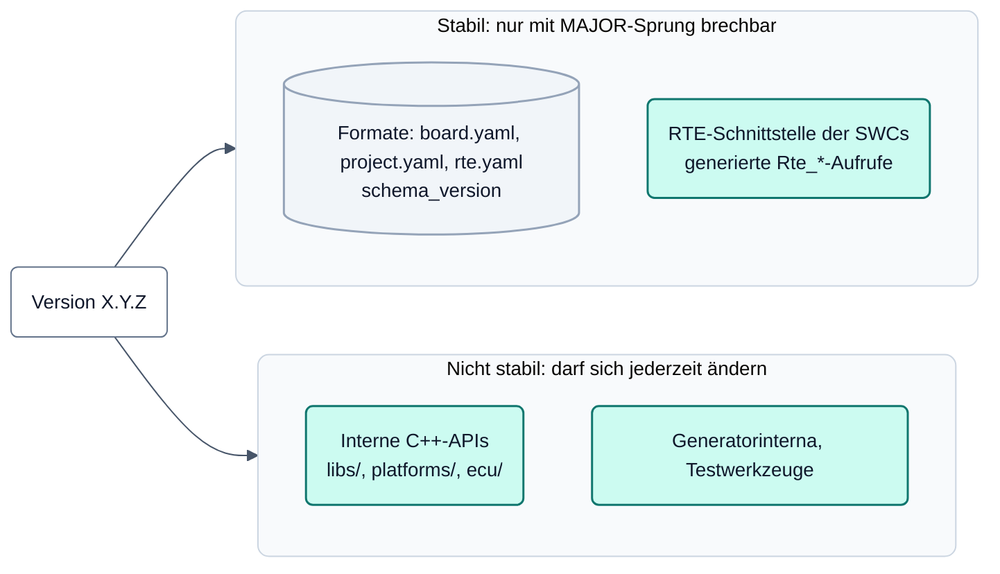

# neXtBSW – Versionierung und Support

Stand: 2026-10-04 (DOC-67). Diese Seite sagt, wie neXtBSW-Versionen nummeriert werden, was sich zwischen zwei
Versionen nicht ändern darf und welchen Support es gibt. Grundlage ist die Entscheidung des Nutzers vom 2026-10-04
(`doc-r1-support-policy`). Sprache: vorerst Deutsch, die englische Fassung kommt mit DOC-70.

## Auf einen Blick

| Teil | Stabil? | Was das heißt |
|---|---|---|
| Konfigurationsformate `board.yaml`, `project.yaml`, `rte.yaml` | ja | Eine gültige Datei bleibt innerhalb einer MAJOR-Version gültig und hat dieselbe Bedeutung. Neue optionale Felder sind möglich. |
| RTE-Schnittstelle der SWCs | ja | Die Aufrufe, über die eine Software-Komponente mit der RTE spricht, ändern sich innerhalb einer MAJOR-Version nicht. |
| interne C++-APIs (`libs/`, `platforms/`, `ecu/`, `bootloader/`) | nein | Dürfen sich in jeder Version ändern, auch in PATCH. Wer sie direkt aufruft, trägt den Aufwand beim Update. |
| Werkzeuge (`tools/`), Ausgabeformate der Generatoren im Einzelnen | nein | Die Eingabe (Formate oben) ist stabil, der erzeugte Code im Einzelnen nicht. |

## Nummerierung

neXtBSW folgt [Semantic Versioning 2.0.0](https://semver.org): `MAJOR.MINOR.PATCH`, die aktuelle Version steht in
`VERSION` im Wurzelverzeichnis.

| Stelle | Wird erhöht bei |
|---|---|
| MAJOR | einer Änderung, die eine gültige Konfigurationsdatei oder eine bestehende RTE-Schnittstelle unbrauchbar macht |
| MINOR | neuen Funktionen und neuen optionalen Feldern, ohne dass Bestehendes bricht |
| PATCH | Fehlerkorrekturen ohne Änderung der stabilen Teile |

Änderungen an den internen C++-APIs lösen für sich keinen MAJOR-Sprung aus. Vorabversionen (zum Beispiel ein
Release Candidate) tragen die SemVer-Vorabkennung und sind **keine** Zusage, dass die stabilen Teile bis zur
Freigabe unverändert bleiben.

Die Formate tragen ihre eigene Versionsnummer in `schema_version` (heute 1). Sie wird nur bei einem Bruch erhöht;
mit ihr erhöht sich auch die MAJOR-Version von neXtBSW. Die Felder der Formate beschreibt die generierte
[Referenz](../reference/README.md), die RTE-Konfiguration insbesondere [rte.md](../reference/rte.md).

## Support

| Version | Support |
|---|---|
| erster Release Candidate (rc1) | keiner: wird ohne Support-Zusage veröffentlicht |
| Freigaben nach rc1 | „best effort“: Es gibt keine Zusage zu Antwortzeit, Fehlerbehebung oder Rückportierung auf ältere Versionen. Der jeweils neueste Stand wird zuerst angesehen. |
| Entwicklungszweig | kein Support |

„Best effort“ ist kein Service-Level. Das Projekt wird von einer Person neben anderer Arbeit gepflegt. Die Freigabe
macht keine Sicherheitszusage; was für den Einsatz anzunehmen ist, steht im
[Safety-Handbuch](../safety/safety-manual.md).

## Sicherheitslücken

Schwachstellen werden **nicht** per E-Mail und nicht in einem öffentlichen Issue gemeldet, sondern über **GitHub
Private Vulnerability Reporting**. Grund: Das Projekt enthält einen UDS-Bootloader mit Seed/Key-Zugriff und
CSEc-Schlüsselverwaltung; eine öffentlich bekannte Lücke dort betrifft Geräte im Feld. Meldeweg, Umfang und
unterstützte Versionen: [`SECURITY.md`](../../SECURITY.md) im Wurzelverzeichnis (englisch, damit GitHub sie als
Sicherheitsrichtlinie anzeigt).

## Lizenz und Fremdteile

neXtBSW steht unter Apache-2.0. Fremdteile (Eclipse OpenBSW, FreeRTOS, Zephyr `hal_nxp`, CMSIS, STMicroelectronics)
mit Lizenz, Copyright und Fundort listet [`NOTICE`](../../NOTICE) (englisch, wie bei Lizenzhinweisen üblich).
Beiträge laufen unter dem DCO, siehe [`CONTRIBUTING.md`](../../CONTRIBUTING.md).
