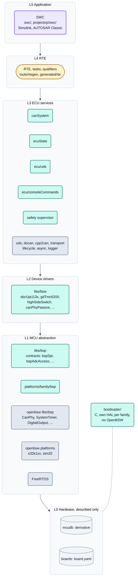

<!-- SPDX-License-Identifier: Apache-2.0 -->

# Bild 1: Schichten

**Legende**

- Grau: Fremdcode, aus Eclipse OpenBSW (`external/openbsw`, Submodul, unverändert) und FreeRTOS. Türkis: neXtBSW.
  Violett: Anwendung (SWC). Gelb: generiert, nie eingecheckt. Hellgrau (Zylinder): nur beschrieben (YAML), kein Code.
- Pfeile: Abhängigkeiten zeigen nur nach unten; keine Schicht kennt ein Board.
- Der Bootloader steht bewusst außerhalb des Schichtenstapels (Entscheidung D6) und liest dieselbe Speicheraufteilung
  wie die Anwendung.
- `ecu/uds` nutzt die OpenBSW-Bibliothek `uds`; `ecu/` selbst ist aus der OpenBSW-Referenzanwendung abgeleitet.

Quellen: [Architekturüberblick, Abschnitt 2](../architecture/overview.md#2-layers),
[neXtBSW und OpenBSW, Abschnitte 2 und 3](../architecture/openbsw.md#2-what-nextbsw-takes).
