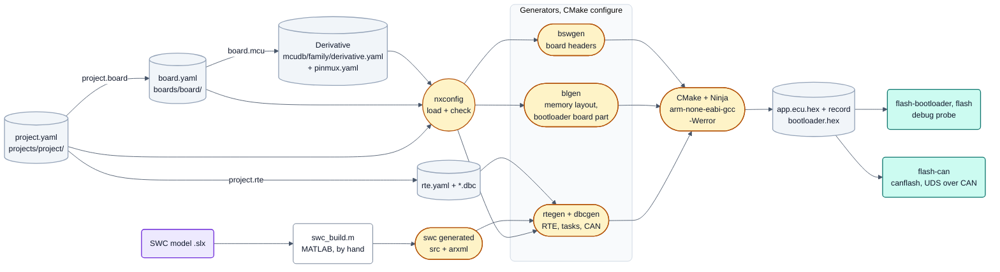

<!-- SPDX-License-Identifier: Apache-2.0 -->

# Bild 2: Konfigurationsfluss

**Legende**

- Hellgrau (Zylinder): eingecheckte Konfiguration, je Wert genau eine Ebene: Derivat (Herstellerfakten), Board (was bestückt und
  verdrahtet ist), Projekt (was diese ECU nutzt). Gewählt wird beim Bauen nur das Projekt.
- Kreis: `tools/nxconfig` liest Projekt → Board → Derivat, prüft über alle Ebenen und meldet jeden Fehler mit Datei,
  Zeile und YAML-Pfad; ein Fehler bricht den Configure-Lauf ab.
- Gelb: erzeugt nach `<build>/generated/`, nie eingecheckt (Pille: ein Werkzeuglauf). Violett: das Simulink-Modell.
  Ausnahme: der Code einer Simulink-Komponente (`swc/<Swc>/generated`) wird eingecheckt, weil MATLAB nicht frei ist; ein Hash meldet einen veralteten Stand.
- Ergebnis (Zylinder) und Flash-Wege (türkis). `flash-bootloader` und `flash` gehen über den Debug-Probe des Boards, `flash-can`
  über den Bootloader (Bild 4).

Quellen: [Architekturüberblick, Abschnitte 3 bis 6](../architecture/overview.md#3-the-three-configuration-levels),
[Build and flash, Schritt 7](../guide/build-and-flash.md#step-7-flash).
