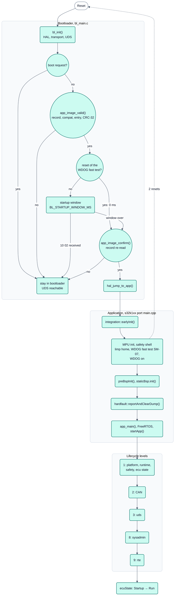

<!-- SPDX-License-Identifier: Apache-2.0 -->

# Bild 3: Startablauf

**Legende**

- Der Bootloader läuft nach jedem Reset zuerst. Er bleibt bei Boot-Anforderung (Anwendung hat `10 02` beantwortet)
  oder bei ungültigem Abbild; sonst wartet er das Startfenster ab (Eval Board: 200 ms) und springt.
- Die beiden Resets des Watchdog-Schnelltests (SM-07) erkennt die Familie (`hal_reset_skips_startup_window()`, BL-33):
  dann ohne Startfenster. Die CRC-32 über das Abbild läuft einmal je Start (BL-38); vor dem Sprung prüft
  `app_image_confirm()` Record, Kompatibilität und Einsprung erneut und vergleicht die CRC aus `bl_init()`.
- Der Bootloader läuft ohne MCU-Watchdog (Sicherheitshandbuch Abschnitt 4).
- Lifecycle: neun Ebenen (`MaxNumLevels = 9`); die RTE startet bewusst zuletzt. `ecuState` wechselt nach Run, wenn
  Ebene 9 erreicht ist (Bild 5).
- Türkis: neXtBSW-Code. Kreis: Entscheidung.
- Gestrichelt: der Schnelltest löst absichtlich zwei Resets aus; danach läuft derselbe Weg erneut.

Quellen: [Architekturüberblick, Abschnitt 7](../architecture/overview.md#7-start-up-sequence-on-the-device),
[`bootloader/src/core/bl_main.c`](../../bootloader/src/core/bl_main.c),
[Bootloader-Doku, Abschnitt 4](../../bootloader/doc/README.md#4-security-access-identification-and-fingerprint-bl-03-bl-04-bl-10),
[Sicherheitshandbuch, Abschnitt 4](../safety/safety-manual.md#4-safe-states-and-reactions).
