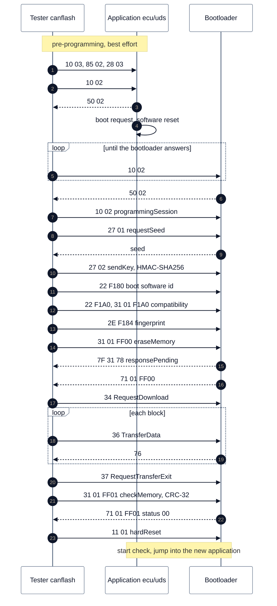

<!-- SPDX-License-Identifier: Apache-2.0 -->

# Bild 4: Flash-Ablauf über UDS

**Legende**

- Ablauf von `canflash flash` bzw. dem CMake-Ziel `flash-can`. Ohne `--wait` schaltet der Tester eine laufende
  Anwendung selbst in den Bootloader (Schritte 2 bis 6).
- Die Vorbereitung (Schritt 1) ist best effort: ein älterer Stand lehnt sie ab, der Flash-Lauf geht weiter.
- Ohne Fingerprint (`2E F184`) lehnt der Bootloader Löschen und Download mit NRC 0x22 ab.
- Passt das Abbild nicht zum Ziel (lokale Prüfung oder Routine `F1A0`), wird vor dem Löschen abgebrochen und mit
  `11 01` zurückgesetzt; die installierte Anwendung startet wieder, wenn sie gültig ist.
- `7F 31 78` steht hier stellvertretend für jeden langen Auftragsschritt (Löschen, CRC, Programmieren); der
  Bootloader sendet ihn nur, wenn der nächste Schritt P2* überschreiten könnte.
- Bootloader vor 0.3.4 prüfen die Kompatibilität unter Routine `FF02` (BL-24); canflash wählt nach DID `F180`.

Quellen: [`tools/canflash/README.md`](../../tools/canflash/README.md),
[`tools/canflash/canflash.py`](../../tools/canflash/canflash.py) (`flash_over_bus`, `flash_application`,
`pre_programming_step`), [Bootloader-Doku, Abschnitte 2 und 4](../../bootloader/doc/README.md#4-security-access-identification-and-fingerprint-bl-03-bl-04-bl-10),
[`ecu/uds/src/systems/DiagSystem.cpp`](../../ecu/uds/src/systems/DiagSystem.cpp) (`enterBootloader`).
