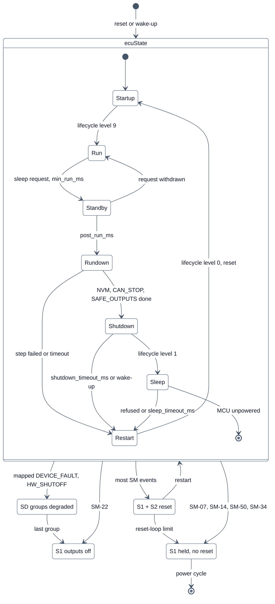

<!-- SPDX-License-Identifier: Apache-2.0 -->

# Bild 5: ECU-Zustandsautomat

**Legende**

- Kasten `ecuState`: Normalbetrieb nach [`ecuState.md`](../../libs/bsw/ecuState/doc/ecuState.md).
  **Nachlauf** = Standby (Anwendung, CAN und RTE laufen weiter) und Rundown (Schritte NVM, CAN_STOP, SAFE_OUTPUTS in
  fester Reihenfolge, je Schritt eine Zeitgrenze). Ab Rundown gibt es keinen Rückweg nach Run.
- `Restart` heißt Lifecycle-Ebene 0 und damit Software-Reset; der neue Start läuft über den Bootloader (Bild 3).
- Außen: Reaktionen des Safe Supervisors, unabhängig vom ECU-Zustand (Bild 6). SD gibt es nur, wenn das Projekt
  Ereignisse auf Ausgangsgruppen abbildet; die letzte Gruppe führt zu S1 ohne Reset.
- Was nach einem Watchdog-Reset passiert, ist einstellbar (`modules.ecuState.after_watchdog_reset: sleep`, SM-50).

Quellen: [`ecuState.md`, Zustände und Übergänge](../../libs/bsw/ecuState/doc/ecuState.md#zustände-und-übergänge),
[Sicherheitskonzept Ausgabe 3, Abschnitt 3](../safety/concept.md#3-safe-states),
[Sicherheitshandbuch, Abschnitt 4](../safety/safety-manual.md#4-safe-states-and-reactions).
