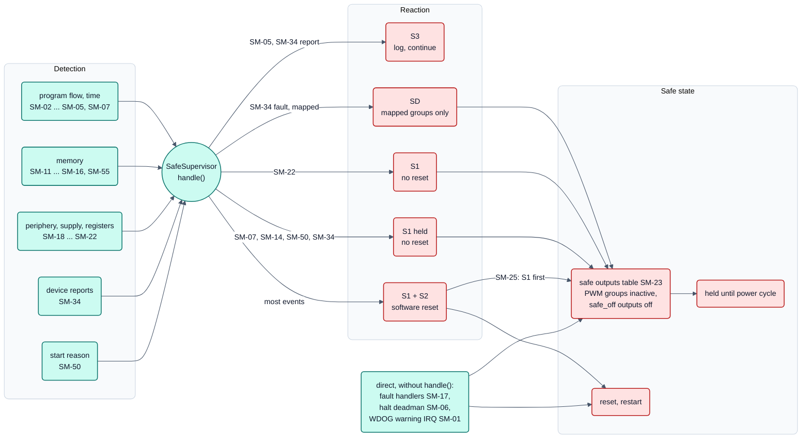

<!-- SPDX-License-Identifier: Apache-2.0 -->

# Bild 6: Safety-Kette

**Legende**

- Rot: Reaktion und sicherer Zustand. Türkis: Erkennung und die Entscheidung in `handle()` (Kreis).
- Drei Ebenen: Erkennung meldet nur ein Ereignis, entschieden wird an genau einer Stelle (`SafeSupervisor::handle()`),
  danach folgt die Wiederherstellung (Start nach dem Reset).
- S1: Ausgänge stromlos über die eine Tabelle des Projekts. S2: Software-Reset, immer erst nach S1 (SM-25).
  S1 held: S1 ohne Reset, alle Interrupts gesperrt, die Tabelle wird zyklisch erneut geschrieben, Ende nur durch
  Aus- und Einschalten. S3: nur Log. SD: nur die abgebildeten Ausgangsgruppen, ohne Reset.
- `SM-34` erscheint dreimal: Meldung → S3, Fehler der Klasse `IDENTITY` → S1 held, andere Klassen → S1 + S2 oder,
  wenn das Projekt sie abbildet, SD.
- Ohne `handle()`: Fault-Handler (SM-17), Halt-Deadman (SM-06) und der Watchdog-Warn-Interrupt (SM-01) schreiben die
  Tabelle direkt, weil der Code, der sonst entscheidet, in diesem Moment nicht vertrauenswürdig ist.
- Nicht über `handle()`: SM-30/SM-31 (die Anwendung entscheidet), SM-32 (Senden gesperrt), SM-51 (Bootloader startet
  ein ungültiges Abbild nicht).

Quellen: [Sicherheitskonzept Ausgabe 3, Abschnitte 3 und 5](../safety/concept.md#5-how-the-mechanisms-are-organised),
[Sicherheitshandbuch, Abschnitt 4](../safety/safety-manual.md#4-safe-states-and-reactions),
Mechanismen-Katalog [`mechanisms.sdoc`](../requirements/safety/mechanisms.sdoc) (Feld `REACTION`).
