<!-- SPDX-License-Identifier: Apache-2.0 -->
<!-- Generated by tools/docgen from libs/*/*/module.yaml, platforms/*/port/**/module.yaml, ecu/platforms/*/**/module.yaml, libs/*/*/doc and tools/test/tests.yaml (like doc/reference/modules.md). Do not edit: change the manifest field `verification` and run `.venv/Scripts/python tools/docgen`. -->

# Bild 7: Modulkarte mit Prüfstand

```mermaid
%%{init: {'theme':'base','flowchart':{'curve':'basis'},'themeVariables':{'fontFamily':'Segoe UI, Helvetica, Arial, sans-serif','fontSize':'14px','background':'#ffffff','primaryColor':'#ffffff','primaryBorderColor':'#64748b','primaryTextColor':'#0f172a','lineColor':'#475569','edgeLabelBackground':'#ffffff','tertiaryColor':'#f8fafc','clusterBkg':'#f8fafc','clusterBorder':'#cbd5e1'}}}%%
flowchart TB
    subgraph G1["libs/bsw"]
        direction LR
        subgraph G1K1["device_driver"]
            m_bccmc33771("bccMc33771 (pending)")
            m_canphypassive("canPhyPassive")
            m_gdtmc6200("gdTmc6200")
            m_highsideswitch("highSideSwitch")
            m_sbcuja113x("sbcUja113x")
        end
        subgraph G1K2["service"]
            m_cansystem("canSystem")
            m_dem("dem")
            m_ecustate("ecuState")
            m_halldecoder("hallDecoder")
            m_mculink("mcuLink")
            m_nvm("nvm")
            m_nvmdataflash("nvmDataFlash")
        end
        subgraph G1K3["library"]
            m_autosarbase("autosarBase")
            m_consolecontext("consoleContext")
            m_e2e("e2e")
        end
    end

    subgraph G2["libs/bsp"]
        direction LR
        subgraph G2K1["contract"]
            m_bspi2c("bspI2c")
            m_bsppinedge("bspPinEdge")
            m_bspsamplegroup("bspSampleGroup")
            m_bspspi("bspSpi")
        end
        subgraph G2K2["mcu_driver"]
            m_bspadcaccess("bspAdcAccess")
        end
        subgraph G2K3["service"]
            m_bsppinevent("bspPinEvent")
        end
    end

    subgraph G3["platforms/s32k1xx/port"]
        direction LR
        subgraph G3K1["mcu_driver"]
            m_s32k1xx_capture("capture")
        end
        subgraph G3K2["device_driver"]
            m_s32k1xx_hall("hall")
        end
        subgraph G3K3["service"]
            m_s32k1xx_safelifecycle("safeLifecycle")
            m_s32k1xx_safememory("safeMemory")
            m_s32k1xx_safesupervisor("safeSupervisor")
            m_s32k1xx_safesystem("safeSystem")
        end
    end

    classDef grp fill:#f8fafc,stroke:#cbd5e1,rx:8,ry:8
    classDef ok fill:#dcfce7,stroke:#15803d,stroke-width:1.5px,color:#0f172a
    classDef part fill:#fef3c7,stroke:#b45309,stroke-width:1.5px,color:#0f172a
    class G1,G1K1,G1K2,G1K3,G2,G2K1,G2K2,G2K3,G3,G3K1,G3K2,G3K3 grp
    class m_cansystem,m_consolecontext,m_e2e,m_ecustate,m_gdtmc6200,m_highsideswitch,m_sbcuja113x ok
    class m_bspadcaccess,m_bspspi ok
    class m_s32k1xx_safelifecycle,m_s32k1xx_safememory,m_s32k1xx_safesupervisor,m_s32k1xx_safesystem ok
    class m_autosarbase,m_bccmc33771,m_canphypassive,m_dem,m_halldecoder,m_mculink,m_nvm,m_nvmdataflash part
    class m_bspi2c,m_bsppinedge,m_bsppinevent,m_bspsamplegroup part
    class m_s32k1xx_capture,m_s32k1xx_hall part
```

**Legende**

- 🟩 Grün, Board (`hardware`): Verhalten an einem echten Board bestätigt.
- 🟨 Gelb, Mock (`mock`): nur Host-Tests, Registermodelle, Generator- und Bau-Tests.
- Stand: 13 × `hardware`, 14 × `mock`, 27 Module.
- Der Prüfstand ist das Manifestfeld `verification`; was am Board bestätigt ist und was nicht, sagt je Modul der Satz `verification_note` in der [Modulreferenz](../reference/modules.md). „Board“ heißt nicht, dass jede Funktion des Moduls am Board geprüft ist.
- `bccMc33771` ist geparkt (`module.yaml.pending`) und von keinem Projekt nutzbar.
- Gruppen: Ort im Repository, darin die Art des Moduls (Manifestfeld `kind`).

## Statusmatrix

| Modul | Ort | Art | Prüfstand |
|---|---|---|---|
| [autosarBase](../reference/modules.md#m-autosarbase) | libs/bsw | `library` | 🟨 Mock (`mock`) |
| [bccMc33771 (pending)](../reference/modules.md#m-bccmc33771) | libs/bsw | `device_driver` | 🟨 Mock (`mock`) |
| [canPhyPassive](../reference/modules.md#m-canphypassive) | libs/bsw | `device_driver` | 🟨 Mock (`mock`) |
| [canSystem](../reference/modules.md#m-cansystem) | libs/bsw | `service` | 🟩 Board (`hardware`) |
| [consoleContext](../reference/modules.md#m-consolecontext) | libs/bsw | `library` | 🟩 Board (`hardware`) |
| [dem](../reference/modules.md#m-dem) | libs/bsw | `service` | 🟨 Mock (`mock`) |
| [e2e](../reference/modules.md#m-e2e) | libs/bsw | `library` | 🟩 Board (`hardware`) |
| [ecuState](../reference/modules.md#m-ecustate) | libs/bsw | `service` | 🟩 Board (`hardware`) |
| [gdTmc6200](../reference/modules.md#m-gdtmc6200) | libs/bsw | `device_driver` | 🟩 Board (`hardware`) |
| [hallDecoder](../reference/modules.md#m-halldecoder) | libs/bsw | `service` | 🟨 Mock (`mock`) |
| [highSideSwitch](../reference/modules.md#m-highsideswitch) | libs/bsw | `device_driver` | 🟩 Board (`hardware`) |
| [mcuLink](../reference/modules.md#m-mculink) | libs/bsw | `service` | 🟨 Mock (`mock`) |
| [nvm](../reference/modules.md#m-nvm) | libs/bsw | `service` | 🟨 Mock (`mock`) |
| [nvmDataFlash](../reference/modules.md#m-nvmdataflash) | libs/bsw | `service` | 🟨 Mock (`mock`) |
| [sbcUja113x](../reference/modules.md#m-sbcuja113x) | libs/bsw | `device_driver` | 🟩 Board (`hardware`) |
| [bspAdcAccess](../reference/modules.md#m-bspadcaccess) | libs/bsp | `mcu_driver` | 🟩 Board (`hardware`) |
| [bspI2c](../reference/modules.md#m-bspi2c) | libs/bsp | `contract` | 🟨 Mock (`mock`) |
| [bspPinEdge](../reference/modules.md#m-bsppinedge) | libs/bsp | `contract` | 🟨 Mock (`mock`) |
| [bspPinEvent](../reference/modules.md#m-bsppinevent) | libs/bsp | `service` | 🟨 Mock (`mock`) |
| [bspSampleGroup](../reference/modules.md#m-bspsamplegroup) | libs/bsp | `contract` | 🟨 Mock (`mock`) |
| [bspSpi](../reference/modules.md#m-bspspi) | libs/bsp | `contract` | 🟩 Board (`hardware`) |
| [capture](../reference/modules.md#m-s32k1xx-capture) | platforms/s32k1xx/port | `mcu_driver` | 🟨 Mock (`mock`) |
| [hall](../reference/modules.md#m-s32k1xx-hall) | platforms/s32k1xx/port | `device_driver` | 🟨 Mock (`mock`) |
| [safeLifecycle](../reference/modules.md#m-s32k1xx-safelifecycle) | platforms/s32k1xx/port | `service` | 🟩 Board (`hardware`) |
| [safeMemory](../reference/modules.md#m-s32k1xx-safememory) | platforms/s32k1xx/port | `service` | 🟩 Board (`hardware`) |
| [safeSupervisor](../reference/modules.md#m-s32k1xx-safesupervisor) | platforms/s32k1xx/port | `service` | 🟩 Board (`hardware`) |
| [safeSystem](../reference/modules.md#m-s32k1xx-safesystem) | platforms/s32k1xx/port | `service` | 🟩 Board (`hardware`) |

Quelle: die Manifeste `module.yaml`, dieselbe Modulliste wie die [Modulreferenz](../reference/modules.md). Die Seite ist **erzeugt**; `tools/docgen --check` meldet, sobald sie von den Manifesten abweicht.
