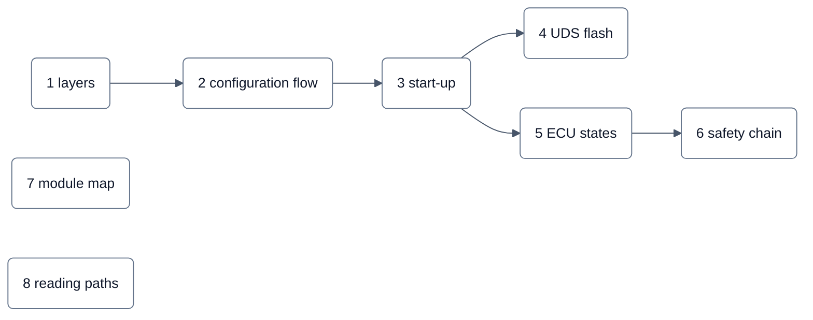

<!-- SPDX-License-Identifier: Apache-2.0 -->

# neXtBSW in Bildern

Je Seite ein Bild, Text nur als Legende. Die Bilder sind Mermaid direkt im Markdown und werden von GitHub gezeichnet.
Beschriftungen sind sprachneutral (Fachbegriffe, IDs, Modulnamen); die Legenden sind vorerst deutsch, die englische
Fassung folgt mit DOC-70. Jede Seite nennt ihre Quellen im Repository; bei einem Widerspruch gilt die Quelle.

| Nr. | Bild | Zeigt |
|---|---|---|
| 1 | [Schichten](01-schichten.md) | L0 bis L5, was von OpenBSW kommt, wo der Bootloader steht |
| 2 | [Konfigurationsfluss](02-konfigurationsfluss.md) | Derivat → `board.yaml` → `project.yaml` → `rte.yaml` → Generatoren → Build → Flash |
| 3 | [Startablauf](03-startablauf.md) | Reset → Bootloader → Abbildprüfung → Anwendung → Lifecycle → Run |
| 4 | [Flash-Ablauf über UDS](04-flash-uds.md) | Sequenz von `canflash flash` bis zum Reset in die neue Anwendung |
| 5 | [ECU-Zustandsautomat](05-ecu-zustaende.md) | Startup, Run, Nachlauf, Sleep und die Reaktionen bis zum sicheren Zustand |
| 6 | [Safety-Kette](06-safety-kette.md) | Erkennung → `handle()` → S1/S2/S1 held/S3/SD → sicherer Zustand, mit SM-Nummern |
| 7 | [Modulkarte](07-modulkarte.md) | alle Module, Farbe = Prüfstand (Board oder Mock), dazu die Statusmatrix; von `tools/docgen` erzeugt |
| 8 | [Lesepfade](08-lesepfade.md) | Verweis auf die Lesepfade in `README.md` und `doc/README.md` |

Bilder zu den langen Safety-Dokumenten, als ergänzende Darstellung ohne inhaltliche Änderung der freigegebenen
Ausgaben:

- [Bilder zum Sicherheitskonzept](../safety/figures/concept-figures.md) (Konzept Ausgabe 3): Ziele → Mechanismen,
  Reaktionen, drei Ebenen, Zeitbudget.
- [Bilder zur Fehleranalyse](../safety/figures/fmea-figures.md) (FMEA Ausgabe 2): Blöcke → Fehlerarten →
  Mechanismen, Abdeckung, Urteile zu den Zielen, Zeitbegriffe.

## Farben und Formen (Stil B1)

Alle Diagramme der Dokumentation haben dieselbe Kopfzeile und dieselben sechs Farben; die Farbe sagt, woher etwas
kommt, nicht wie wichtig es ist.

| Farbe | Bedeutung |
|---|---|
| Türkis | neXtBSW (eigener Code) |
| Grau | Fremdcode und Fremdgeräte: OpenBSW, FreeRTOS, Hardware, externe Werkzeuge |
| Gelb | generiert, Generator |
| Hellgrau | Datei, Konfiguration, Daten |
| Violett | Anwendung, SWC |
| Rot | Safety-Reaktion, sicherer Zustand |
| ohne Farbe | neutral (Lesewege, Schrittfolgen) |

Status nur in Statusbildern, jeweils mit eigener Legende: Grün = erfüllt, Gelb = teilweise, Rot = nicht erfüllt.
Formen: abgerundetes Rechteck = Baustein, Pille = Werkzeuglauf, Zylinder = Datei oder Daten, Kreis = Entscheidung
oder Verteiler. Durchgezogene Linie = Fluss oder Aufruf, gestrichelt = optional oder indirekt. Gruppen (Subgraphs) sind
hellgrau und gerundet.

**Prüfung.** `tools/test -k docgen-mermaid` prüft jeden Mermaid-Block in `doc/` und `README.md` (Diagrammtyp,
Klammern, Anführungszeichen, keine leeren Knoten, Stil B1: Kopfzeile, erlaubte Farben, keine eckigen Knoten, Rauten
oder `style`-Zeilen) und die Links dieser Seiten. Die Modulkarte wird wie die
Modulreferenz aus den Manifesten erzeugt (`tools/docgen`); `tools/docgen --check` und `tools/test -k docgen` melden,
sobald sie abweicht.
