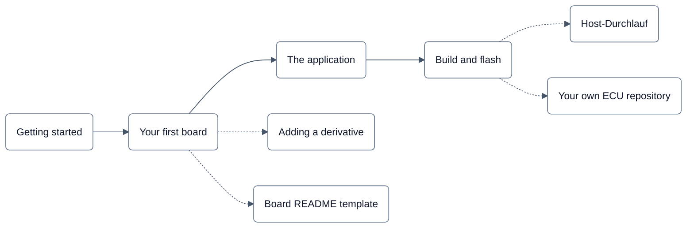

# Guide

Task-oriented documentation: how to get a control unit running with neXtBSW. The reasoning behind it is in
[`../architecture/`](../architecture/README.md), field-by-field details are generated into [`../reference/`](../reference/README.md).

| Page | Covers |
|---|---|
| [Getting started](getting-started.md) | the route at a glance, what runs today, building an existing project to check your set-up |
| [Your first board](your-first-board.md) | steps 1–4: derivative, board, project; what belongs in which file; `nxconfig check` and its messages |
| [The application](the-application.md) | step 5: software components, tasks, connections, CAN in `rte.yaml` |
| [Build and flash](build-and-flash.md) | steps 6–8: presets, the configure run, flash targets, the console |
| [Host-Durchlauf ohne Hardware](host-durchlauf.md) | (Deutsch) the whole route without a board as a picture series, every command really run |
| [Your own ECU repository](customer-project.md) | the production case: neXtBSW pinned in a repository of your own, workspace `.venv`, tests and CI, git, taking a newer neXtBSW |
| [Adding a derivative](new-derivative.md) | when your MCU is not in `mcudb/` yet (step 2): public sources only, `source`/`verify`, generated pin tables |
| [Board README template](board-readme-template.md) | the `README.md` next to your `board.yaml` (step 3): supply, debug set-up, safety rules |

Rules for these pages: English, except the picture pages (German with language-neutral diagrams, until DOC-70); every
command tested as written and every output from a real run (steps that need hardware and were not run are marked);
board-neutral, boards appear only as set-apart examples; examples link only to files of the open tree
(`test_guide_open.py` checks it against `tools/distcheck`); honest about what runs, what only builds and what is not
there yet; link to the reference instead of repeating it.
