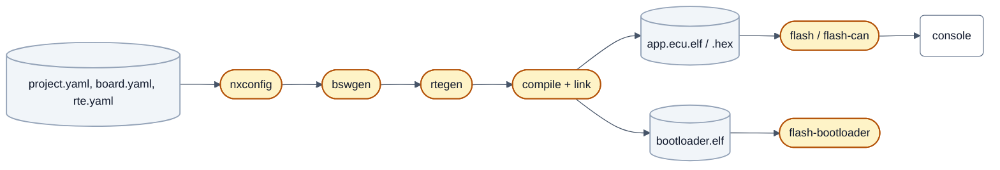

# Build and flash

Steps 6 to 8 of the [route](getting-started.md#the-route-at-a-glance): turn the configuration into an image, put it on
the board, and talk to it.



The configure and build commands and outputs below come from real runs. The flash commands and the console need a
connected board and were **not** run for this page; they are the targets and settings that exist in the build.

## Step 6: configure and build

The project is the only thing you select; board, derivative, family, core and compiler options follow from the
configuration. Each project has a CMake preset; the open tree has `buildtest-s32k148-min`
(`projects/buildtest_s32k148_min`). For **your** project add a preset
to `CMakePresets.json` that inherits from `nx-arm-gcc` and sets `NX_PROJECT` to your `project.yaml`
([Your own ECU repository, step 5](customer-project.md#step-5-check-generate-build)); without a preset, pass `NX_PROJECT`
directly ([`../../projects/README.md`](../../projects/README.md), section "Bauen", German).

```sh
cmake --preset buildtest-s32k148-min
cmake --build --preset buildtest-s32k148-min
```

On Windows the build path is limited: in a deep checkout or worktree pass a short folder with `-B <short folder>`.

### What the configure run does

| Tool | Does |
|---|---|
| `nxconfig` | loads and checks project, board and derivative (the same check as `nxconfig check`) and writes the build settings |
| `bswgen` | generates the board configuration of the basic software: clock, pins, CAN, UART, ADC, PWM, interrupt priorities, memory layout, bootloader values, module integration |
| `rtegen` | generates the RTE from `rte.yaml` |

Each reports under its name; the log ends `Configuring done`, `Generating done`. The run validates the project again
before any generator writes a file, so an error carries file, line and YAML path and stops the run:

```text
project.yaml:106 (interrupts.ranks): error: CAN bus CAN1 is used, but has no interrupt rank: the board port cannot set the level of its message buffer interrupts (interrupts.ranks: {source: can, name: CAN1, rank: <n>})
```

Fix the entry and configure again. The generated files are in `<build>/generated/` (`board/` from bswgen, `rte/` from
rtegen, `nxconfig/project.cmake`) and are never edited by hand.

### The build

The build compiles the application, the bootloader and a bootloader updater and links them, with warnings as errors
(`-Werror`). The images are `ecu/application/RelWithDebInfo/app.ecu.elf` (and `.hex`) and
`bootloader/RelWithDebInfo/bootloader.elf` in the build folder; the last steps print the size table and the A2L
generation (`[337/338] A2L of app.ecu (tools/a2lgen)`).

The example project `buildtest_s32k148_min` doubles as a check of board neutrality: another derivative than the
maintainers' board, an 8 MHz crystal, passive transceivers, two CAN buses with different bit rates, no hardware behind
it. If a change breaks it, the change assumed something about one particular board. The maintainers' S32K116
(Cortex-M0+) profile, which does the same for small memory, is not in this tree yet (see
[Getting started](getting-started.md#what-runs-today)). The complete run with all host tests is
`.venv/Scripts/python tools/test --group all --jobs 4`, see [`../../CONTRIBUTING.md`](../../CONTRIBUTING.md#build-and-test).

## Step 7: flash

Every project gets three flash targets:

| Target | Puts on the board | Through |
|---|---|---|
| `flash-bootloader` | the bootloader, once per board and again for a bootloader update | the debug probe |
| `flash` | application and its validity record | the debug probe |
| `flash-can` | the application | CAN, through the bootloader (UDS) |

```sh
cmake --build --preset <preset> --target flash-bootloader
cmake --build --preset <preset> --target flash
cmake --build --preset <preset> --target flash-can
```

Flash the bootloader first; after that `flash-can` needs no probe. **Which probe and tool** is decided by the board
(`board.debug.probe`, `board.debug.interface`), **where it is installed** by your workstation (`PATH`, an environment
variable or a CMake cache variable). The configure run names the tool it found (`-- flash targets: jlink (…) for probe
J-Link`); a missing tool leaves the target in place and it stops with the reason. Supported: J-Link, ST-LINK,
CMSIS-DAP/DAPLink, XDS110; the table of tools and variables is in
[`../../projects/README.md`](../../projects/README.md) (section "Flash-Ziele je Debug-Probe", German). A target writes
a command file next to the image (`ecu/application/<configuration>/flash.jlink` for a J-Link) that you can read before
running it.

On hardware, the J-Link path has been used on one maintainer board and the ST-LINK path on a platform build-test image;
the command lines of the other probes are tested against the generated commands only and are to be confirmed at the
first use. Flashing over CAN needs a CAN adapter supported by python-can
([`../../tools/canflash/README.md`](../../tools/canflash/README.md)). Read the README of your board before flashing it
(its safety rules, [board README template](board-readme-template.md)) and write one for your own board.

## Step 8: the console

The application has a text console on the UART the board describes (`board.yaml`, `uart`), with the baud rate from
`project.yaml` (`uart.<name>.baudrate`), 8 data bits, no parity, one stop bit. Open the serial port with any terminal
program.

| Command | Answers with |
|---|---|
| `help` | the command groups built into this application |
| `lc` | lifecycle: which components are running |
| `stats` | runtime statistics of the tasks |
| `rte` | the RTE: signals of the components, CAN messages with qualifier and counters |
| `can status` | state of each CAN bus the project uses |

More groups appear with what the project uses (one per driver module with a `console:` name in `project.yaml`). Commands
that act on hardware able to cut its own supply are listed with their safety rules in the board's README. Every command
with syntax and the build or module it needs: [console reference](../reference/console.md).

## Where to go from here

- The configuration fields: [reference](../reference/README.md). The existing projects: [`../../projects/README.md`](../../projects/README.md).
- Why the configuration is split this way: [`../architecture/README.md`](../architecture/README.md), section 4.
