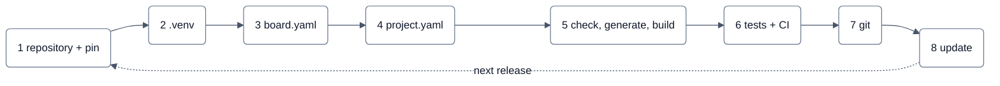

# Your own ECU repository

A production ECU project lives in a **repository of its own** and references neXtBSW at a fixed version. The route,
from an empty folder to a built image:



| Step | You do | Command |
|---|---|---|
| 1 | repository, submodule, pin file | `git submodule add`, `nextbsw.yaml` |
| 2 | the workspace's own Python environment | `python nextbsw/tools/setup venv .` |
| 3 | your board | `nxconfig board new` |
| 4 | your project | `nxconfig new`, `nxconfig check` |
| 5 | build | `cmake --preset main`, `cmake --build --preset main` |
| 6 | tests and CI | `tools/test --workspace .`, `tools/ci run --workspace .` |
| 7 | what goes into git | `.gitignore`, the Studio's git page |
| 8 | a newer neXtBSW | `tools/nxupdate` |

Why a pin and not a copy, which variants were weighed: [`../architecture/customer-project.md`](../architecture/customer-project.md).
This page only says what to do. If you have never built anything with neXtBSW, do [Getting started](getting-started.md)
first; everything below assumes that worked.

| Term | What it is |
|---|---|
| **neXtBSW tree** | one checked-out or unpacked neXtBSW release: the folder with `VERSION` and `tools/` |
| **Workspace** | your repository: the folder with the pin file `nextbsw.yaml`. One workspace, one tree |
| **Pin** | the reference to exactly one neXtBSW version: `nextbsw.yaml` plus the submodule's commit |

The rule the design rests on: your repository contains **only what your ECU decides** (projects, boards, components,
modules, tests and one pin). Nothing of neXtBSW is copied into it and nothing generated is checked in.

## Before you start

| Tool | Version used here | Notes |
|---|---|---|
| git | any recent one | with submodule support |
| Python | 3.12 | the workspace gets its own `.venv`; `tools/ci/.python-version` names the pinned one |
| CMake | 4.4.3 (3.28 minimum) | preset schema version 6 |
| Ninja | 1.13.2 | |
| `arm-none-eabi-gcc` | 11.3.1 (xPack, `tools/ci/versions.toml`) | on `PATH` or `NX_ARM_GCC_BIN` (workstation setting, never checked in); `python -m tools.ci setup` fetches it |

### Where the repository may live: the Windows path limit

Windows refuses paths over 260 characters, and the object files of a target build are the longest paths in the
system (measured, ARCH-57):

| Quantity | Value |
|---|---|
| longest object path of a workspace target build | 247 of 260 characters |
| of that: build directory / below it | 55 / 192 characters |
| **limit for the build directory** | **67 characters** (about 56 for the workspace root with `build/<preset>`) |

So keep the repository folder short and near a drive root (`C:/acme-bcm`), keep the preset name short (`main`), or
point the build elsewhere: the Studio setting **Build-Wurzel** (`NX_STUDIO_BUILD_ROOT`) or
`cmake --preset <p> -B <short dir>`. The Studio warns when a build directory grows past 67 characters. The
submodule folder name does not show up in object paths (CMake hashes them), only in the roomier source paths.

## Step 1: the repository and the pin

A workspace stands on a **release tag** (`v<MAJOR>.<MINOR>.<PATCH>` on `master`; this page uses `v0.2.0`).

### By hand

```sh
mkdir acme && cd acme
git init -b main
git submodule add <url of the neXtBSW repository> nextbsw
git -C nextbsw checkout v0.2.0
git add nextbsw
git submodule update --init --recursive
```

**The order matters.** `git submodule update` puts the submodule back on the *staged* commit; run it before
`git add nextbsw` and the tag checkout is silently undone. `--recursive` matters too: OpenBSW is a nested submodule
(`external/openbsw`), and without it the build stops with missing sources. Without access to GitHub, point git at a
mirror with `git -c url.<mirror>.insteadOf=https://github.com/eclipse-openbsw/openbsw.git …`. With a local clone as
URL, Git 2.38.1 and newer want `-c protocol.file.allow=always`.

Then write the pin file `nextbsw.yaml` in the repository root:

```yaml
schema_version: 1
nextbsw:
  version: 0.2.0                 # must equal the tree's VERSION file
  source: submodule              # submodule | archive
  path: nextbsw                  # the tree, relative to this file
  profile: open                  # open | licensed | nda
search:                          # your own extensions, searched BEFORE the tree's own folders
  boards: [boards]               # <dir>/<board>/board.yaml
  # mcudb:   [mcudb]             # only if a derivative is missing
  # modules: [libs]              # your own drivers and services
```

A search path that does not exist is an error, on purpose, so a typo does not silently disable your boards; unknown
keys are errors too. Check the pin (this needs the environment of step 2):

```sh
.venv/Scripts/python nextbsw/tools/nxconfig version .
.venv/Scripts/python nextbsw/tools/nxconfig pin --release .
```

`version` shows tree, git describe, workspace and pin. `pin` checks that the pin is a release (annotated tag
`v<version>`, reachable from `master`, tree clean; TOOL-65); `--release` makes a development pin an error instead of a
warning, which is what a customer release uses. If pin and tree disagree you are told which is which (`pins neXtBSW
0.1.0, but the tree nextbsw is 0.2.0`).

Every tool finds the workspace the way git finds `.git`: it walks up from the `project.yaml` you named and stops at the
first folder with `nextbsw.yaml`, at a neXtBSW tree root, or at a git root. No pin means "the tree I am running from".

### In the Studio

The wizard **Neues Projekt**, first step *Ablage*, offers "Eigenes Repository mit fester neXtBSW-Version" (TOOL-60):
folder, version to pin, submodule source or release archive with checksum, CI template, first commit, and the
workspace's own `.venv`. Nothing is written before **„Anlegen"**; the summary names every file, git step and warning,
and the pin is written last and checked at once. The wizard needs an empty or not-yet-existing folder; a further
project of an existing workspace follows step 4. The command line equivalent:

```sh
python tools/studio new-workspace --releases                                                # which tags exist
python tools/studio new-workspace C:/ECU/acme-bcm acme_main --board acme_ctl_b1 --tag v0.2.0
```

`--development` pins a development commit, `--copy <project>` starts from a copy, `--archive <file> [--sha256 <hash>]`
uses the archive variant.

### The archive variant

Without access to a git server, use `source: archive` with `url` and `sha256` and unpack the release to the same
`path`; the tools only read `path` and `version`:

```yaml
nextbsw:
  version: 0.2.0
  source: archive
  path: nextbsw
  url: https://files.example.invalid/nextbsw-0.2.0.zip   # where the delivery is kept
  sha256: e53f4fde7fe3b0c864c9bef0c414de46cdc5c975d5bd8ec921dae335e77f90e1
```

`nextbsw/` is then a plain folder in `.gitignore`, never a submodule (TOOL-86). Another workstation or the CI
receives the pin but not the tree and rebuilds it from the same archive, checked against the pinned checksum:

```sh
python tools/studio restore-archive <repository> <archive>
```

A wrong checksum, an archive without a neXtBSW tree, an unsafe member (absolute path, `..`, link) or a non-empty
target are refused before anything is written. A delivered archive has to contain `external/openbsw` (a plain
`git archive` does not). Without the Studio, compare `certutil -hashfile <archive> SHA256` (or `sha256sum`) with the
pin and unpack to `nextbsw/`.

## Step 2: the Python environment

The generators, the configuration check and the build run with the **workspace's own** `.venv`, built from the
requirements of exactly the pinned tree:

```sh
python nextbsw/tools/setup venv .
```

It runs with any Python 3.12 (standard library only; `py -3.12 …` on Windows) and finds the workspace by walking up.
The core list (generators, `nxconfig`, host tests, CI) is free of Qt; `--studio` adds PySide6 and the Studio test
tools. `python nextbsw/tools/setup check .` only reports.

A second run changes nothing (`Nichts zu tun`). The environment carries a marker (`.venv/nextbsw-venv.json`) with a
hash over requirements, constraints and Python version; after you move the pin the hash no longer fits, and
`setup check` (exit 1, with the repair command), `tools.ci check` and the Studio's **Werkzeuge** page say so.

## Step 3: your board

Your boards are ordinary `board.yaml` files, found through `search.boards`; same schema, same checks as the boards of
the tree.

```sh
.venv/Scripts/python nextbsw/tools/nxconfig board new acme_ctl_b1 --root . \
    --mcu S32K146 --package LQFP100 --supply-v 5.0 --sosc-hz 8000000 \
    --debug-interface SWD --debug-probe "J-Link" --adc-reference-mv 5000 \
    --can body=FlexCAN0 --can chassis=FlexCAN1 --uart console=LPUART1 \
    --adc vbat=ADC0:SE8:PTC0 --out safe_en=PTD15:high --out fault=PTD16:high \
    --in wake=PTC12:low --no-port --dry-run
```

`--root .` puts board (and optional port) into **your** repository; drop `--dry-run` to write, the command then also
runs the checks (here two warnings: no CAN transceiver `phy` described, treated as passive). While choosing pins:
`nxconfig board list --mcu S32K146 --package LQFP100 [--function FlexCAN0_RX]`. Channel names are those of the pin
multiplexing table (`ADC0:SE8`, not `ADC0:CH8`). In the Studio the wizard **Neues Board anlegen** asks signal by
signal and offers only the pins that can carry the function.

Bus, UART, input, output and PWM names are free to choose after the nets of your schematic (`body`, `chassis`,
`console`). What goes into a `board.yaml` is [Your first board](your-first-board.md#step-3-the-board). If your MCU is
not in `mcudb/`, [Adding a derivative](new-derivative.md) applies: put the file under `mcudb/<family>/` of your
repository and add `mcudb: [mcudb]` to `search`.

## Step 4: your project

A project is a `project.yaml` plus `rte.yaml` (and `diag.yaml` if the ECU answers diagnostics) below
`projects/<name>/`; `project.board` is relative to `project.yaml`:

```yaml
project:
  name: acme_main
  board: ../../boards/acme_ctl_b1
  rte: rte.yaml
```

Start an **empty project on a board** or a **copy of an example** (paths rewritten for you), from the workspace root.
`nxconfig new` offers the boards of `search.boards` before those of the tree:

```sh
.venv/Scripts/python nextbsw/tools/nxconfig new --list
.venv/Scripts/python nextbsw/tools/nxconfig new acme_main --board acme_ctl_b1
.venv/Scripts/python nextbsw/tools/nxconfig new acme_main --copy buildtest_s32k148_min --dir projects/acme_main
```

A copy still points at the example's board (`../../nextbsw/boards/<board>`) and keeps its diagnostic addresses, CAN
and XCP ids; change `project.board` to your own board and the ids if both ECUs share a bus. Then let `nxconfig check`
name **every** reference that does not fit, with file, line and YAML path:

```sh
.venv/Scripts/python nextbsw/tools/nxconfig check projects/acme_main/project.yaml
```

```text
project.yaml:135 (safety.locked_pin): error: 'LED2' must be a digital output used by the project
project.yaml:109 (interrupts.ranks[2].name): error: board acme_ctl_b1 has no uart entry UART (available: console)
```

Work the list from the top: the bus and UART names of the source (`CAN0`, `CAN1`, `UART`) become your names
everywhere (`bootloader.can`, `xcp.bus`, `can:`, `uart:`, `interrupts.ranks`), and `safety.safe_state_output`,
`safety.locked_pin`, `safety.test_pin` name outputs and pins of your board. When the list is empty you get
`acme_main: ok (board acme_ctl_b1, S32K146, 2 warning(s))`. A warning is the tool refusing to pretend something is
confirmed. Messages in detail: [Your first board](your-first-board.md#reading-the-messages).

Connections in `rte.yaml` that name board signals are checked by `rtegen` at configure, not by `nxconfig check`
(`BUTTON1 is not a dio.in signal used by the project`). Connecting a component port to the output that
`safety.safe_state_output` names is a justified safety warning at configure: the pin floats in the safe state and
comes back on without an enable (AoU-30). Choose an output the application does not write, or, for a display such as an
LED, confirm it with `safety.safe_state_output_shared_with_application: "<reason>"`.

What belongs in the two files: [Your first board](your-first-board.md#step-4-the-project) and
[The application](the-application.md).

## Step 5: check, generate, build

A CMake preset is resolved relative to the preset file, so the workspace root needs a `CMakeLists.txt` next to its
`CMakePresets.json`. Both are templates in the tree, copied once with their placeholders replaced:

| Template | Copy to | Replace |
|---|---|---|
| `nextbsw/cmake/workspace/CMakeLists.txt.in` | `CMakeLists.txt` | `@NX_TREE@` → `nextbsw` |
| `nextbsw/cmake/workspace/CMakePresets.json.in` | `CMakePresets.json` | `@NX_TREE@` → `nextbsw`, `@NX_PRESET@` → `main`, `@NX_PROJECT_DIR@` → `acme_main` |

The root `CMakeLists.txt` holds no build logic; it sets `NX_ROOT` to the tree and includes the tree's root file. The
preset file includes the tree's base presets and adds one preset per project:

```json
{
    "include": ["nextbsw/cmake/NxPresets.json"],
    "configurePresets": [
        {
            "name": "main",
            "inherits": "nx-arm-gcc",
            "displayName": "acme_main",
            "cacheVariables": { "NX_PROJECT": "${sourceDir}/projects/acme_main/project.yaml" }
        }
    ]
}
```

Build directory and interpreter come from your workspace, toolchain file and compiler options from the tree; nothing
is ever written into the submodule. **Write both files without a byte-order mark**: `tools/ci` stops with
`Unexpected UTF-8 BOM` (Windows PowerShell 5.1 `Set-Content -Encoding utf8` adds one; CMake itself does not mind).

```sh
cmake --preset main
cmake --build --preset main
```

The configure log names the board, the derived switches and the XCP/bootloader settings and ends with `Build files
have been written`; the build ends with the `calseg`, `romcheck` and `a2lgen` lines and no warning under `-Werror`
(configure 110 s, build 9 min 27 s with `-j 2` on a busy machine). The A2L's EPK names project and neXtBSW release.
The configure run step by step and the flash targets: [Build and flash](build-and-flash.md).

### No board port needed

A board of your own needs **no folder in the tree**. The feature switches are **derived**, and the configure log says
where each came from:

| Switch | Derived from |
|---|---|
| `OPENBSW_PLATFORM` | the family of the derivative |
| `IO` | the project uses an I/O entry of its board (`use.dio`, `use.adc`, `use.input_capture`, a `pwm` group) |
| `CAN` | the project uses a CAN bus (`use.can`) |
| `TRANSPORT`, `UDS` | the project has a `diagnostics` section |
| `ETHERNET` | build option `NX_ETHERNET`, checked against the derivative |
| `WATCHDOG`, `MPU` | the family port, `ecu/platforms/<family>/features.yaml` |

`ecu/platforms/<board>/Options.cmake` remains the place for a **justified exception** of one board; write down why.

## Step 6: your tests and your CI

Both run the tree's tooling against your repository; the tree is only read.

```sh
.venv/Scripts/python nextbsw/tools/ci template --list        # github, gitlab, tests, pipeline
.venv/Scripts/python nextbsw/tools/ci template tests    --out .
.venv/Scripts/python nextbsw/tools/ci template pipeline --out .
.venv/Scripts/python nextbsw/tools/ci template github   --out .
```

Replace the placeholder `MEIN_PROJEKT` in `ci/tests.yaml` with your project folder and the preset name with yours, or
your first run is red on purpose.

```sh
.venv/Scripts/python nextbsw/tools/test --workspace . --list
.venv/Scripts/python nextbsw/tools/test --workspace . --jobs 2 --group python
```

Six of the eight listed entries are **inherited from the tree** (they test the workspace mechanics: pin, release
strictness, tree resolution, update, environment); the tree never pushes its own project builds into your run. Add
your own (host tests of your C components, SIL tests of your models) to `ci/tests.yaml` in the tree's format; an entry
with a `cmake_preset` per visible preset is expected, otherwise the CI is red with "Profil ohne CI-Entscheidung".
`--group python` leaves out the target build. The test runner reports in German; `Ergebnis: OK` is the line that counts.

The provider file only checks out (with submodules), provides Python and calls the tree's pipeline:

```sh
.venv/Scripts/python nextbsw/tools/ci run --workspace . --release --jobs 2
```

The run provides the pinned tools (the compiler of the neXtBSW release CI; `--toolchain local` uses yours), checks pin
and environment, runs your tests and builds, and writes a report with a table of your artefacts under `build/ci-out`;
it ended `Ergebnis: OK (8 gruen, 0 rot, …)` after 641 s. `--release` turns the `Pin`/`Release` lines into errors for a
pin that is not on an annotated release tag reachable from `master`, or whose tree is dirty.

### Coverage and static analysis of your own code

From the first release after v0.2.0 on (TOOL-217, gap N19 of the
[architecture page](../architecture/customer-project.md)), your workspace keeps its own thresholds and baseline in the
tree's formats (with v0.2.0 the workspace CI skips both and says so):

```sh
.venv/Scripts/python nextbsw/tools/ci template coverage         --out .   # ci/coverage.yaml
.venv/Scripts/python nextbsw/tools/ci template misra-deviations --out .   # ci/misra/deviations.yaml
```

| File | What you decide there |
|---|---|
| `ci/coverage.yaml` | statement and branch thresholds per module of *your* code, each with its reason |
| `ci/misra/deviations.yaml` | justified deviations of your code (starts empty) |
| `ci/misra/baseline.yaml` | the known findings of your first inventory, written by the tool |
| `ci/misra/rules.yaml` | optional: your own rule set; without it the tree's applies |

`[coverage]` and `[static_analysis]` in `ci/pipeline.toml` switch the stages on (`static_analysis.compile_db =
"main/compile_commands.json"`). Only files of your workspace count, never the tree, `nextbsw/`, the build root or
`.venv`. Your first inventory, after one run of the target build:

```sh
.venv/Scripts/python nextbsw/tools/test --workspace . -k target-main
.venv/Scripts/python nextbsw/tools/misra baseline --workspace .
```

From then on every finding in neither `baseline.yaml` nor `deviations.yaml` turns the run red. A stage switched off is
named as not run; a stage switched on without its file is red with the command that writes the starting point. This was
checked with synthetic workspaces, not yet with a run against a v0.2.0 workspace.

## Step 7: working with git

### What is checked in

| Artefact | In git? | Why |
|---|---|---|
| `nextbsw.yaml`, the submodule's gitlink | yes | together they **are** the pin |
| `project.yaml`, `rte.yaml`, `diag.yaml`, DBC, `board.yaml` | yes | the sources of the ECU |
| your own `mcudb/` derivatives and `libs/` modules | yes | same |
| `.slx`, `<Swc>_data.m`, `swc.yaml`, hand-written `src/` | yes | the sources of the components |
| `swc/<Swc>/generated/{src,arxml}`, `model.sha256` | **yes** | firmware and CI build without MATLAB; the hash makes stale code visible at configure |
| root `CMakeLists.txt`, `CMakePresets.json`, `ci/`, the provider file | yes | written once |
| update reports `doc/nextbsw-updates/*.md` | yes | the evidence of an impact analysis per pin move |
| `build/`, `generated/` of the build | **no** | determined by your sources plus the pinned tree |
| content of `nextbsw/` | no | referenced, never edited |
| `.venv/`, `CMakeUserPresets.json` | no | workstation |

The minimum `.gitignore` is `build/`, `.venv/`, `CMakeUserPresets.json`, `__pycache__/`. `nextbsw` in the tracked files
is the gitlink, one line, not a copy of the tree.

### The git page

The Studio's git page groups the changes of a workspace (*neXtBSW-Referenz*, *Eigene Projekte*, *Eigene Boards*,
*Eigene Module*, *Diagnosebeschreibung*, *Modelle*, *Komponenten-Code*, *Generierte Dateien*, *Sonstiges*) and shows
the pinned neXtBSW as a row of its own; on the command line:

```sh
.venv/Scripts/python nextbsw/tools/studio git status projects/acme_main/project.yaml
```

- **The pin moves only through a deliberate commit.** The Studio never moves it; it may tell you a newer release exists.
- **A commit of the workspace never touches the tree.** Paths inside the submodule are refused, and a submodule with
  changes of its own blocks the commit.
- **Generated files belong in `.gitignore`, not in a commit.**

The never-commit path rule and the protected branches are read from *your* repository: `git config
nextbsw.protectedbranch` names yours, otherwise `dev`, `master` and `main` are protected.

## Step 8: taking a newer neXtBSW

An update is a deliberate change of its own, on a branch, reviewed like any other.

1. **Move the pin.** Fetch in the submodule, check out the new tag, `git add nextbsw`, then
   `git submodule update --init --recursive` (the order of step 1), and set `nextbsw.version`; `nxconfig check`
   refuses the mismatch until you do both.
2. **Recreate the environment** if requirements changed: `python nextbsw/tools/setup venv .`.
3. **Migrate the formats** the new release raised; `nxconfig migrate` edits the YAML in place, preserving comments,
   and shows a diff before it writes anything:

   ```sh
   .venv/Scripts/python nextbsw/tools/nxconfig migrate --list
   .venv/Scripts/python nextbsw/tools/nxconfig migrate .          # dry run with diff
   .venv/Scripts/python nextbsw/tools/nxconfig migrate . --write  # writes a backup of every file it changes
   ```

4. **Generate, build, test**: `cmake --preset …`, `tools/test --workspace .`, `tools/ci run --workspace .`.
5. **Commit** the gitlink, `nextbsw.yaml`, the migrated files and the update report as one change.

### The matching Studio

A Studio build bundles the generator modules of the tree it was packed from, so it must match the pin **exactly**
(`MAJOR.MINOR.PATCH`). Otherwise a **NUR LESEND** banner blocks generating, building and flashing (configuring,
checking, host tests and every view keep working) and offers two ways out: the installed Studio build of the pinned
version (`<tools>/neXtBSW Studio/neXtBSW_Studio_v_x.y.z`), or a deliberate pin move.

**`tools/nxupdate` does the five steps** (TOOL-64): it generates every project with the old and the new tree, moves the
pin only after the target tag has passed the release rule, runs the target tree's migrations, and writes
`doc/nextbsw-updates/v<old>-v<new>.md` (pin findings, skipped releases, changelog excerpt, changed `nxconfig check`
messages, generated-file diff with field-relevant changes flagged):

```sh
.venv/Scripts/python nextbsw/tools/nxupdate C:/acme --to 0.3.0                    # dry run, report on stdout
.venv/Scripts/python nextbsw/tools/nxupdate C:/acme --to 0.3.0 --write            # moves the pin, writes the report
.venv/Scripts/python nextbsw/tools/nxupdate C:/acme --to 0.3.0 --write --commit   # and commits (never pushes)
```

`--release` makes a development target tag an error, `--tree <path>` points it at an unpacked tree (archive variant).
Open: compiling and testing after the move (`tools/ci run --workspace` does it, but the two are not wired together) and
the ELF size change.

**Known problem of v0.2.0 (DOC-36):** a dry run does not get through. A relative workspace path ends in a traceback
(pass an **absolute** path), and with an absolute path the generation "after" fails because the generators refuse to
run from the temporary tree. Until fixed, do the five steps by hand and write the update report yourself.

## What is not there yet

| Gap | What it means for you today |
|---|---|
| Licensed overlays in a workspace (N16 / ARCH-59) | one profile per workspace, no overlay trees |
| neXtBSW version in the image identity (N13 / PLAT-93) | the A2L's EPK names the release; the identity over console and diagnostics does not yet |

## Where to go from here

- [Your first board](your-first-board.md): what belongs in `board.yaml` and `project.yaml`, and the messages.
- [The application](the-application.md): components, tasks, connections, CAN.
- [Build and flash](build-and-flash.md): the configure run, flash targets, the console.
- [Adding a derivative](new-derivative.md): when your MCU is not in `mcudb/` yet.
