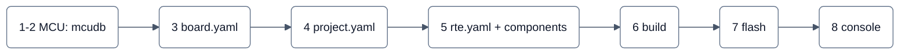

# Getting started

The way in for someone who wants to **use** neXtBSW: you have a control unit (or a schematic of one) and want basic
software with an application on it. First the whole route at a glance, then you build a project that already exists, so
you know your setup works before you describe your own hardware. Why the software is split the way it is: [`../architecture/`](../architecture/README.md).

## The route at a glance

A neXtBSW control unit is described in configuration files, not in code. Each fact is written **once**, in the level it
belongs to; the generators derive the rest (clock trees, bit timings, linker values, pin set-up, the RTE).



| Step | You decide | Where it goes | How you know it is right | Page |
|---|---|---|---|---|
| 1 | Which MCU (derivative and package) the schematic uses | nothing yet | the derivative exists in `mcudb/` | [Your first board](your-first-board.md#step-1-what-you-have) |
| 2 | Manufacturer facts of that MCU | `mcudb/<family>/<derivative>.yaml`: check it, or add it | `nxconfig check` finds it and accepts your pins | [Your first board](your-first-board.md#step-2-the-derivative) |
| 3 | What is fitted on the board and how it is wired | `boards/<board>/board.yaml`: **hardware only** | `nxconfig check` | [Your first board](your-first-board.md#step-3-the-board) |
| 4 | What this software uses, at which clock, bit rate, frequency; memory split; diagnostic addresses | `projects/<project>/project.yaml` | `nxconfig check` | [Your first board](your-first-board.md#step-4-the-project) |
| 5 | Which components run in which task, and what their ports connect to | `projects/<project>/rte.yaml`, a DBC, components under `swc/` | the configure run (`rtegen`) | [The application](the-application.md) |
| 6 | Build | a CMake preset | configure and build pass, without warnings | [Build and flash](build-and-flash.md#step-6-configure-and-build) |
| 7 | Flash bootloader and application | `flash-bootloader`, `flash`, `flash-can` | the board starts | [Build and flash](build-and-flash.md#step-7-flash) |
| 8 | Talk to the running ECU | serial console | the console answers | [Build and flash](build-and-flash.md#step-8-the-console) |

**No board is the yardstick.** The boards and projects of this tree (a build-test profile for an S32K148, the NXP S32K116
evaluation board) are *examples*: they show one real set of values, yours will differ, and nothing in neXtBSW assumes
the values of an example board.

## What runs today

The state of the repository, not a promise:

| Board profile | Derivative (core) | Configure and check | Target build | Running on hardware |
|---|---|---|---|---|
| `buildtest_s32k148` (`buildtest_s32k148_min`) | S32K148 (Cortex-M4F) | yes | yes | no: a pure build test with no board behind it |

The software has been brought up on one S32K144 board of the maintainers. Its board files exist, but in the maintainers' private repository and not in this public tree, so you will not find them here;
for the board profile above there is no recorded bring-up of the application. For your hardware:

- **S32K1 with a Cortex-M4F (S32K142/144/146/148):** you can describe your board, check it and build application and
  bootloader. Expect to be the first to measure the bring-up on a board of your own.
- **S32K116 (Cortex-M0+):** the derivative data (`mcudb/s32k1xx/S32K116.yaml`) and the platform code are in this tree.
  The maintainers' profile for the NXP evaluation board is not published yet: the levels of its LEDs, buttons and
  potentiometer are not confirmed by a public source and are measured on the board first. In that profile
  configuration and compilation work; only a reduced application (no console, no application CAN, no UDS) links, the
  full application does not fit into 128 KB flash and the small RAM yet.
- **Other families (STM32, S32K3, RM4x):** derivative data and parts of the platform exist in the maintainers' tree,
  but are not published yet; a complete target build does not exist.

## Before you start

Python 3.12, CMake 3.28 or newer, Ninja and an `arm-none-eabi-gcc` (the pinned xPack GCC 11.3.1 from
`python -m tools.ci setup`; found on `PATH` or through `NX_ARM_GCC_BIN`, a setting of your workstation that is never
checked in). The one-time set-up (submodule, virtual environment, requirements) is in
[`../../CONTRIBUTING.md`](../../CONTRIBUTING.md#get-set-up). On Windows use the interpreter from `.venv` and set
`PYTHONUTF8=1`.

## Step 0: build something that already works

If this fails, the problem is your set-up, not your board.

```sh
.venv/Scripts/python tools/nxconfig check projects/buildtest_s32k148_min/project.yaml
cmake --preset buildtest-s32k148-min
cmake --build --preset buildtest-s32k148-min
```

The check ends `buildtest_s32k148_min: ok (board buildtest_s32k148, S32K148, 0 warning(s))`: `ok`, the board and
derivative it resolved to, and the number of warnings. A warning means something is unconfirmed or probably unintended
([reading the messages](your-first-board.md#reading-the-messages)). The configure run ends with `-- Build files have
been written to: …`, the build with the application and bootloader linked; nothing needs a board
([Build and flash](build-and-flash.md#step-6-configure-and-build)). Optionally run the checks of the configuration model:

```sh
.venv/Scripts/python tools/test -k nxconfig --jobs 4
```

The test runner reports in German; `Ergebnis: OK` is the line that counts. When all of this passes, go on to
[Your first board](your-first-board.md).
