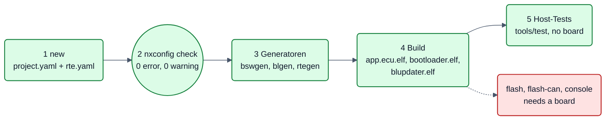
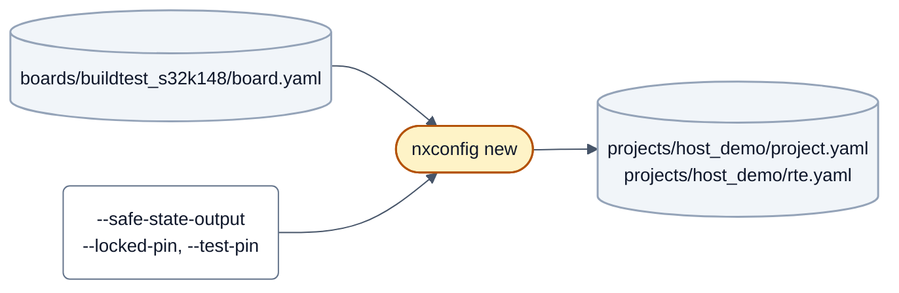
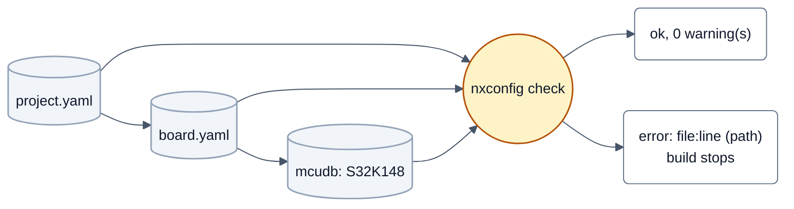
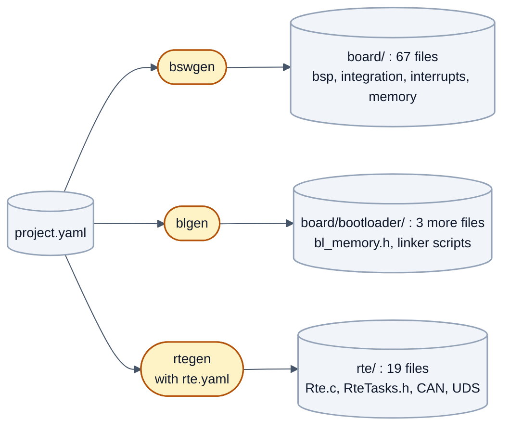
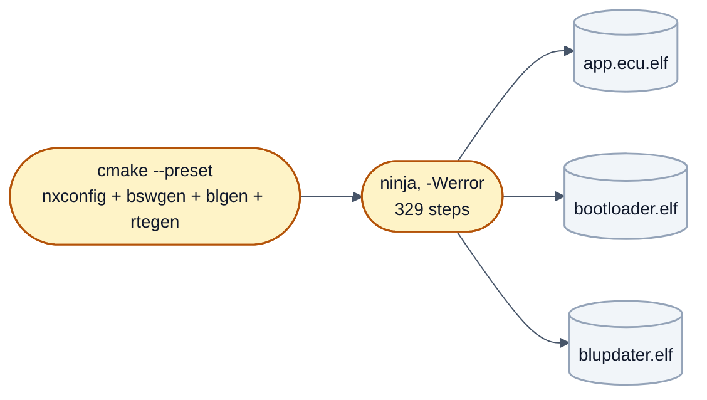
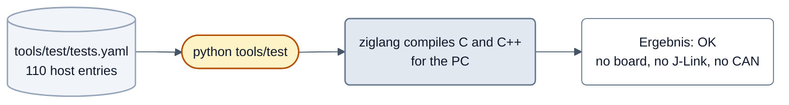
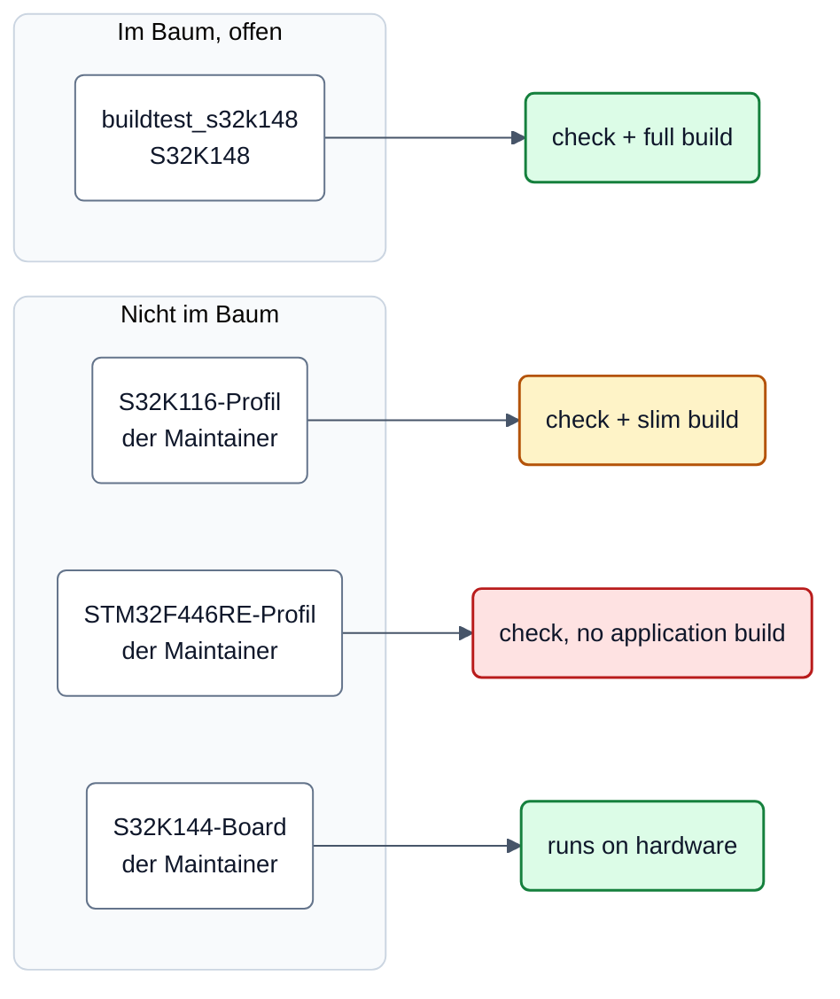

<!-- SPDX-License-Identifier: Apache-2.0 -->

# Host-Durchlauf ohne Hardware



Fünf Schritte von einem leeren Klon bis zu grünen Tests. **Kein Board, kein Debugger, kein CAN-Adapter.** Grün hinterlegt
ist, was dieser Durchlauf wirklich ausführt, rot, was ein Board braucht und hier nicht gelaufen ist
([Build and flash](build-and-flash.md#step-7-flash)). Dies ist der Weg für jeden, der neXtBSW zum ersten Mal ausprobiert;
ein Referenzboard, auf dem die Anwendung außerhalb des Maintainer-Aufbaus läuft, gibt es erst nach R1
([Board-Tabelle](#welche-boards-was-können-sie)).

**Was geprüft wurde.** Jeder Befehl auf dieser Seite wurde am 2026-10-04 in einem Git-Worktree des Repositorys
ausgeführt (Windows 10, Python 3.12, CMake 3.28, Ninja, `arm-none-eabi-gcc` 11.3.1 aus `python -m tools.ci setup`); die
Ausgaben sind echt und gekürzt (`…`). Zwei Abweichungen vom Klon: Der Worktree hat kein eigenes `.venv`, deshalb steht
beim Konfigurieren `-DPython3_EXECUTABLE=…` und wegen der Pfadlänge unter Windows ein kurzer `-B`-Ordner. Im Klon
entfallen beide Angaben, wenn das `.venv` wie in [`CONTRIBUTING.md`](../../CONTRIBUTING.md#get-set-up) angelegt ist.
Ein frischer Klon auf einem zweiten Rechner wurde nicht durchlaufen.

Voraussetzungen und die einmalige Einrichtung (Submodul, `.venv`, Compiler): [Getting started](getting-started.md#before-you-start).
Im Folgenden steht `.venv/Scripts/python` für den Interpreter dieses `.venv`; unter Windows `PYTHONUTF8=1` setzen.

## Schritt 1: Projekt anlegen



`nxconfig new` legt ein leeres Projekt für ein Board an; Takt, Speicheraufteilung, Diagnoseadressen und Interrupt-Ränge
werden aus Board und Derivat abgeleitet. Nur der Abschnitt `safety` wird **nie** abgeleitet: Welcher Ausgang eine
Anzeige ist und welcher Pin unbeschaltet ist, steht nur im Schaltplan. Die Kandidaten nennt
`nxconfig new --safety-candidates --board <board>`.

```sh
.venv/Scripts/python tools/nxconfig new host_demo --board buildtest_s32k148 \
    --safe-state-output LED1 --locked-pin LED2 --test-pin PTA0
```

```text
empty project host_demo in …/projects/host_demo:
  project.yaml
  rte.yaml
note: core clock 80 MHz (highest value of S32K148 the clock model reaches with this board and its buses)
note: safety section as chosen: safe_state_output LED1, locked_pin LED2, test_pin PTA0 - check on the schematic that the indicator drives no actuator and that PTA0 is unconnected. …
…
host_demo: created …/projects/host_demo/project.yaml, 0 error(s), 0 warning(s)
```

> **Beispiel: das Build-Test-Board.** LED1, LED2 und PTA0 sind hier beliebig gewählt, weil hinter dem Profil kein Board
> steht, das man verdrahten könnte. Bei einem echten Board wählt man sie am Schaltplan. Das Projekt liegt in
> `projects/host_demo` des eigenen Klons; es gehört nicht zum Lieferumfang.

Ohne eigenes Projekt geht es auch mit dem vorhandenen `projects/buildtest_s32k148_min`; die Schritte 2 bis 5 sind
dieselben. Mehr zum Anlegen: [`projects/README.md`](../../projects/README.md) (Abschnitt „Neues Projekt“) und
[Your first board](your-first-board.md#step-4-the-project).

## Schritt 2: `nxconfig check`



```sh
.venv/Scripts/python tools/nxconfig check projects/host_demo/project.yaml
```

```text
host_demo: ok (board buildtest_s32k148, S32K148, 0 warning(s))
```

`ok` und `0 warning(s)` sind das Ziel. Eine Warnung ist kein Fehler, aber ein offener Punkt. Ein Fehler nennt Datei, Zeile
und YAML-Pfad und stoppt später auch den Build; Beispiele und ihre Lesart:
[Your first board](your-first-board.md#reading-the-messages).

## Schritt 3: Generatoren



Beim Konfigurieren laufen die Generatoren von selbst (Schritt 4). Einzeln aufgerufen zeigen sie, was sie schreiben. Das
Ziel ist ein beliebiger Ordner; die erzeugten Dateien werden nie von Hand geändert.

```sh
.venv/Scripts/python tools/bswgen/bswgen.py projects/host_demo/project.yaml <ordner>/board
.venv/Scripts/python tools/bswgen/blgen.py  projects/host_demo/project.yaml <ordner>/board
.venv/Scripts/python tools/rtegen/rtegen.py projects/host_demo/project.yaml <ordner>/rte --repo .
```

Alle drei enden ohne Ausgabe und mit Rückgabewert 0. Ergebnis im Ordner: `bswgen` schreibt 67 Dateien, `blgen` ergänzt
3, `rtegen` schreibt 19 (zusammen 89):

```text
board/bootloader/bl_memory.h  bl_memory.ld  bl_sections.ld  bl_board.h  …
board/bsp/io/output/outputConfiguration.h  …
board/integration/modules.cmake  …
rte/Rte.c  RteConfig.cpp  RteTasks.h  Rte_Type.h  uds/udsBusConfiguration.h  …
```

Eine erzeugte Datei sagt in der ersten Zeile, woher sie kommt, zum Beispiel
`// Generated by tools/bswgen from projects/host_demo/project.yaml (board buildtest_s32k148) - do not edit.`
Die Rolle der Generatoren im Ganzen: [Build and flash](build-and-flash.md#what-the-configure-run-does).

## Schritt 4: Build



Es gibt für das neue Projekt noch kein eigenes Preset (siehe [Build and flash](build-and-flash.md#step-6-configure-and-build)).
Man nimmt das Preset des Build-Test-Boards und überschreibt das Projekt:

```sh
cmake --preset buildtest-s32k148-min -DNX_PROJECT=<Pfad zum Klon>/projects/host_demo/project.yaml
cmake --build build/buildtest-s32k148-min --config RelWithDebInfo
```

Konfigurieren (gekürzt, 82 s Konfigurieren und 13 s Erzeugen auf diesem Rechner):

```text
-- nxconfig: host_demo: board buildtest_s32k148, S32K148 (s32k1xx, cortex-m4f), 0 warning(s)
…
-- flash targets: jlink (C:/Program Files/SEGGER/JLink/JLink.exe) for probe J-Link
…
-- bootloader: CAN bus CAN0, device hooks:
-- Configuring done (81.7s)
-- Generating done (12.6s)
-- Build files have been written to: …
```

Bauen (329 Schritte, Rückgabewert 0, keine Warnung im Log):

```text
[327/329] Linking C executable bootloader\updater\RelWithDebInfo\blupdater.elf
[329/329] Linking CXX executable ecu\application\RelWithDebInfo\app.ecu.elf; ROM check: reference CRC into app.ecu.elf and its hex (SYS-38)
romcheck: app.ecu.hex: 5 areas, 159800 bytes (0 gap bytes as 0xFF), CRC 0x80DDA7C5, list at 0x0002F060, result at 0x0002F08C
   text	   data	    bss	    dec	    hex	filename
 159396	    452	  42548	 202396	  3169c	…/ecu/application/RelWithDebInfo/app.ecu.elf
```

Das Abbild wird gebaut und **nicht** geflasht: Hinter dem Build-Test-Profil steht kein Board
([Board-Tabelle](#welche-boards-was-können-sie)). Die Flash-Ziele sind vorhanden, aber nicht gelaufen. Unter Windows
auf einen kurzen Build-Ordner achten (`-B`), sonst sprengt ein tiefer Klon die Pfadgrenze.

## Schritt 5: Host-Tests



`tools/test` führt alle Tests aus **einer** Liste aus. Die Gruppe `host` übersetzt die C- und C++-Quellen des Treibers
mit `ziglang` für den PC und prüft sie gegen Registermodelle. Eine Auswahl, die in diesem Durchlauf lief:

```sh
.venv/Scripts/python tools/test --group host --jobs 4 \
    -k clock-config-s32k-s32k148 -k clock-check-s32k-firc -k safe-watchdog
```

```text
[ 1/3] OK   host    clock-check-s32k-firc         34.8s  42 Prüfungen, 0 Fehler
[ 2/3] OK   host    safe-watchdog                 34.9s  39 Prüfungen, 0 Fehler
[ 3/3] OK   host    clock-config-s32k-s32k148     35.3s  59 Prüfungen, 0 Fehler
…
Ergebnis: OK (3 gruen, 0 rot, 0 uebersprungen, 140 Testfaelle, 35.4s)
```

(Der Testlauf berichtet noch auf Deutsch; maßgeblich ist die Zeile `Ergebnis: OK`.) Alles, was fehlt (zum Beispiel ein
Compiler), wird als „übersprungen“ gemeldet und nicht rot. `--group host --list` zeigt alle 110 Einträge dieser Gruppe,
ohne sie auszuführen. Der vollständige Lauf, `.venv/Scripts/python tools/test --group all --jobs 4`, wurde für diese Seite
**nicht** ausgeführt; er dauert lange und ist in [`CONTRIBUTING.md`](../../CONTRIBUTING.md#build-and-test) beschrieben.

## Was ohne Hardware nicht geht

| Schritt | Ohne Board | Warum |
|---|---|---|
| `flash-bootloader`, `flash`, `flash-can` | nicht gelaufen | brauchen Debugger bzw. CAN-Adapter und ein Board |
| Konsole (`help`, `lc`, `rte`, …) | nicht gelaufen | läuft auf dem UART des Boards |
| Zeitverhalten, Stromaufnahme, Pegel | nicht prüfbar | Host-Tests nutzen Registermodelle, keine Silizium-Eigenschaften |
| Software-Komponenten aus Simulink-Modellen neu erzeugen | nicht in diesem Durchlauf | braucht MATLAB (`swc_build.m`); das Projekt hier hat keine Komponente |
| Test-Einträge mit `requires: [full_tree]` | im offenen Export übersprungen | brauchen Teile, die nicht öffentlich sind |

Dass die Anwendung auf echter Hardware läuft, ist bisher nur auf dem privaten S32K144-Board der Maintainer belegt, dessen
Dateien nicht zum Baum gehören.

## Welche Boards, was können sie?



Farbe: grün = Konfiguration prüfen und voll bauen, gelb = nur abgespeckt bauen, rot = nur prüfen, kein Anwendungs-Build.

| Board (Ordner in `boards/`) | Derivat | Stand | Was ein Außenstehender damit kann | Quelle |
|---|---|---|---|---|
| `buildtest_s32k148` (Projekt `buildtest_s32k148_min`) | S32K148, Cortex-M4F | **nur Build**: `nxconfig check` ohne Warnung; Anwendung, Bootloader und Updater bauen ohne Warnung; keine Hardware dahinter | den Host-Durchlauf dieser Seite machen; prüfen, dass eine Änderung nicht an ein bestimmtes Board gebunden ist; kein Flashen, keine Konsole | [`boards/buildtest_s32k148/README.md`](../../boards/buildtest_s32k148/README.md), Test `target-buildtest-s32k148` |
| S32K116-Profil der Maintainer (NXP-Evaluierungsboard) | S32K116, Cortex-M0+ | **nicht im öffentlichen Baum**, bis die Pegel von LEDs, Tastern und Poti am Board gemessen sind (kein öffentlicher Beleg). Dort baut nur eine abgespeckte Anwendung (ohne Konsole, ohne Anwendungs-CAN, ohne UDS) in 128 KB Flash und 14 KB RAM; die volle Anwendung passt nicht. Hardware: nichts geprüft | nichts direkt; offen sind die Derivatdaten (`mcudb/s32k1xx/S32K116.yaml`) und die Host-Tests der Plattform | [Getting started](getting-started.md#what-runs-today) |
| STM32F446RE-Profil der Maintainer | STM32F446RE, Cortex-M4F | **nicht im öffentlichen Baum**: die Familie `stm32` wird noch nicht unterstützt (kein Board-Generator in `bswgen`) | nichts direkt | [Getting started](getting-started.md#what-runs-today) |
| S32K144-Board der Maintainer | S32K144, Cortex-M4F | **läuft**: Anwendung, Bootloader, Flashen, Konsole auf Hardware belegt; Board-Dateien existieren, liegen aber im privaten Repository der Maintainer und nicht in diesem öffentlichen Baum | nichts direkt; das Verhalten ist nur als Bericht der Maintainer belegt | [Getting started](getting-started.md#what-runs-today) |

Für ein eigenes Board gilt: Ein S32K142/144/146/148 (Cortex-M4F) lässt sich beschreiben, prüfen und bauen; die
Inbetriebnahme am eigenen Board hat bisher niemand außerhalb der Maintainer gemessen. Andere Familien: Daten und
Teile der Plattform liegen bei den Maintainern und sind noch nicht veröffentlicht, ein vollständiger Build fehlt.

**Stand R1 (Nutzerentscheidung `doc-r1-referenzboard`): Host-Durchlauf plus diese ehrliche Tabelle; ein Referenzboard,
auf dem Außenstehende die Anwendung wirklich laufen lassen können, kommt erst nach R1.**

## Weiter

- Eigene Hardware beschreiben: [Your first board](your-first-board.md).
- Eigenes Repository mit festgenagelter neXtBSW-Version: [Your own ECU repository](customer-project.md).
- Flashen und Konsole, sobald ein Board da ist: [Build and flash](build-and-flash.md#step-7-flash).
