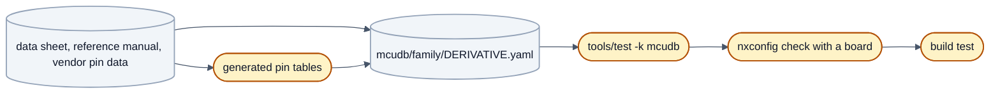

# Adding a derivative

How to describe a new MCU derivative of a family neXtBSW already supports, for example one more S32K1 part: which
files to write, where each value comes from, how to mark what is not confirmed, how the pin table is made, and how to
check the result. [Your first board](your-first-board.md#step-2-the-derivative) sends you here when your MCU is not in
`mcudb/` yet.



## Derivative or family?

| | New derivative of an existing family | New family |
|---|---|---|
| Example | another S32K1 part next to S32K116/142/144/146/148 | a first TI RM4x, a first S32K3 that builds |
| What you write | data: `mcudb/<family>/<DERIVATIVE>.yaml`, its pin tables, the vendor pin data under `sources/` | code: an OpenBSW-style platform `platforms/<family>`, a family branch in the board generator, the family's clock model, a family port |
| This page | yes | no |

A derivative belongs to an existing family when that family's drivers run it unchanged: same peripheral IP blocks, a
device header that describes it (or a superset), a core the toolchain file knows. Everything that differs (memory sizes,
instance counts, packages, pins, clock limits) is data. For a new family the rules are in
[`../architecture/README.md`](../architecture/README.md), section 6 (platform rule P1–P6), and
[`../architecture/plattformen.md`](../architecture/plattformen.md).

## The rule on sources

Every value in `mcudb/` is a manufacturer fact and needs **public evidence** (decision PLAT-46: *mcudb values only with
a public source*):

| Allowed as a source | Not allowed |
|---|---|
| Data sheet and reference manual as published, including files attached to the PDF; cite document, revision, section or table, page (for s32k1xx the memory map `S32K1xx_Memory_Map.xlsx`, tag `[MAP]`, cite the sheet) | anything from a document the manufacturer has not published, even one number |
| Vendor files in the repository with an open licence, cited by path: Zephyr `hal_nxp` pin headers (Apache-2.0), STM32 Open Pin Data (BSD-3-Clause), device headers under `platforms/*/bsp/bspMcu/include/3rdparty/` | vendor files whose licence forbids redistribution or is unclear (device headers and linker scripts of a vendor IDE) |
| Public reference code with an open licence, for a *default* the documents leave open (the s32k1xx clock defaults cite the OpenBSW reference port) | values guessed from a similar part without saying so |

- **If no published document answers a question, the value stays out**, or goes in as `verify: true` with a comment
  that a public source is missing. A clock `default` without evidence is left out, and a project that uses the instance
  without choosing a clock gets an error instead of a guessed value.
- **Vendor files whose licence is unclear stay on the workstation.** Worked example: the S32K116 SVD file, only a
  README with download address, licence finding and checksum is checked in
  ([`../../mcudb/s32k1xx/sources/keil_s32k116_dfp/README.md`](../../mcudb/s32k1xx/sources/keil_s32k116_dfp/README.md)).
  A test in [`../../mcudb/tools/test_mcudb.py`](../../mcudb/tools/test_mcudb.py) rejects citations of vendor-IDE files.

## What you need before you start

The **data sheet** (memory sizes, packages, instance counts, clock and oscillator limits), the **reference manual** (memory
map, flash sector and programming sizes, clock distribution, MPU, ADC channel codes) and **public pin multiplexing
data** for every package ([The pin tables](#the-pin-tables)). Write down document number and revision; you cite them in
almost every entry.

## The derivative file

Create `mcudb/<family>/<DERIVATIVE>.yaml` (file name = derivative name in capitals, folder = family). `nxconfig` finds a
derivative by the `mcu:` of a board. Start from the closest existing derivative of the family and change every value you
can back; the structure is fixed by the schema, class `Derivative` ([generated reference](../reference/derivative.md)),
and unknown keys are rejected. Put a comment block at the top that lists the documents with a short tag each, and use the
tags in the entries (`mcudb/s32k1xx/S32K142.yaml`, comments there are German):

```yaml
#   [DS]    S32K1xx Data Sheet Rev. 15 (5 March 2026), Figure 3 "S32K1xx product series comparison"
#   [RM]    S32K1xx Series Reference Manual Rev. 13 (04/2020): 31.3.1 Table 31-2 "On-chip SRAM sizes"
```

### Sections and where each value comes from

| Section | Contents | Source |
|---|---|---|
| `derivative` | `name` (= file), `family` (= folder), `core`, `fpu`, `nvic_priority_bits`, `features`, `packages`, `pin_pattern`, `sources`, optional tool names (`jlink_device`, `pyocd_target`, `openocd_target`) | data sheet, reference manual |
| `memory` | per region: `name`, `kind` (`code_flash`, `data_flash`, `ram`, `eeprom_ram`), `start`, `size`; flash also `sector_size` (or `sectors`) and `program_size` | reference manual memory map and flash chapter; data sheet sizes |
| `instances` | per peripheral instance: `class`, timer `channels`, ADC `resolution_bits`, `channel_pattern`, `internal_channels`, `clock` (`sources`, `divider`, `max_hz`, `default`) | data sheet (counts), reference manual (channels, clock distribution); `default` from a public reference port |
| `mpu` | `regions` | reference manual, MPU chapter |
| `pinmux` | per package: `file` of the generated pin table | generated ([pin tables](#the-pin-tables)) |
| `device_header` | `file` the family code includes, `describes` (a superset is allowed) | a header in the repository with an open licence |
| `clock` | oscillators, `pll` limits, `max_hz` per domain, `system_source_max_hz`, `output_max_hz`, `pcc` | data sheet, reference manual clock chapter |
| `vim` | Cortex-R only: channel count, fixed channels | reference manual |

Nothing that depends on a board or project goes in: no crystal, no chosen clock, no pins in use, no memory split.

- **One value, one place.** If a family needs a value the schema cannot hold, that is a schema change, not a comment.
- **The largest variant** where the ordering code varies the RAM size, said in a comment.
- **Fact and default are separate.** The derivative says which clock sources an instance *can* use; the project chooses.
  An optional `default` needs evidence like any other value, otherwise leave it out.
- **The device header must know every instance.** `nxconfig` compares your instances with the derivative named in
  `device_header.describes`. If no existing header covers your derivative, providing one is platform work, see
  [`../../platforms/s32k1xx/bsp/bspMcu/include/3rdparty/nxp/rtd/README.md`](../../platforms/s32k1xx/bsp/bspMcu/include/3rdparty/nxp/rtd/README.md).

### `source:` and `verify:`

Almost every entry takes a `source:` string and a `verify:` flag (instances take `verify:` only).

- **`source:`** names the document tag, the section or table and the page, enough for a reviewer to find it in a minute:
  `source: "[RM] 36.1.2 256 KB, 36.2.1.1 Sektor 2 KB"`.
- **`verify: true`** marks a value without public evidence yet (a document you could not get, a sister part, a
  placeholder). Say in a comment why and what would confirm it.
- **`derivative.example: true`** is for format examples that are not real data; `nxconfig` warns whenever a project
  uses one.

`nxconfig check` warns once per `verify: true` entry whose values the project actually uses, with file, line and YAML
path, naming the fields it read and what they are needed for; entries the project does not touch stay silent. Every
such warning has to be cleared, by a source or a measurement on hardware, before the first bring-up.

## The pin tables

Pin tables say which signal a pin can take with which selector (s32k1xx: the `PORT_PCR.MUX` value). They are
**generated from vendor pin data, never typed**; each generated file names its source and licence and must not be edited.

| Family | Vendor data | Generator |
|---|---|---|
| s32k1xx, s32k3xx | Zephyr `hal_nxp`, `dts/nxp/s32/pinctrl`, one `<part>-pinctrl.h` per derivative and package (Apache-2.0) | [`../../mcudb/tools/pinmux_hal_nxp.py`](../../mcudb/tools/pinmux_hal_nxp.py) |
| stm32 | STMicroelectronics `STM32_open_pin_data`: `<RefName>.xml` and the GPIO modes file under `IP/` (BSD-3-Clause) | `pinmux_stm32_open_pin_data.py` in the maintainers' tree; not published yet, the family is not supported |

For an NXP part:

1. Copy the header of your derivative and package **unchanged** into `mcudb/<family>/sources/hal_nxp/`, from the same
   upstream commit as the others. "Delta headers" `#include` another part; copy the base header too.
2. Record the origin in the `README.md` of that folder: upstream repository, path, commit, date, licence
   ([`../../mcudb/s32k1xx/sources/hal_nxp/README.md`](../../mcudb/s32k1xx/sources/hal_nxp/README.md) is the pattern).
   `test_mcudb.py` requires a `LICENSE` file and the word "Commit" in the README of every source folder.
3. Run the generator (one table per header found; prints nothing when nothing changed):

   ```sh
   .venv/Scripts/python mcudb/tools/pinmux_hal_nxp.py
   ```

4. Reference each table from the derivative, keyed by the package name under `packages` (key and file name may differ,
   e.g. `MAPBGA100: { file: S32K144_BGA100.pinmux.yaml }`):

   ```yaml
   pinmux:
     LQFP100: { file: S32K142_LQFP100.pinmux.yaml }
     LQFP64: { file: S32K142_LQFP64.pinmux.yaml }
   ```

`--check` compares without writing, exits 1 and names every missing or outdated table. Entries the generator cannot map
without guessing are left out and listed in the header of the generated file.

**No public pin data for a package?** Leave it out of `pinmux`: the configuration loads, but every board on that package
gets the warning `S32K142 has no pin multiplexing data for package LQFP64: pin functions are not checked`. Do not fill the
gap with an unmarked copy of another package; the schema has `verify: true` and `complete: false` on a `pinmux` entry for
that case.

## Checking the derivative

**The derivative database tests.**

```sh
.venv/Scripts/python tools/test -k mcudb --jobs 4
```

The group `mcudb` loads every derivative file, runs the derivative checks of `nxconfig` for each package, and checks
that every pin table is referenced exactly once and every source folder names origin and licence; `mcudb-pinmux-nxp` and
`mcudb-pinmux-stm32` check that the tables are up to date. Two assertions list the database contents on purpose, so a new
derivative makes them fail until you update [`../../mcudb/tools/test_mcudb.py`](../../mcudb/tools/test_mcudb.py): the
number of derivative/package pairs and, for s32k1xx, the MPU region count per derivative (with its evidence in
`mpu.source`). `tools/test -k nxconfig` additionally requires every s32k1xx derivative to describe the clock gates the
family clock driver writes, each with `source` (or `verify: true`) and a `default`.

**`nxconfig check` with a board on the new derivative.** A derivative is only checked completely together with a board and
project that use it. Without a board, use a minimal one; the synthetic profile `testproject_s32k142_bl` is one for the
S32K142:

```sh
.venv/Scripts/python tools/nxconfig check tools/nxconfig/test/profiles/projects/testproject_s32k142_bl/project.yaml
```

Mistakes in the derivative file are reported against that file, with line and YAML path:

```text
S32K142.yaml:17 (derivative.name): error: name S32K143 does not match the file name S32K142.yaml
S32K142.yaml:19 (derivative.core): error: unknown core cortex-m4 (known: cortex-m0plus, cortex-m4f, cortex-m7f, cortex-m33, cortex-r4f)
S32K142.yaml:31 (memory[0].size): error: size 0x40000 of PFLASH is no multiple of sector_size 0x1800
```

**The build test.** The last check is a target build of a minimal project on the derivative; it shows that family code,
device header and linker template accept the new memory map and instance set, which no configuration check can see.
`buildtest_s32k148_min` is the pattern, a project with no hardware behind it
([`../../boards/buildtest_s32k148/README.md`](../../boards/buildtest_s32k148/README.md)); give yours a preset in
`CMakePresets.json` (see [Build and flash](build-and-flash.md#step-6-configure-and-build)):

```sh
cmake --preset buildtest-s32k148-min
cmake --build --preset buildtest-s32k148-min
```

A derivative with less memory than the application needs configures and compiles but does not link, which is the state
of the S32K116 today ([Getting started](getting-started.md#what-runs-today)): a real result, not a mistake in the file.

## Checklist

- [ ] `mcudb/<family>/<DERIVATIVE>.yaml` with a document list at the top and `source:` on every entry that takes one
- [ ] every value without public evidence marked `verify: true`, with a comment saying why
- [ ] nothing from unpublished documents or from vendor files that may not be redistributed
- [ ] vendor pin data copied unchanged under `sources/`, origin and licence in its README, tables generated, `--check` silent
- [ ] `tools/test -k mcudb` and `tools/test -k nxconfig` green, `test_mcudb.py` updated
- [ ] `nxconfig check` of a board and project on the derivative: `ok`
- [ ] a build-test project that configures and builds

Next, for your own hardware: [Your first board](your-first-board.md#step-3-the-board) and the
[board README template](board-readme-template.md).
