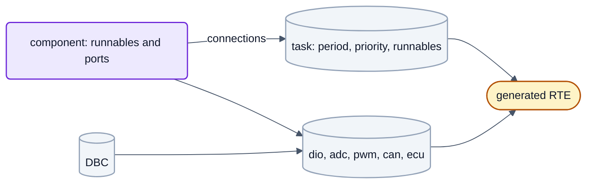
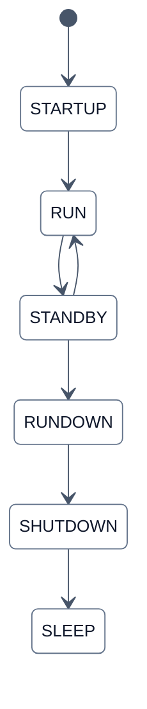

# The application

Step 5 of the [route](getting-started.md#the-route-at-a-glance): which software components run, in which task, and what
their ports are connected to. The result is the **ECU description** of the project, `rte.yaml`, from which
`tools/rtegen` generates the RTE during the configure run.



The full rules (model conventions, connection targets, task rules, data consistency, qualifiers) are in
[`../../swc/README.md`](../../swc/README.md) (German for now); every key of the file is in the generated
[`rte.yaml` reference](../reference/rte.md). This page takes you through the decisions in order.

## What you need

| File | Contents |
|---|---|
| `projects/<project>/rte.yaml` | tasks, components, connections, CAN and diagnostic bus; `project.rte` points to it. **Required**: an ECU without components has one task and `components: []`, as `nxconfig new` writes it |
| `projects/<project>/<Name>.dbc` | the CAN database, if the application sends or receives CAN signals |
| `swc/<Swc>/` or `projects/<project>/swc/<Swc>/` | a software component: Simulink model (`.slx`) and its generated code and ARXML, both checked in |

Paths inside `rte.yaml` (`components[].path`, `can.dbc`) are relative to the file itself (RTE-22).

## Components

Application logic is a Simulink model configured as an AUTOSAR Classic software component. MATLAB with Simulink,
Embedded Coder and AUTOSAR Blockset is needed only to **change** a model; generated C code and ARXML are checked in, so
building needs no MATLAB. A new component starts as a `swc.yaml` copied from `swc/template/swc.yaml` into a folder of
the component's name, checked before the model is created:

```sh
.venv/Scripts/python tools/swc/swc_yaml.py check swc/<Swc>
```

Model creation and code generation run in MATLAB (`swc_create`, `swc_build`, see [`../../swc/README.md`](../../swc/README.md);
not run for this guide). A reusable component lives under `swc/`, one of a single project under
`projects/<project>/swc/`. A component never refers to a pin, a board or a bus, only to its ports.

## Tasks

`tasks` lists name, `period_ms`, `priority`, `stack_bytes` and the runnables in call order. `priority` is an ordering key
among the tasks of the basic software (background 10, bsp 20, can 40, sysadmin 50, safety 60); pick one that is not
taken. Without `tasks`, one task `swc` is created.

## Connections

Each port is connected in `connections` as `<Swc>.<Port>.<Element>: <target>`. Targets name board entries the **project
uses** (`use:` in `project.yaml`), never pins:

| Target | Meaning |
|---|---|
| `dio.in.<NAME>`, `dio.out.<NAME>` | digital input or output |
| `adc.mv.<NAME>`, `adc.phys.<NAME>`, `adc.qlf.<NAME>` | analog input in mV, in the physical unit of its sensor circuit, and its quality |
| `can.rx.<Msg>.<Signal>`, `can.tx.<Msg>.<Signal>`, `can.qlf.<Msg>` | CAN signals from the DBC and the qualifier of a received message |
| `pwm.<Pair>`, `capture.<Channel>.<value>`, `hall.<Sensor>.<value>` | PWM duty, measured input signals |
| `ecu.state`, `ecu.wakeup…`, `ecu.sleep_request` | ECU state management |
| `ecu.mode` | the ECU states as modes, for mode ports only ([Modes](#modes)) |
| `<Swc>.<Port>.<Element>` | a provided port of another component |
| `rte` | kept in the RTE only (visible on the console) |

Where a value has a quality (CAN messages, measured inputs, sensors), connect the qualifier too: a value alone keeps its
last content when the source fails; only the qualifier tells the component. `rtegen` warns when one is missing.

## Modes

The ECU states `STARTUP`, `RUN`, `STANDBY`, `RUNDOWN`, `SHUTDOWN`, `SLEEP` are also available as AUTOSAR **modes** of one
mode manager, `ecu.mode`:



(Main path only; the full state machine with restart paths is [`../figures/05-ecu-zustaende.md`](../figures/05-ecu-zustaende.md).)

A component needs a **mode port** (a required port whose mode switch interface names exactly these six modes; read with
`Rte_Mode_<Port>_<ModeGroup>()`) and may have **mode switch runnables** (`SWC-MODE-SWITCH-EVENT` on entry, exit or
transition), all described in its ARXML. In `rte.yaml` the mode port is connected to `ecu.mode` and every mode switch
runnable goes into a task like a periodic one, without `offset_ms`:

```yaml
tasks:
  - name: app
    period_ms: 10
    priority: 30
    stack_bytes: 2048
    runnables: [MySwc.Run10ms, MySwc.OnRunEntry, MySwc.OnRunExit]

connections:
  MySwc.EcuMode.EcuMode: ecu.mode        # <Swc>.<Port>.<ModeGroup>
```

A task sees a change at the start of its next cycle and runs its mode switch runnables once before the periodic ones:
on-exit of the old mode, on-transition, on-entry of the new mode. In that time `Rte_Mode` returns
`RTE_TRANSITION_<Group>`. A port read by runnables of several tasks has no task view and reads the manager directly.

- A mode that lasts less than one cycle of a task can pass unnoticed (no queue of mode switches).
- The application tasks stop when the lifecycle goes down: `SHUTDOWN` is seen for at most one cycle and `SLEEP` never
  (`rtegen` warns about events on them); last actions belong on entry of `RUNDOWN`.
- `ecu.state` stays a sender-receiver port with the state number, for where a number is enough.

`rtegen` rejects, with the YAML path: a mode port connected to anything but `ecu.mode`, a mode group with missing or
unknown modes, an unassigned mode switch runnable or one with an offset, provided mode ports and mode-disabled events.
AUTOSAR correspondence: [`../architecture/autosar.md`](../architecture/autosar.md), section 2.3.

## Explicit and implicit access

Which way a component reads and writes its sender-receiver ports is a property of the **component** (its port mapping in
Simulink, reaching the RTE through its ARXML); `rte.yaml` has no setting for it.

| Model mapping | Call in the component code | What the runnable sees |
|---|---|---|
| `ExplicitReceive` / `ExplicitSend` | `Rte_Read_<Port>_<Element>(&v)`, `Rte_Write_…(v)` | every call reaches the RTE buffer at that moment |
| `ImplicitReceive` / `ImplicitSend`, `ImplicitSendByRef` | `Rte_IRead_<Runnable>_<Port>_<Element>()`, `Rte_IWrite_…(v)`, `Rte_IWriteRef_…()` | its own copy: read values stay the same for its whole run, written values appear when it ends |

Implicit access keeps one copy per runnable and data element, loaded before and published after the runnable under one
lock at most (for a port used by several tasks). Prefer it for a runnable that reads a value several times and must not
see it change in between; the price is RAM and copy time per call (`tools/schedana` lists both). Both ways may be mixed
in one component, even in one runnable. `rtegen` rejects an implicit read on a provided port, an implicit write on a
required port and `ExplicitReceiveByVal`; it warns when runnables of several tasks write one element implicitly. Not
provided: `Rte_IStatus`, `Rte_IInvalidate`. The template `swc/template/swc.yaml` creates explicit ports. Details:
[`../architecture/autosar.md`](../architecture/autosar.md), section 2.3.

## CAN and diagnostics

`can` names the DBC, the node of this ECU in it (`BU_`), the bus (a board CAN name from `use.can`) and the task in which
signals are packed and unpacked; per received message `can.qualifiers` sets timeout, debouncing and end-to-end
protection. `uds.bus` selects the bus of the diagnostic stack. The diagnostic IDs are in `project.yaml`
(`diagnostics`), because the bootloader uses them too. A project without CAN signals leaves out `can`; the bus is still
used for diagnostics and the bootloader.

Example: `projects/buildtest_s32k148_min/rte.yaml` has two tasks (`app10`, `app100`) with freely chosen priority keys,
one component `DemoSwc` (`path: ../../swc/DemoSwc`) and connections such as `DemoSwc.Button1.Button1: dio.in.BUTTON1`
and `DemoSwc.PcCommandQlf.PcCommandQlf: rte.init` (no `can` section, so the qualifier keeps its init value). The same
component runs unchanged in the project of another board, connected to that board's signals. With CAN:

```yaml
can:
  dbc: MyEcu.dbc
  node: ECU
  bus: CAN0
  task: app10

connections:
  MySwc.CommandQlf.CommandQlf: can.qlf.Command
  MySwc.Led1.Led1: [dio.out.LED1, can.tx.Status.Led1]
```

## How you know it is right

`rte.yaml` is checked by `rtegen` during the configure run ([step 6](build-and-flash.md#step-6-configure-and-build)), not
by `nxconfig check`; messages start with `rtegen:`. An error stops the run, a warning does not, but read it:

```text
rtegen: rte.yaml:28 (connections.DemoSwc.Button1.Button1): error: connection DemoSwc.Button1.Button1 -> dio.in.BUTTON9: BUTTON9 is not a dio.in signal used by the project
rtegen: rte.yaml:27 (connections.DemoSwc.PcCommandQlf.PcCommandQlf): warning: required port DemoSwc.PcCommandQlf.PcCommandQlf is not connected: it reads QLF_NOT_AVAILABLE (64, no source) from a constant buffer …
```

The unchanged example project has no warning. The generated RTE lands in `<build>/generated/rte/`; the generator's own
tests run with `.venv/Scripts/python tools/test -k rtegen`. Next: [Build and flash](build-and-flash.md).
