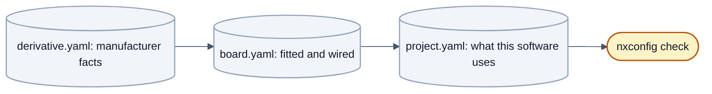

# Your first board

From a schematic to a checked configuration: steps 1 to 4 of the [route](getting-started.md#the-route-at-a-glance).
At the end you have a derivative, a board and a project that `nxconfig check` accepts. The application on top
follows in [The application](the-application.md).



Every value has exactly one level it belongs to (binding table: [`../architecture/README.md`](../architecture/README.md),
section 4, "Responsibility per value"):

| Level | File | Contains | Changes when |
|---|---|---|---|
| Derivative | `mcudb/<family>/<derivative>.yaml` | what the **manufacturer** decided: core, memories, peripheral instances, pin functions, clock limits | never for your project |
| Board | `boards/<board>/board.yaml` | what is **fitted and wired** on the PCB | the PCB changes |
| Project | `projects/<project>/project.yaml` | what **this software** uses and how: clocks, bit rates, memory split, diagnostics, parameters | you change the software |

When unsure: *would a second piece of software on the same PCB need the same value?* Board. *Would the same software
on a different PCB keep it?* Project. *Is it in the datasheet of the MCU?* Derivative.

## Step 1: what you have

Collect before writing anything: the **derivative and package** exactly as ordered (pin functions depend on the
package), the **schematic**, and the **datasheets of the fitted parts** the software drives. Values without a source are
allowed, but marked, see [Sources and `verify`](#sources-and-verify).

## Step 2: the derivative

Look in `mcudb/` (`s32k1xx/`, `s32k3xx/`, `stm32/`, plus one pin table per package). **If it is there,** you normally do
not touch it; check that your package is listed under `packages:` and that a pin table `<derivative>_<package>.pinmux.yaml`
exists, because `nxconfig` uses it to decide whether a pin can take the function you assign. **If it is missing,**
[Adding a derivative](new-derivative.md) says how. Some pins exist only in the larger package (the second CAN bus of the
S32K148 build-test board sits on PTE24/PTE25, which the LQFP100 does not have); that is why the package matters.

## Step 3: the board

Create `boards/<board>/board.yaml`: **what is fitted and how it is wired**, nothing about how software uses it. A board
can carry several projects that use it differently, which only works if the file stays free of usage decisions.

The sections (`board`, `devices`, `can`, `uart`/`spi`/`i2c`, `adc`, `rails`, `dio`, `input_capture`; `pwm` with a power
stage is after R1) and every key are in the generated [Board description](../reference/board.md); the existing board
files are worked examples, for instance `boards/buildtest_s32k148/board.yaml` (two passive CAN transceivers on two
controller instances, an 8 MHz crystal) and the synthetic test boards under `tools/nxconfig/test/profiles/boards`.
What differs from board to board is exactly what belongs in this file.

What does **not** go in, because the PCB does not decide it:

- **Frequencies, bit rates, baud rates, dead times, which peripherals are used.** A board lists everything wired, even
  if no project uses it yet. Project.
- **Memory split, CAN IDs, diagnostic addresses, tasks.** Project.
- **The load behind a sensor input** (an NTC in a connector): project (`adc_loads`); the board describes the circuit up
  to the pin.
- **Workstation settings** (debugger path, serial port, probe serial number): not checked in at all.

A signal name is free: name it after the net in your schematic.

## Step 4: the project

Create `projects/<project>/project.yaml`: what this software uses from the board and how. Paths in the `project`
section are relative to the file. The sections (`project`, `clock`, `use`, `can`/`uart`, `memory`, `bootloader`,
`diagnostics`, `interrupts`, `modules`, `safety`, …) are in the generated [Project description](../reference/project.md).
Three rules to know while writing:

- `project.rte` is **required** (an ECU without components has one task and `components: []`), see
  [The application](the-application.md).
- `clock.system_hz` is the core clock; PLL settings, dividers and peripheral clocks are derived, never written.
- `use:` lists the board entries the software uses (`all` or names); every CAN bus and UART in use needs its bit rate
  or baud rate, and every CAN bus an interrupt rank.

What does **not** go in: pins, pads and instances (the project refers to board entries by name; the one exception is
`safety.test_pin`), the crystal (board), and derived values such as PLL factors, bit-timing segments, linker addresses
or register values (the generator computes them).

**Values the flashed bootloader depends on.** `memory`, `bootloader.can` and `diagnostics` are also compiled into the
bootloader. Once a bootloader is on a board, a project that changes any of them needs a bootloader update as well;
choose them carefully and keep them identical across projects that share a board. Example:
`projects/buildtest_s32k148_min/project.yaml`. Using one timer both as PWM and as capture input in **one** project is
rejected by `nxconfig check`.

## Checking: `nxconfig check`

Run it after every change:

```sh
.venv/Scripts/python tools/nxconfig check projects/<project>/project.yaml
```

It loads project, board and derivative together, resolves every name and checks what can be checked without building:
pins and pin functions, resources used twice, clock and timing reachability, memory layout, diagnostic IDs, module
parameters, and rules across levels (a CAN bus without interrupt rank). `--json` gives machine-readable messages; the exit
code is 0 without error, otherwise 1. A few rules are applied only by the generators in the configure run and appear as
`rtegen:` messages in [step 6](build-and-flash.md#step-6-configure-and-build).

### Reading the messages

Every message has file, line, YAML path, severity and a sentence:

```text
project.yaml:45 (memory.bootloader.size): error: bootloader size 0x8800 ends inside a sector of PFLASH (nearest sector boundaries 0x8000, 0x9000)
project.yaml:95 (can.CAN9): error: board buildtest_s32k148 has no can entry CAN9 (available: CAN0, CAN1)
buildtest_s32k148_min: ok (board buildtest_s32k148, S32K148, 0 warning(s))
```

- **error**: the configuration cannot be built as it is; no `ok` line.
- **warning**: it can be built, but something is unconfirmed or probably unintended. Read every warning.

### Sources and `verify`

Values from a schematic you only have as a picture, from a handbook you could not get, or chosen as a placeholder are
welcome, but marked: `verify: true` on the entry, a comment why, and `source:` (document and page) for values that are
backed. Where a check depends on an unconfirmed fact, `nxconfig` warns instead of trusting it silently (a PWM group
without backed `power_stage` facts gets a warning that its dead time is not checked). The rules for derivative values
are in [Adding a derivative](new-derivative.md#source-and-verify).

## A board port is the exception, not a step

A new board needs **no folder in `ecu/platforms/`**: the build switches (`OPENBSW_PLATFORM`, `PLATFORM_SUPPORT_*`) are
derived from the configuration levels and the family port (table in
[Your own ECU repository](customer-project.md#no-board-port-needed)); the configure run prints each with the value it
derived. `ecu/platforms/<board>/Options.cmake` is the place for a **justified exception**; write down why. The code
itself comes from the family template under `platforms/<family>/port` and is never copied per board
([`../../ecu/platforms/README.md`](../../ecu/platforms/README.md), German). Copying code from another board's port is an
architecture gap to report, not a step of this guide.

Next: [The application](the-application.md). With a repository of your own:
[Your own ECU repository](customer-project.md).
