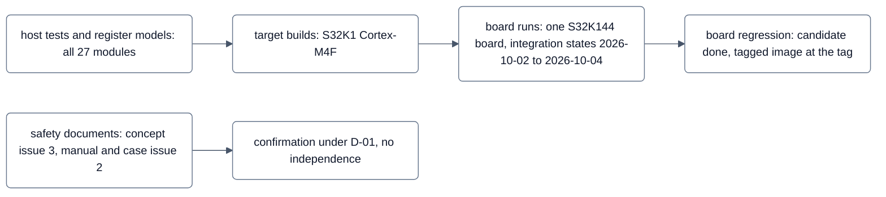

<!-- SPDX-License-Identifier: Apache-2.0 -->
<!-- This curated file is the authoritative release note of v1.0.0-rc1. Until TOOL-229 is done, `python -m tools.ci
     release` still writes its own RELEASE_NOTES-v<version>.md from the lines CHANGELOG.md gained since the previous
     tag; that generated file does not apply to this release and is not distributed. -->
<!-- DOC-61, tag v1.0.0-rc1 (80962d9f, tree f93bc886), filled after the tag (2026-10-05). -->

# neXtBSW v1.0.0-rc1 — release notes

Release date: 2026-10-05 (tag `v1.0.0-rc1`)

> **Development release – no safety claim.**
>
> neXtBSW targets ASIL B as a software safety element out of context. This release candidate (release R1) does
> **not** claim ASIL B capability and is not a safety release.
>
> - R1 was checked under **deviation D-01**: the confirmation measures were performed by the safety responsible
>   **without independence**. No working state and no tag gets an ASIL statement from them.
> - Performed for R1 (all under D-01): CM-01 safety plan, CM-02 safety analyses, CM-04 verification plan and CM-07
>   safety concept and CM-05 safety case (each closed after a re-check), CM-10 safety manual (`accepted with
>   conditions`; one finding open until the first public release) and CM-06 release decision (`accepted with
>   conditions`: the release was decided with the conditions bound CI report, board run on the tagged image and verified
>   export; see the record of the release).
> - **Performed after R1**, as a documented deviation from their planned timing: CM-03 (dependent failure analysis),
>   CM-08 (tool classification and qualification), CM-09 (component qualification and coexistence) and CM-11
>   (functional safety audit). The deviation is recorded in [safety plan](../safety/safety-plan.md) section 5 and as
>   deficit D-22 in the [safety case](../safety/safety-case.md). It is lifted before the first public release or the
>   first release with an ASIL B claim, whichever comes first.
> - R1 is distributed privately. Every recipient receives this statement together with the
>   [safety manual](../safety/safety-manual.md).

## Release at a glance

| Item | State in v1.0.0-rc1 |
|---|---|
| Safety claim | none — development release (above) |
| Main target | NXP S32K1 family with Cortex-M4F (S32K142/144/146/148) |
| Hardware evidence | one S32K144 board of the maintainer; board files and recordings are not part of this distribution |
| Previous release | v0.2.0 (2026-10-01, development release) |
| Bootloader | `nextbsw-bl 0.3.9` (v0.2.0: 0.3.5) |
| neXtBSW Studio | not part of this release (distributed separately) |
| Support | none for rc1 ([SECURITY.md](../../SECURITY.md)) |

## What is neXtBSW

neXtBSW is a configurable basic software for 32-bit ARM Cortex-M and Cortex-R microcontrollers (little endian), built
on [Eclipse OpenBSW](https://github.com/eclipse-openbsw/openbsw) and FreeRTOS. A control unit is described in
configuration files — MCU derivative, board and project — and generators derive clock tree, pins, CAN bit timing,
memory layout, bootloader values and the RTE from them. Application software is attached as Simulink models (AUTOSAR
Classic software components) through the generated RTE.

Start with the [README](../../README.md) and the [documentation map](../README.md).

## Scope of this release

### Platforms and projects

| Board profile / project (CMake preset) | Derivative (core) | Configure and check | Target build | On hardware |
|---|---|---|---|---|
| `buildtest_s32k148` / `buildtest-s32k148-min` | S32K148 (Cortex-M4F) | yes | yes | no board behind it (build test) |
| same, `buildtest-s32k148-ethernet`, `buildtest-s32k148-threadx` | S32K148 | yes | yes | no; keep the paths to Ethernet/lwIP and ThreadX open, not the default |
| `s32k116evb` / `s32k116evb-minimal` | S32K116 (Cortex-M0+) | yes | partly: the full application does not fit into 128 KB flash yet | no |
| `nucleo_f446re` / `nucleo-f446re-demo` | STM32F446RE (Cortex-M4F) | yes | no for the application (board generator lacks the stm32 family); the platform build-test image builds | partly: flashing, clock, LED, button, console |
| S32K3, TI RM4x | — | derivative data, `nxconfig check` | no | no |

The software has been brought up on one S32K144 board of the maintainer, whose board files are not part of this
tree. For an S32K1 derivative with a Cortex-M4F you can describe your board, check it and build application and
bootloader; expect to be the first to measure the bring-up on your own hardware. Details:
[Getting started — What runs today](../guide/getting-started.md#what-runs-today).

### Content

- **Configuration and generators:** configuration model and checks (`tools/nxconfig`), BSW and RTE generators
  (`bswgen`, `rtegen`), CAN database generator (`dbcgen`), calibration objects in `swc.yaml` with A2L and datasets,
  configuration and generator identity in the image (console `version`/`info`, UDS DID).
- **ECU application and services:** derived from the OpenBSW reference application; ECU state management, CAN with
  a second bus (diagnostic CAN), UDS in the application, fault memory (simplified DEM), NvM core with integrity
  classes, data flash, persistent operating hours and reset statistics, E2E profiles P01/P02/P11, XCP.
- **Drivers:** 27 driver and service modules with neutral contracts; their verification level is listed per module in
  the [module reference](../reference/modules.md) and drawn in the [module map](../figures/07-modulkarte.md).
- **Bootloader:** UDS bootloader over CAN (ISO-TP), plain C, hardware-independent core; flashing with
  `tools/canflash`; bootloader updater; diagnostic CAN supported (`nextbsw-bl 0.3.9`).
- **Safety mechanisms (stage 1, s32k1xx family port):** safe supervisor, safety task and lifecycle, MPU-protected
  safety RAM, ECC supervision, ROM check, supply and ADC reference supervision, watchdog and halt deadman, safe
  outputs table with read-back, degraded reaction per PWM group. The list of mechanisms, what each one covers and
  what an integrator may rely on is in the [safety manual](../safety/safety-manual.md) section 5.
- **Tools:** test runner (`tools/test`), CI wrapper (`tools/ci`), workspace update (`tools/nxupdate`), distribution
  check (`tools/distcheck`).

### Not part of this release

- **neXtBSW Studio** (desktop tool) — it has its own release and is not contained in this distribution.
- The maintainer's own evaluation board, its projects and its board recordings.

## Verification

| Level | What | State |
|---|---|---|
| Host (mock) | host tests, register models, generator tests with own profiles, mutation checks, static analysis; one command: `.venv/Scripts/python tools/test --group all` | all 27 modules have host tests; 14 modules are verified on the host only (`mock` in the [module reference](../reference/modules.md)); release CI on the tagged tree (`tools.ci run --strict --slow`): 413 of 413 entries green, 539 160 test cases, 50 target builds, static analysis without new findings; report bound to the tag (`ci-out-v1.0.0-rc1.zip`) |
| Target build | application, bootloader and updater for the presets above, warnings as errors | see the platform table |
| Board (hardware) | one S32K144 board with lab supplies, electronic load, oscilloscope and CAN interface; board sessions per task and suite runs of the board test specification | 13 modules verified on hardware (`hardware` in the [module reference](../reference/modules.md)): canSystem, consoleContext, e2e, ecuState, gdTmc6200, highSideSwitch, sbcUja113x, bspAdcAccess, bspSpi, safeLifecycle, safeMemory, safeSupervisor, safeSystem; bootloader flashing over CAN including the diagnostic CAN |
| Board regression of the release (SYS-167) | the demo cases of the board test specification with `tools/boardtest suite`, the S1 read-back case BT-S1-03 with the pin cases, and the restart-time measurement F4 with the oscilloscope | **release candidate** (code freeze plus version, image SHA-256 `93e9796e…730afd`, 2026-10-04): no firmware finding; 21 of 25 suite cases passed, the bus-off case included; the remaining cases failed on the test definition, not on the firmware, and passed or were shown by hand after its correction (BT-S1-01: one tool finding left, the board behaviour confirmed by the tester); BT-S1-03: outputs off within 0.71 ms; F4 in six runs: 703 ms (MPU path, limit 858 ms) and 896 … 926 ms (watchdog path, limit 1 077 ms). **Tagged image:** the automated cases and F4 repeated on 2026-10-05 (image SHA-256 `1583be99…c7ba45`, the identification `v1.0.0-rc1` on the board): 9 of 9 automated cases passed; F4 in six runs 703 ms (MPU path) and 876 … 926 ms (watchdog path) — the cases with a manual step count from the candidate, whose image differs from the tagged one only in the repository identification |

Further board results of R1 were taken at integration states between 2026-10-02 and 2026-10-04 (recording folders
`2026-10-02_board`, `2026-10-02_suite-integ12`, `2026-10-03_board`, `2026-10-04_rc1-candidate` of the development
repository). The recordings are not part of this distribution and are available on request. Open board proofs are listed in the
[safety manual](../safety/safety-manual.md) section 10.3 and under [Known limitations](#known-limitations).

Limits of the release verification compared with a safety release: no coverage gate, no independent review of test
authoring, reproduction of the release build on a second machine not shown. They are listed in
[verification plan](../safety/verification-plan.md) section 9.1.

## Safety documentation

The work products the integrator reads, with their issue at the code freeze. "Accepted" means accepted by the safety
responsible; "under D-01" means after a confirmation review without independence.

| Work product | Issue / status |
|---|---|
| [Safety manual](../safety/safety-manual.md) (assumptions of use) | issue 2, accepted under D-01 (CM-10, `accepted with conditions`; one finding open until the first public release) |
| [Safety concept](../safety/concept.md) and the safety requirement catalogues (`doc/requirements/safety`: safety requirements, goals, assumptions, mechanisms) | issue 3, accepted under D-01 (CM-07 closed) |
| [Failure analysis (FMEA)](../safety/fmea.md) | issue 2, accepted under D-01 (CM-02 closed) |
| [Architecture safety analysis](../safety/architecture-safety-analysis.md) | issue 2, accepted under D-01 (CM-02 closed) |
| [Verification plan](../safety/verification-plan.md) | issue 2, accepted under D-01 (CM-04 closed) |
| [Safety plan](../safety/safety-plan.md) | issue 2, accepted under D-01 (CM-01 closed) |
| [Safety case](../safety/safety-case.md) | issue 2, accepted under D-01 (CM-05 closed); top claim **not supported** |
| [Dependent failure analysis](../safety/dfa.md) | issue 1, accepted; confirmation CM-03 after R1 |
| [Tool classification](../safety/tool-classification.md) | issue 1, accepted; confirmation CM-08 after R1; qualification reports of the TCL 2 tools not written |
| [Component qualification](../safety/component-qualification.md), [coexistence](../safety/coexistence.md) | issue 1, draft / accepted; confirmation CM-09 after R1 |
| [Anomaly register](../safety/anomaly-register.md) | issue 1, accepted; public extract below |
| [Configuration management plan](../safety/cm-plan.md) | issue 2, accepted |
| [Board test specification](../safety/board-test-spec.md) | issue 1, draft |

**Not published, available on request.** These stay in the development repository: the records of the confirmation
reviews and inspections (`doc/safety/reviews`), the gap analysis, the generated traceability matrix, the RTOS
comparison, the requirements other than the safety catalogues, the board recordings, parts B and C of the
partner-and-degraded analysis (implementation notes and decisions B/C; section 7, the source of AoU-31 and AoU-33, is
published) and the planning files. A Markdown link to such a file reads "not published, available on request" in the
distributed tree. Where a document names such a file only as a path in the text, the path is left as it is: the file
is not part of this distribution and is likewise available on request. None of these files raises a verdict of the
published documents.

## Known limitations

| Area | Limitation in v1.0.0-rc1 |
|---|---|
| Motor control (FOC) | no fast control loop and no motor application in this release; the concept is in fast-control-loop.md (not published, available on request). The center-aligned PWM group with trigger (IO-61) and the hardware trigger chain PWM → TRGMUX → PDB → ADC (IO-62) are in the tree, host-verified, **without board proof** and not part of the R1 scope |
| Hardware over-current shut-off | the comparator threshold with shut-off without the core (SYS-86), its start test (SYS-129, SYS-165) and the FTM fault inputs are in the tree, host-verified, **without board proof** and not part of the R1 scope; the related anomalies are listed below |
| CAN FD | only the bit-timing calculation exists (host-tested); no CAN FD driver, schema, DBC/RTE or flashing over CAN FD |
| OTA and multi-MCU ECUs | no OTA master, image store or campaign; the inter-MCU link protocol (`mcuLink`) is host-verified only |
| Secure boot | the bootloader checks the application image (CRC, record, compatibility block) but not its own integrity and verifies no signature; CSEc secure boot is planned after R1 |
| Further platforms | the safety family port exists for s32k1xx only ([safety manual](../safety/safety-manual.md) 1.4); STM32, S32K3 and RM4x get the family-neutral part only; S32K116 does not fit the full application yet |
| Board proofs after R1 | hold and S1 + S2 with a gated timer, B16 (a), (c), (d), and the low-voltage detect reset (SM-59) at falling supply have no board recording (SYS-198); the LVD reset is switched on and re-checked cyclically, but not credited |
| Partitioning | no partitioning of the application; the MPU protects the safety manager's data and stack only; task activation is not supervised |
| Stage-2 mechanisms | no plausibility between two measurement paths, no age supervision of device values, no safe state for bus-commanded actuators (G2 … G4) |
| Process | no quality management system, no evidence of competence, no independent confirmation review, no functional safety assessment (AoU-35) |
| Tool qualification | qualification reports for the TCL 2 tools and the FreeRTOS qualification package are not written |
| Cybersecurity | no cybersecurity claim ([safety manual](../safety/safety-manual.md) section 11) |
| SBC without software development mode | an SBC without software development mode (UJA113x SDMS 0) runs its watchdog after an SBC reset already in Standby: use `bootloader.sbc_watchdog: serve`; the correction follows with BL-41 (AN-191). With the default `leave` a device without a valid application resets in a loop (outputs de-energised, but it cannot be updated), and an application must trigger the watchdog within about 256 ms after the SBC start. The eval board (SDMS 1) is not affected |
| Host tests on Linux | several host tests do not build with a 64-bit `long`; the suite is run on Windows (AN-118) |

The complete list, including evidence limits, is in [safety manual](../safety/safety-manual.md) section 10.

## Known anomalies

Public extract of the [anomaly register](../safety/anomaly-register.md) at the code freeze: anomalies with status
`open` or `accepted` that affect how an integrator uses neXtBSW. Anomalies about the documents themselves or about
the internal process are not listed; the register has all of them.

| ID | Anomaly | Effect | Workaround / assumption of use |
|---|---|---|---|
| AN-005 (accepted) | a failed SPI master is a common cause for several device diagnostics and is not treated as one event | device diagnostics on one SPI bus can fail together; only a per-bus "bus lost" correlation exists | no stage-1 mechanism relies on SPI; consider SPI as a shared resource in your own analysis |
| AN-010 (open) | RTE task activation (starvation, late start) is not supervised; only run durations are measured | a task that is not activated or starts late is not detected by the BSW | AoU-17: develop safety-related code at the target ASIL or provide your own partitioning and timing supervision |
| AN-016 (accepted) | the tolerance band of the ADC reference supervision allows a silent gain error of up to about 5 % on every analogue value | analogue values may be wrong within the band without a reaction | AoU-24: check that the reference tolerance is smaller than the accuracy your safety-related values need |
| AN-018, AN-020 (open) | no plausibility check of two measurement paths; no safe state for bus-commanded actuators | ASG-04 has no stage-1 mechanism; ASG-01 only partly covered | AoU-23: provide this detection yourself |
| AN-024 (open) | the MCU manufacturer's safety manual is not available to the project; the required software measures are not derived from it | hardware coverage statements refer only to neXtBSW's use of a feature | AoU-09, AoU-36: obtain it and apply the measures it requires |
| AN-025, AN-067 (open) | the MPU does not deny DMA and Ethernet masters access to the protected RAM (descriptor 0 grants them access) | a DMA or Ethernet master could overwrite safety data | AoU-41: enable no bus master other than the core |
| AN-026 (open) | no mechanism checks the integrity of the bootloader itself | a corrupted bootloader is not detected (ASG-07 partial) | none in this release; consider it in your analysis; CSEc secure boot planned after R1 |
| AN-058 … AN-065 (open) | some configuration registers are written but not re-checked at run time: NVIC of the watchdog warning interrupt, system handler enables, ERM and flash fault interrupts, LPIT and system clock, FTM output mask, platform clock gates, ADC supply enable | a drift of these registers is not detected by the cyclic register check | none in this release; listed so that you can consider them in your hardware analysis |
| AN-069 (open) | a stopped LPIT functional clock stops the halt deadman (SM-06) | on a lost clock only the MCU watchdog reset de-energises the outputs, after at most about 283 ms on the maintainer's board | safety manual 10.2: residual risk; compare the time with your fault tolerant time interval |
| AN-071 (open) | the safe outputs walk skips a clock-gated FTM; a gated timer keeps its output level after S1 | a PWM group whose timer clock gate is off is not de-energised by the walk | give each PWM group a `safe_off` enable on another peripheral; `nxconfig` warns for a group without one |
| AN-073 (open) | a stopped system time is not detected by the period check | SPI and CAN time-outs that count on the system time stop | the halt deadman SM-06 (outputs off after about 10 ms) and the watchdog SM-01 (reset after about 160 to 283 ms) react; safety manual section 5 |
| AN-102 … AN-105, AN-119, AN-120 (open) | hardware fault path (FTM fault inputs, comparator): polarity and reset behaviour not verified, recovery and start-test strategy undecided, interplay with the safe outputs walk undecided, start with an exceeded threshold and output state with fault control enabled not confirmed on the board | the hardware over-current shut-off is not proven | do not rely on the hardware threshold in R1 (not part of the R1 scope) |
| AN-130 (accepted) | the watchdog is switched off on the way to lifecycle level 0 | a level-1 component that hangs in its shutdown is not detected | accepted residual; consider it for your shutdown sequence |
| AN-131 (accepted) | the interrupt lock around the selection of the active short works only in privileged code | in unprivileged thread mode the lock is ignored without a fault | AoU-42: run every task privileged |
| AN-164 (open) | UDS 10 02 resets the ECU into the bootloader without S1 and without precondition; UDS 11 01/03 run down without precondition | a diagnostic request can reset the ECU in any state | AoU-ASA-b: protect ECU reset and writing services by security access and a precondition you define |
| AN-165 (accepted) | at run-down the outputs keep their last value until the last run-down step | actuators stay commanded during run-down | AoU-ASA-d: switch the actuators off in the application at `RUNDOWN` |
| AN-166 (open) | `timeout_ms: 0` switches the reception time-out off, also for a message with an E2E profile, and no check refuses it | a lost safety-related message is not detected | AoU-11: configure an E2E profile and a non-zero time-out for every safety-related message |
| AN-167 (open) | the age qualifier for ports between tasks is optional | a consumer of a stopped producer sees the last value | configure the age qualifier on safety-related ports between tasks |
| AN-168 (open) | a failed read of `dio.in`, `adc.mv` or `adc.raw` keeps the old value without a qualifier; a failed `dio.out` write is discarded | the application cannot see the failed access | none in the BSW in this release; plan your own plausibility for safety-related inputs (AoU-23) |
| AN-169 (open) | a UDS DID (2E) or routine (31) may write a required port of a safety-related component; only session and security guard it | diagnostics can change a safety-related input | AoU-ASA-b |
| AN-170 (accepted) | XCP has no access protection | every calibration parameter is writable within its limits | AoU-ASA-b: do not build XCP into the product, or protect it |
| AN-172 (accepted) | with a passive CAN transceiver the transmit gate (SM-32) follows bus-off only | a transceiver fault without bus-off is not detected | AoU-ASA-a: accept it for your item or supervise the transceiver yourself |
| AN-173 (open) | E2E states NOTAVAILABLE/NONEWDATA map to other qualifiers than the documentation says | qualifier values differ from the description; both are fail-safe | evaluate the qualifier as an error state |
| AN-191 (open) | SBC without software development mode (UJA113x SDMS 0): its watchdog runs after an SBC reset already in Standby (128 ms) and the bootloader with `bootloader.sbc_watchdog: leave` does not serve it | without a valid application the ECU resets in a loop (safe state, but no update); an application must trigger within about 256 ms after the SBC start | use `bootloader.sbc_watchdog: serve` (AoU-34); the correction follows with BL-41 |
| AN-092, AN-107 (open) | the byte-identical rebuild on another machine is not shown; the tool classification names GCC 11.4 while xPack GCC 11.3.1 builds the image | reproducibility and the tool argument are not complete for this compiler | use the pinned toolchain of `tools/ci/versions.toml`; AoU-20 |

Assumptions of use (AoU-…) are defined in the [safety manual](../safety/safety-manual.md) section 7.

## Upgrade from v0.2.0

The notes below are taken from the changelog; a compatibility review per interface (RTE, schema, safe supervisor
API, assumptions of use) against v0.2.0 was not made.

- **Version.** `VERSION` reads `1.0.0` (the file holds MAJOR.MINOR.PATCH only); the release-candidate state is the tag
  `v1.0.0-rc1`, which the image carries in its repository identification. Moving a customer workspace pin:
  `tools/nxupdate <workspace> --to v1.0.0-rc1` (dry run first; see [tools/nxupdate](../../tools/nxupdate/README.md)).
- **Bootloader 0.3.5 → 0.3.9.** Update fielded bootloaders with the updater (`canflash blupdate`, see
  [tools/canflash](../../tools/canflash/README.md)) or with the debug probe (`flash-bootloader`). Since 0.3.7 the
  bootloader starts only an application whose record carries the compatibility block, and it checks the image again
  right before the jump; a record written before that block existed is no longer started (DID 0xF1A0 reports why) —
  flash the application again with the current tools. 0.3.6 adds the low-voltage detect reset from the reset handler
  and skips the start window after the watchdog fast-test resets; 0.3.9 fixes a reset loop on the 16-buffer FlexCAN
  instances (diagnostic CAN).
- **NvM layout.** The reserved fault memory block `DemEvents` grows when a project takes the new standard
  safety-reset DTCs (in the maintainer's demo: 14 → 39 bytes, 2 → 7 DTCs), and the new reserved block
  `EcuStatistics` (operating hours and reset statistics, DID 0x0130) lies behind the component and fault memory
  blocks. Blocks behind a changed one move: after flashing, the fault memory starts empty once and the statistics
  start at zero once.
- **AUTOSAR base types.** `uint32`/`sint32` (and the other integer types) are now the `stdint.h` types; on the target
  `uint32` is `unsigned long`. Code that relied on `uint32` being `unsigned int` (format strings, overloads) needs a
  look.
- **Stricter checks of `nxconfig`.** New project field `project.integrity` (`qm`, `asil_a` … `asil_d`): without it a
  project counts as an ASIL project, `qm` has to be set deliberately. In an ASIL project a BSW task stack, the
  interrupt stack or its guard below the default without an evidence note is an error (a warning in a QM project);
  merging the `background` task into `bsp` is refused for projects with a power stage; an interrupt stack value on a
  family where it has no effect is an error. New project values: `bsw_tasks.<task>.evidence`,
  `memory.application.isr_stack_size`, `isr_stack_guard_size` and their evidence fields.
- **Product image.** Service console commands that write registers, frames, outputs or the fault memory are no longer
  in the product build (`NX_PRODUCT_BUILD=ON`); `out set` refuses `safe_off` outputs in every build, `pwm` refuses the
  PWM groups of the safe outputs table. Read commands and `nvm write` stay.

## License and feedback

neXtBSW is licensed under the **Apache License 2.0** (`LICENSE`). Third-party parts keep their licences; they are
listed in [NOTICE](../../NOTICE), the licence texts are in [LICENSES/](../../LICENSES). Eclipse OpenBSW is a git
submodule and is not part of this distribution.

Vulnerabilities: please report privately as described in [SECURITY.md](../../SECURITY.md), not in a public issue.
This release candidate comes without a support commitment. Contributions: [CONTRIBUTING.md](../../CONTRIBUTING.md).
