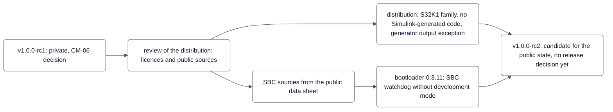

<!-- SPDX-License-Identifier: Apache-2.0 -->
<!-- This curated file is the authoritative release note of v1.0.0-rc2. Until TOOL-229 is done, `python -m tools.ci
     release` still writes its own RELEASE_NOTES-v<version>.md from the lines CHANGELOG.md gained since the previous
     tag; that generated file does not apply to this release and is not distributed. -->
<!-- PLAT-118a, prepared before the tag against dev f4055d8e (2026-10-08); the TODO comments left are filled at the
     tag. -->

# neXtBSW v1.0.0-rc2 — release notes

Release date: 2026-10-XX <!-- TODO: date of the annotated tag v1.0.0-rc2 -->

> **Development release – no safety claim.**
>
> neXtBSW targets ASIL B as a software safety element out of context. This second release candidate of 1.0.0 does
> **not** claim ASIL B capability and is not a safety release.
>
> - **No release decision like the one of rc1.** The release decision CM-06 of the safety plan was made for
>   `v1.0.0-rc1` only. For `v1.0.0-rc2` no such decision has been recorded; rc2 is a **candidate for the public
>   state** of neXtBSW, not a release confirmed by a review. <!-- TODO at the tag: state whether a CM-06 decision for
>   rc2 was made, and with which verdict, or that none was made -->
> - The confirmation measures that exist were performed by the safety responsible under **deviation D-01**, without
>   independence. No working state and no tag gets an ASIL statement from them.
> - The deviation recorded for rc1 still applies: CM-03 (dependent failure analysis), CM-08 (tool classification and
>   qualification), CM-09 (component qualification and coexistence) and CM-11 (functional safety audit) are not yet
>   performed ([safety plan](../safety/safety-plan.md) section 5, deficit D-22 in the
>   [safety case](../safety/safety-case.md)). The safety plan ties their completion to the first release with an
>   ASIL B claim; until then a release may be public only as a development release without a safety claim, as this
>   one is (decision of the safety responsible 2026-10-08, safety plan issue 3, released in its confirmation review
>   the same day).
> - Every recipient receives this statement together with the [safety manual](../safety/safety-manual.md); it stands
>   in every release note and in the [README](../../README.md) of the repository (safety plan section 5).

## Why rc2

`v1.0.0-rc1` (2026-10-05) was distributed privately. Before the first public distribution the distributed tree was
reviewed for licences and for the public provenance of every value and statement it contains. The review found
passages in the rc1 distribution that were taken from a manufacturer document that is not public. `v1.0.0-rc2` is the
cleaned state: those passages are removed, and every statement they supported now rests on public sources only. The
same review led to the other distribution changes listed below (generated code, generator output, supported
families). `v1.0.0-rc2` is the state from which the public repository is built.

The firmware changes of rc2 are small: the bootloader serves the SBC watchdog of an SBC without software development
mode (0.3.10 and 0.3.11), and the SBC driver documents its behaviour from the public data sheet with its code
unchanged.

## Release at a glance

| Item | State in v1.0.0-rc2 |
|---|---|
| Safety claim | none — development release (above) |
| Release decision | none recorded for rc2 (CM-06 covers rc1 only) |
| Main target | NXP S32K1 family with Cortex-M4F (S32K142/144/146/148) |
| Previous release | v1.0.0-rc1 (2026-10-05, development release, distributed privately) |
| Bootloader | `nextbsw-bl 0.3.11` (rc1: 0.3.9) |
| neXtBSW Studio | not part of this release (distributed separately) |
| Support | best effort, no commitment ([SECURITY.md](../../SECURITY.md)) |

## Changes since v1.0.0-rc1

The changelog of the development repository has the details per task.

### Sources and distribution

- **SBC driver and bootloader SBC hook from public sources only.** Every statement of the UJA113x driver, the
  bootloader's SBC hook, their tests and their module documentation that rested on a non-public manufacturer
  document now cites the public UJA113x data sheet (Rev. 2); the code of the driver is unchanged. On the way, the host
  model of the bootloader test was corrected to the data sheet: without software development mode (SDMS 0) the SBC
  watchdog already runs in Standby after an SBC reset. This finding led to the bootloader changes below.
- **The distribution check guards it.** `tools/distcheck` refuses references to the content of non-public application
  material in the open export, and it refuses every value in `mcudb` and in the published board profiles that has no
  public evidence (`verify: true`) instead of only warning.
- **Simulink-generated code is not distributed.** Code and ARXML generated by Simulink Coder (the demo component and
  one RTE test model) are left out of the open export. The models, their parameters and the build script stay. The
  export puts a hand-written C component with the same RTE interface in place of the demo component
  (`swc/DemoSwcSubstitute`), so the demo builds without MATLAB; with your own MATLAB licence you can generate the
  original from the model.
- **Generator output exception.** Files written by the neXtBSW generators may be used under terms of your choice. The
  exception is stated in [NOTICE](../../NOTICE) and in `LICENSES/AdditionRef-neXtBSW-Generator-Output-Exception.txt`;
  every generated file carries the SPDX line `Apache-2.0 WITH AdditionRef-neXtBSW-Generator-Output-Exception`. The
  generators and their templates stay Apache-2.0.
- **Published scope narrowed to the S32K1 family.** STM32, S32K3 and TI RM4x (derivative data, platform code and their
  tests), the Nucleo-F446RE board and project and the S32K116EVB board profile are not part of this distribution
  until their values have public evidence. The S32K116 derivative data and the build-test profile of the S32K148 stay.
- **Export fixes.** The export carries the pinned commit of the Eclipse OpenBSW submodule (rc1 needed it added by hand),
  and the test suite of the exported tree runs on the published profiles (seven tests moved off the private demo
  project).

### Bootloader 0.3.9 → 0.3.11

- **0.3.10:** with an SBC without software development mode (UJA113x SDMS 0) the bootloader always serves the SBC
  watchdog itself, also with `bootloader.sbc_watchdog: leave`: fixed autonomous setting in Standby, trigger every
  256 ms and right before the jump, so that the application has a full period to take over. With development mode
  (SDMS 1) `leave` is unchanged. New diagnostic field `bl_sbc_watchdog.reason`.
- **0.3.11:** the same also when the bootloader only reads the SBC (the SBC not in `bootloader.init`, for example a
  bootloader on another CAN bus): only the watchdog is set and triggered, the SBC stays in Standby (no V2, no CAN of
  the SBC until the application starts).
- The updater is unchanged; it still refuses an SBC without development mode. The assumption of use AoU-34 in the
  [safety manual](../safety/safety-manual.md) states what the board has to meet.

### Documentation and website

- Documentation website (MkDocs Material), with a workflow prepared to publish one documentation version per release;
  the project log and the agent rules are not part of the site, and the navigation lists every published page.
- Release notes of rc1 completed after its tag; anomaly AN-191 (SBC watchdog without development mode in rc1) and its
  limitation added there.

## Verification

| Level | What | State |
|---|---|---|
| Host (mock) | host tests, register models, generator tests with own profiles, mutation checks, static analysis | the changes since rc1 are host-verified, the bootloader SBC watchdog with 38 host tests including mutants for each new path; release CI on the tagged tree: <!-- TODO at the tag: `tools.ci run --strict --clean [--slow]` result, entries, test cases, report bound with `tools.ci release --tag v1.0.0-rc2` --> **not run yet** |
| Exported tree | the test suite run inside the open export (`tools/distcheck verify`) | green in trial exports of the development state of 2026-10-07 (build, target, host and Python groups including the slow mutation runs; the entries changed afterwards run again); <!-- TODO at the tag: run on the export of the tag --> on the export of the tag **not run yet** |
| Board (hardware) | bootloader 0.3.11 on one S32K144 board of the maintainer (SBC with development mode, SDMS 1) | 2026-10-07: update 0.3.9 → 0.3.11 with the updater, application of rc1 flashed, SBC state identical to the baseline, 174 s run without reset — the SDMS 1 path is unchanged. **Open:** the proof with an SBC without development mode (SDMS 0) on hardware |
| Board regression of the release | the board run of rc1 (demo cases, BT-S1-03, F4) | not repeated for rc2 <!-- TODO at the tag: state whether a board run on the tagged image of rc2 is made --> |

Everything else is as in [v1.0.0-rc1](v1.0.0-rc1.md#verification).

## Known limitations and anomalies

The lists of [v1.0.0-rc1](v1.0.0-rc1.md#known-limitations) apply, with these changes:

| Area | Change in v1.0.0-rc2 |
|---|---|
| SBC without software development mode (AN-191) | corrected in the bootloader (0.3.10/0.3.11, above). The anomaly stays open in the [anomaly register](../safety/anomaly-register.md) until the board proof with an SBC without development mode; until then follow AoU-34 |
| Further platforms | STM32, S32K3, RM4x and the S32K116EVB board are not part of this distribution (above) |

## Upgrade from v1.0.0-rc1

- **Version.** `VERSION` stays `1.0.0`; the candidate state is the tag `v1.0.0-rc2`. Moving a customer workspace pin:
  `tools/nxupdate <workspace> --to v1.0.0-rc2` (dry run first; see [tools/nxupdate](../../tools/nxupdate/README.md)).
- **Bootloader 0.3.9 → 0.3.11.** Update fielded bootloaders with the updater (`canflash blupdate`, see
  [tools/canflash](../../tools/canflash/README.md)) or with the debug probe. Boards with an SBC without development
  mode no longer need `bootloader.sbc_watchdog: serve` as a workaround.
- **Generated files.** Every generated file gains two comment lines at its top (the SPDX line of the generator output
  exception). Expect this difference when you compare generated output with rc1.
- **Demo component.** In the distributed tree `swc/DemoSwc` is the hand-written C substitute (`implementation: c` in
  `swc.yaml`); see `swc/DemoSwcSubstitute/README.md` for how to go back to the Simulink model.

## License and feedback

neXtBSW is licensed under the **Apache License 2.0** (`LICENSE`), with the generator output exception stated in
[NOTICE](../../NOTICE). Third-party parts keep their licences; they are listed in [NOTICE](../../NOTICE), the licence
texts are in [LICENSES/](../../LICENSES). Eclipse OpenBSW is a git submodule and is not part of this distribution.

Vulnerabilities: please report privately as described in [SECURITY.md](../../SECURITY.md), not in a public issue.
Contributions: [CONTRIBUTING.md](../../CONTRIBUTING.md).
