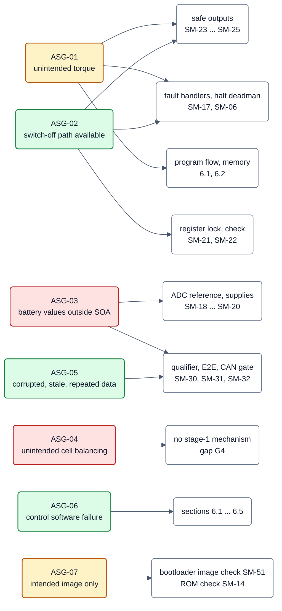
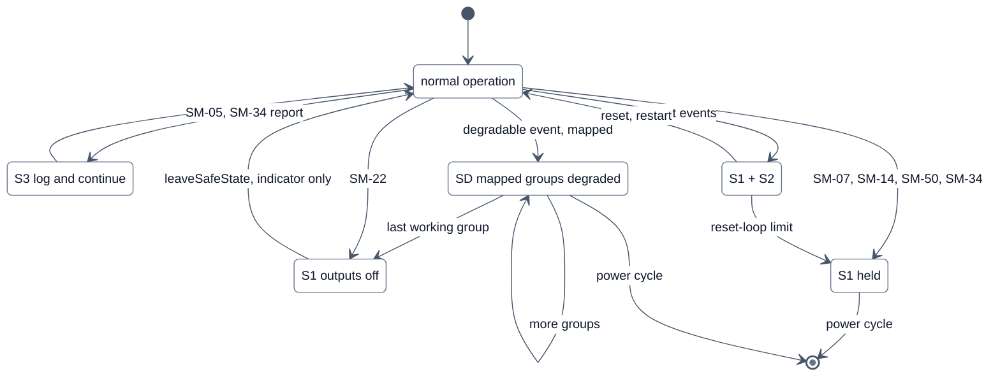
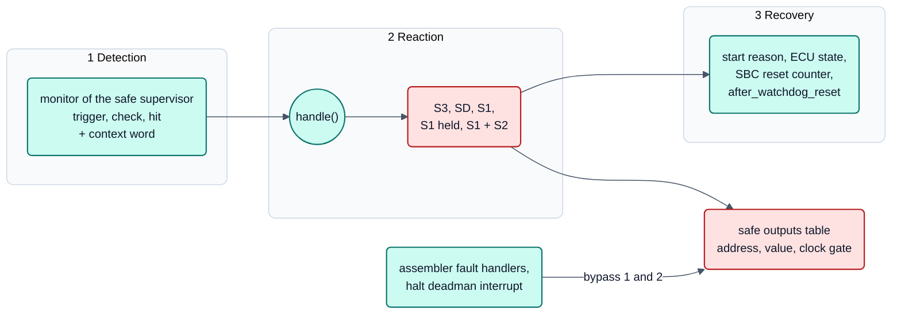
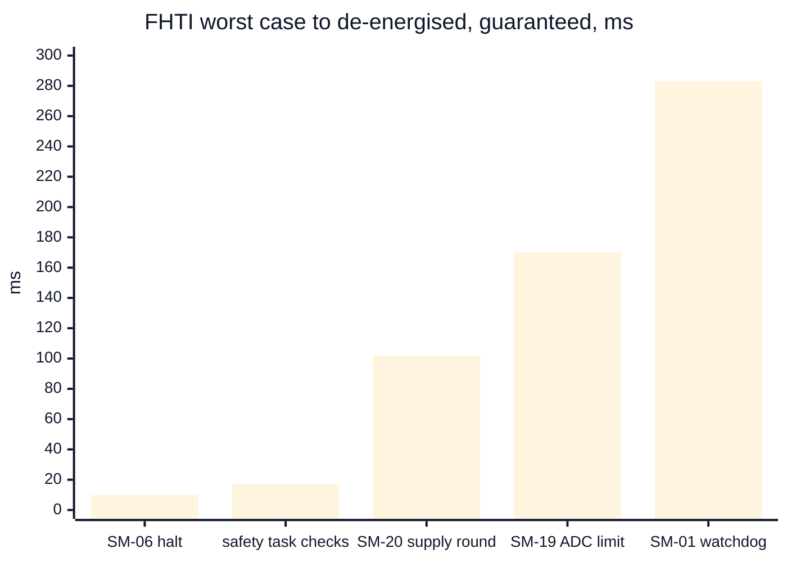
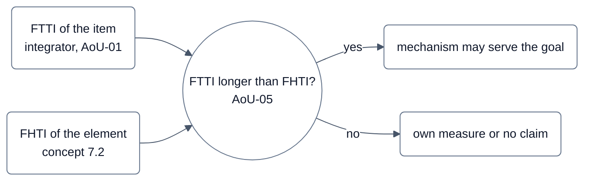

<!-- SPDX-License-Identifier: Apache-2.0 -->

# Bilder zum Sicherheitskonzept (Konzept Ausgabe 3)

Ergänzende Darstellung **ohne inhaltliche Änderung** des freigegebenen
[Sicherheitskonzepts](../concept.md), Ausgabe 3 (DOC-51, freigegeben 2026-10-04). Maßgeblich ist immer das Konzept;
bei einem Widerspruch gilt der Text dort, und das Bild ist ein Befund. In das Konzept selbst kommen die Bilder erst mit
dessen nächster Ausgabe.

R1 ist eine Entwicklungsfreigabe **ohne Sicherheitsanspruch**.

## K1: Sicherheitsziele → Mechanismen der Stufe 1

**Legende**

- Farbe = Abdeckung in Stufe 1 (Feld `COVERAGE`): grün `limited` (abgedeckt mit Grenzen), gelb `partial`,
  rot `none`. Alle Ziele sind angenommen, ASIL B.
- Pfeile = Mechanismen, die das Ziel in Stufe 1 anrechnet (Feld `STAGE1_CONTRIBUTION`). Beiträge der Bausteintreiber
  (Stufe 2, SM-40 … SM-43) zählen nicht und fehlen deshalb.
- ASG-03: SM-30/SM-31 schützen den eigenen Messpfad und den Transport, nicht die Zellwerte (Abdeckung `none`).

Quelle: Konzept Ausgabe 3, [Abschnitt 2.2](../concept.md#22-assumed-safety-goals); die Ziele selbst stehen in
[`goals.sdoc`](../../requirements/safety/goals.sdoc).

## K2: Reaktionen und sichere Zustände

**Legende**

- Eine Stelle entscheidet: `SafeSupervisor::handle()`. Ein Mechanismus meldet nur.
- S1 ist eine Einbahnstraße nach oben: `leaveSafeState()` gibt nur die Anzeige frei, eine Leistungsstufe kommt nur
  über ein ausdrückliches `enable()` ihres Treibers zurück.
- S1 held: alle Interrupts gesperrt, Tabelle zyklisch neu geschrieben, MCU-Watchdog bedient; Ende nur durch Aus- und
  Einschalten oder Reset von außen.
- SD: nur Ereignisse der geschlossenen Liste (`DEVICE_FAULT` außer `IDENTITY`, Auslösung eines Hardware-Abschaltpfads
  `HW_SHUTOFF`), nur wenn das Projekt sie abbildet; Fehler der MCU selbst nie. Gruppen sammeln sich, nur Aus- und
  Einschalten beendet SD.
- S3 ist nur zulässig, wo die Analyse zeigt, dass innerhalb der FTTI kein Sicherheitsziel verletzt wird (SM-05:
  Reaktion bei der Anwendung, AoU-18).

Quelle: Konzept Ausgabe 3, [Abschnitt 3](../concept.md#3-safe-states).

## K3: Erkennung, Reaktion, Wiederherstellung

**Legende**

- Ebene 1 erkennt und meldet ein Ereignis, Ebene 2 entscheidet, Ebene 3 regelt den Start nach dem Reset.
- Fault-Handler und Halt-Deadman überspringen Ebene 1 und 2 absichtlich: der Code, der sonst entscheidet, ist in
  diesem Moment nicht vertrauenswürdig. Deshalb ist die Tabelle ein schlichtes Feld aus Adresse, Wert und
  Takt-Gate-Wort statt Treiberaufrufen.

Quelle: Konzept Ausgabe 3, [Abschnitt 5](../concept.md#5-how-the-mechanisms-are-organised).

## K4: Zeitbudget – längste Fehlerbehandlungszeit (FHTI) je Klasse

**Legende**

- Balken: garantierte Werte der Tabelle 7.2 bis „Ausgänge stromlos“, jeweils zuzüglich des Tabellendurchlaufs
  (< 1 µs gerechnet, am Board ≤ 21 µs begrenzt). Nominal sind die Prüfungen im Safety-Task 10 ms, SM-19 100 ms,
  SM-20 60 ms; SM-01 sind 250 ms bei nominalem LPO, bis etwa 283 ms über den LPO-Bereich.
- Nicht im Balken: Restrisiko DF-05 (SIRC verloren): kein Tabellendurchlauf vor dem Watchdog-Reset nachgewiesen,
  höchstens etwa 283 ms. SM-05 schaltet nichts ab (nur Log).
- Grundwerte (Demo-Projekt): Safety-Task 10 ms, Watchdog-Bedienung alle 70 ms, Watchdog-Zeitablauf 250 ms; geprüft wird
  3 × 70 ms = 210 ms ≤ 230,2 ms (Zeitablauf beim schnellsten LPO).
- Ein Reset ist nicht sofort: der Neustart dauert am Eval Board bis 1 077 ms (Watchdog-Weg) bzw. 858 ms (MPU-Fehler).
- Das Element legt keine FTTI fest; der Integrator vergleicht je Ziel (AoU-05).

Quelle: Konzept Ausgabe 3, [Abschnitt 7.1](../concept.md#71-where-the-times-come-from),
[Abschnitt 7.2](../concept.md#72-worst-case-time-to-the-reaction-per-class) und
[Abschnitt 7.3](../concept.md#73-what-this-means-for-the-integrator).
