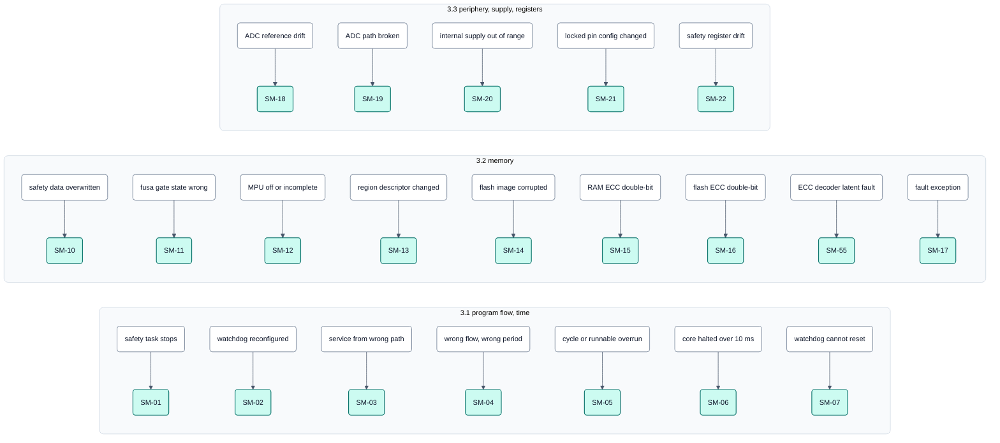
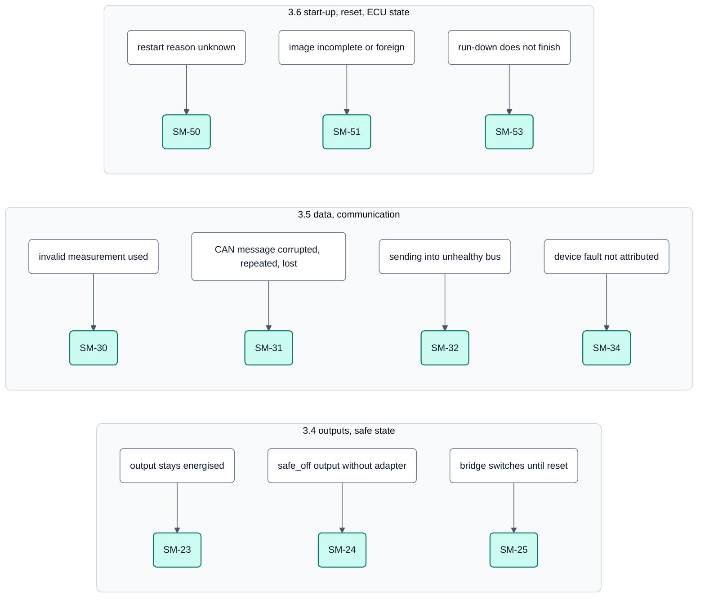
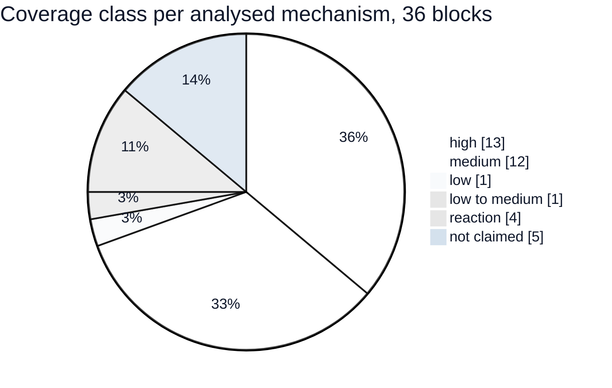
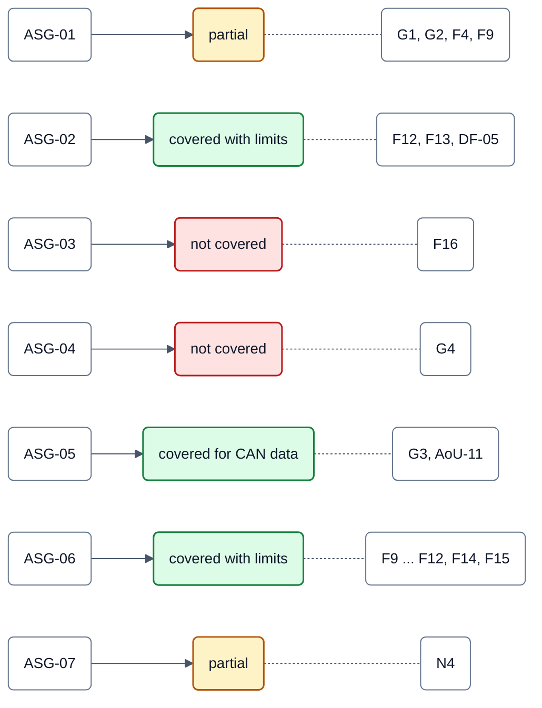
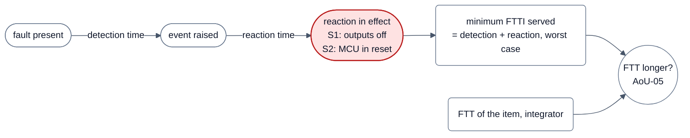

<!-- SPDX-License-Identifier: Apache-2.0 -->

# Bilder zur Fehleranalyse (FMEA Ausgabe 2)

Ergänzende Darstellung **ohne inhaltliche Änderung** der [Fehleranalyse der Stufe-1-Mechanismen](../fmea.md),
Ausgabe 2 vom 2026-10-04 (DOC-55; Freigabe nach der Nachprüfung der Befunde aus CM-02 ausstehend, siehe Kopf der
FMEA). Maßgeblich ist immer die FMEA; bei einem Widerspruch gilt der Text dort, und das Bild ist ein Befund. In die
FMEA selbst kommen die Bilder erst mit ihrer nächsten Ausgabe.

R1 ist eine Entwicklungsfreigabe **ohne Sicherheitsanspruch**.

## F1: Blöcke → Fehlerarten → Mechanismen (Programmfluss, Speicher, Peripherie)

## F2: Blöcke → Fehlerarten → Mechanismen (Ausgänge, Daten, Start)

**Legende zu F1 und F2**

- Ein Kasten je Block der FMEA (Abschnitte 3.1 bis 3.6, gegliedert wie Konzept 6.1 bis 6.7), eine Zeile je
  angerechnetem Mechanismus: 31 Mechanismen.
- Die Fehlerart ist auf wenige Wörter verkürzt nach dem Fehlermodell des Katalogs (Feld `FAULT_MODEL` in
  [`mechanisms.sdoc`](../../requirements/safety/mechanisms.sdoc)); was ein Mechanismus ausdrücklich **nicht** fängt,
  steht in der Zeile „Faults considered“ seines Blocks.
- Nicht dargestellt: die fünf nicht angerechneten Mechanismen SM-26, SM-27, SM-58, SM-59, SM-60 (analysiert, ohne
  Klasse) und die Stufe-2-Mechanismen der Bausteintreiber.

Quelle: FMEA Ausgabe 2, [Abschnitt 3](../fmea.md#3-per-mechanism-analysis) und
[Abschnitt 0](../fmea.md#0-result-in-one-page).

## F3: Abdeckungsübersicht

**Legende**

- Zählung der Spalte „Coverage class“ der Übersichtstabelle, 36 Blöcke. Klassen sind ordinal, **keine Prozentwerte**;
  die FMEA macht ausdrücklich keine Zuordnung zu 60/90/99 %.
- high: SM-06, SM-07, SM-10, SM-12, SM-13, SM-14, SM-17, SM-19, SM-24, SM-31, SM-50, SM-51, SM-55.
  medium: SM-01, SM-02, SM-04, SM-05, SM-11, SM-15, SM-16, SM-18, SM-21, SM-22, SM-30, SM-32.
  low: SM-03. low to medium: SM-20. reaction: SM-23, SM-25, SM-34, SM-53. not claimed: SM-26, SM-27, SM-58, SM-59,
  SM-60.
- Eingeordnet nach dem ersten Wort der Zelle: SM-14 „high at start; at run time high with a re-check period …, low
  with period 0“ als high, SM-05 „medium / none (activation)“ als medium, SM-06 „high (blind spot …)“ als high.

Quelle: FMEA Ausgabe 2, [Abschnitt 3.7](../fmea.md#37-summary-table) und
[Abschnitt 1.3](../fmea.md#13-diagnostic-coverage-classes-not-percentages).

## F4: Urteile zu den angenommenen Sicherheitszielen

**Legende**

- Farbe = Urteil: grün abgedeckt (mit Grenzen oder für CAN-Daten), gelb teilweise, rot nicht abgedeckt.
- Alle sieben Urteile des Konzepts sind **bestätigt**; die Analyse fügt Grenzen hinzu, ändert aber kein Urteil.
- Gestrichelt: die Befunde und Lücken, die Abschnitt 4 je Ziel nennt. Viele davon sind inzwischen geschlossen oder
  eingeengt (z. B. F9 durch SM-04 seit SYS-40, F11/F12/F14 seit SYS-41, F15 seit SYS-42); der Stand je Befund steht
  in der Zeile des Ziels.

Quelle: FMEA Ausgabe 2, [Abschnitt 4](../fmea.md#4-the-assumed-safety-goals-checked).

## F5: Zeitbegriffe je Mechanismus

**Legende**

- Je Mechanismus nennt die FMEA Erkennungszeit, Reaktionszeit und daraus die kürzeste Fehlertoleranzzeit, der er
  dienen kann. Nur wenn die FTT des Integrators **länger** ist, darf er sich für ein Ziel auf den Mechanismus stützen.
- Zwei Formen: **nominal** (Demo-Konstanten, Safety-Task im Takt) und **garantiert** (was das Element selbst erkennt,
  wenn die Zeitannahme bricht), z. B. 10 ms nominal, 17 ms garantiert für die Prüfungen im Safety-Task.
- Die Neustartzeit nach S2 zählt nicht zur Zeit bis „stromlos“, ist aber die Zeit, in der die ECU ausfällt.

Quelle: FMEA Ausgabe 2, [Abschnitt 1.2](../fmea.md#12-time-terms) und
[Abschnitt 2](../fmea.md#2-the-timing-basis-corrected-f9).
