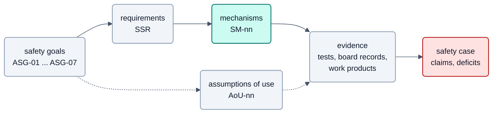

<!-- SPDX-License-Identifier: Apache-2.0 -->

# Safety: Einstieg

> **R1 (v1.0.0-rc1) is a development release and makes no safety claim.** Die Safety-Dokumente beschreiben das
> Ziel (Software-SEooC, ASIL B) und den Stand der Nachweise, keine Zusicherung. Maßgeblich ist der
> [Safety Case, Abschnitt 0](../safety-case.md#0-result-in-one-page).

**Legende**

- Von links nach rechts: Die angenommenen Sicherheitsziele (ASG) werden zu Sicherheitsanforderungen (SSR), diese
  durch Mechanismen (SM) umgesetzt; die Mechanismen werden durch Tests, Boardaufzeichnungen und Arbeitsprodukte belegt,
  und der Safety Case bündelt die Nachweise mit den offenen Lücken.
- Gestrichelt: Was neXtBSW nicht selbst leistet, steht als Annahme (AoU) an den Integrator im Sicherheitshandbuch;
  auch sie werden belegt, soweit sie neXtBSW betreffen.
- Türkis = eigener Code (die Mechanismen), hellgrau = Dokumente und Daten, rot = Ergebnis mit Urteil und Lücken.
- Die Kataloge stehen im offenen Baum: [Ziele](../../requirements/safety/goals.sdoc),
  [Anforderungen](../../requirements/safety/ssr.sdoc), [Mechanismen](../../requirements/safety/mechanisms.sdoc),
  [Annahmen](../../requirements/safety/assumptions.sdoc).

## Hauptpfad

1. [Sicherheitshandbuch](../safety-manual.md): was ein Integrator beachten muss, mit den Annahmen (AoU) an seine
   Umgebung und Konfiguration.
2. [Sicherheitskonzept](../concept.md): angenommene Sicherheitsziele, Mechanismen der Stufe 1, Reaktionen und sichere
   Zustände, Grenzen des Anspruchs.
3. [Anomalie-Register](../anomaly-register.md): bekannte Abweichungen und offene Befunde, die ein Anwender kennen muss.

Bilder zu Konzept und FMEA (ergänzende Darstellung ohne inhaltliche Änderung):
[Bilder zum Sicherheitskonzept](../figures/concept-figures.md), [Bilder zur Fehleranalyse](../figures/fmea-figures.md). Die
Safety-Kette im Überblick: [Bild 6](../../figures/06-safety-kette.md).

## Work products (informative)

Nachweise und Hintergrund für Assessoren; für das Verständnis des Hauptpfads sind sie nicht nötig.

| Dokument | Wofür |
|---|---|
| [FMEA](../fmea.md) | Fehleranalyse der Mechanismen der Stufe 1 |
| [Analyse abhängiger Fehler (DFA)](../dfa.md) | gemeinsame Ursachen zwischen den Mechanismen |
| [Architektur-Sicherheitsanalyse (ASA)](../architecture-safety-analysis.md) | Analyse der Architektur über die Mechanismen hinaus |
| [Safety Case](../safety-case.md) | Ansprüche, Argumente, Nachweise und Lücken |
| [Verifikationsplan](../verification-plan.md) | Prüfungen je Anforderung, archivierte Berichte je Baseline |
| [Sicherheitsplan](../safety-plan.md) | Aktivitäten und Rollen der Sicherheitsentwicklung |
| [Partner-MCU und degradierte Reaktion](../partner-and-degraded.md) | Konzept für Partnerüberwachung und degradierten Betrieb |
| [Software-Architektur](../sw-architecture.md), [Einheitenentwurf](../unit-design.md) | Entwurf des Safety-Teils |
| [HSI s32k1xx](../hsi-s32k1xx.md), [Hardware-Mechanismen](../hardware-mechanisms.md) | Schnittstelle zur Hardware, Mechanismen ohne Software |
| [Koexistenz ASIL B und QM](../coexistence.md), [Komponentenqualifikation](../component-qualification.md) | Mischbetrieb, Vorgehen je vorhandener Komponente |
| [Konfigurationsbereich](../config-range.md), [Zusammenspiel mit Cybersecurity](../security-interplay.md) | zulässiger Bereich, Berührung mit Security |
| [Werkzeugklassifizierung](../tool-classification.md), [statische Analyse](../static-analysis.md), [Entwicklungsumgebung](../dev-environment.md) | Werkzeuge, Richtlinien, Build- und Testablauf |
| [Konfigurationsmanagement](../cm-plan.md), [Board-Testspezifikation](../board-test-spec.md) | Baselines, Boardtests je Anforderung |

Not published, available on request: Review-Protokolle, Rückverfolgbarkeits-Matrix, Lückenanalyse gegen die Norm,
RTOS-Vergleich.
