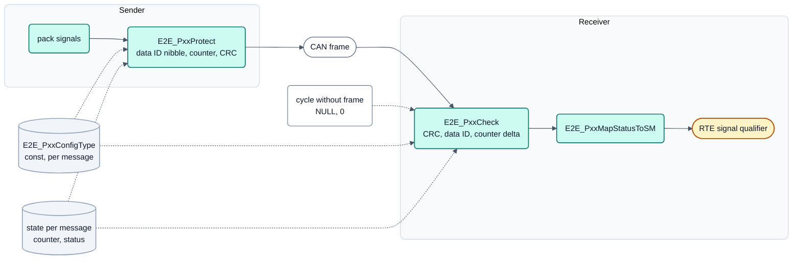
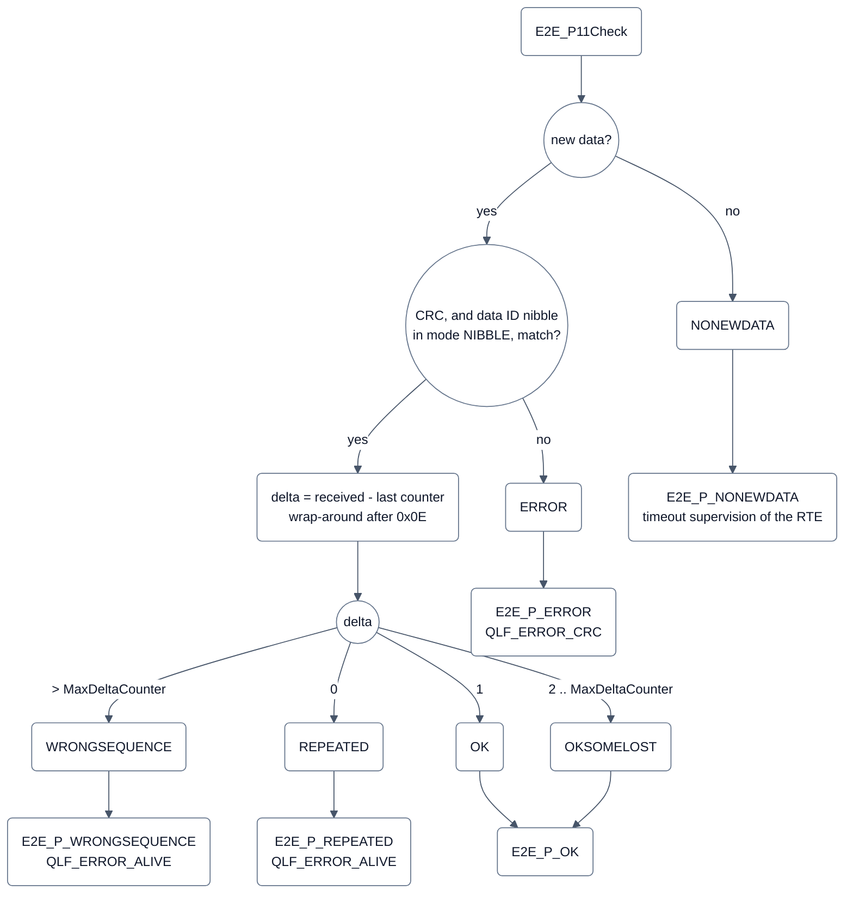

# E2E-Bibliothek (`e2e`)
## Bilder

### Schutzprofil: Sender und Empfänger



**Legende**

- `Protect` schreibt (P11) Data-ID-Nibble, Zähler und CRC in die Daten und erhöht den Zähler modulo 15; `Check` prüft
  CRC und Data ID, dann den Zähler. Konfiguration (`const`) und Zustand liegen je Botschaft vor; die Bibliothek hält
  keine globalen Variablen. Vorbild ist Profil 11, P01 und P02 folgen derselben Schnittstelle.
- Ein Zyklus ohne Botschaft heißt `Check(NULL, 0)` und ergibt `NONEWDATA`.
- Abbildung auf den Qualifier: siehe das folgende Bild und [Konfiguration](#beispiel-für-com-03-empfang-p11).

### Prüfung eines Empfangs (Profil 11)



**Legende**

- Das ist eine Folge von Entscheidungen je Aufruf, kein Zustandsautomat: die E2E-Zustandsmaschine (`E2E_SMCheck`) ist
  nicht umgesetzt, die zeitbasierte Entprellung liegt im Qualifier der RTE (Tabelle „Abweichungen von der
  AUTOSAR-API“). Der Zustand zwischen zwei Aufrufen ist nur Zähler und letzter Status.
- Quelle: `libs/bsw/e2e/src/e2e/E2E_P11.c` (`E2E_P11Check`, `E2E_P11MapStatusToSM`), Abbildung auf `QLF_*` wie im
  Beispiel unten. Profil 1 und 2 haben zusätzlich `SYNC`, `INITIAL`, `WRONGCRC` (siehe API).

AUTOSAR-E2E-Profile **P01, P02 und P11** für den Schutz von CAN-Botschaften: Sender tragen Zähler und CRC ein
(`Protect`), Empfänger prüfen CRC, Data ID und Zählerfolge (`Check`). Grundlage für den Signal-Qualifier der RTE
(COM-03, [doc/architecture/signal-qualifier.md](../../../../doc/architecture/signal-qualifier.md)).

**Stand (COM-10, 2026-09-15):** Host-getestet (Mock). **Seit COM-03 (2026-09-16) in der RTE genutzt:** rtegen erzeugt
die E2E-Prüfung für Signale mit Profil (`E2E_PROFILES`), `ecu/rte/CMakeLists.txt` linkt die Bibliothek bei
`RTE_USES_E2E`.

## Eigenschaften

- **C99**, nur `<stdint.h>`/`<stdbool.h>`, keine OpenBSW-Abhängigkeit, keine dynamische Speicherverwaltung,
  keine globalen Variablen, reentrant. Läuft damit unverändert auf S32K1/S32K3/STM32 und im Host-Build (Zig, Tester).
- **Zustand je Botschaft:** Jede geschützte oder geprüfte Botschaft hat eine eigene Konfigurationsstruktur
  (`E2E_PxxConfigType`, kann `const` im Flash liegen) und eine eigene Zustandsstruktur. Beliebig viele Busse und
  Botschaften sind möglich; Busse, IDs und Anzahl legt der Generator fest, nicht die Bibliothek.
- Strukturen enthalten nur `uint8_t`/`uint16_t`/`bool`, Aufzählungen sind `uint8_t` mit `#define`-Konstanten.
  Das Layout ist dadurch unabhängig von `-fshort-enums` (Target) und aus Python per `ctypes` nachbildbar.
- Konstanten- und Funktionsnamen, Werte und Verhalten nach AUTOSAR R22-11 (Quellen unten).

## API

| Header | Inhalt |
|---|---|
| `e2e/E2E.h` | `E2E_ReturnType` (`E2E_E_OK`, `E2E_E_INPUTERR_NULL`, `E2E_E_INPUTERR_WRONG`), `E2E_PCheckStatusType` (`E2E_P_OK`, `_REPEATED`, `_WRONGSEQUENCE`, `_ERROR`, `_NOTAVAILABLE`, `_NONEWDATA`), `E2E_Crc8`, `E2E_Crc8H2F` |
| `e2e/E2E_P01.h` | Profil 1: Data-ID-Modus `BOTH`/`ALT`/`LOW`/`NIBBLE`, Status `OK`, `OKSOMELOST`, `WRONGCRC`, `SYNC`, `INITIAL`, `REPEATED`, `NONEWDATA`, `WRONGSEQUENCE` |
| `e2e/E2E_P02.h` | Profil 2: `DataIDList[16]`, Status wie P01 |
| `e2e/E2E_P11.h` | Profil 11: Data-ID-Modus `BOTH`/`NIBBLE`, Status `OK`, `OKSOMELOST`, `ERROR`, `REPEATED`, `NONEWDATA`, `WRONGSEQUENCE` |

Je Profil `xx` = `01`, `02`, `11`:

```c
E2E_ReturnType E2E_PxxCheckConfig(E2E_PxxConfigType const* config);
E2E_ReturnType E2E_PxxProtectInit(E2E_PxxProtectStateType* state);
E2E_ReturnType E2E_PxxProtect(E2E_PxxConfigType const* config, E2E_PxxProtectStateType* state,
                              uint8_t* data, uint16_t length);                 /* length = DataLength / 8 */
E2E_ReturnType E2E_PxxCheckInit(E2E_PxxCheckStateType* state);
E2E_ReturnType E2E_PxxCheck(E2E_PxxConfigType const* config, E2E_PxxCheckStateType* state,
                            uint8_t const* data, uint16_t length);             /* NULL, 0 = keine neue Botschaft */
E2E_PCheckStatusType E2E_P01MapStatusToSM(E2E_ReturnType rc, E2E_P01CheckStatusType status, bool profileBehavior);
E2E_PCheckStatusType E2E_P02MapStatusToSM(E2E_ReturnType rc, E2E_P02CheckStatusType status, bool profileBehavior);
E2E_PCheckStatusType E2E_P11MapStatusToSM(E2E_ReturnType rc, E2E_P11CheckStatusType status);
```

### Konfiguration

Offsets sind **Bit-Offsets** ab Datenbeginn wie in AUTOSAR: Byte = Offset / 8, `Offset % 8 == 0` ist das untere
Nibble, `== 4` das obere. Varianten 1A/1C/11A/11C: `CRCOffset 0`, `CounterOffset 8`, `DataIDNibbleOffset 12`.
`DataLength` in Bit (P01/P11: 16…256, P02: 16…2048). `E2E_PxxCheckConfig` prüft zusätzlich zu AUTOSAR, dass CRC-Byte,
Zähler-Nibble und Data-ID-Nibble in den Daten liegen und sich nicht überschneiden und im Modus `NIBBLE` die Data ID
höchstens 12 Bit hat. rtegen soll die Offsets aus den DBC-Signalen ableiten und dieselben Regeln mit YAML-Pfad melden;
die Bibliothek prüft bei jedem Aufruf noch einmal und liefert dann `E2E_E_INPUTERR_WRONG`.

### Beispiel für COM-03 (Empfang, P11)

```c
static E2E_P11ConfigType const PcCommandE2e = {8U, 0U, 0x100U, 12U, E2E_P11_DATAID_NIBBLE, 64U, 1U};
static E2E_P11CheckStateType pcCommandE2eState;          /* E2E_P11CheckInit() beim Start */

/* bei Empfang: data/8; im Zyklus ohne Empfang: NULL/0 */
E2E_ReturnType const rc = E2E_P11Check(&PcCommandE2e, &pcCommandE2eState, data, 8U);
switch (E2E_P11MapStatusToSM(rc, pcCommandE2eState.Status))
{
    case E2E_P_OK: /* gültig: Heilung, QLF_OK wenn keine anderen Fehler */ break;
    case E2E_P_ERROR: /* -> QLF_ERROR_CRC (entprellt) */ break;
    case E2E_P_REPEATED:
    case E2E_P_WRONGSEQUENCE: /* -> QLF_ERROR_ALIVE (entprellt) */ break;
    default: /* E2E_P_NONEWDATA: Timeout-Überwachung der RTE */ break;
}
```

Senden: `E2E_P11Protect(&cfg, &state, data, 8U)` nach dem Packen der Signale, vor dem Senden.

Abbildung laut Konzept: `ERROR` → `QLF_ERROR_CRC`, `REPEATED`/`WRONGSEQUENCE` → `QLF_ERROR_ALIVE`,
`NONEWDATA` → Timeout-Überwachung. `E2E_P_NOTAVAILABLE` liefert keine Check-Funktion; es ist der Startwert für einen
gespeicherten Status, solange noch nichts geprüft wurde.

Für P01/P02 empfiehlt sich `profileBehavior = true` (R4.2-Verhalten wie P11): die erste Botschaft (`INITIAL`) zählt als
`WRONGSEQUENCE`, `SYNC` als `OK`. Mit der zeitbasierten Entprellung des Qualifiers bleibt die erste Botschaft
dadurch `QLF_DEBOUNCE`, bis die zweite mit passender Folge kommt. P11 verhält sich nach dem Start ähnlich: der
Empfänger startet mit Zähler 0x0E; eine erste Botschaft mit Zähler 0 (bis `MaxDeltaCounter` - 1) ist `OK`, mit 14
`REPEATED`, sonst `WRONGSEQUENCE`. Ab der zweiten Botschaft ist die Folge synchron.

## Abweichungen von der AUTOSAR-API

| AUTOSAR | Hier | Grund |
|---|---|---|
| `Std_ReturnType`, Enum-Typen | `uint8_t`-Typen mit gleichen Werten | ohne `Std_Types.h`, Layout unabhängig von `-fshort-enums` |
| P01/P02: `State->NewDataAvailable`, kein `Length` | Parameter `length`; `data == NULL && length == 0` = keine neue Botschaft | gleiche Schnittstelle wie P11, Längenprüfung auch bei P01/P02 |
| P02: Konfigurationsfeld `Offset` (R22-11) | nicht vorhanden, Kopf fest in Byte 0/1 | die Flussdiagramme von P02 werten `Offset` nicht aus; Kopfverschiebung bietet P22 |
| `Forward`-Funktionen | nicht umgesetzt | für CAN-Botschaften der RTE nicht nötig |
| E2E-Zustandsmaschine (`E2E_SMCheck`) | nicht umgesetzt | Konzept: zeitbasierte Entprellung im Qualifier |
| Protect mit Zählerwert > 14 im Zustand (P01/P11) | `E2E_E_INPUTERR_WRONG` | Zustand wurde von außen verfälscht |

Übernommene Eigenheiten der Spezifikation: P01 meldet einen empfangenen Zähler 15 als `E2E_E_INPUTERR_WRONG` (nicht
als Status); P11 prüft den Zählerwert 15 nicht gesondert (Delta-Berechnung modulo 15 wie im Flussdiagramm). P01 und
P02 erhöhen die Zählertoleranz `MaxDeltaCounter` bei jedem Check-Aufruf um 1 bis zur nächsten gültigen Botschaft.

**`SyncCounterInit` bei P01/P02 (COM-14):** Mit `SyncCounterInit = 0` bleibt die Referenz `LastValidCounter` bei
`WRONGSEQUENCE` stehen, während `MaxDeltaCounter` weiter wächst. Ein **stehender Zähler** nach einem Sprung passt
deshalb nach `delta - 1` Botschaften ins Fenster und kommt einmal als `OKSOMELOST` (`E2E_P_OK`) zurück, danach
`REPEATED` - spezifikationsgemäß, gedacht für die Zustandsmaschine mit Fenster. Am Board (Mitschnitt 2026-09-16:
gültig bis Zähler 4, dann dauerhaft 0) war das die zehnte Botschaft, und der Qualifier der RTE heilte für einen
Zyklus. Wer ohne `E2E_SMCheck` auswertet (Heilung nach einer gültigen Botschaft), setzt `SyncCounterInit >= 1`:
dann wird der Zähler der Botschaft mit falscher Folge neue Referenz, der stehende Zähler bleibt `REPEATED`, und die
nächste Botschaft in Folge ist `SYNC` (mit `profileBehavior = true` `E2E_P_OK`). P11 verhält sich von sich aus so.
rtegen erzeugt `SyncCounterInit = 1` (`tools/rtegen/rtegen.py`, `E2E_SYNC_COUNTER_INIT`). Nachweis:
`testStalledCounterLegacy` im C-Host-Test (Statusfolge mit 0 und 1 für P01 und P02).

## Verifikation

| Test | Befehl | Inhalt |
|---|---|---|
| C-Host-Test | siehe unten | 1367 Prüfungen: CRC-Prüfwerte und Tabellen, Beispiele der Spezifikation, Zählerüberlauf, Wiederholung, Sprünge, stehender Zähler nach Sprung mit `SyncCounterInit` 0/1 (COM-14), Data-ID-Nibble, Bitfehler, zwei Botschaften, Eingabe- und Konfigurationsfehler |
| Referenzmodell | `.venv/Scripts/python -m unittest tools/e2e/test_e2e_ref.py` | Python-Modell gegen dieselben Beispielwerte |
| Vergleich C ↔ Python | `.venv/Scripts/python tools/e2e/test_e2e_host.py` | C als DLL, 250 Szenarien × 80 Schritte je Profil mit zufälligem Aufbau und Kanalfehlern (Verlust, Wiederholung, alte Botschaft, Bitfehler, falsche Data ID, keine Daten), Zustand nach jedem Aufruf identisch; alle Status kommen vor; 6000 Konfigurationen |
| Aussagekraft | `.venv/Scripts/python tools/e2e/test_e2e_mutations.py` | 33 gezielt eingebaute Fehler, alle erkannt |

```sh
.venv/Scripts/python -m ziglang cc -std=c99 -O1 -Wall -Wextra -Wconversion -Werror -Ilibs/bsw/e2e/include \
    libs/bsw/e2e/src/e2e/E2E.c libs/bsw/e2e/src/e2e/E2E_P01.c libs/bsw/e2e/src/e2e/E2E_P02.c \
    libs/bsw/e2e/src/e2e/E2E_P11.c libs/bsw/e2e/test/host/E2eHostTest.c -o build/host/e2e_test.exe
build/host/e2e_test.exe
```

Das Python-Referenzmodell `tools/e2e/e2e_ref.py` ist unabhängig vom C-Code geschrieben (tabellengesteuerte CRC über
die ganze Bytefolge mit den effektiven Start-/XOR-Werten statt verketteter Aufrufe) und kann von PC-Werkzeugen
importiert werden, z. B. um E2E-geschützte Botschaften im Tester zu erzeugen oder zu prüfen.

## Quellen

Frei zugänglich unter www.autosar.org (Standards R22-11):

- AUTOSAR_PRS_E2EProtocol (FO R22-11), Abschnitte 6.5 (Profil 1), 6.6 (Profil 2), 6.12 (Profil 11) mit
  Flussdiagrammen und den Beispieltabellen 6.18–6.27, 6.34–6.36, 6.86–6.92.
- AUTOSAR_SWS_E2ELibrary (CP R22-11): Datentypen und Enum-Werte (8.2), Init-Werte und `MapStatusToSM`-Tabellen (8.3),
  Fehlercodes (SWS_E2E_00047), `E2E_PCheckStatusType` (SWS_E2E_00347).
- AUTOSAR_SWS_CRCLibrary (CP R22-11): Tabellen 7.1–7.4 (Parameter, Prüfwerte, Ergebnistabellen, Magic Check).

**Gegen R25-11 geprüft, keine Änderung für P01/P02/P11/CRC** (ARCH-62, 2026-10-01, ARCH-68, 2026-10-02): Die
Änderungshistorien von PRS E2EProtocol, SWS E2ELibrary und SWS CRCLibrary seit R22-11 (neues Profil 76, geänderte
Schnittstelle von Profil 22, zwei neue Funktionen für Methoden, neues CRC-32 nach J1939-76, Wegfall der
hardwareunterstützten CRC-Verweise) betreffen die hier umgesetzten Profile und die verwendeten CRC-Routinen nicht;
`Offset` hat Profil 2 in R25-11 weiterhin. Nicht geprüft: die profilspezifischen Flussdiagramme von P01/P02/P11
Zeile für Zeile (nur Änderungshistorien und Datentypen). Wird Profil 22 ergänzt, gilt die Schnittstelle von
R24-11/R25-11. Einzelheiten: [doc/architecture/autosar-ecuc-evaluation.md](../../../../doc/architecture/autosar-ecuc-evaluation.md)
Abschnitt 4.
