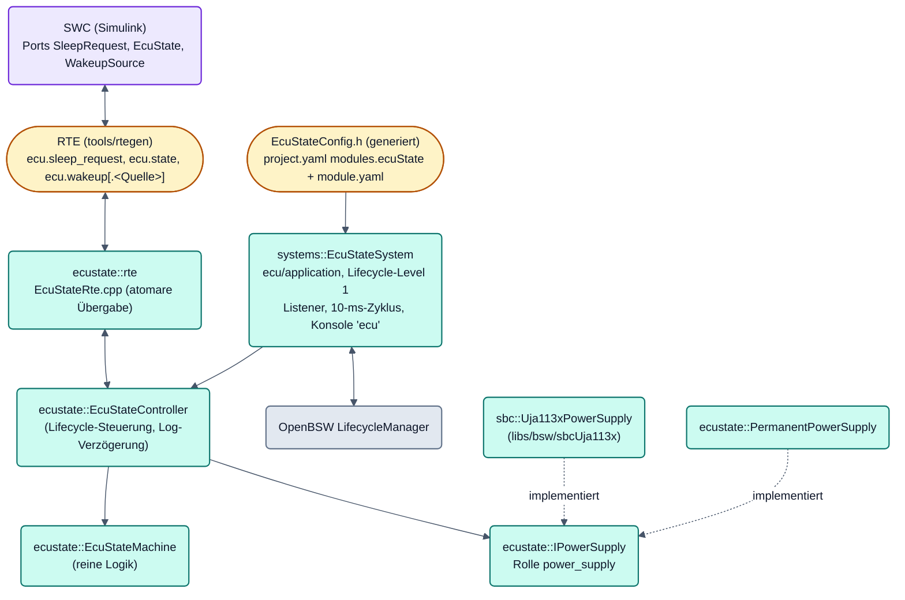
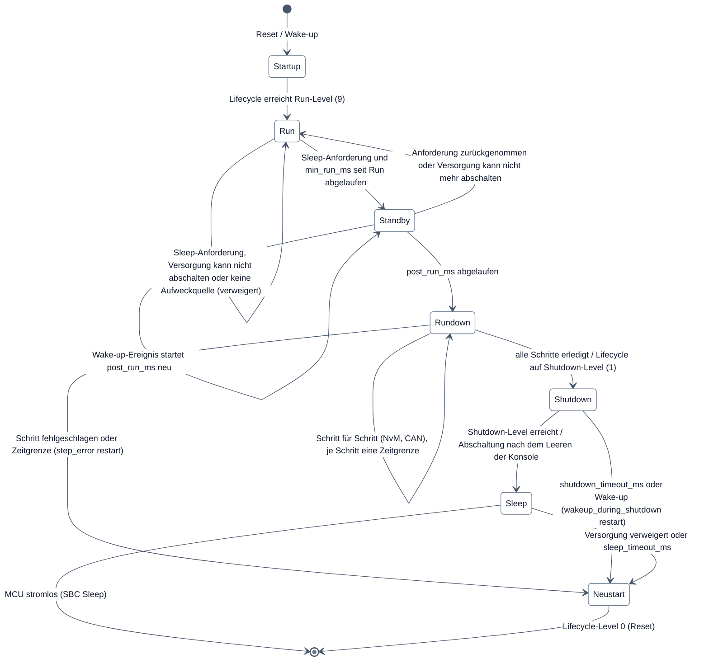
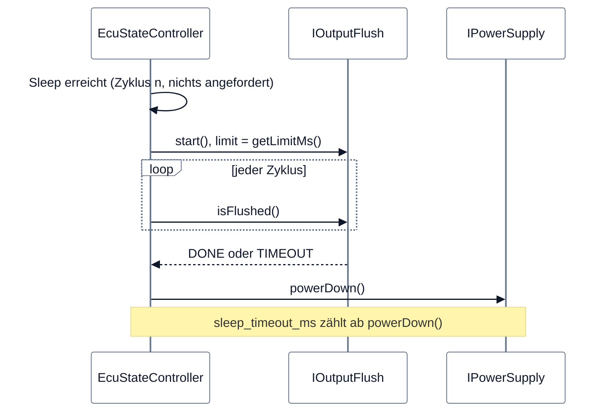

# ECU-Zustandsverwaltung (`ecuState`)

## Bilder

### Normalablauf und Nachlauf

```mermaid
%%{init: {'theme':'base','flowchart':{'curve':'basis'},'themeVariables':{'fontFamily':'Segoe UI, Helvetica, Arial, sans-serif','fontSize':'14px','background':'#ffffff','primaryColor':'#ffffff','primaryBorderColor':'#64748b','primaryTextColor':'#0f172a','lineColor':'#475569','edgeLabelBackground':'#ffffff','tertiaryColor':'#f8fafc','clusterBkg':'#f8fafc','clusterBorder':'#cbd5e1'}}}%%
flowchart LR
    ST("Startup") -->|"lifecycle level 9"| RUN("Run")
    RUN -->|"sleep request,<br/>min_run_ms"| SBY("Standby<br/>post_run_ms")
    SBY -->|"request withdrawn"| RUN
    SBY --> RD
    subgraph RD["Rundown, fixed order, time limit per step"]
        direction LR
        S0("NVM<br/>nvm_timeout_ms") --> S1("CAN_STOP<br/>can_stop_timeout_ms") --> S2("SAFE_OUTPUTS<br/>50 ms")
    end
    RD -->|"all steps done"| SD("Shutdown<br/>lifecycle level 1")
    SD --> SL("Sleep<br/>MCU unpowered")
    RD -->|"step failed or timeout"| RS("Restart<br/>lifecycle level 0")
    SD -->|"timeout or wake-up"| RS
    SL -->|"refused or sleep_timeout_ms"| RS
    RS --> ST

    classDef own fill:#ccfbf1,stroke:#0f766e,stroke-width:1.5px,color:#0f172a
    classDef grp fill:#f8fafc,stroke:#cbd5e1,rx:8,ry:8
    class ST,RUN,SBY,S0,S1,S2,SD,SL,RS own
    class RD grp
```



**Legende**

- Gesamtbild mit den Reaktionen des Safe Supervisors: [Bild 5, ECU-Zustandsautomat](../../../../doc/figures/05-ecu-zustaende.md).
  Der vollständige Zustandsautomat dieses Moduls mit allen Bedingungen steht in
  [Zustände und Übergänge](#zustände-und-übergänge), der Modulaufbau in [Aufbau](#aufbau).
- Ab Rundown gibt es keinen Rückweg nach Run. Die Schritte und ihre Zeitgrenzen: [Nachlauf vor dem Sleep](#nachlauf-vor-dem-sleep).

Board-neutrale Zustandsverwaltung der ECU: **Startup → Run ⇄ Standby → Rundown → Shutdown → Sleep**. Sie baut auf
dem OpenBSW-Lifecycle auf (Level hoch zum Betrieb, Level herunter zum Abschalten, Level 0 = Neustart wie
`lc reboot`) und spricht die Versorgung nur über die Rolle `power_supply` an. Der SBC UJA113x ist eine
Implementierung dieser Rolle, ein Board ohne schaltbare Versorgung nutzt `PermanentPowerSupply`.

Host-getestet (Testliste im [Modulkatalog](../../../../doc/reference/modules.md)), nicht am Board geprüft.

## Aufbau



| Datei | Inhalt |
|---|---|
| `include/ecuState/EcuState.h` | Zustände, Aufweckbits, Richtlinien, `EcuStateConfig`, `isValidEcuStateConfig` |
| `include/ecuState/EcuStateMachine.h`, `src/…/EcuStateMachine.cpp` | Zustandsmaschine, Zeit und Ereignisse als Parameter, gibt Aktionen zurück |
| `include/ecuState/EcuStateController.h`, `src/…/EcuStateController.cpp` | verbindet Zustandsmaschine, Lifecycle (`ILifecycleControl`), Versorgung und RTE |
| `include/ecuState/IPowerSupply.h` | Rolle `power_supply` |
| `include/ecuState/IShutdownStep.h` | Nachlauf-Schritte: `ShutdownStep`, `StepState`, `IShutdownStep`, `ShutdownSequence` |
| `include/ecuState/IOutputFlush.h` | Ausgabe vor der Abschaltung leeren: `IOutputFlush`, `OutputFlushState` |
| `include/ecuState/PermanentPowerSupply.h` | Versorgung ohne Abschaltmöglichkeit |
| `include/ecuState/EcuStateRte.h`, `src/…/EcuStateRte.cpp` | Übergabe an die RTE (eigener Task) |
| `include/ecuState/EcuStateIntegration.h` | `ECU_STATE_CONFIG()`: generierte Parameter → `EcuStateConfig` |
| `module.yaml` | Manifest: Dienst, Parameter mit Standardwerten, Konsole `ecu` |
| `libs/bsw/sbcUja113x/include/sbc/Uja113xPowerSupply.h` | Rolle `power_supply` des UJA113x |
| `ecu/application/src/systems/EcuStateSystem.cpp` | OpenBSW-Lifecycle-Komponente, Konsole, Log |
| `platforms/<familie>/port/main/include/integration/Integration.h` | `integration::powerSupply()`, `powerSupplyContext()`, `shutdownSequence()` |
| `platforms/s32k1xx/port/main/src/integration/CanShutdownStep.h/.cpp` | Nachlauf-Schritt `CAN_STOP` über `can::ICanSystem` und die Rolle `can_phy` |
| `platforms/s32k1xx/port/main/src/integration/ConsoleOutputFlush.h`, `IdleOutputDrain.h` | Konsole leeren vor der Abschaltung |

Der Kern (`EcuStateMachine`, `EcuStateController`) kennt weder OpenBSW noch Hardware und läuft unverändert im Host-Test.

## Zustände und Übergänge



| Zustand | Wert (`ecu.state`) | Bedeutung | Verlassen |
|---|---|---|---|
| Startup | 0 | Lifecycle steigt bis zum Run-Level, Anwendung noch nicht vollständig | Run-Level erreicht |
| Run | 1 | Normalbetrieb | Sleep-Anforderung nach `min_run_ms` |
| Standby | 2 | Sleep angefordert, Nachlauf: Anwendung, CAN und RTE laufen weiter | nach `post_run_ms` → Rundown, Rücknahme → Run |
| Shutdown | 3 | Lifecycle fährt bis Level 1 herunter (RTE, UDS, CAN aus). Kein Rückweg | Level 1 erreicht → Sleep |
| Sleep | 4 | Konsole leeren, dann Abschaltung bei der Versorgung anfordern | MCU stromlos, sonst Neustart |
| Rundown | 5 | Abmeldeablauf vor dem Herunterfahren: NvM, CAN, sichere Ausgänge. Kein Rückweg | alle Schritte erledigt → Shutdown |

Die Werte 0–4 sind Teil der RTE-Schnittstelle; Rundown ist deshalb mit 5 angehängt und steht in der Reihenfolge
zwischen Standby und Shutdown.

**Sleep-Anforderung** = RTE (UND aller an `ecu.sleep_request` verbundenen Komponenten) **oder** Konsole (`ecu sleep`).
Ist nichts verbunden, gilt „keine Anforderung“.

**Ohne Rückweg aus Rundown und Shutdown:** Ab dem Rundown ist der NvM-Stand geschrieben und die CAN-Kommunikation
beendet; heruntergefahrene OpenBSW-Komponenten werden nicht wieder hochgefahren. Ein Aufweckereignis ab Rundown führt
über einen Neustart (`wakeup_during_shutdown` `restart`); der neue Start wertet es als Aufweckquelle aus.

## Nachlauf vor dem Sleep

Im Zustand **Rundown** läuft ein Ablauf mit fester Reihenfolge, bevor der Lifecycle heruntergefahren wird. Je Schritt
ruft die Zustandsverwaltung einmal `start()` und dann je 10-ms-Zyklus `poll()`, bis der Schritt `DONE` oder `FAILED`
meldet; nichts blockiert.

| # | Schritt (`ShutdownStep`) | Aufgabe | Zeitgrenze | Anbieter |
|---|---|---|---|---|
| 0 | `NVM` | nichtflüchtige Daten schreiben | `nvm_timeout_ms` (1000 ms) | NvM der Anwendung über `DataFlashRunDownStep`; keiner in einem Projekt ohne NvM-Blöcke |
| 1 | `CAN_STOP` | Botschaften einstellen (`mute()`), Hardware-Sendequeue leerlaufen lassen, Transceiver der Rolle `can_phy` in Standby | `can_stop_timeout_ms` (500 ms) | `systems::CanShutdownStep` |
| 2 | `SAFE_OUTPUTS` | Leistungsausgänge über die Tabelle der sicheren Ausgänge in den sicheren Zustand und dort halten (SYS-174) | 50 ms (Konstante des Mechanismus) | `integration::SafeOutputsShutdownStep` (s32k1xx, Projekte mit PWM-Gruppe oder `safe_off`-Ausgang) |

| Ergebnis (`StepState`) | Bedeutung |
|---|---|
| `not present` | kein Anbieter im Projekt; kein Fehler, wird gezählt |
| `done` | Schritt fertig |
| `failed` | Anbieter meldet Fehler, `getFailureReason()` nennt ihn |
| `timeout` | länger `running` als die Zeitgrenze |
| `skipped` | ein früherer Schritt hat den Ablauf abgebrochen |

- **Abbruch (`step_error`):** `restart` (Standard): restliche Schritte `skipped`, Neustart (Level 0, `RUN_DOWN_STEP_FAILED`);
  ein halb vorbereitetes Gerät soll nicht einschlafen. `continue`: Fehler vermerkt, Ablauf geht weiter. Nach dem
  NvM-Schritt gibt es nie `continue` (`isContinuableStep()`, SYS-174), weil der Schritt noch Flash schreiben kann;
  `tools/rtegen` lehnt `continue` für Projekte mit NvM-Blöcken ab. Der Grund bleibt lesbar (`getStepAbort()`).
- **Zeitüberschreitung:** `IShutdownStep::abort()` wird einmal im Zyklus des Timeouts aufgerufen; der Schritt wird
  danach nicht mehr gestartet oder abgefragt.
- **`SAFE_OUTPUTS`** setzt zuerst eine Rundown-Sperre (jedes `enable()` eines `safe_off`-Treibers wird verweigert),
  läuft die Tabelle ab und übergibt die PWM-Sperre an den Debug-Halt-Wächter. Der Safe-State-Latch bleibt unberührt, der
  Rundown ist kein Fehler.
- **Neustart** = Lifecycle-Level 0; der `IdleHandler` löst den Software-Reset aus, genau einmal. Seit SYS-173 gibt die
  Zustandsverwaltung dem Lifecycle ab der Anforderung `shutdown_timeout_ms`; danach ruft sie den direkten Reset der
  Familie (`ecuState/DirectReset.h`; s32k1xx: Tabelle der sicheren Ausgänge, dann `softwareSystemReset()`).
- **Eigenen Schritt anbieten:** `IShutdownStep` implementieren und in der Integration in die `ShutdownSequence`
  eintragen. Manuelle Lifecycle-Wechsel (`lc level <n>`) ändern den ECU-Zustand nicht.

## Log und Konsole vor der Abschaltung leeren

Die letzten Log-Zeilen müssen die UART erreichen, bevor die Versorgung abgeschaltet wird; der OpenBSW-Logger gibt im
Leerlauf-Task Byte für Byte aus.



- Ohne Anbieter gilt die feste Verzögerung `POWER_DOWN_DELAY_MS` (100 ms) ab `Sleep`; Zeitschranke 0 überspringt das Leeren.
- Anbieter `integration::ConsoleOutputFlush` (s32k1xx): kein zweiter Schreibweg. `start()` loggt die letzte Zeile
  `ECU power down after the console output is flushed (limit … ms)` und stellt eine Sonde in den Ausgabekontext; zwei
  Abstände unter 4 Zeichenzeiten zwischen ihren Läufen heißen „Logger-Puffer leer“, danach wartet
  `bsp::Uart::waitForTxReady()` auf das letzte Zeichen.
- Die Zeitschranke ist abgeleitet: `consoleFlushLimitMs(baud)` = 65 536 Zeichen × 10 Bit / Baudrate, 5 689 ms bei
  115 200 Bd. Sie greift nur, wenn die Ausgabe hängt.
- Nach dem Start des Leerens loggt nur die Zustandsverwaltung nicht mehr (`isOutputClosed()`, SYS-11); zurückgehaltene
  Meldungen folgen nur, wenn die ECU weiterläuft (verweigerte Abschaltung, Sleep-Timeout).

## Rolle power_supply

```cpp
namespace ecustate {
class IPowerSupply {
public:
    enum class PowerDownResult : uint8_t { STARTED, NOT_SUPPORTED, WAKEUP_PENDING, FAILED };
    virtual char const* getName() const = 0;
    virtual bool isPowerDownSupported() const = 0;       // kann powerDown() jetzt gelingen?
    virtual uint32_t getStartupWakeupSources() const = 0; // Gründe dieses Starts (wakeup-Bits)
    virtual bool restartedForThisStart() const { return true; } // Versorgung selbst neu gestartet?
    virtual uint32_t takeWakeupEvents() = 0;             // Aufweckereignisse seit dem letzten Aufruf
    virtual uint32_t getSupportedWakeupSources() const = 0;      // was diese Platine bewaffnen kann
    virtual uint32_t getCyclicWakeupMs(uint32_t requestedMs) const = 0; // eigenes Raster, 0 = kann nicht
    virtual PowerDownResult powerDown(uint32_t nowMs, WakeupSelection const& selection) = 0; // nicht blockierend
};
}
```

Alle Aufrufe kommen aus dem Task, den die Implementierung verlangt (UJA113x: Task `bsp`).

| Implementierung | Abschalten | Aufweckquellen |
|---|---|---|
| `sbc::Uja113xPowerSupply` | SBC Sleep (V1 aus), nur wenn Treiber in Normal und MTPNV SLPC = 0; ein Interrupt direkt vor dem Sleep ergibt `WAKEUP_PENDING` | CAN-Bus des integrierten Transceivers, verdrahtete WAKE/HVIO-Eingänge, `TIMER` (Watchdog in Sleep) |
| `ecustate::PermanentPowerSupply` | nie (`NOT_SUPPORTED`): Sleep-Anforderungen werden verweigert, die ECU bleibt in Run | keine |

**Bewaffnen und prüfen:** In jedem Zyklus gilt `armed = ecu_state.wakeup_* ∩ getSupportedWakeupSources()` und
`missing = wakeup_* \ supported`; `missing` wird einmal geloggt und steht in `ecu status`. Ist `armed` leer, wird eine
Sleep-Anforderung verweigert, weil die ECU sonst nie wieder aufwacht. `powerDown()` bekommt nur `armed`.

## Aufweckquellen

Bitmaske (`ecustate::wakeup`, RTE `ecu.wakeup`), mehrere Bits möglich:

| Bit | Name | Bedeutung | `ecu.wakeup.<Quelle>` |
|---|---|---|---|
| 0 | `POWER` | Versorgung eingeschaltet | `POWER` |
| 1 | `RESET` | MCU-Reset ohne Aufweckereignis (Reset-Pin, Debugger, Software-Reset, Neustart der Zustandsverwaltung) | `RESET` |
| 2 | `WATCHDOG` | Watchdog-Reset | `WATCHDOG` |
| 3 | `SUPPLY` | nach Versorgungsfehler (Unterspannung, Überlast) | `SUPPLY` |
| 4 | `TIMER` | zyklisches Aufwecken (z. B. SBC-Watchdog in Sleep) | `TIMER` |
| 7 | `UNKNOWN` | Versorgung kann den Grund nicht bestimmen | `UNKNOWN` |
| 8 + i | CAN-Bus i | Wake-up über CAN-Bus mit Index i (`NX_CAN_<bus>_INDEX`) | Busname, z. B. `CAN0` |
| 16 + i | lokaler Eingang i | Wake-up-Eingang der Versorgung (SBC: Bit i von Register 0x64) | `LOCAL0` … `LOCAL7` |

**UJA113x, Startgrund beim Start** (Reihenfolge der Auswertung):

| Beim Start | Ergebnis |
|---|---|
| CWI anstehend | CAN-Bus des integrierten Transceivers (ohne genutzten Bus: `UNKNOWN`) |
| Bank-0-Wake-up Bit i | `LOCAL i` |
| POSI anstehend | `POWER` |
| sonst RCC auf dem Startwert (kein SBC-Reset seit dem letzten Start, NVM-34) | `RESET`, `restartedForThisStart()` false |
| sonst RSS 12 | `TIMER` |
| sonst RSS 14, 15, 16 | `WATCHDOG` |
| sonst RSS 18, 19 | `SUPPLY` |
| sonst RSS 0, 1, 17, 20 | `RESET` |
| sonst (LIN, Diagnose, FSP) oder SBC-Start fehlgeschlagen | `UNKNOWN` |

Das Reset-Quellen-Register RSS ändert sich nur bei einem SBC-Reset; nach einem reinen MCU-Reset steht dort das letzte
Ereignis. Darum zählen Power-on und Wake-up nur mit ihrem beim Start anstehenden Interrupt, und der Reset-Zähler RCC
zeigt, ob der SBC seit dem letzten Start zurückgesetzt wurde. Grenze: Bei offenem JP1 kann die SYS-07-Kompensation den
Zähler eines echten SBC-Resets zurücknehmen (Unterspannungs-Reset ohne Interrupt wird als reiner MCU-Start gemeldet).

**Zweite Quelle: Reset-Status der MCU (SYS-18).** Die Versorgung kennt nur, was ihr Baustein sah. Die Familie
registriert deshalb eine Funktion (`ecuState/McuStartReasons.h`, `setMcuStartReasonSource()`; s32k1xx: `RCM_SRS` vor
`main()`), die den MCU-Reset-Status als `wakeup`-Bits liefert. Beim Erreichen des Run-Levels wird die Vereinigung beider
Quellen gebildet (Rangfolge `WATCHDOG` > `SUPPLY` > Wake-up > `POWER` > `RESET`, nur `UNKNOWN` der Versorgung weicht);
`ecu.wakeup` und `bsw.reset.reason` melden damit denselben Start. Ohne Funktion bleibt das Verhalten wie zuvor.

**Auswahl (SYS-02):** Was die ECU vor dem Abschalten bewaffnet, steht als Projektwert unter `modules.ecuState`:

| Parameter | Bits | Beispiel |
|---|---|---|
| `wakeup_can` | ein Bit je CAN-Bus des Projekts (Bit 8 + Index) | `all`, `none`, `CAN0,CAN1` |
| `wakeup_local` | lokale Eingänge der Versorgung (Bit 16 + i) | `none`, `LOCAL0,LOCAL2`, `all` |
| `wakeup_cyclic_ms` | setzt `TIMER` (Bit 4), wenn > 0 | `1000` |

`tools/nxconfig` prüft jeden Busnamen gegen `use.can`; daraus entsteht eine Maske im Generat
(`NX_ECU_STATE_WAKEUP_SOURCES`). Eine Quelle, die es auf der Platine nicht gibt, fällt zur Laufzeit heraus. Beispiel
Eval Board: Der UJA1131 bietet CAN0 und `TIMER`, aber keinen lokalen Eingang, weil die WAKE/HVIO-Verdrahtung im
Board-Schema nicht beschrieben ist (ARCH-12).

## RTE-Ports

Verbindungsziele in der ECU-Beschreibung (`projects/<projekt>/rte.yaml`, `tools/rtegen`):

| Ziel | Richtung | Typ | Wert |
|---|---|---|---|
| `ecu.state` | Required Port | `uint8`/`uint16`/`uint32` | Zustand 0–4 (Tabelle oben) |
| `ecu.wakeup` | Required Port | `uint32` | Bitmaske der Startgründe, 0 bis Run erreicht |
| `ecu.wakeup.<Quelle>` | Required Port | `boolean` | ein Bit, Quellen siehe Tabelle; Busnamen aus dem Projekt |
| `ecu.sleep_request` | Provided Port | `boolean` | 1 = Sleep gewünscht; mehrere Ports: Sleep nur, wenn **alle** 1 melden |

`rtegen` prüft Richtung, Typ, Quelle und doppelte Verbindung; nur bei einem verbundenen `ecu.*`-Ziel enthält
`RteConfig.cpp` Code dafür.

**Zustand für BSW-Teile (NVM-26):** `ecustate::rte::publishedState()` und `ecustate::isOnWayToPowerDown(state)`
(wahr ab STANDBY). Erster Nutzer: Der Datenflash nimmt ab STANDBY keinen neuen Lösch- oder Schreibauftrag an.

Beispiel (Vorschlag, nicht im Demo-Projekt):

```yaml
connections:
  # Sleep-Anforderung aus dem Modell, zusätzlich zur LED (DemoSwc: Led1 folgt BUTTON1)
  DemoSwc.Led1.Led1: [dio.out.LED1, can.tx.EVB_Status.Led1, ecu.sleep_request]

# project.yaml
modules:
  ecuState:             # optional, fehlende Werte aus libs/bsw/ecuState/module.yaml
  post_run_ms: 2000
  wakeup_during_shutdown: restart
  nvm_timeout_ms: 1000
  can_stop_timeout_ms: 500
  step_error: restart         # restart | continue
  wakeup_can: CAN0            # all | none | Busnamen des Projekts
  wakeup_local: none          # none | all | LOCAL0..LOCAL7
  wakeup_cyclic_ms: 0         # 0 = kein zyklisches Wecken
```

## Parameter

Projektwerte stehen in `project.yaml` unter `modules.ecuState`; Schema, Standardwerte, Bereiche und ihre Begründung
stehen in `module.yaml` und sind im [Modulkatalog](../../../../doc/reference/modules.md) erzeugt. `tools/nxconfig`
prüft sie mit Zeile und YAML-Pfad, `rtegen` erzeugt daraus `EcuStateConfig.h`.

| Parameter | Standard | Wirkung |
|---|---|---|
| `min_run_ms` | 5000 | Mindestzeit in Run vor einem Sleep; lässt Tester und `canflash` Zeit |
| `post_run_ms` | 2000 | Nachlauf in Standby (Größenordnung AUTOSAR-CanNm) |
| `shutdown_timeout_ms` | 5000 | Grenze für das Herunterfahren; danach Neustart |
| `sleep_timeout_ms` | 2000 | Grenze ab `powerDown()` bis die MCU stromlos ist; sonst Neustart |
| `wakeup_during_shutdown` | `restart` | `restart` oder `sleep` bei Wake-up nach dem Herunterfahren |
| `after_watchdog_reset` | `run` | `sleep`: nach einem Watchdog-Reset ohne Anforderung schlafen |
| `nvm_timeout_ms`, `can_stop_timeout_ms` | 1000, 500 | Zeitgrenzen der Nachlauf-Schritte |
| `step_error` | `restart` | `restart` oder `continue` |
| `wakeup_can`, `wakeup_local`, `wakeup_cyclic_ms` | `all`, `none`, 0 | Auswahl der Aufweckquellen |

Fest im Code: 10-ms-Zyklus, Log-Verzögerung 100 ms (nur ohne `IOutputFlush`-Anbieter), Lifecycle-Level
(Run = höchstes Level, Shutdown = Level der Versorgung), Reihenfolge der Nachlauf-Schritte.

## Einbindung in den Lifecycle

- `app.cpp` registriert `EcuStateSystem` als Komponente `ecu` im **Level 1** nach `sbc`, `bsp`, `runtime` und
  `safety`: Level 1 bleibt beim Herunterfahren aktiv, Level 0 ist der Neustart. Run-Level = `MaxNumLevels` (9),
  Shutdown-Level = 1.
- Kontext: der Task der Versorgung (`integration::powerSupplyContext()`, heute `TASK_BSP`). Der Lifecycle-Listener
  läuft im Task `sysadmin` und setzt nur Merker, die der Versorgungstask unter der Interrupt-Sperre der Plattform
  liest (nicht mit `std::atomic::exchange`: ARMv6-M hat dafür keinen Befehl, PLAT-28).
- Versorgung: `integration::powerSupply()` liefert den `Uja113xPowerSupply`, wenn `NX_MODULE_SBCUJA113X_COUNT == 1`,
  sonst `PermanentPowerSupply`. Auf einem anderen Board ist nichts zu tun; eine neue Versorgung implementiert
  `IPowerSupply` und wird in der Integration ausgewählt.

## Konsole und Log

Befehle `ecu status` (Zustand, Startgründe, Aufweckquellen, Nachlauf-Schritte, Parameter, Zähler), `ecu sleep` (Sleep
anfordern; **mit SBC geht die MCU-Versorgung aus, nur mit Nutzer vor Ort**) und `ecu run` (Anforderung zurücknehmen);
vollständig in der [Konsolenreferenz](../../../../doc/reference/console.md).

Log (Komponente LIFECYCLE):

| Meldung | Bedeutung |
|---|---|
| `ECU state Run, wake-up sources 0x…, power supply …` | Start abgeschlossen |
| `ECU state Run -> Standby` usw. | Zustandswechsel |
| `ECU wake-up sources 0x… not available on this board (…)` | gewählte Quelle, die diese Platine nicht bewaffnen kann |
| `ECU sleep request refused: power supply … cannot power down` | Anforderung verweigert, bleibt in Run |
| `ECU run-down step CAN done within 500 ms` / `… failed (limit 500 ms): …` / `… NvM not present: …` | Ergebnis je Nachlauf-Schritt |
| `ECU power down after the console output is flushed (limit 5689 ms)` | letzte Zeile vor einer erfolgreichen Abschaltung |
| `ECU power down: started / wake-up pending / failed / not supported` | Ergebnis; seit SYS-11 nur geloggt, wenn die ECU weiterläuft |
| `ECU restart: shutdown timeout / wake-up during shutdown / power down refused / sleep timeout / run-down step failed` | Neustart angefordert |

## Tests

```sh
.venv/Scripts/python tools/test -k ecustate     # Host-Läufe (zig c++) und ARMv6-M/M4F-Builds
.venv/Scripts/python tools/test -k uja113x      # SBC-Treiber, Aufweckquellen
.venv/Scripts/python -m unittest tools/rtegen/test_rtegen.py
```

Die Liste der Host-Tests steht im [Modulkatalog](../../../../doc/reference/modules.md). Die Aussagekraft ist mit
gezielt eingebauten Fehlern geprüft (Mutationsliste im Changelog SYS-01, SYS-147, SYS-173, SYS-174).

## Grenzen und offene Punkte

- **Nicht am Board geprüft** (Sleep aus dem Modell nur mit Nutzer vor Ort). Gilt auch für SYS-09 (Leeren der Konsole),
  SYS-173/SYS-174 (direkter Reset, Schritt sichere Ausgänge) und das zyklische Wecken.
- Das Leeren setzt voraus, dass die Anwendung Logger und Konsole in `TASK_IDLE` ausgibt und die UART blockierend
  schreibt; sonst meldet die Sonde sofort „leer“. Zeilen anderer Komponenten zwischen Ende des Leerens und Abschaltung
  werden nicht zurückgehalten (SYS-11).
- Der Watchdog auf dem Weg nach Level 0 (WDG-F03: `SafetySystem::shutdown()` schaltet ihn ab) liegt außerhalb dieses
  Moduls und ist offen.
- Die Versorgungsauswahl liegt übergangsweise in `ecu/application` und kennt nur den SBC an CAN0 (ARCH-07); ebenso
  bekommt `CAN_STOP` die Transceiver über die globale Tabelle `platform::canPhys`.
- Der UJA113x meldet keine Aufweckereignisse im Betrieb (`takeWakeupEvents()` = 0): Busverkehr während Standby bis
  Shutdown verlängert den Nachlauf nicht; nach dem Einschlafen führt er sofort zum Wake-up.
- WAKE/HVIO-Eingänge sind im Board-Schema nicht beschrieben (ARCH-12); auf dem Eval Board ist die Maske 0.
- Keine Hardware-Standby-Stufe (SBC Standby mit MCU-Stop), keine Netzwerkmanagement-Anbindung; die Reihenfolge der
  Nachlauf-Schritte ist fest.
- Ausgänge behalten beim Shutdown ihren Wert, solange kein Schritt `SAFE_OUTPUTS` vorhanden ist (Projekte ohne PWM-Gruppe
  und ohne `safe_off`-Ausgang).
