# Gate-Treiber TMC6200 (`gdTmc6200`)

Status: **planned (after R1)**. Das Modul gehört zum Motorregler (Dreiphasen-Endstufe), nicht zum R1-Kern. Der Treiber
ist implementiert und auf dem Eval Board nur ohne Motor und bei ausgeschalteter Brücke geprüft (Umfang im
[Modulkatalog](../../../../doc/reference/modules.md)). Diese Kurzseite zeigt den Aufbau und die Sicherheitsregeln;
Herleitungen, Messbefunde und Testlisten stehen im Changelog (IO-25, IO-35, IO-44, IO-67, SYS-36, SYS-147) und im
Vorschlag IO-32 (not published, available on request).

```mermaid
%%{init: {'theme':'base','flowchart':{'curve':'basis'},'themeVariables':{'fontFamily':'Segoe UI, Helvetica, Arial, sans-serif','fontSize':'14px','background':'#ffffff','primaryColor':'#ffffff','primaryBorderColor':'#64748b','primaryTextColor':'#0f172a','lineColor':'#475569','edgeLabelBackground':'#ffffff','tertiaryColor':'#f8fafc','clusterBkg':'#f8fafc','clusterBorder':'#cbd5e1'}}}%%
flowchart LR
    SYS("GateDriverSystem<br/>lifecycle component, log, console")
    DRV("gd::Tmc6200<br/>init, cyclic 10 ms, enable, clearFaults")
    CFGH(["gateDriverConfiguration.h<br/>project values to Tmc6200Config"])
    SPI("ITmc6200Spi<br/>one 40-bit datagram")
    IO("ITmc6200Io<br/>DRV_EN, FAULT<br/>BiosTmc6200Io")
    LP("ISpiDevice transferLong<br/>LPSPI0, MOT1_GD")
    HW("TMC6200-TA")
    RTE(["RTE inputs<br/>gd.name.faults, enabled, qlf"])
    SYS --> DRV
    CFGH --> SYS
    DRV --> SPI --> LP --> HW
    DRV --> IO
    IO -- "MOT1_GD_DRV_EN" --> HW
    HW -- "MOT1_GD_FAULT" --> IO
    SYS --> RTE

    classDef own fill:#ccfbf1,stroke:#0f766e,stroke-width:1.5px,color:#0f172a
    classDef third fill:#e2e8f0,stroke:#64748b,stroke-width:1.5px,color:#0f172a
    classDef gen fill:#fef3c7,stroke:#b45309,stroke-width:1.5px,color:#0f172a
    class SYS,DRV,SPI,IO own
    class LP,HW third
    class CFGH,RTE gen
```

**Legende**

- Dateien und Rollen: [Aufbau](#aufbau). Der Treiber kennt keinen MOSFET und schaltet DRV_EN nie selbst ein
  ([Sicherheitsregeln](#sicherheitsregeln-des-treibers)); `enable()` ist der einzige Weg.
- Abläufe `init()`, `cyclic()`, `enable()`, `clearFaults()` und die Fehlerbits `gd::fault`: [Ablauf](#ablauf).

Complex Device Driver für den Dreiphasen-MOSFET-Gate-Treiber **TMC6200** (Trinamic/ADI) im SPI-Modus (SPE high).
Quelle aller Register, Bitfelder und Reset-Werte: TMC6200 Datasheet Rev. 1.08 (2022-06-01),
`doc/hardware/tmc6200/TMC6200_datasheet_rev1.08.pdf`; die Registerdatei `include/gd/tmc6200Registers.h` nennt die
Seite an jedem Wert.

## Aufbau

| Datei | Inhalt |
|---|---|
| `include/gd/tmc6200Registers.h` | Adressen, Bitfelder, Reset-Werte, Kennwerte mit Seitenangabe |
| `include/gd/ITmc6200Access.h` | `ITmc6200Spi` (ein 40-Bit-Datagramm), `ITmc6200Io` (DRV_EN, FAULT) |
| `include/gd/Tmc6200.h`, `src/gd/Tmc6200.cpp` | Treiber, `Tmc6200Config`, Fehlerbits `gd::fault` |
| `test/host/Tmc6200HostTest.cpp` | Host-Tests gegen `FakeTmc6200` (Registermodell) |
| `module.yaml` | Manifest: Anschlüsse `drv_en`/`fault`, Projektparameter, Konsole je Instanz |
| `platforms/s32k1xx/port/bspConfiguration/include/bsp/gd/gateDriverConfiguration.h` | SPI-Fakten, Projektparameter zu `Tmc6200Config` |
| `platforms/s32k1xx/port/main/…/systems/GateDriverSystem.{h,cpp}` | Lifecycle-Komponente, Logging, Konsole, `BiosTmc6200Io` |

Der Baustein hat ein eigenes Registermodell mit Fehlerlatches eigener Semantik, daher ein hardwarenaher Treiber je
Bausteinfamilie ([Treibergranularität](../../../../doc/architecture/treiber-granularitaet.md), Fall 2). Nach außen
meldet er Fehler in Begriffen der Funktion (`gd::fault`). Endstufenabhängige Felder (Totzeit, Treiberstrom) bleiben
auf dem Reset-Wert.

**Projektparameter** (`project.yaml`, `modules.<Baustein>`; `0` oder `-1` = Reset-Wert des Bausteins, kein
SPI-Schreibzugriff; Wertebereiche im [Modulkatalog](../../../../doc/reference/modules.md)):

| Parameter | Wirkung |
|---|---|
| `overtemperature_shutdown_c` | Abschaltschwelle 120/136/143/150 °C |
| `short_retries`, `short_all_bridges_off`, `fault_output_each_short` | Verhalten bei erkanntem Kurzschluss |
| `short_to_ground_mv`, `short_to_supply_mv` | Erkennungspegel als Drain-Source-Spannung des leitenden Schalters (209..1560 bzw. 106..1560 mV); nxconfig rechnet daraus den Strombereich |
| `short_filter_ns`, `short_delay_ns` | Filter 0/100/1000/2000/3000 ns, Austastung 0/750/1500 ns |

## Sicherheitsregeln des Treibers

| Regel | Auslöser | Reaktion |
|---|---|---|
| DRV_EN nie selbstständig an | `init()`, `cyclic()`, Wiederholversuch, Neuinitialisierung | nichts; nur `enable()` schaltet ein, die Konsole hat keinen Einschaltbefehl |
| `init()` schaltet DRV_EN zuerst aus | jeder Start | danach lesen, nur konfigurierte Felder (nicht `KEEP`) schreiben und zurücklesen; bei falscher Version oder SPI-Fehler kein Schreibzugriff |
| DRV_EN ohne Sollwert wird zurückgenommen (SYS-147) | fremder High-Pegel (Konsole `out set`, Debugger) | jeder `cyclic()` treibt DRV_EN low, wenn der Treiber nicht high kommandiert; `ENABLE_MISMATCH` bleibt gespeichert |
| Sperre im Safe State (SYS-36) | Safe State S1 aktiv | DRV_EN low, `ENABLED` zu `DISABLED` ohne gespeicherten Fehler, `enable()` antwortet `LOCKED`; Rückweg nur über `leaveSafeState()` und ein neues `enable()` |
| Gemeldeter Kurzschluss schaltet ab (IO-44) | GSTAT `shortdet_u/v/w` | gehört zu `gd::fault::SHUTDOWN`: DRV_EN aus, `enable()` verweigert bis `clearFaults()` |
| Enable nur mit allen drei Phasen im gleichen Zustand (IO-44, IO-45) | `enable()` | verweigert bei gemischtem Tastverhältnis; `clearFaults()` meldet, wenn der Zustand weiter anliegt |
| Fehlende Versorgung ist kein Kommunikationsfehler (IO-67) | IOIN als Null-Datagramm | `NO_SUPPLY` (aktuell), gespeichert nur beim Verschwinden aus `DISABLED`/`ENABLED`; Wiederholung jede Sekunde |
| Debug-Halt (IO-32) | Debugger hält den Kern | PWM-Gruppe über `SWOCTRL` inaktiv, DRV_EN aus, kein Neustart; Auslegung im Vorschlag IO-32 (not published, available on request) |
| Nie geschrieben | - | OTP_PROG 0x06, FACTORY_CONF 0x08, GCONF test_mode, SHORT_CONF disable_S2G/disable_S2VS |
| Register über die Konsole | - | nur bei DRV_EN aus, nur GCONF (ohne test_mode), GSTAT, SHORT_CONF (ohne Abschaltbits), DRV_CONF |

Am Eval Board gilt zusätzlich: MOT1_GD_DRV_EN nur mit dem Nutzer vor Ort.

## Ablauf

**`init(nowMs)`:** DRV_EN aus, IOIN (Version), GSTAT, OTP_READ, dann GCONF, SHORT_CONF, DRV_CONF je lesen, einsetzen,
nur bei Abweichung schreiben und zurücklesen, State `DISABLED`. Fehler: `FAILED`, Wiederholung jede Sekunde.

**`cyclic(nowMs)`** (10 ms): GSTAT, IOIN und FAULT-Pin lesen, alle 100 ms die Konfigurationsregister zurücklesen.

| Ereignis | Reaktion |
|---|---|
| SPI-Fehler, Version falsch | DRV_EN aus, `FAILED`, `COMMUNICATION` gespeichert, Wiederholung nach 1 s |
| IOIN als Null-Datagramm (IO-67) | DRV_EN aus, `FAILED`, `NO_SUPPLY` |
| Register weichen ab oder GSTAT.reset bei DRV_EN an | Baustein-Reset: DRV_EN aus, `DEVICE_RESET`, Konfiguration neu schreiben |
| Abschaltfehler (uv_cp, drv_ot, s2g*, s2vs*, shortdet*, DRV_EN-Abweichung, test_mode) bei DRV_EN an | DRV_EN aus, `DISABLED`, Fehler gespeichert |
| Warnung (drv_otpw, FAULT-Pin) | nur gemeldet |

**`enable()`:** nur in `DISABLED` ohne gespeicherten Abschaltfehler; DRV_EN an, IOIN muss DRV_EN = 1 zeigen (sonst
`PIN_ERROR`, aus). **`clearFaults()`:** nur bei DRV_EN aus; löscht GSTAT-Flags und gespeicherte Fehler.

Fehlerbits `gd::fault` (RTE-Signal `gd.<Baustein>.faults`):

| Bit | Name | Quelle |
|---|---|---|
| 0x0001 | COMMUNICATION | SPI, Version, Rücklesen |
| 0x0002 | DEVICE_RESET | Registerverlust im Betrieb |
| 0x0004 | CHARGE_PUMP_UNDERVOLTAGE | GSTAT uv_cp |
| 0x0008 | OVERTEMPERATURE_WARNING | GSTAT drv_otpw |
| 0x0010 | OVERTEMPERATURE_SHUTDOWN | GSTAT drv_ot |
| 0x0020–0x0080 | SHORT_TO_GROUND_U/V/W | GSTAT s2gu/v/w |
| 0x0100–0x0400 | SHORT_TO_SUPPLY_U/V/W | GSTAT s2vsu/v/w |
| 0x0800 | SHORT_DETECTED | GSTAT shortdet_u/v/w |
| 0x1000 | FAULT_PIN | FAULT-Ausgang high |
| 0x2000 | ENABLE_MISMATCH | IOIN DRV_EN ≠ Sollpegel |
| 0x4000 | TEST_MODE | GCONF test_mode |
| 0x8000 | NO_SUPPLY | IOIN als Null-Datagramm |

## Konsole

Befehle `gd status`, `gd dump`, `gd read <adr>`, `gd write <adr> <wert>`, `gd clear`, `gd off` (Name je Instanz,
Vorgabe `gd`); vollständig in der [Konsolenreferenz](../../../../doc/reference/console.md). Bewusst ohne `on`.

## Grenzen

- Kein Motorbetrieb vor Board-Test und IO-15; es gibt keinen RTE-Ausgang zum Einschalten.
- Stromsensorverstärker nur als Registerfeld, keine Offset-Kompensation.
- Standalone-Modus (SPE low) nicht unterstützt.
- Kein Interrupt auf FAULT: Polling im 10-ms-Takt, der Baustein schaltet selbst in unter 2,2 µs ab (S. 38).
- Der Enable-Test (alle Phasen gleich) gilt nur beim Einschalten; im laufenden Betrieb schützt die Kurzschlusserkennung
  des Bausteins (IO-45, offen für die Motorregelung IO-61..IO-66).
