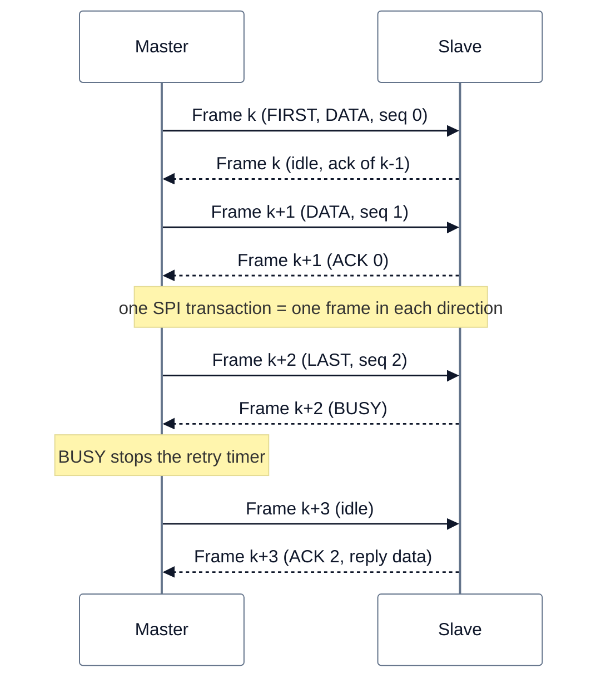

<!-- SPDX-License-Identifier: Apache-2.0 -->

# mcuLink — Protokoll zwischen zwei MCUs

Status: **planned (after R1)**. Das Mehr-MCU-Steuergerät gehört nicht zu R1. Das Protokoll ist als Host-Test
umgesetzt (BL-15); auf Hardware lief es nicht. Herleitung, Durchsatzmessung und Codegrößen stehen im Changelog (BL-15)
und im Test `libs/bsw/mcuLink/test/test_mcu_link_host.py`.

**Legende**

- Eine SPI-Transaktion ist ein Frame fester Länge in jeder Richtung gleichzeitig. Es gibt keine Längenverhandlung;
  das Abfragen des Slaves ist der Leer-Frame des Masters.
- Die Quittung für Frame *k* kommt im Frame *k+1* (Verzögerung um einen Austausch); das Sendefenster füllt diese Lücke.
- `BUSY` ist Flusskontrolle, kein Fehler: der Sender hält zurück und stoppt seinen Wiederholzähler. Die Frist darüber
  gehört zum UDS-Server (P2\*).
- Ein Zähler je Start des Senders (Session) erkennt einen Neustart des Partners; laufende Nachrichten werden verworfen
  (`MCULINK_EVT_PEER_RESTART`, NRC `0x24`).

Der Rahmen ist C99 ohne OpenBSW, RTOS und dynamischen Speicher. Er ist die zweite Umsetzung der Transportschnittstelle
des Bootloaders neben CAN/ISO-TP ([Mehr-MCU-Konzept](../../../../doc/architecture/planned.md), ARCH-47).

| | |
|---|---|
| Protokoll | `libs/bsw/mcuLink/src/mcuLink/McuLink.c`, `include/mcuLink/McuLink.h` |
| Transport des Slave-Bootloaders | `bootloader/src/link/bl_transport_link.c` |
| Link-Treiber des Masters | `bootloader/src/link/bl_link_master.c` |
| Hardwarevertrag | `bootloader/src/link/bl_link_hal.h` |

## Frameformat

`frameLen` Bytes, auf beiden Seiten gleich, mindestens `MCULINK_FRAME_OVERHEAD + 1`.

| Offset | Inhalt |
|---|---|
| 0 | Start `0x5A` (unterscheidet einen echten Partner von `0x00`/`0xFF`) |
| 1 | Flags: `FIRST`, `LAST`, `DATA`, `ACK`, `NACK`, `BUSY`, `RESET` |
| 2 | Session-Zähler des Senders |
| 3 | untere Hälfte: Sequenznummer dieses Segments; obere Hälfte: bestätigte Sequenznummer |
| 4 | Nutzbytes in diesem Frame |
| 5 … | Nutzdaten, dann Nullen |
| letzte 2 | CRC-16/CCITT-FALSE über alle vorigen Bytes, big endian |

## Parameter

Alles sind Werte, keine Compile-Time-Maxima; die Puffer gehören dem Aufrufer.

| Wert | Bedeutung | Vorgabe im Bootloader |
|---|---|---|
| `frameLen` | Bytes je Transaktion | 64 |
| `window` | unquittierte Segmente (Go-back-N, kostet keinen RAM) | 2 |
| `retries` | Rückläufe, dann `MCULINK_EVT_TX_FAILED` (NRC `0x22`) | 8 |
| `ackTimeoutMs` | Zeit bis zum Rücklauf | 20 ms |
| `pollPeriodMs` | nur Master: Leer-Austausch | je Projekt |
| `readyLine` | Ready-Leitung verdrahtet, sonst Polling | Boardfakt |

## Nicht enthalten

Die SPI-Treiber hinter `bl_link_hal.h` (BL-16, BL-17), das Gateway mit Routing und NRC-Abbildung (BL-17), die
Eintrittsabläufe (BL-17), Schema und Generatoren (ARCH-48) und jeder Hardwarenachweis (BL-18).
