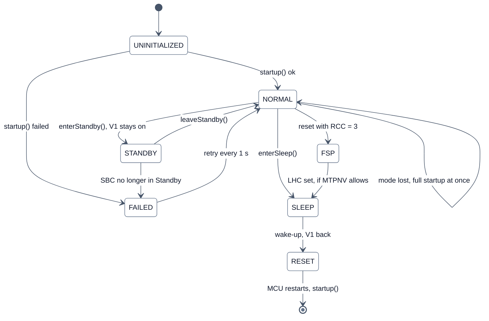
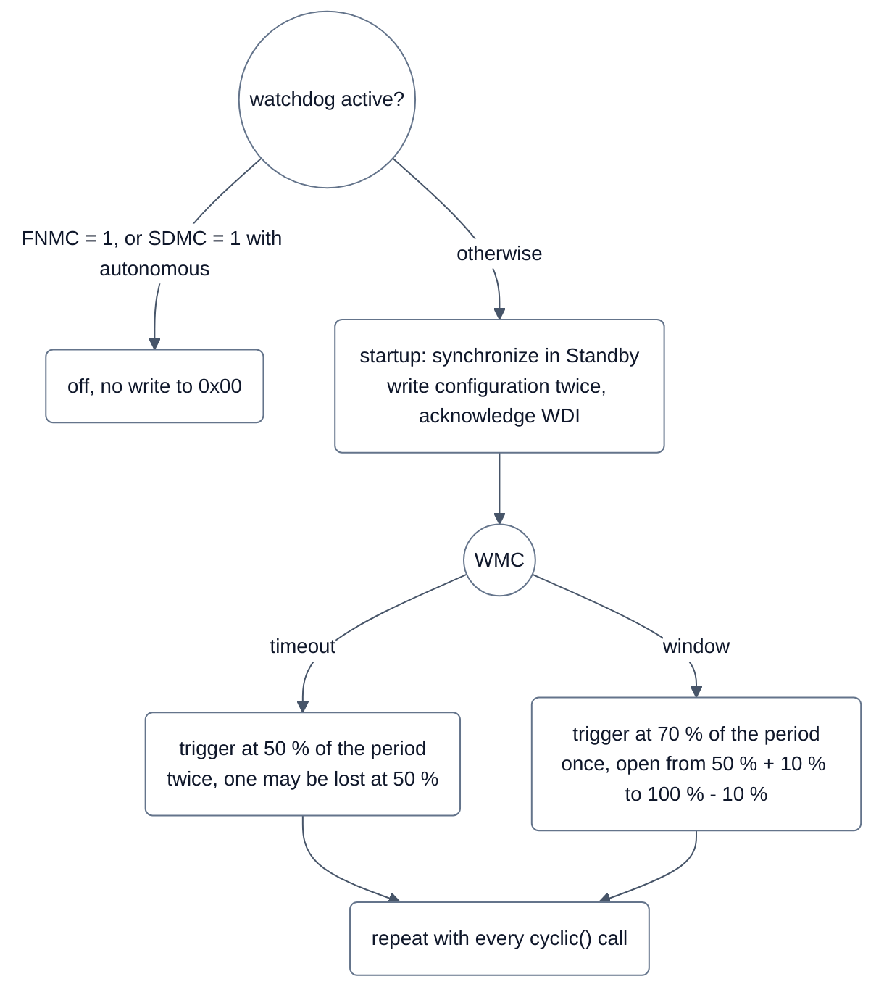
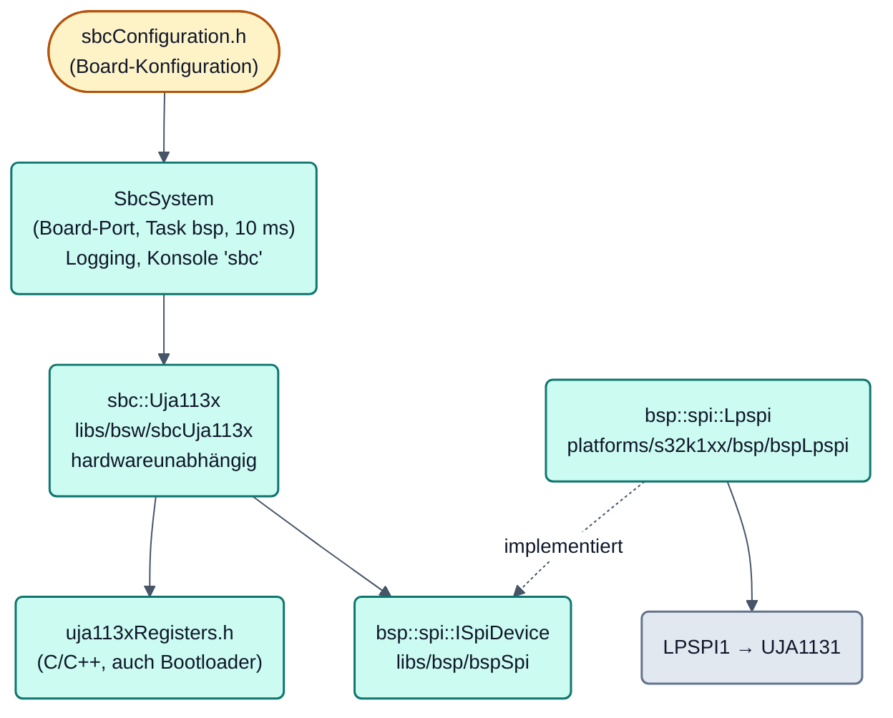
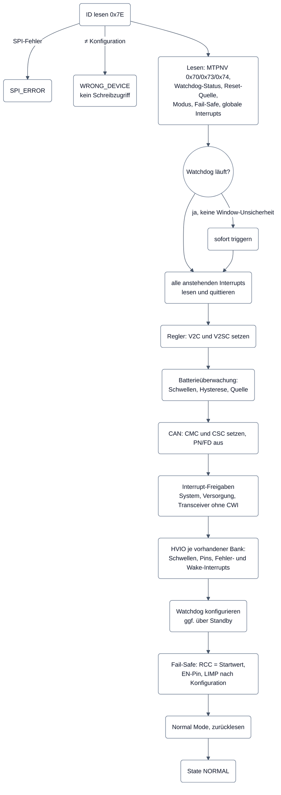

# SBC-Treiber UJA113x (`sbcUja113x`)
## Bilder

### Modi des SBC und Zustand des Treibers



**Legende**

- `UNINITIALIZED`, `NORMAL`, `FAILED`, `STANDBY` sind die Werte von `Uja113x::State`. `SLEEP`, `RESET` und `FSP`
  (Forced Sleep Preparation) sind Modi des SBC, in denen der Treiber nicht läuft: die MCU ist dann ohne Versorgung
  oder im Reset. Startablauf: [Startablauf](#startablauf), Sleep: [Sleep](#sleep), Reset-Zähler:
  [Reset-Zähler und Limp Home](#reset-zähler-und-limp-home), Standby: [INTN1 and Standby](#intn1-and-standby-io-68).
- Ein Rücksetzen von RCC nach jedem erfolgreichen Start verhindert FSP; der Treiber schreibt es als letzten Schritt
  vor Normal Mode.

### Watchdog-Ablauf



**Legende**

- Konfigurationsänderungen von WMC oder NWP nur in Standby: im Normal Mode lösen sie einen System-Reset aus. Der
  Treiber triggert aus seinem eigenen Zyklus und prüft damit nur den Task `bsp` (Abschnitt [Watchdog](#watchdog)).
- Eval Board: SDMC = 1 und `AUTONOMOUS`, der Watchdog ist aus. Mit 10-ms-Zyklus ist Window erst ab 64 ms Periode
  sinnvoll.

Complex Device Driver für die System Basis Chips der NXP-Familie UJA113x (UJA1131/1132/1135/1136,
auch /FD-Varianten). Auf dem Eval Board sitzt ein **UJA1131HW/FD/5V/4Y**.

Der Treiber kümmert sich um alles, was der SBC von der Software erwartet: Start und Initialisierung,
Watchdog, Interrupts, Überwachung des CAN-Transceivers, Reset-Zähler und den Übergang in Sleep. Der Ablauf
folgt dem öffentlichen UJA113x-Datenblatt (Rev. 2; Watchdog Abschnitt 7.2) und der NXP Application Hint AH1501
(Software Flow).

**Stand:** Start, zyklischer Betrieb, Sleep und Wake-up per CAN und die RCC-Rücksetzung sind am Eval Board bestätigt.
Alles Übrige ist nur im Registermodell geprüft: Watchdog im Timeout-/Window-Modus, RCC-Kompensation (SYS-07), wählbare
Aufweckquellen (SYS-02), Partial Networking (COM-07), HVIO, EN-Pin, LIMP und Batterieüberwachung (IO-10), INTN1 und
Standby (IO-68). Einzelheiten: [Verifikation](#verifikation).

---

## Aufbau



| Datei | Inhalt |
|---|---|
| `libs/bsw/sbcUja113x/include/sbc/uja113xRegisters.h` | Registeradressen und Bitmasken (C-kompatibel, auch vom Bootloader genutzt) |
| `libs/bsw/sbcUja113x/include/sbc/Uja113x.h` | Treiberklasse, Konfigurationsstruktur, Enums |
| `libs/bsw/sbcUja113x/include/sbc/Uja113xResetCounter.h` | RCC-Kompensation der MCU-Watchdog-Testresets (SYS-07), Implementierung in `Uja113x.cpp` |
| `libs/bsw/sbcUja113x/src/sbc/Uja113x.cpp` | Implementierung |
| `libs/bsw/sbcUja113x/include/sbc/Uja113xCanPhy.h` | Rolle `can_phy`: Bereitschaft des integrierten Transceivers als `::bios::CanPhy` (ARCH-05) |
| `libs/bsw/sbcUja113x/include/sbc/Uja113xPowerSupply.h` | Rolle `power_supply`: Startgründe, angebotene Aufweckquellen und Sleep für die ECU-Zustandsverwaltung (`ecustate::IPowerSupply`, SYS-01/SYS-02, [ecuState.md](../../ecuState/doc/ecuState.md)) |
| `libs/bsw/sbcUja113x/test/host/Uja113xPowerSupplyHostTest.cpp` | Host-Test der Rolle `power_supply` (läuft über `libs/bsw/ecuState/test/test_ecustate_host.py`) |
| `libs/bsw/sbcUja113x/module.yaml` | Modul-Manifest: Bausteine UJA1131/1132/1135/1136, Rollen, Lifecycle (ARCH-05) |
| `libs/bsw/sbcUja113x/test/host/Uja113xHostTest.cpp` | Host-Tests gegen ein Registermodell |
| `libs/bsp/bspSpi/include/spi/ISpiDevice.h` | SPI-Schnittstelle für Gerätetreiber |
| `platforms/s32k1xx/bsp/bspLpspi/` | LPSPI-Master-Treiber (Polling) und Teilerberechnung |
| `platforms/s32k1xx/port/bspConfiguration/include/bsp/sbc/sbcConfiguration.h` | Konfiguration für das Eval Board |
| `platforms/s32k1xx/port/main/src/systems/SbcSystem.cpp` | Lifecycle-Komponente, Logging, Konsolenbefehl |
| `platforms/s32k1xx/port/main/src/sbc/SbcEarlyStart.cpp` | früher SBC-Zugriff als Early-Init-Hook: RCC-Kompensation, Board-Test `sbc failstart` |
| `platforms/s32k1xx/port/main/src/integration/Integration.cpp` | Einbindung: `SbcSystem`, Hooks und CAN-Rolle nur, wenn das Projekt den SBC nutzt |

**Designprinzipien**

- **Hardwareunabhängig:** Der Treiber kennt nur `ISpiDevice` und bekommt die Zeit als Parameter (`nowMs`).
  Er läuft deshalb unverändert auf dem Target und im Host-Test.
- **INTN1 where the board wires it, polling otherwise (IO-68):** the driver has no ISR; the port tells `cyclic()` the
  state of the line, see [INTN1 and Standby](#intn1-and-standby-io-68).
- **Ein Kontext:** Nicht thread-safe, alle Aufrufe (inklusive Konsole) laufen im Task `bsp`.
- **Keine dynamischen Ressourcen:** kein Heap, keine Callbacks. Ereignisse werden gesammelt und von der
  Anwendung abgeholt.

---

## Einbindung auf einem Board

1. **Pins** im Board-Profil (`boards/<board>/board.yaml`) unter `spi:` eintragen und im Projekt
   (`projects/<projekt>/project.yaml`, `use: spi`) auswählen. Der Generator konfiguriert
   den Pinmux. Die INTN-Pins als DIO-Eingänge mit `pull: up` anlegen, falls die Platine keine Pull-ups hat
   (INTN ist Open-Drain).
2. **Takt** des LPSPI-Moduls im Clock-Setup des Boards festlegen (`CLOCK_SOURCE_LPSPIx` in `boardClock.h`).
3. **Konfiguration** analog zu `sbcConfiguration.h` anlegen: `LpspiConfig` und `Uja113xConfig`, siehe unten.
4. **Baustein** im Board-Profil unter `devices:` mit seiner Teilenummer eintragen (`part: UJA1131...`), beim SPI-Bus
   `device:` und beim CAN-Anschluss `phy:` auf ihn verweisen. bswgen ordnet ihn über `module.yaml` diesem Modul zu
   und erzeugt `integration/moduleConfiguration.h` (`NX_MODULE_SBCUJA113X_COUNT`, `NX_CAN_<bus>_PHY_MODULE_SBCUJA113X`)
   sowie `NX_MODULES` für CMake. Nutzt das Projekt den CAN-Anschluss, aber nicht den SPI-Bus des SBC, meldet bswgen
   einen Fehler mit YAML-Pfad.
5. **CMake/Lifecycle:** `main` bindet `SbcSystem`, `SbcEarlyStart`, `bspLpspi`, `sbcUja113x` und `sbcUja113xCanPhy`
   nur ein, wenn `sbcUja113x` in `NX_MODULES` steht. `Integration.cpp` registriert `SbcSystem` im Level 1 vor dem
   BSP, damit V2 und der CAN-Transceiver konfiguriert sind, bevor ADC und CAN starten, übergibt dem `CanSystem`
   `SbcSystem::getCanPhy()` als Transceiver und trägt die Early-Init-Hooks ein (ARCH-05).

```cpp
lifecycleManager.addComponent("sbc", sbcSystem.create(TASK_BSP), level);
lifecycleManager.addComponent("bsp", bspSystem.create(TASK_BSP, staticBsp), level);
```

Ohne `SbcSystem` lässt sich der Treiber direkt nutzen:

```cpp
::bsp::spi::Lpspi spi(SPI_CONFIG);
::sbc::Uja113x sbc(spi, SBC_CONFIG);

spi.init();
if (sbc.startup(getSystemTimeMs32Bit()) != ::sbc::Uja113x::Status::OK) { /* melden */ }
// alle 10 ms:
sbc.cyclic(getSystemTimeMs32Bit());
```

`SPI_CONFIG` und `SBC_CONFIG` werden per Referenz gehalten und müssen statisch leben.

---

## Konfiguration

### SPI (`bsp::spi::LpspiConfig`)

| Feld | Eval Board | Bedeutung |
|---|---|---|
| `base` | `IP_LPSPI1` | LPSPI-Instanz |
| `functionalClockHz` | 48 000 000 | Takt nach DIV2-Teiler (hier FIRCDIV2) |
| `baudrateHz` | 500 000 | Obergrenze. Genutzt wird die schnellste erreichbare Rate darunter (hier genau 500 kHz). |
| `pcs` | 0 | Chip-Select-Index |
| `frameBits` | 16 | Rahmenlänge |
| `cpol` / `cpha` | false / true | SBC schiebt Daten mit steigender, tastet mit fallender SCK-Flanke |
| `timeoutUs` | 5000 | Timeout je Frame |

**Where the values come from (ARCH-41).** `base`, `functionalClockHz` and `pcs` are project values (generat from
`board.yaml`, `use.spi` and the clock plan). Rate, frame length, clock polarity/phase and timeout are the same on every
board: `sbc::Uja113xSpi` in `sbc/Uja113x.h`, derived from the data-sheet values in `sbc/uja113xRegisters.h`
(`UJA113X_SPI_MAX_SCK_HZ` = 4 MHz, a `static_assert` keeps `BAUDRATE_HZ` below it).

SPI-Rahmen des UJA113x (16 Bit, MSB zuerst):

```
Byte 1: [A6 A5 A4 A3 A2 A1 A0 RO]   RO = 1: nur lesen
Byte 2: [D7 .. D0]                   Daten zum SBC / Registerinhalt vom SBC
```

Während des ersten Bytes gibt der SBC die Adresse auf SDO zurück. Der Treiber prüft das bei jedem Lesezugriff.

### SBC (`sbc::Uja113xConfig`)

| Feld | Eval Board | Bedeutung |
|---|---|---|
| `identification` | `0x51` | Erwarteter Inhalt von Register 0x7E. Bei Abweichung schreibt der Treiber nichts. |
| `startupControl` | `0x00` | Erwartete MTPNV 0x73 (nur Vergleich) |
| `sbcConfig` | `0x06` | Erwartete MTPNV 0x74 (nur Vergleich) |
| `watchdogMode` | `AUTONOMOUS` | `AUTONOMOUS`, `TIMEOUT` oder `WINDOW` |
| `watchdogPeriod` | `MS_128` | 8, 16, 32, 64, 128, 256, 1024 oder 4096 ms |
| `v2` | `ON_NORMAL_STANDBY_RESET` | V2/VEXT: `OFF`, `ON_NORMAL`, `ON_NORMAL_STANDBY_RESET`, `ON_ALWAYS` |
| `can` | `ACTIVE` | `OFFLINE`, `ACTIVE`, `ACTIVE_NO_UV` (VCAN-Unterspannung ignoriert), `LISTEN_ONLY` |
| `systemIrqEnable` | `OTWIE \| SPIFIE` | Register 0x04: Übertemperatur-Warnung, SPI-Fehler |
| `supplyIrqEnable` | `SMPSSI \| VEXTOI \| VEXTUI \| V1UI` | Register 0x1C |
| `transceiverIrqEnable` | `CFI` | Register 0x23. CAN-Wake-up (CWI) setzt der Treiber nur für Sleep. |
| `resetCounter` | `0` | RCC-Wert nach jedem erfolgreichen Start (0–3) |
| `limpHomeAtStartup` | `false` | LIMP nach dem Start: `false` gibt den Pin frei (LHC = 0), `true` zieht ihn low |
| `enPin` | siehe unten | EN-Ausgang (IO-10), `configure: false` lässt ENSC/ENDC/ENC wie vorgefunden |
| `battery` | siehe unten | Batterieüberwachung (IO-10), `configure: false` schreibt die Register 0x11–0x14 nicht |
| `hvio[0..1]` | beide `configure: false` | HVIO-Bänke (IO-10), Bank 0 = HVIO1–4, Bank 1 = HVIO5–8 |

**Hinweise zum Eval Board**

- **MTPNV** (aus dem früheren MBDT-Projekt): 0x73 = 0x00 bedeutet V2 nach dem Einschalten aus.
  0x74 = 0x06 bedeutet Software-Entwicklungsmodus (SDMC = 1), V2 als Versorgung auf der Platine, Sleep erlaubt.
- **V2:** versorgt +5VD und damit die Referenz VREFH (LM4132, 4,096 V). V2 bleibt deshalb auch in Standby und
  Reset an, sonst würde jeder Umweg über Standby die ADC-Referenz abschalten und die Safety-Prüfung auslösen.
- **Battery monitor, EN pin, HVIO:** project values `modules.SBC` of the demo (9000 / 18000 mV on BAT, 500 mV
  windows, nothing switched off, see [Project values and board wiring](#project-values-and-board-wiring-io-33)); the net
  `SBC_ENABLE` is not wired (`pins.EN: none`, EN stays low); the part has HVIO1-HVIO4 only, `board.yaml`: HVIO2 WAKE
  button, HVIO3 wake input at J2, HVIO4 CP_WAKE, these three are the local wake-up sources LOCAL1..LOCAL3.

---

## Startablauf

`startup(nowMs)` setzt AH1501 Kapitel 2.1 um. Jeder Schreibzugriff (außer Interrupt-Quittierung und
Watchdog-Trigger) wird zurückgelesen. Eine Abweichung bricht den Start mit `VERIFY_ERROR` ab.



Einzelheiten:

| Schritt | Verhalten |
|---|---|
| ID | Nur bei passender ID geht es weiter, denn alle Schreibzugriffe setzen die Registerbelegung voraus. |
| MTPNV | Wird **nur verglichen**. Abweichung oder Werkszustand (NVMPS = 1) setzt `mtpnvMismatch`, der Start läuft trotzdem weiter. |
| Watchdog | `_watchdogActive` = kein Forced Normal Mode und (Modus ≠ autonomous oder kein Entwicklungsmodus). Siehe [Watchdog](#watchdog). |
| Interrupts | Werden vor der Initialisierung quittiert, z. B. POSI (Power-on) nach dem Einschalten. Das Ergebnis steht in `StartupInfo::interrupts`. |
| Regler zuerst | Damit V2 an bleibt, falls die Watchdog-Konfiguration über Standby führt. |
| Batterie | Schwellen vor allem, was auf sie reagiert (IO-10). Ohne `battery.configure` wird nichts geschrieben. |
| CAN | Partial Networking und CAN-FD-Toleranz aus. Die Shutdown-Steuerung CSC kommt aus der Konfiguration, sobald die Batterieüberwachung konfiguriert ist – sonst bleibt sie erhalten (IO-10). |
| HVIO | Nur Bänke, die der Baustein laut Identifikation hat. Ohne `hvio[b].configure` bleibt die Funktion unberührt und nur die Wake-Freigabe wird auf 0 gesetzt (AH1501 2.2.3). |
| RCC/EN/LHC | Ein Schreibzugriff: Reset-Zähler, EN-Pin und LIMP nach Konfiguration. Ohne `enPin.configure` bleiben ENSC/ENDC/ENC wie vorgefunden. |

Schlägt der Start fehl, geht der Treiber in `FAILED` und `cyclic()` versucht es jede Sekunde erneut
(`STARTUP_RETRY_MS`).

---

## Zyklischer Betrieb

`cyclic(nowMs)` ist für einen 10-ms-Takt ausgelegt.

| Aufgabe | Takt | SPI-Frames |
|---|---|---|
| Watchdog bedienen (falls aktiv) | Timeout: 50 %, Window: 70 % der Periode | 1–2 |
| Globales Interrupt-Register 0x60 lesen | jeder Aufruf | 1 |
| Anstehende Interrupts lesen und quittieren | bei Bedarf | 2 je Register |
| CAN-Transceiver-Status 0x22 | bei CAN aktiv jeder Aufruf, sonst 100 ms; sofort bei Transceiver-Interrupt | 1 |
| Modus prüfen | 1 s | 1 |
| Neuer Startversuch (State `FAILED`) | 1 s | Start |

**CAN bereit** (`isCanTransceiverReady()`) heißt: CTS = 1 (Sender aktiv), VCS = 0 (keine VCAN-Unterspannung)
und CFS = 0 (kein TXD-Dominant-Fehler). Die Anwendung soll nur senden, wenn das erfüllt ist (AH1501 Abb. 16/17).

**Latenz des Transceiver-Status (COM-08):** Bei aktivem CAN-Modus (`ACTIVE`, `ACTIVE_NO_UV`) liest der Treiber Register
0x22 in jedem `cyclic()`-Aufruf (ein SPI-Rahmen), nicht nur alle 100 ms; ein Wegfall von VCAN oder ein abgeschalteter
Sender fällt nach einem Zyklus auf (Eval Board: 10 ms). Bei `OFFLINE` und `LISTEN_ONLY` bleibt der 100-ms-Takt.

**Meldung an das CAN-System (COM-23):** `SbcSystem` meldet jede Änderung von `isCanTransceiverReady()` über
`::can::CanPhyReadiness` (libs/bsw/canSystem), das CAN-System schaltet sofort stumm oder wieder aktiv. Ein Schreibzugriff
auf 0x20 über `writeRegister()` liest 0x22 direkt danach und meldet im selben Aufruf, damit ein abgeschalteter Sender
stumm ist, bevor die Anwendung einen weiteren Rahmen schreibt.

**Modusverlust:** Steht der SBC nicht mehr in Normal, hat er einen eigenen Reset gemacht, während die MCU
weiterlief (z. B. bei offenem JP1). Die Register stehen dann auf Default, V2 ist womöglich aus. Der Treiber
zählt `modeLost` und führt sofort einen kompletten Start durch.

Am Board gemessen: Task `bsp` einschließlich SBC im Mittel 65 µs pro Zyklus (0,65 % CPU).

---

## Watchdog

### Verhalten des SBC

| MTPNV | WMC | Normal | Standby (INTN1 high) | Sleep |
|---|---|---|---|---|
| FNMC = 1 (Forced Normal) | – | aus | aus | aus |
| SDMC = 1 (Entwicklungsmodus) | autonomous | aus | aus | aus |
| SDMC = 1 | timeout / window | Timeout / Window | Timeout | Timeout |
| SDMC = 0 | autonomous | **Timeout** | aus | aus |
| SDMC = 0 | timeout / window | Timeout / Window | Timeout | Timeout |

(Vereinfacht nach Datenblatt Tabelle 8 und Abschnitt 7.2.4. In Standby mit anstehendem Interrupt (INTN1 low) läuft
der Watchdog bei SDMC = 0 auch mit autonomous als Timeout-Watchdog. Nach einem SBC-Reset steht WMC laut Tabelle 7 und
7.2.1 auf timeout (SDMC = 0) bzw. autonomous (SDMC = 1), NWP auf 128 ms.)

### Regeln, die der Treiber einhält

- **Konfigurationsänderungen nur in Standby.** Eine Änderung von WMC oder NWP im Normal Mode löst sofort einen
  System-Reset aus (Datenblatt 7.2, 7.3.3). `configureWatchdog()` wechselt deshalb bei Bedarf nach Standby,
  schreibt die Konfiguration zweimal (Pflicht bei kürzerer Periode, Datenblatt 7.2.5 Fall A), quittiert ein dabei
  entstehendes WDI und liest zurück.
- **Synchronisation über Standby:** Ist der Watchdog aktiv, synchronisiert der Treiber beim Start immer in Standby
  (dort gilt Timeout-Verhalten). Nach einem reinen MCU-Reset ist die Phase eines Window-Watchdogs unbekannt, ein
  sofortiger Trigger könnte ins geschlossene Fenster fallen.
- **Timeout-Trigger zweimal**, weil ein einzelner Trigger genau bei 50 % wie ein ignorierter wirken kann
  (Datenblatt 7.2.5 Fall B).
- **Window-Trigger einmal**, sonst landet der zweite im geschlossenen Fenster.
- **Triggerzeitpunkt Window:** Das Fenster ist offen von 50 % (+10 % Oszillatortoleranz) bis 100 % (−10 %).
  (Datenblatt Tabelle 91, t_trig(wd)1/t_trig(wd)2.) Der Treiber zielt auf 70 %. Mit 10-ms-Zyklus ist Window erst
  ab 64 ms Periode sinnvoll.
- **Entwicklungsmodus mit autonomous:** kein einziger Schreibzugriff auf Register 0x00.

**Eval Board:** SDMC = 1 und `AUTONOMOUS`, der Watchdog ist also aus (am Board gelesen: Status 0x04).

> **Hinweis zum Watchdog-Trigger:** Der Treiber triggert aus seinem eigenen Zyklus. Er prüft damit nur, ob der
> Task `bsp` läuft, nicht die ganze Anwendung. Für echte Programmflusskontrolle sollte der Trigger später an
> Lebenszeichen der übrigen Tasks gekoppelt werden (AH1501 2.2.2).

---

## Interrupts

Der SBC signalisiert Ereignisse in den Statusregistern 0x61–0x67. Register 0x60 fasst zusammen, welche
davon etwas melden. Quittiert wird durch Schreiben einer 1 auf das jeweilige Bit.

| Feld in `InterruptFlags` | Register | Bits (Auswahl) |
|---|---|---|
| `system` | 0x61 | OVSDI 0x20, POSI 0x10 (Power-on), OTWI 0x04, SPIFI 0x02, WDI 0x01 |
| `supply` | 0x62 | SMPSSI 0x20, BMOI 0x10, BMUI 0x08, VEXTOI 0x04, VEXTUI 0x02, V1UI 0x01 |
| `transceiver` | 0x63 | PNFDEI 0x20, CBSI 0x10, LWI2 0x08, LWI1 0x04, CFI 0x02, CWI 0x01 |
| `wake` | 0x64 | HVIO1–4-Flanken, **zwei Bit je HVIO**: Bit 2·i steigend (IOnREI), Bit 2·i+1 fallend (IOnFEI) |
| `failure` | 0x65 | HVIO1–4: Bit 2·i Leerlauf (IOnOLI), Bit 2·i+1 Kurzschluss (IOnSCI) |
| `wakeBank1` | 0x66 | dieselben Bits für HVIO5–8 (nur Bausteine mit zwei Bänken) |
| `failureBank1` | 0x67 | dieselben Bits für HVIO5–8 |

Vor IO-10 wurden Bank 0 und Bank 1 in dasselbe Feld geodert; ein Ereignis an HVIO5 sah damit aus wie eines an
HVIO1. Die Felder sind deshalb getrennt.

- **Beim Start** landen die gefundenen Interrupts in `getStartupInfo().interrupts`.
- **Im Betrieb** sammelt der Treiber sie. `takeInterruptEvents()` gibt sie zurück und setzt die Sammlung zurück.
  `SbcSystem` loggt sie als Warnung.
- WDI, POSI, OVSDI und PNFDEI haben keine Freigabebits und sind immer aktiv.

**INTN-Pins:** INTN1/INTN2 sind Open-Drain und brauchen Pull-ups nach V1. Auf dem Eval Board fehlen sie im
Schaltplan. Das Board-Profil nutzt deshalb den internen Pull-up der MCU (`pull: up`). Am Board bestätigt: ohne
Pull-up dauerhaft low, mit Pull-up und quittierten Interrupts inaktiv. `sbc status` zeigt ihren Pegel zur Kontrolle;
seit IO-68 nutzt der Treiber INTN1, wenn das Board es verdrahtet (nächster Abschnitt).

### INTN1 and Standby (IO-68)

| Pin | Driven low by | Release |
|---|---|---|
| INTN1 | **every** enabled interrupt (WDI, POSI, OVSDI, PNFDEI always) | high when all status bits are cleared, then held high for 0.9..1.1 ms (data sheet 7.12.1) |
| INTN2 | only OTWI, V1UI, BMUI, BMOI, OVSDI, SMPSSI | no delay timer |

Both are open drain with pull-ups to V1. A wake-up event is an interrupt as well: in Standby it pulls INTN1 low, in Sleep
it wakes the SBC. The driver uses INTN1 only (it carries every event, and boards such as the BCU V3.3 wire only INTN1);
INTN2 would only shorten the reaction to its subset, which the 10 ms service already covers (decision D6, 2026-10-01).

INTN1 is the optional module connection `intn1` (`module.yaml connect`, ARCH-52): the board names the digital input
(`devices[].connect: { intn1: SBC_INTERRUPT1 }`, `pull: up` if the board has no pull-up); the project decides with a pin
event on the same input (`pin_events.<input>`, see [bspPinEvent](../../../bsp/bspPinEvent/doc/bspPinEvent.md)) whether
the line also raises a pin interrupt.

| Board / project | What the service does every 10 ms |
|---|---|
| `intn1` not wired | reads 0x60, `cyclic(now)` = `cyclic(now, InterruptLine::UNKNOWN)` |
| wired, no pin event | samples the input; reads 0x60 only if INTN1 is low, else every 100 ms as fallback |
| wired, pin event | as above, an edge since the previous cycle counts as low; the pin interrupt is the wake-up source of the MCU from a stop mode (`SbcSystem::isMcuWakeLineArmed()`) |

The reaction time stays one service cycle; what changes is one SPI frame per 100 ms instead of per 10 ms while nothing
happens. **Line supervision:** a fallback read that finds a pending interrupt the line did not show (more than
`INTERRUPT_RELEASE_MS` = 2 ms after the last clear) is a miss; `INTERRUPT_LINE_MISS_LIMIT` (2) misses in a row latch the
line as faulty (`isInterruptLineFaulty()`, log `SBC INTN1 faulty`) and the driver reads 0x60 in every call again until
the next MCU reset. A line stuck low with nothing pending costs one read per call and is counted (`interruptLineIdle`).

**Standby with V1 on.** `enterStandby(now, wakeup)` puts the SBC into Standby without switching V1 off, so the MCU can
enter a stop mode of its own (S32K1 VLPS, PLAT-108). Wake-up sources are those of `enterSleep()` (`SleepWakeup`): CAN
wake-up (any bus activity, no partial networking), HVIO wake inputs of both banks, and with `cyclic` the watchdog as
timeout watchdog. Every wake-up event raises its interrupt and pulls INTN1 low.

- Refused: `NOT_READY` outside Normal, `NOT_ALLOWED` without a source or with an input of a missing bank (nothing
  written), `INTERRUPT_PENDING` if an interrupt is pending before or after the mode change (back in Normal).
- In Standby (`State::STANDBY`) the CAN transceiver is offline, the battery monitor is off, Sleep is refused. `cyclic()`
  triggers the watchdog with the Standby value, collects the wake-up interrupts and supervises the SBC every second; a
  lost source counts as mode loss and runs a new startup.
- `leaveStandby(now)`: watchdog as configured, Normal mode, sources removed, transceiver status read. If the SBC is in
  neither Standby nor Normal, the driver goes to `FAILED` and starts again. Board test: `sbc standby <ms>`.

---

## Reset-Zähler und Limp Home

- **Zählen:** Der SBC zählt jeden Reset im Reset-Zähler RCC (Register 0x02, Bits 1:0).
- **Überlauf:** Steht RCC auf 3, wechselt der SBC beim nächsten Reset in **Forced Sleep Preparation (FSP)**. Dort
  setzt er LHC (LIMP-Pin low) und geht, falls die MTPNV Sleep erlaubt (SLPC = 0), in **Sleep**. Die MCU verliert dann
  ihre Versorgung, bis ein Wake-up (z. B. CAN) kommt.
- **Rücksetzen:** Die Software muss RCC nach jedem erfolgreichen Start zurücksetzen. Der Treiber schreibt
  `resetCounter` als letzten Schritt vor Normal Mode und löscht dabei ein aktives LHC
  (`StartupInfo::limpHomeWasActive`).

**Wirkung auf dem Eval Board:** JP1 verbindet RSTN des SBC mit dem Reset der MCU. Ist JP1 geschlossen, zählt jeder
MCU- oder JTAG-Reset mit. Ohne Rücksetzen schaltete der SBC nach wenigen Resets die Versorgung ab. Mit dem
Treiber setzt jede erfolgreich gestartete Anwendung RCC auf 0 (am Board bestätigt, VER-03: 6 Neustarts mit
`lc reboot`, jedes Mal RCC 0 und kein Forced Sleep).

**Bewusst nicht im Bootloader:** Setzte auch der Bootloader RCC zurück, würde der SBC eine Anwendung, die
dauerhaft vor dem Start abstürzt, nicht mehr erkennen.

### Kompensation der MCU-Watchdog-Testresets (SYS-07)

`main()` ruft den OpenBSW-Selbsttest `safety::bsp::Watchdog::executeFastTest` auf; er löst bei jedem Start zwei
Watchdog-Resets der MCU aus (`WDOG_CS.TST` = 2 und 3). Bei geschlossenem JP1 zieht jeder Reset RSTN und zählt im RCC:
nach Power-on stand RCC beim SBC-Start auf 2, nach einem MCU-Reset auf 3, ein einziger Fehlstart führte in Forced Sleep.

`SbcEarlyStart::compensateResetCounter()` (Hook der Rolle `early_init`, ganz am Anfang von `main()`, nur wenn das Projekt
den SBC nutzt) verringert RCC um 1 (nie unter 0), wenn der letzte Reset ein Watchdog-Reset war (`RCM_SRS.WDOG`) **und**
`WDOG_CS.TST` = 2 oder 3. Sonst wird der SBC nicht angesprochen. Die Logik ist hardwareunabhängig
(`sbc::compensateWatchdogTestReset()`): ID 0x7E prüfen, 0x02 lesen, nur die RCC-Bits ändern, zurücklesen; bei SPI-Fehler,
falschem Echo oder falscher ID wird nichts geschrieben, der Start läuft weiter. Die MTPNV wird nie geschrieben. Der
Zugriff ändert weder Takt noch Pins (Standardkonfiguration aus `board.yaml`) und nur RCC im SBC.

| Folge (JP1 geschlossen) | RCC beim SBC-Start vorher | mit Kompensation |
|---|---|---|
| Power-on | 2 | 0 |
| MCU-Reset (`lc reboot`, Absturz, JTAG) | 3 | 1 |
| echter Watchdog-Reset der MCU | 3 | 1 (zählt weiter) |

**Reserve:** Die Kompensation wirkt erst im Start nach dem Testreset. Tolerierte Fehlstarts vor dem SBC-Start: nach
Power-on 2 (vorher 0), nach MCU-Reset 1 (vorher 0); danach endet der nächste Start im Forced Sleep.

**Board-Test `sbc failstart <n>`** (nur mit Nutzer vor Ort, JP1 geschlossen): legt einen Zähler im No-Init-RAM
(`BL_BOOT_REQUEST_ADDR` − 8) an, löst nach 300 ms einen Software-Reset aus und danach in n Starts je einen Reset vor
dem SBC-Start. Der Zähler wird nur mit Magic und invertierter Kopie akzeptiert und nur gelesen, wenn POR/LVD in
`RCM_SSRS` seit dem Einschalten gelöscht wurden.

---

## HVIO, EN-Pin und Batterieüberwachung

Seit **IO-10** konfiguriert der Treiber die drei Funktionsblöcke, die der UJA113x neben Versorgung, Watchdog
und Transceiver anbietet. Leitlinie ist Abschnitt 5 von
[`treiber-granularitaet.md`](../../../../doc/architecture/treiber-granularitaet.md): **An der Modulgrenze
stehen physikalische Größen der Funktion, keine Registercodes.** Der Treiber ist die Stelle, die umrechnet.

### Was in welcher Einheit konfiguriert wird

| Größe | Einheit im Projekt | Raster des SBC | Umrechnung |
|---|---|---|---|
| Unter-/Überspannungsschwelle der Batterie | mV am überwachten Pin | 256 Stufen über 20 V, 78,4 mV | `batteryThresholdCode()` |
| Rückfallfenster (Hysterese) | mV | 16 Stufen zu je 313,7 mV | `batteryHysteresisCode()` |
| Messwert der Batterieüberwachung | mV | 10 Bit über 20 V, Genauigkeit ±300 mV | `batteryAdcMv()` |
| Kurzschlussschwelle eines HVIO | mA Laststrom | 30 / 45 / 60 / 90 mA (typisch) | `shortCircuitThresholdCode()` |
| Leerlaufschwelle eines HVIO | mA Laststrom | 2 / 5 / 10 / 20 mA (typisch) | `openLoadThresholdCode()` |

**Gerundet wird immer zur sicheren Seite**, damit die Reaktion nie später kommt als verlangt: die
Unterspannungsschwelle aufwärts, die Überspannungsschwelle abwärts, die Stromschwellen auf den nächsten
Rasterwert ≤ Wunsch (unterhalb des kleinsten Rasterwerts bleibt der empfindlichste). `getBatteryThresholds()`
meldet zurück, womit der SBC tatsächlich vergleicht – das gehört ins Log und in eine spätere
nxconfig-Prüfung, weil zwischen Wunsch und Raster bis zu 78 mV bzw. 30 mA liegen.

### Batterieüberwachung

Der SBC misst mit einem 10-Bit-Wandler die Spannung an **BAT** und an **BATSENSE** und vergleicht **eine**
davon (`source`) gegen die beiden Schwellen. Sie läuft **nur im Normal Mode**.

| Feld von `BatteryMonitorConfig` | Register | Bedeutung |
|---|---|---|
| `configure` | – | `false`: 0x11–0x14 bleiben unberührt, es gibt keine Ereignisse (Zustand vor IO-10) |
| `source` | 0x11 BMSC | `BAT` oder `BATSENSE` |
| `undervoltageMv` / `overvoltageMv` | 0x12 / 0x13 | Schwellen in mV |
| `undervoltageHysteresisMv` / `overvoltageHysteresisMv` | 0x14 | Rückfallfenster in mV |
| `canShutdown` | 0x20 CSC | Transceiver bei Unter-/Überspannung abschalten |
| `v2Shutdown` | 0x10 V2SC | V2/VEXT bei Unter-/Überspannung abschalten |

`readBatteryVoltages()` liefert beide Messwerte in mV und den Status BMUVS/BMOVS; die Ereignisse selbst
kommen als Interrupts BMUI/BMOI über `takeInterruptEvents()` (Freigabe in `supplyIrqEnable`).

> **Wichtig:** Der Einschaltwert von **CSC ist 01**, also „CAN-Transceiver aus bei Unterspannung". Vor IO-10
> hat der Treiber CSC unverändert übernommen – das fiel nicht auf, weil BMUTC = 0x00 nie ausgelöst hat.
> Sobald eine Schwelle gesetzt ist, würde der Bus bei jedem Spannungseinbruch still verstummen. Deshalb
> schreibt der Treiber CSC und V2SC jetzt aus der Konfiguration, sobald `battery.configure` gesetzt ist.

### Project values and board wiring (IO-33)

The port builds `SBC_CONFIG` from the generat `integration/sbcUja113xConfiguration.h` (tools/bswgen):

| Input | Level | Where | Becomes |
|---|---|---|---|
| `battery_source` (`bat`\|`batsense`), `undervoltage_mv`, `overvoltage_mv`, `undervoltage_hysteresis_mv`, `overvoltage_hysteresis_mv` | project | `project.yaml` `modules.<sbc>` | `BatteryMonitorConfig` source, thresholds, windows |
| `can_shutdown`, `v2_shutdown` (`none`\|`undervoltage`\|`overvoltage`\|`both`) | project | `modules.<sbc>` | `canShutdown`, `v2Shutdown` |
| `shutdown_delay_ms` | project | `modules.<sbc>` | `shutdownDelayMs` |
| `pins.HVIO1..8: none`\|`wake_input`, `pins.EN: none` | board | `board.yaml` `devices[<sbc>].pins` | HVIO banks, wake-up sources |

Defaults (`module.yaml`): BAT, 9000/18000 mV, 500 mV windows, nothing switched off, no delay. `nxconfig check` checks
the data-sheet limits and prints the values on the SBC grid.

**Switch-off delay.** The SBC has no filter on its monitor, and switching on a load at the same supply pulls BAT below
9 V for a moment (IO-13). With `shutdown_delay_ms: 0` CSC/V2SC are written as configured and the SBC switches by
itself. With a delay > 0 they stay 00 and `cyclic()` reads the supply status (BMUVS/BMOVS): CAN goes offline and V2 off
once the event has lasted the delay, and both come back when the SBC has ended the event. `isCanShutOffByBattery()`,
`isV2ShutOffByBattery()` and `Counters::supplyShutdowns` show the state.

**Wake-up inputs.** A pin wired as `wake_input` is sampled permanently (IOnCC = 011, IOnAC = 001); nothing is armed in
Normal mode, a Sleep arms both edges of the selected inputs. `Uja113x::configuredWakeInputs()` returns them and
`Uja113xPowerSupply` offers exactly them as `LOCAL<n>` (n = HVIO number − 1).

### HVIO

Jeder HVIO ist wahlweise High-Side-Treiber, Low-Side-Treiber, Wake-up-Eingang oder High-Side-Treiber **und**
Eingang (vorgespannter Schalter). Die Bänke zu je vier Pins sind eine Eigenschaft des Bausteins: der Treiber
leitet ihre Zahl aus der Identifikation ab (`hvioBankCount()`, zwei Bänke bei den HW-Varianten, eine bei
/FD/4, keine bei /FD/0) und **fasst eine Bank, die der Baustein nicht hat, nie an**.

| Feld von `HvioConfig` | Register | Bedeutung |
|---|---|---|
| `function` | IOnCC | `OFF`, `HIGH_SIDE`, `LOW_SIDE`, `WAKE_INPUT`, `HIGH_SIDE_AND_WAKE` |
| `slopeControl` | IOnCC | begrenzt dU/dt des Treibers (EMV) |
| `activation` | IOnAC | aus, ein, über Timer 1–4 oder direkt von HVIO(n+4) gesteuert (nur Bank 0) |
| `shutdown` | IOnSC | automatisches Lastabwerfen bei Unter-/Überspannung der Batterie |
| `wakeOnRisingEdge` / `wakeOnFallingEdge` | 0x37 / 0x47 | Wake-Fähigkeit je Flanke |
| `shortCircuitInterrupt` / `openLoadInterrupt` | 0x38 / 0x48 | Diagnose-Interrupts des Treibers |
| `shortCircuitThresholdMa` / `openLoadThresholdMa` | 0x39 / 0x3A | Schwellen als Laststrom |
| `HvioBankConfig::wakeThreshold` | 0x34 / 0x44 | ganze Bank: absolut (2,4–4,1 V) oder ratiometrisch zu BATHSx |

**Es gibt keinen eigenen Pull-Parameter.** Ein Pull-up an einem HVIO ist der High-Side-Treiber
(`HIGH_SIDE_AND_WAKE` für einen vorgespannten Schalter), ein Pull-down der Low-Side-Treiber. Wer einen
„Pull" konfigurieren will, konfiguriert also eine Funktion – das ist die Begriffswelt des Bausteins und
nicht durch einen zusätzlichen Parameter zu verbessern.

Reihenfolge beim Start: erst Bank-Schwelle, Kurzschluss- und Leerlaufschwellen, **dann** die Pins selbst,
zuletzt Fehler- und Wake-Interrupts. Sonst könnte ein Treiber mit den Schwellen der vorigen Konfiguration
einschalten.

Diagnose im Betrieb:

- `readHvioStatus(bank, status)` liefert die Eingangspegel (0x35/0x45) und den Treiberstatus (0x36/0x46,
  zwei Bit je Pin: ok, Leerlauf, Kurzschluss, aus – `hvioDriverStatus()` schneidet sie heraus).
- Ein **Kurzschluss rastet ein**: der SBC schaltet den Treiber ab und gibt ihn erst wieder frei, wenn IOnAC
  auf 000 stand. `clearHvioFailure(index)` macht genau das und stellt danach die konfigurierte Aktivierung
  wieder her. `setHvioActivation()` schaltet einen Ausgang im Betrieb, ohne Funktion, Flankenwahl oder
  Schwellen zu verlieren; ein nicht konfigurierter HVIO lässt sich damit nicht versehentlich einschalten.

### EN-Pin und LIMP

| Feld von `EnPinConfig` | Register | Bedeutung |
|---|---|---|
| `configure` | – | `false`: ENSC/ENDC/ENC bleiben wie vorgefunden (Zustand vor IO-10) |
| `mode` | ENC | `LOW`, `HIGH_NORMAL_RESET_STANDBY`, `HIGH_NORMAL`, `TIMER2` |
| `driver` | ENDC | Push-Pull oder Open-Drain (dann externer Pull-up nach V1 nötig) |
| `shutdown` | ENSC | EN bei Unter-/Überspannung der Batterie low, überstimmt `mode` |

`setEnMode()` ändert nur ENC und lässt ENDC, ENSC und den Reset-Zähler stehen. Das ist die vorgesehene Art,
sicherheitsrelevante Hardware freizugeben: Bei jedem Reset geht EN von selbst auf low.

Der **LIMP-Pin** (Open-Drain, aktiv low) folgt LHC im selben Register. `limpHomeAtStartup` sagt, wie der
Start ihn hinterlässt – normal `false`, also freigegeben, denn ein LHC aus der Forced Sleep Preparation soll
verschwinden. `setLimpHome(true)` zieht ihn im Betrieb low, `isLimpHomeActive()` meldet den Stand.
Die erweiterte Limp-Home-Funktion über HVIO2–HVIO4 (statischer Ausgang, 100-Hz- und 1,25-Hz-PWM) hängt an
MTPNV-Bits im Start-up-Control-Register und ist damit eine Platinen-Eigenschaft, keine Laufzeitentscheidung;
der Treiber schreibt die MTPNV nie. Auf dem Eval Board sind diese Bits 0.

---

## Sleep

`enterSleep(nowMs, wakeup)` nach AH1501 Abb. 37 (Variante ohne Partial Networking; selektives Wecken siehe
[unten](#selektives-wecken-per-can-partial-networking-com-07)). Die Aufweckquellen kommen vom
Aufrufer (`sbc::SleepWakeup`, SYS-02):

| Feld | Register | Bedeutung |
|---|---|---|
| `can` | 0x23 CWIE | CAN-Wake-up des integrierten Transceivers |
| `wakeInputs` | 0x37 / 0x47 | **Eingangsmaske**, Bit i = HVIO(i+1) über beide Bänke. Der Treiber setzt daraus die beiden Freigabebits je HVIO nach den konfigurierten Flanken; nennt die Konfiguration keine Flanke, werden beide freigegeben. Ein Eingang einer Bank, die der Baustein nicht hat, führt zu `NOT_ALLOWED` statt zu einem Schreibzugriff auf ein reserviertes Register. |
| `cyclic`, `cyclicPeriod` | 0x00 WMC/NWP | zyklisches Wecken: Der Watchdog läuft in Sleep als Timeout-Watchdog weiter (Datenblatt 7.2.3, Tabelle 8) und weckt den SBC mit seinem Überlauf (Reset-Quelle RSS 12). |

`enterSleep(nowMs)` ohne zweites Argument bleibt als Kurzform mit CAN-Wake-up (Board-Test `sbc sleep`).
**Ohne eine einzige Quelle gibt der Treiber `NOT_ALLOWED` zurück und schreibt nichts**, denn der SBC würde sonst
einen Reset statt Sleep machen.

### Selektives Wecken per CAN (Partial Networking, COM-07)

Nur die /FD-Varianten (Identifikation 0x40/0x41/0x50/0x51/0x60/0x61/0x70/0x71, auf dem Eval Board 0x51) können statt auf
jede Busaktivität nur auf einen **Wake-up-Frame** aufwachen (ISO 11898-2/-6). Der Treiber hält dafür keine eigenen Werte:
Bitrate, ID, Maske, DLC, Datenmaske und FD-passiv sind Projektdaten (`sbc::CanWakeupFrame` über
`setCanWakeupFrame(&frame)`, `nullptr` = Standard-Wake-up).

| Feld | Register | Bedeutung |
|---|---|---|
| `bitrate` | 0x26 CDR | 50 000, 100 000, 125 000, 250 000, 500 000, 1 000 000 bit/s |
| `id`, `extendedId` | 0x27–0x2A, 0x2F IDE | Identifier; 11 Bit stehen in ID28..ID18 |
| `idCompareMask` | 0x2B–0x2E | Bit = 1: muss übereinstimmen (der Treiber invertiert für den SBC) |
| `evaluateData`, `dlc` | 0x2F PNDM, DLC | mit DLC und Datenfeld vergleichen (dann keine Remote-Frames) |
| `dataMask[i]` | 0x68–0x6F | weckt bei gemeinsamem 1-Bit von Frame und Maske; rechtsbündig (DLC n: Byte 0 gehört zu Maske 8 − n) |
| `fdPassive` | 0x20 CFDC | CAN-FD-Frames werden übergangen statt als Fehler gezählt |

`setCanWakeupFrame()` lehnt Unmögliches ab (`NOT_ALLOWED`, alte Einstellung bleibt). Geschrieben wird erst in
`enterSleep()` mit `can = true`, in dieser Reihenfolge (COM-39): (1) Device ohne PN oder Eingang einer fehlenden Bank:
`NOT_ALLOWED` ohne Schreibzugriff; (2) 0x23 CWIE vor der PN-Konfiguration; (3) 0x26–0x2F, 0x68–0x6F schreiben und
zurücklesen (jeder Schreibzugriff löscht PNCOK); (4) 0x20 zuletzt: CPNC = 1, PNCOK = 1, CFDC, CSC wie konfiguriert und
**CMC = 00 (Offline)**, denn das Auswerten von Wake-up-Frames ist an CAN Offline gekoppelt (Datenblatt 7.9.1.3; mit
CMC = 01 weckte am Board nichts); (5) 0x22: CPNS = 1 bestätigt, sonst `VERIFY_ERROR`; (6) HVIO-Freigaben, Interrupts
prüfen, Standby, Watchdog, und unmittelbar vor dem Sleep-Befehl 0x22 erneut lesen (CPNS = 0: Abbruch). Beim Abbruch
nimmt der Treiber PN zurück und stellt CMC wieder her.

**Board-Diagnose ohne Sleep:** `armPartialNetworking()` (Konsole `sbc pn arm`, danach `sbc dump`) schreibt Schritt 3–5,
bleibt in Normal und behält den CAN-Modus. Erwartung für ID 0x123, 500 kbit/s, DLC 0, Maske 0x7FF: 0x26 = 0x05,
0x27 = 0x00, 0x28 = 0x00, 0x29 = 0x8C, 0x2A = 0x04, 0x2F = 0x40, 0x20 = CSC | 0x30 | CMC (Eval Board 0x31), 0x22 mit
CPNS = 1. Als Startgrund meldet `uja113xWakeupSources()` neben CWI auch PNFDEI.

**Bitzeit des Weckrahmens (COM-39/COM-40):** Der PN-Dekoder tastet den Rahmen unabhängig vom FlexCAN selbst ab; ein
Sender mit anderer Bitzeit als der Bus wird verworfen (am Board: Vector-Standardbitzeit weckte nicht, die Projektbitzeit
sofort). Jeden Weck-Test daher mit der Bitzeit **dieses** Busses senden; `tools/boardtest wake` nimmt sie aus dem
Projekt und öffnet den CAN-Kanal vor jedem Versuch neu.


```mermaid
%%{init: {'theme':'base','flowchart':{'curve':'basis'},'themeVariables':{'fontFamily':'Segoe UI, Helvetica, Arial, sans-serif','fontSize':'14px','background':'#ffffff','primaryColor':'#ffffff','primaryBorderColor':'#64748b','primaryTextColor':'#0f172a','lineColor':'#475569','edgeLabelBackground':'#ffffff','tertiaryColor':'#f8fafc','clusterBkg':'#f8fafc','clusterBorder':'#cbd5e1'}}}%%
sequenceDiagram
    participant D as Uja113x
    participant S as SBC
    Note over D: keine Quelle gewählt → NOT_ALLOWED, kein Schreibzugriff
    opt wakeup.can
        D->>S: 0x23 |= CWIE (CAN-Wake-up freigeben), zurücklesen
        opt Filter gesetzt (COM-07/COM-39)
            D->>S: 0x26–0x2F, 0x68–0x6F schreiben, zurücklesen
            D->>S: 0x20 = CPNC | PNCOK | CFDC | CSC, CMC = 00; 0x22 CPNS prüfen
        end
    end
    opt wakeup.wakeInputs
        D->>S: 0x37 = wakeInputs (WAKE/HVIO freigeben), zurücklesen
    end
    D->>S: 0x60 lesen
    alt Interrupt anstehend
        D->>S: CWIE und 0x37 wieder entfernen
        Note over D: INTERRUPT_PENDING, bleibt Normal
    else nichts anstehend
        D->>S: Modus Standby
        opt zyklisch oder Watchdog nicht autonomous
            D->>S: Watchdog setzen (2x): zyklisch = timeout + Periode, sonst autonomous
            D->>S: 0x61 WDI quittieren
        end
        opt Filter gesetzt
            D->>S: 0x22 CPNS erneut prüfen (sonst Abbruch)
        end
        D->>S: 0x60 erneut lesen
        alt Interrupt anstehend
            D->>S: Watchdog laut Konfiguration zurück, Normal, Quellen entfernen
            Note over D: INTERRUPT_PENDING
        else
            D->>S: Modus Sleep
            Note over S: V1 aus → MCU stromlos
            Note over S: Wake-up per CAN / WAKE / Watchdog-Überlauf → Reset → Neustart
        end
    end
```

- **Voraussetzungen:** State `NORMAL`, keine anstehenden Interrupts, mindestens eine Wake-up-Quelle; sonst macht der SBC
  einen Reset statt Sleep.
- **Zyklisches Wecken:** WMC/NWP werden nur im Standby geschrieben; beim Abbruch stellt `configureWatchdog()` die
  Konfiguration wieder her. Bei Forced Normal Mode (FNMC = 1) gibt es kein zyklisches Wecken und `TIMER` wird nicht
  angeboten.
- **Rückgabe:** Normalerweise ist die MCU wenige Millisekunden nach dem Aufruf stromlos; läuft sie eine Sekunde später
  noch (z. B. SLPC = 1), initialisiert `cyclic()` den SBC neu. **Nach dem Wake-up:** MCU-Kaltstart, Reset-Quelle
  `CAN wake-up` (RSS 1), RCC um 1 gestiegen.
- **Vorher:** CAN-Kommunikation beenden; das macht der Nachlauf-Schritt `CAN_STOP` der ECU-Zustandsverwaltung, siehe
  [ecuState.md](../../ecuState/doc/ecuState.md#nachlauf-vor-dem-sleep). Beim direkten Board-Test `sbc sleep` ist es
  Aufgabe des Bedieners.
- **Aus der ECU-Zustandsverwaltung:** `Uja113xPowerSupply::powerDown(nowMs, selection)` ruft `enterSleep()` erst nach
  dem Nachlauf und dem Herunterfahren bis Level 1. `OK` → `STARTED`, `INTERRUPT_PENDING` → `WAKEUP_PENDING`, nicht in
  Normal, SLPC = 1 oder keine Quelle → `NOT_SUPPORTED`. Die Rolle übersetzt die Auswahl in `SleepWakeup`:

  | `ecustate::wakeup`-Bit | Umsetzung |
  |---|---|
  | `canBus(<Index des integrierten Transceivers>)` | `can = true` (CWIE) |
  | `local(i)`, sofern das Board den Eingang verdrahtet | Bit i in `wakeInputs` (0x37) |
  | `TIMER` mit Periode | `cyclic` mit der kürzesten Watchdog-Periode ≥ Wunsch (`watchdogPeriodFor()`) |

  `getSupportedWakeupSources()` bietet nur an, was die Platine hat (Bus des Transceivers, verdrahtete WAKE-Eingänge,
  `TIMER` solange der Watchdog nutzbar ist; vor einem erfolgreichen Start nichts). Die Startgründe bildet
  `uja113xWakeupSources()` aus RSS und den beim Start quittierten Interrupts, siehe
  [ecuState.md](../../ecuState/doc/ecuState.md#aufweckquellen); `uja113xRestartedForThisStart()` erkennt einen reinen
  MCU-Start (RCC auf dem Startwert, kein Start-Interrupt, NVM-34).

---

## API

```cpp
namespace sbc {
class Uja113x {
public:
    Uja113x(::bsp::spi::ISpiDevice& spi, Uja113xConfig const& config);

    Status startup(uint32_t nowMs);          // Startablauf, setzt State NORMAL oder FAILED
    void   cyclic(uint32_t nowMs);           // alle 10 ms
    Status enterSleep(uint32_t nowMs, SleepWakeup const& wakeup); // kehrt bei Erfolg praktisch nicht zurück
    Status enterSleep(uint32_t nowMs);       // Kurzform: nur CAN-Wake-up
    Status setCanWakeupFrame(CanWakeupFrame const* frame); // selektives Wecken (COM-07), nullptr = Standard
    Status armPartialNetworking();                         // PN-Register ohne Sleep schreiben (COM-39, sbc pn arm)
    CanWakeupFrame const* getCanWakeupFrame() const;
    static bool isValidCanWakeupFrame(CanWakeupFrame const& frame);
    static bool supportsPartialNetworking(uint8_t identification); // /FD-Variante

    Status readRegister(uint8_t address, uint8_t& value);   // 0x00..0x7F
    Status writeRegister(uint8_t address, uint8_t value);   // gesperrt: 0x00, 0x01, ab 0x70; 0x20 liest 0x22 nach (COM-23)

    State  getState() const;                 // UNINITIALIZED, NORMAL, FAILED
    bool   isCanTransceiverReady() const;
    uint8_t getTransceiverStatus() const;    // letzter Wert von 0x22
    uint8_t getResetSource() const;          // RSS aus 0x03 beim letzten Start
    StartupInfo const& getStartupInfo() const;
    Counters const& getCounters() const;
    InterruptFlags takeInterruptEvents();    // seit dem letzten Aufruf

    static uint32_t watchdogPeriodMs(WatchdogPeriod period);
    static WatchdogPeriod watchdogPeriodFor(uint32_t ms); // kürzeste Periode >= ms (SYS-02)
    static char const* resetSourceName(uint8_t rss);

    // IO-10: Batterieüberwachung, HVIO, EN und LIMP
    static uint8_t  hvioBankCount(uint8_t identification);   // 0, 1 oder 2 Bänke zu je vier HVIO
    uint8_t getHvioBanks() const;                            // was beim Start gefunden wurde
    static uint8_t  batteryThresholdCode(uint16_t mv, bool roundUp);
    static uint16_t batteryThresholdMv(uint8_t code);
    static uint8_t  batteryHysteresisCode(uint16_t mv);
    static uint16_t batteryHysteresisMv(uint8_t code);
    static uint16_t batteryAdcMv(uint16_t code);
    BatteryThresholds getBatteryThresholds() const;          // Schwellen nach der Rasterung
    Status readBatteryVoltages(BatteryVoltages& voltages);    // BAT und BATSENSE in mV, BMUVS/BMOVS
    static uint8_t  shortCircuitThresholdCode(uint16_t ma);
    static uint16_t shortCircuitThresholdMa(uint8_t code);
    static uint8_t  openLoadThresholdCode(uint16_t ma);
    static uint16_t openLoadThresholdMa(uint8_t code);
    static uint8_t  hvioDriverStatus(uint8_t bankStatus, uint8_t indexInBank);
    Status readHvioStatus(uint8_t bank, HvioBankStatus& status);
    Status setHvioActivation(uint8_t index, HvioActivation activation);
    Status clearHvioFailure(uint8_t index);                  // Kurzschluss-Latch lösen und neu starten
    Status setLimpHome(bool active);
    bool   isLimpHomeActive() const;
    Status setEnMode(EnMode mode);
};
}
```

### Status

| Wert | Bedeutung |
|---|---|
| `OK` | erfolgreich |
| `SPI_ERROR` | SPI-Timeout oder falsches Adress-Echo (kein SBC, SDO hängt, falscher Chip-Select) |
| `WRONG_DEVICE` | ID passt nicht zur Konfiguration |
| `VERIFY_ERROR` | zurückgelesener Wert weicht ab |
| `NOT_ALLOWED` | geschütztes Register |
| `INTERRUPT_PENDING` | Sleep abgebrochen, Interrupt steht an |
| `NOT_READY` | Treiber nicht in `NORMAL` |

### Reset-Quellen (RSS)

| RSS | Bedeutung | RSS | Bedeutung |
|---|---|---|---|
| 0 | Power-on | 14 | Watchdog zu früh getriggert |
| 1 | CAN-Wake-up | 15 | Watchdog-Überlauf |
| 2–3 | LIN-Wake-up | 16 | unzulässige Watchdog-Änderung |
| 4–11 | HVIO1–8-Wake-up | 17 | RSTN extern low (z. B. MCU-/JTAG-Reset) |
| 12 | Watchdog-Überlauf in Sleep | 18 | Überlast verlassen |
| 13 | Diagnose-Wake-up | 19 | V1-Unterspannung |
| | | 20 | unzulässiges Sleep |
| | | 21 | Wake-up nach FSP |

---

## Konsole

Befehle `sbc status`, `sbc dump`, `sbc read <adr>`, `sbc write <adr> <wert>` (nicht 0x00, 0x01, MTPNV), `sbc sleep`,
`sbc failstart <n>`, `sbc standby <ms>` und `sbc pn arm`; vollständig in der
[Konsolenreferenz](../../../../doc/reference/console.md). Mit Nutzer vor Ort: `sbc sleep` (MCU-Versorgung aus, Wake-up
nur durch CAN-Aktivität oder Stromausfall) und `sbc failstart` (kann in Forced Sleep führen). `sbc status` zeigt Zustand,
Reset-Quelle, Modus, Watchdog-Status, RCC, Versorgung, CAN, RCC-Kompensation, Zähler und die Pegel von INTN1/INTN2 sowie
die Lesegründe von 0x60.

---

## Diagnose und Fehlersuche

### Log-Meldungen (`SbcSystem`, Komponente BSP)

| Meldung | Bedeutung |
|---|---|
| `SBC RCC compensated: was …, now …, SRS 0x…, TST …` | RCC nach einem Watchdog-Testreset um 1 verringert (vor dem Selbsttest dieses Starts) |
| `SBC RCC compensation: no test reset / RCC already 0, SRS 0x…, TST …` | keine Kompensation nötig |
| `SBC RCC compensation failed: …` | SPI-Fehler, falsche ID oder Rücklese-Abweichung, Start läuft weiter |
| `SBC failstart: … failed starts still armed` | Board-Test `sbc failstart` noch aktiv |
| `SBC UJA113x ready: ID …, reset source …, was …, SPI … Hz` | Start erfolgreich |
| `SBC reset source is old: no SBC reset, MCU-only start` | NVM-34: RCC stand auf dem Startwert und kein Start-Interrupt - die Reset-Quelle stammt von einem früheren SBC-Reset, dieser Start war ein reiner MCU-Reset (z. B. `lc reboot` bei offenem JP1); Startgrund `RESET`, die Reset-Statistik zählt ihn nur in der MCU-Zeile |
| `SBC startup irq: sys … supply … trx … wake … fail …, RCC was …` | beim Start quittierte Interrupts, RCC-Stand vor dem Start |
| `SBC MTPNV differs from configuration: …` | MTPNV entspricht nicht `startupControl`/`sbcConfig` |
| `SBC limp home was active (forced sleep preparation), released` | SBC war im FSP, LIMP freigegeben |
| `SBC SPI: … read-back mismatches, … address echo mismatches` | Schreib- oder Lese-Integrität verletzt |
| `SBC startup failed: …` | Start fehlgeschlagen, neuer Versuch jede Sekunde (wiederholte Fehler bleiben stumm) |
| `SBC interrupt: …` | Interrupt im Betrieb |
| `SBC CAN transceiver ready / not ready (status …)` | Änderung der CAN-Bereitschaft |
| `SBC Sleep refused: …` | Sleep abgebrochen |

### Zähler (`Counters`)

| Zähler | Erhöht bei |
|---|---|
| `spiErrors` | SPI-Timeout oder falschem Adress-Echo |
| `verifyErrors` | Rücklese-Abweichung |
| `addressEchoMismatches` | falschem Adress-Echo (Teilmenge von `spiErrors`) |
| `watchdogTriggers` | jedem Watchdog-Trigger bzw. jeder Konfiguration |
| `interruptEvents` | jedem Zyklus mit quittierten Interrupts |
| `canNotReady` | Wechsel von bereit auf nicht bereit |
| `modeLost` | SBC nicht mehr in Normal |
| `startupAttempts` | jedem Startversuch |

### Typische Fehlerbilder

| Symptom | Mögliche Ursache |
|---|---|
| `SPI error`, Echo-Zähler steigt | SBC nicht versorgt, falscher Chip-Select oder Pin, SDO hängt |
| `wrong device ID` | anderer SBC-Typ bestückt, ID in der Konfiguration anpassen (nur nach Prüfung der Registerbelegung) |
| `read-back mismatch` | SDI-Leitung gestört oder Register gesperrt (Lock-Register 0x0A) |
| ADC-/Safety-Fehler nach Stromausfall | V2 aus: SBC-Start fehlgeschlagen oder `v2 = OFF` |
| MCU geht nach mehreren Resets aus | RCC-Überlauf → FSP → Sleep. Läuft die Anwendung überhaupt bis zum SBC-Start? |
| `mode lost` steigt | SBC-Reset ohne MCU-Reset (Watchdog, Unterspannung), Reset-Quelle im Log |
| CAN nicht bereit | VCAN-Unterspannung (VCS), TXD dominant (CFS), CAN offline konfiguriert |

---

## Sicherheitsregeln des Treibers

- **MTPNV wird nie geschrieben.** Neu programmieren geht nur nach einem Werksreset, und der braucht einen
  Hardware-Eingriff (RSTN auf GND, CANH auf BAT, CANL auf GND beim Einschalten). Außerdem ist die Zahl der
  Schreibzyklen begrenzt. Das bleibt eine bewusste manuelle Entscheidung.
- **Keine Schreibzugriffe bei falscher ID** oder ohne gültiges Adress-Echo.
- **Register 0x00 (Watchdog) und 0x01 (Modus)** sind über `writeRegister()` gesperrt: Watchdog-Änderung im Normal
  Mode = Reset, Sleep = MCU stromlos.
- **Watchdog-Konfiguration nur in Standby**, Window-Trigger nur einmal.
- **Sleep nur ohne anstehende Interrupts und mit Wake-up-Quelle.**
- **Selektives Wecken nur mit bestätigter Konfiguration** (CPNS = 1) und nur auf /FD-Varianten; sonst kein Sleep,
  statt unbemerkt auf jede Busaktivität aufzuwachen (COM-07).

---

## Tests

Host-Tests ohne Hardware: Der Treiber wird mit Zig/Clang für den PC gebaut und gegen `FakeUja113x` getestet, ein
Registermodell mit Write-1-to-clear, System-Reset bei WMC/NWP-Änderung, Watchdog-Fenster, Adress-Echo, RSTN-Reset mit RCC
und Forced Sleep, Partial Networking nach Datenblatt 7.9.1.3 sowie der analogen Seite von Batterieüberwachung und HVIO.

```sh
.venv/Scripts/python tools/test -k uja113x
```

Die Liste der Tests steht im [Modulkatalog](../../../../doc/reference/modules.md). Die Aussagekraft ist mit gezielt
eingebauten Fehlern geprüft (Mutationslisten im Changelog SYS-07, COM-07, IO-10).

---

## Verifikation

Am Eval Board bestätigt: LPSPI 500 kHz, Adress-Echo, Startablauf mit Rücklesen und ID 0x51, Quittieren der Start-Interrupts,
V2 an und CAN bereit, Dauerbetrieb ohne SPI-Fehler (ca. 6 min), INTN-Pins mit internem Pull-up, Sleep und Wake-up per CAN
(VER-02), RCC-Rücksetzung bei geschlossenem JP1 (VER-03).

Nur im Registermodell geprüft, am Board **offen**:

| Punkt | Grund |
|---|---|
| Sleep mit gewählten Aufweckquellen (SYS-02), Partial Networking (COM-07) | Sleep nur mit Nutzer vor Ort |
| RCC-Kompensation und Reserve für Fehlstarts (SYS-07) | offen |
| Watchdog Timeout/Window, Neuinitialisierung nach SBC-Reset | Board im Entwicklungsmodus |
| Batterieüberwachung, Messwert gegen Multimeter, HVIO, EN-Pin und LIMP (IO-10) | Beschaltung unbekannt oder offen |
| INTN1 statt Polling, Standby mit V1 an, Pin-Interrupt als Wake-up aus VLPS (IO-68, PLAT-108) | offen (`sbc standby`) |

---

## Grenzen und offene Punkte

- **Watchdog-Trigger** hängt nur am Task `bsp`, nicht an der Programmflusskontrolle der Anwendung; ein Window-Watchdog
  braucht mit dem 10-ms-Zyklus mindestens 64 ms Periode.
- **RCC-Reserve:** Auch mit Kompensation bleibt nach einem MCU-Reset nur ein tolerierter Fehlstart; mehr ginge nur mit
  einer Kompensation vor dem Testreset oder ohne Selbsttest-Resets bei geschlossenem JP1. `sbc failstart` setzt voraus,
  dass `RCM_SSRS` write-1-to-clear ist (am Board zu bestätigen).
- **Ohne Entwicklungsmodus** (SDMC = 0) läuft der Watchdog ab dem SBC-Reset mit 128 ms; Bootloader (200-ms-Fenster) und
  Hochlauf der Anwendung sind dafür zu langsam.
- **Partial Networking (COM-07)** ist im Treiber umgesetzt, aber nicht eingebunden (Projekt-Schema, Generator und der
  Aufruf von `setCanWakeupFrame()` im Board-Port fehlen); die rechtsbündige Zuordnung der Datenmasken ist am Board zu
  bestätigen.
- **Nicht umgesetzt:** LIN, die vier Timer des SBC (Register 0x50–0x57), SMPS-Ausgangsspannung, General Purpose Memory,
  Lock-Register.
- **HVIO, EN, LIMP, Batterieüberwachung (IO-10)** sind am Board unbestätigt. Welche HVIO-Pins die Platine wie beschaltet,
  steht nicht in `board.yaml` (ARCH-12). Die Schwellen 9000/18000 mV sind ein Vorschlag für ein 12-V-Bordnetz. Am Board zu
  prüfen sind drei Hypothesen: die Richtung des Rückfallfensters der Unterspannung (BMUVS), das Verhalten von IOnOLIE
  gegenüber IOnSCIE (Datenblatt Tabelle 69/71) und die Stromrichtung der Schwellen. Die Stromschwellen sind die
  typischen Datenblattwerte (bis zu 20 % Streuung). `SbcSystem` loggt `wakeBank1`/`failureBank1` noch nicht.
- **Aufweckquellen für Sleep (SYS-02)** sind am Board nicht geprüft; welche WAKE/HVIO-Eingänge verdrahtet sind, kennt
  das Board-Schema nicht (ARCH-12), `Uja113xPowerSupply` bekommt die Maske als Konstruktorwert (Eval Board: 0).
- **INTN1 (IO-68)** ersetzt das 10-ms-Polling nur dort, wo das Board es verdrahtet (`connect: intn1`; Eval Board: ja,
  Demo ohne Pin-Event); INTN2 wird nicht genutzt. Die Reaktionszeit bleibt ein Servicezyklus; schneller wäre nur eine
  Aktivierung des Tasks durch den Pin-Interrupt (IO-57). Der Stop-Modus der MCU ist PLAT-108, der warme Ruhezustand der
  ECU SYS-156.
- **Konfiguration** ist noch ein handgeschriebener Header; später aus Board und Projekt bzw. dem Studio (ARCH-05).

---

## Quellen

Aus der NXP-Dokumentensammlung des Nutzers (`<document-collection>/NXP_S32/UJA113x_SBC`):

- UJA113x series, Product data sheet, Rev. 2, 5 July 2016 (Registerbeschreibung, Pinning, INTN-/RSTN-Kennwerte;
  Partial Networking: Abschnitt 7.9.1.3, Tabellen 26, 28–33, 78, 87, Abb. 19; IO-10: EN-Pin 7.4 und Tabelle 12,
  Limp Home 7.5 und 7.10.6, Batterieüberwachung 7.8.2 mit Tabellen 14–22, HVIO 7.10 mit Tabellen 34–46,
  Stromschwellen Tabelle 90, Identifikationscodes Tabelle 78, Einschaltwerte Tabelle 87; Watchdog 7.2 mit Tabellen 7
  und 8, Reset-Quellen 7.3.3, Watchdog-Zeiten Tabelle 91). Öffentlich:
  `https://www.nxp.com/docs/en/data-sheet/UJA113X_SER.pdf`
- AH1501 UJA113x Application Hints: Software Flow, Rev. 2.0, mit Beispielsoftware UJA1132/UJA1132FD4

Datenblatt und AH1501 liegen unter `doc/hardware/uja113x`. AH1506 und AH1507 sind nicht öffentlich; seit PLAT-117
stützt sich keine Aussage dieses Treibers mehr auf sie.
