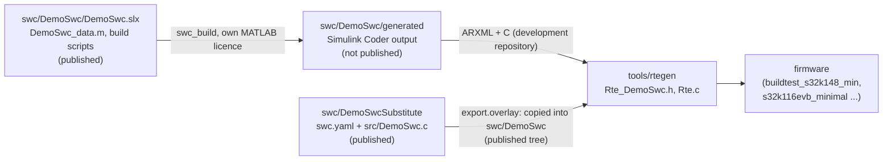

# DemoSwc substitute (hand-written C)



The demo component `swc/DemoSwc` is a Simulink model. Its C code and ARXML were generated with Simulink Coder
R2024a under a MATLAB student licence, which does not allow commercial use - and the Apache-2.0 licence of neXtBSW
does. So the generated code is **not published** (decision F9 A, PLAT-119): the model, its calibration data
(`DemoSwc_data.m`) and the build scripts are, and this folder holds a small **hand-written C component with the same
RTE interface**, so the published tree builds the demo without MATLAB.

## Which one you get

| Tree | `swc/DemoSwc` contains | The RTE builds DemoSwc from |
|---|---|---|
| Development repository | model, data, scripts, `generated/` (ARXML + C) | the ARXML, code from `generated/src` (Simulink) |
| Published (exported) tree | model, data, scripts, plus `swc.yaml` and `src/DemoSwc.c` from this folder | `swc.yaml` (`implementation: c`), code from `src/` |

The switch is made by the export, not by the build: `tools/distcheck/distribution.yaml` classifies
`swc/*/generated/**` as private and its `export.overlay` entry writes `swc.yaml` and `src/DemoSwc.c` of this folder
into `swc/DemoSwc` whenever `swc/DemoSwc/generated` is not part of the exported profile (rule R13 of
[`tools/distcheck`](../../tools/distcheck/README.md) checks that the copy is applicable and was made). No project file
changes: the ECU descriptions keep `path: ../../swc/DemoSwc`.

### Using the original model instead

With your own MATLAB R2024a licence (Simulink, Embedded Coder, AUTOSAR Blockset) in a published tree:

```sh
matlab -batch "addpath('tools/swc'); swc_build('swc/DemoSwc')"   # writes swc/DemoSwc/generated/{src,arxml}
rm swc/DemoSwc/swc.yaml                                           # without swc.yaml the component is Simulink again
rm -r swc/DemoSwc/src
```

The generated code is then subject to the terms of your MATLAB licence. Nothing else has to change; the runnables are
called `Run10ms`/`Run100ms` again instead of `DemoSwc_Run10ms`/`DemoSwc_Run100ms`.

## Interface

Identical to the model (checked against its ARXML in the development repository, `InterfaceTest`):

| Port / parameter | Direction | Type | Runnable |
|---|---|---|---|
| `Button1` | in | `boolean` | `Run10ms` |
| `PcCommandQlf` | in | `uint8` (`QLF_*` of `Rte_Qlf.h`) | `Run10ms` |
| `MotorNtc_mV` | in | `uint32` | `Run100ms` |
| `Led1`, `Led2` | out | `boolean` | `Run10ms` |
| `MotorNtcFiltered_mV` | out | `uint32` | `Run100ms` |
| `CalPrm.FilterAlpha` | calibration | `float32`, value in `swc/DemoSwc/DemoSwc_data.m` | `Run100ms` |

Runnables: `DemoSwc_Init`, `Run10ms` (10 ms), `Run100ms` (100 ms). As for every hand-written component (RTE-20) the C
functions of the periodic runnables are `DemoSwc_Run10ms` and `DemoSwc_Run100ms`.

## Behaviour

Written from the description in [`swc/README.md`](../README.md#demoswc), not from the generated code:

- `Run10ms`: `Led1 = Button1`; a blink state toggles every 50 calls (1 Hz), `Led2 = blink AND (PcCommandQlf ==
  QLF_OK)`. The blink counter keeps running while `Led2` is blocked, so the blink continues in phase after healing.
- `Run100ms`: low-pass `y = y + (MotorNtc_mV - y) * FilterAlpha` with a `float32` state, output rounded to the
  nearest mV and limited to the `uint32` range; `FilterAlpha` is limited to 0..1.

It is a plausible stand-in for the demo, not a bit-exact copy of the model: no back-to-back equivalence with the
Simulink code is claimed.

## Files and tests

| File | Purpose |
|---|---|
| `swc.yaml` | description of the C component (name `DemoSwc`, `implementation: c`) |
| `src/DemoSwc.c` | the implementation, application code (`-Wall -Wextra -Werror`, MISRA scope of `tools/misra`) |
| `test/assemble.py` | builds `swc/DemoSwc` as the export writes it, from the same `export.overlay` entry |
| `test/test_demoswc_substitute.py` | test `swc-demoswc-substitute`: valid C component, interface against the ARXML, host test |
| `test/DemoSwcSubstituteHostTest.c` | the host test proper, compiled against the generated `Rte_DemoSwc.h` |
| `test/target_build.py` | test `target-demoswc-substitute`: `buildtest_s32k148_min` with the substitute, warning-free |

```sh
.venv/Scripts/python tools/test -k swc-demoswc-substitute -k target-demoswc-substitute
```

This folder is no component folder of its own (its name is not the component name); use it only through the export
or `test/assemble.py`.
