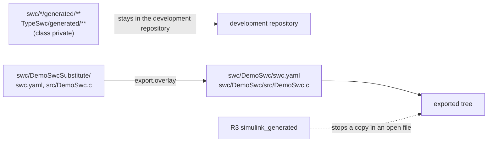

# distcheck – distribution check and export of the open tree

`tools/distcheck` checks a tree **before** anything is exported and writes the open source line as a fresh tree
without git history (PLAT-50). The concept is `doc/architecture/lizenz-und-release.md`, section 5.3; the decisions
of 2026-09-17 behind the rules are listed at the top of `distribution.yaml`. Core logic without Qt
(`distcheck.py`, `exporter.py`), command line in `__main__.py`, host tests in `test_distcheck.py`.

```sh
python tools/distcheck check --profile open --references           # exit 1 on errors
python tools/distcheck check --references --json > report.json      # machine readable (severity, rule, path, line)
python tools/distcheck report --format markdown                      # which rule classified how many files
python tools/distcheck export --out %TEMP%/s32k/export --verify --openbsw external/openbsw
python tools/distcheck verify --tree %TEMP%/s32k/export --openbsw external/openbsw
python tools/distcheck export --out C:/nx --verify --verify-timeout 0 --verify-jobs 6 --openbsw external/openbsw
python tools/distcheck patterns --out doc/confidential/distcheck-patterns.yaml
```

Nothing here publishes anything. `export` writes a directory; what happens with it is decided by the maintainer.

## Classification

Every file gets one class: `open` < `licensed` < `nda` < `private` < `workstation`. The class comes from a module
manifest with `distribution:` if there is one, otherwise from the path table `distribution.yaml` (most specific glob
wins). The catch-all `**` makes an unknown file `private` (fail closed) and reports it (R1 warning), so every file
needs an entry of its own. A profile (`open`, `licensed`, `nda`) contains the files whose class is not higher.

## Rules

| Rule | Error if |
|---|---|
| R1 | a file has no class of its own, or no class at all |
| R2 | an SPDX header names a licence outside the profile's allowlist, or `LicenseRef-*` in `open`; warning if a source file has no header and the licence only comes from the table |
| R3 | text matches a content pattern: the public base list in `distribution.yaml`, plus the **private list** (below); the base list includes `simulink_generated`, the header lines Simulink Coder writes into generated C code and ARXML (PLAT-119, below) |
| R4 | a binary or document file (PDF, SVD, ...) has no explicit `binary_ok` entry; PDFs are text-scanned (first four and last page) |
| R5 | (`--references`) a file of the profile points out of it: `#include`, `add_subdirectory`, `target_link_libraries`, python `import`, `board:`/`derivative:` of a project; a target that any file of the profile also defines counts as present, and `external_targets` of the rules lists targets that come from Eclipse OpenBSW in the real build (stand-ins in the build tests of private families) |
| R6 | a `.sha256` file does not match; a third party folder lacks its README/LICENSE (warning) |
| R7 | key material (`BL_SECURITY_CONSTANT` with a value, private keys, tokens), the address of a private repository (development `neXtBSW_development`, Studio `neXtBSW-Studio`; the open repository `neXtBSW` may be named), the decision board; workstation paths (warning) |
| R8 | (`--history <range>`) a path that ever held a blob in the range is not in the profile; more than one commit (warning) |
| R9 | `verify`: host tests and the target preset `verify_preset` run **in the exported tree**; skipped steps are named. Each step is limited to 5400 s by default; the full host suite takes longer on a loaded workstation, so a release export passes `--verify-timeout 0` (no limit) or a larger value, and `--verify-jobs` (verify: `--timeout`, `--jobs`). Keep `--out` short: deep paths break the target build |
| R10 | the export lacks LICENSE, NOTICE or CONTRIBUTING.md, or NOTICE misses a licence in use |
| R11 | a value of the derivative database cites a non-public source (`[S32DS]`, decision of 2026-09-17) |
| R12 | the markers of a private section (below) are unbalanced, nested, unreadable or end inside a fenced code block; the export refuses to run |
| R13 | an entry of `export.overlay` (below) cannot be applied: its source is not in the profile, its target is already a file of the profile, or the path it replaces does not exist; in an exported tree: a target is missing or differs from its source. The export refuses to run |

Every finding carries rule, severity, tree relative path and – where the rule works on text – the line.

## The private pattern list

Patterns that name documents under NDA reveal those documents, so the list is not part of the repository. Its path
is `pattern_file` in `distribution.yaml` (default `doc/confidential/distcheck-patterns.yaml`; `doc/confidential/` is
in `.gitignore`). `patterns.example.yaml` is a template without real document numbers. Without the list the check
still runs and says so on every run: `UEBERSPRUNGEN: R3: private Musterliste ... fehlt`.

## Code generated with MATLAB/Simulink (PLAT-119)



The C code and ARXML of the Simulink components were generated with Simulink Coder R2024a under a MATLAB student
licence, which does not allow commercial use; Apache-2.0 does. Decision F9 A of 2026-10-06: the generated output is
not published, the models (`.slx`), their data files and the build scripts are.

- **Classification:** `swc/*/generated/**`, `tools/rtegen/test/types/TypeSwc/generated/**` and the ARXML copy
  `TypeSink_datatype.arxml` are private; so are the three host tests that include the generated `TypeSwc.h` (R5).
- **Detection:** the content pattern `simulink_generated` (R3) matches the header lines Simulink Coder writes
  (`Code generated for Simulink model`, `Simulink Coder version :`, `Embedded Coder version :`, `Auto generated XML
  Component Description for model`). A copy of generated code or ARXML in an open file is an error, and the export
  refuses to run. Only this folder may name the lines (`allow`).
- **Substitute:** `export.overlay` names files the export writes in place of a path the profile lacks. Today one entry:
  when `swc/DemoSwc/generated` is not exported, `swc/DemoSwcSubstitute/swc.yaml` and `src/DemoSwc.c` are copied into
  `swc/DemoSwc`, which makes DemoSwc a hand-written C component with the same RTE interface (RTE-20). The projects and
  their `rte.yaml` stay unchanged, so the open demo projects build without MATLAB. Whoever has a MATLAB licence
  generates the original with `swc_build` and removes the two files again - see
  [`swc/DemoSwcSubstitute/README.md`](../../swc/DemoSwcSubstitute/README.md). R13 checks the entry before the export
  and the copies in the exported tree; the tests of the substitute assemble the folder from the same entry.
- **Tests of the export:** entries whose files are no longer exported drop out of `tools/test/tests.yaml` as usual
  (`demoswc-sil`, the NvM suites on the test model TypeSwc); `rtegen` keeps running in the export without the cases that
  need the generated code (clean rule `narrow`, which now runs before the drop, so it can also take a private file out
  of `covers`); the same holds for `rtegen-c-swc`, `rtegen-device-values`, `rtegen-disabled`, `swc-yaml`,
  `elfcheck-timing` and `a2lgen`, `target-c-swc` drops out (`reads`). An `export.substitute` renames the runnables of
  DemoSwc in the rtegen reference outputs to the C names of the substitute, so `rtegen-reference` stays green.

## Export

`export` copies the files of the profile, writes the cleaned forms of `CHANGELOG.md` (replaced), `CLAUDE.md`
(internal sections and bullets removed), `doc/todo.yaml` (only tasks on open paths, public fields),
`tools/test/tests.yaml` (entries on non-exported files and their dependants removed) and `CMakePresets.json`
(presets of private projects and their heirs removed), and generates `LICENSE`. `NOTICE` and `SECURITY.md` are kept by hand in the repository (DOC-67); R10 checks that `NOTICE` names every licence in use. `export.substitute`
replaces single texts inside otherwise unchanged files (glob, regex, with) - today the link of the internal review
page in the safety review records (`doc/**/*.md`), which stays in the development repository as evidence; `check`
scans those files as the export writes them, so it reports only what would remain (PLAT-114).

Links to unpublished files (DOC-73, decision K1 of 2026-10-04): review records, gap analysis, migration plan, RTOS
comparison, traceability matrix and the stack report of the private demo project stay in the development repository,
and the published documents keep linking to them there. In the export every Markdown link of an exported `.md` file
to a file or folder of the tree that is not exported (and not written by a clean rule or generated) is replaced by
its link text plus `(not published, available on request)` - inline links with or without anchor, images, reference
links and their definitions; links in fenced code blocks, web addresses and unknown paths stay. The source text is
unchanged; `check` scans the replaced text and names the number (`EXPORT:`). The export writes the list of all its
replacements - per file the number of replaced links and `export.substitute` texts, then every replaced link with line
and target - next to the tree as `<out>.replacements.md` (never into it) and prints the summary. In
`tools/test/tests.yaml` the clean rule drops entries that read an unpublished file without naming it (`reads`) and
narrows the selection of an entry where only single cases need such a file (`narrow`, e.g. a `-k` pattern). The cleaner
is lenient, because it also runs on an exported tree; the repository test (`tests_yaml_rule_problems`) checks in the
development tree that every named entry, path and `narrow` text still exists.

Private sections of published documents (DOC-74, decision K1 of 2026-10-04; today parts B and C of
`doc/safety/partner-and-degraded.md`): a block between `<!-- export:private-begin [label] -->` and
`<!-- export:private-end -->` (own lines, outside fenced code blocks) stays in the development repository, and the
export replaces it by one line `*label (not published, available on request)*`. The anchors of the headings and of
`<a id/name>` inside a block do not exist in the export; every link to them - from any published Markdown file, also a
pure `#anchor` of the same file - is replaced like a link to an unpublished file, with the target `file#anchor` in the
list. So the documents that cite a section by link stay unchanged and the export has no dead anchor. `check` scans the
cut text and names the number of sections (`EXPORT:`); `<out>.replacements.md` lists every cut section with the
lines of its markers in the source and the number of anchors it held.

The list of what the export leaves out on purpose (DOC-85): the consistency tests of the safety documents check them
against each other (anomaly register against the gap analysis and the review records, document register against the
traceability matrix, DFA against the test list and the tasks). In the exported tree such a source may be absent on
purpose, and the check must neither fail nor disappear. So the export writes `doc/unpublished.yaml`
(`export.unpublished`, format and reader in `unpublished.py`): the private files of the scope `export.unpublished.files`
(today `doc/safety/**`, `doc/requirements/**`; NDA and workstation material is never named), the folders of
`export.unpublished.folders` as a whole (board captures, Studio, planning tool - each must be wholly private, else the
export stops), the files written only in cleaned form (a text of the original need not be in them), the entries the
clean rule removed from `tools/test/tests.yaml`, and the tasks the public `doc/todo.yaml` lacks, with their status. The
tests in `doc/safety/test` accept an absent source only when it is listed and check everything else as in the
development repository; a public file that is missing from the export stays an error. The development repository has no list
(the repository test makes sure it never tracks one).

The export refuses to run while
`check` reports errors (`--allow-findings` only for trial runs), writes no `.git` (`--git-init` creates a repository
with exactly one commit), and checks the result again as an exported tree.

**Submodule link (TOOL-236).** `.gitmodules` alone gives a clone no OpenBSW: `git submodule update --init` (README,
CONTRIBUTING) needs the *gitlink* (mode 160000) of `external/openbsw` with the commit the source tree pins. A plain folder
cannot hold a gitlink, so the export reads it from the source tree (`git ls-files -s`, only for submodule paths that are
exported) and records it as `<out>.gitlinks` next to the tree (the input format of `git update-index --index-info`; the
note of the export says so). With `--git-init` it goes into the index before the one commit, and the export stops with an
error if `.gitmodules` and the commit disagree (a submodule without gitlink, or a gitlink without entry). A release that
commits the folder by other means must run `git update-index --index-info < <out>.gitlinks` before the commit. The check
for a release export, to be run before anything is pushed:

```
git clone <export> %TEMP%/s32k/clone && cd %TEMP%/s32k/clone && git submodule update --init
git -C external/openbsw rev-parse HEAD     # must equal the commit in <out>.gitlinks
```

`GitlinkExportTest` in `test_distcheck.py` does this with a local upstream repository (no network, not the real
`external/openbsw`), and its counter-check shows that an export without the gitlink is detected.

## Release publication (TOOL-69, doc/architecture/customer-project.md gap N15)

A release exports one or more profiles for a tagged baseline, plus the tag, the CI report and the release notes -
that whole local plan is `python -m tools.ci release` in [`tools/ci`](../ci/README.md), which calls `export()`
here per profile. `release-targets.yaml` next to this README names the repository each profile would be pushed
to (`doc/architecture/customer-project.md` Abschnitt 7 Q2). Since PLAT-114 (repositories created by the user on
2026-10-02) the open profile has its repository; licensed and NDA stay `null`, and the plan carries them as
undecided instead of a guessed address. The Studio's repository is recorded beside the profiles (`studio:`), never
as one - the Studio is no part of any export (F12). Neither this tool nor `tools/ci release` ever pushes anything -
the target is only a value in the plan; a push into a release repository needs the user's yes.

## Build checks without the Studio (PLAT-114)

Open tests must not import `tools/studio` (R5): the Studio is not distributed. The target build checks that copy a
project and build it the way the Studio builds use the open helper `tools/nxconfig/projectbuild.py`; the configure
arguments come from `tools/nxconfig/presets.py`, which the Studio re-exports and uses itself. The MATLAB tests that
drive the Studio's import and model flow (`tools/swc/test/studio_flow.py` and the four `Swc*Test.m` that call it) are
classified private with the Studio, and the export removes their entries from `tools/test/tests.yaml`.
